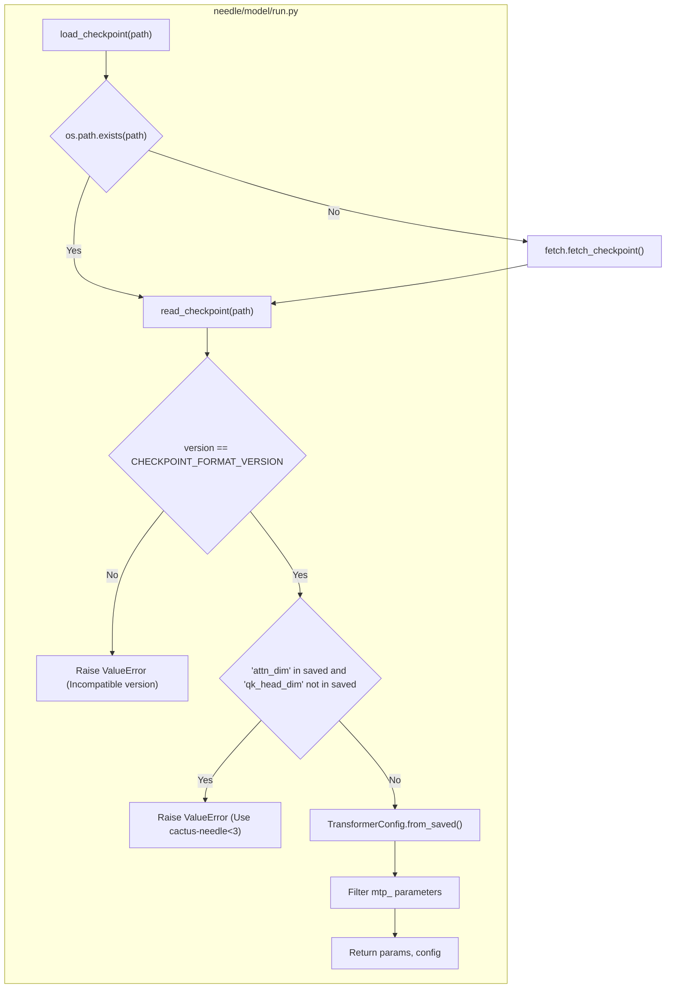
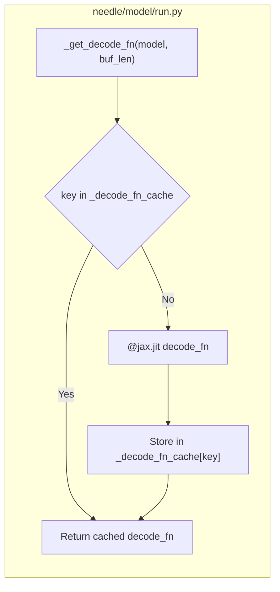
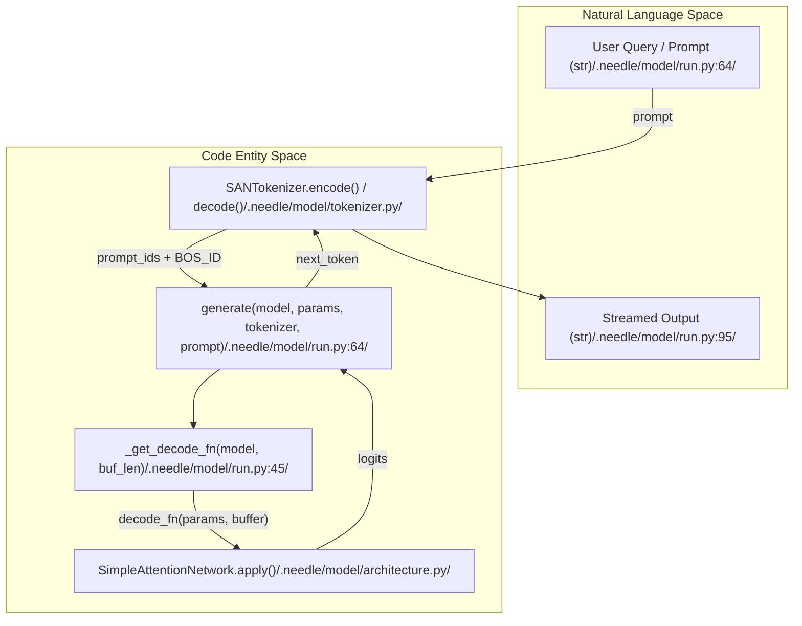
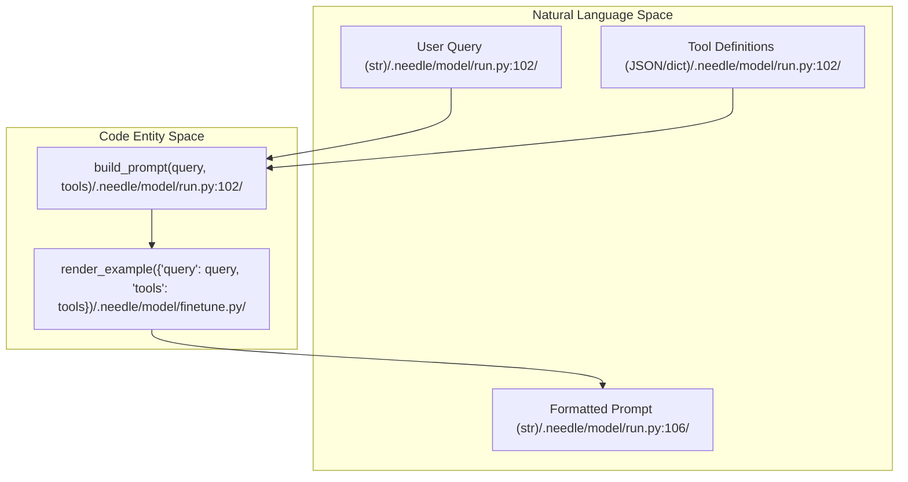

<!-- source: DeepWiki mcp.deepwiki.com · repo cactus-compute/needle · page 4.2 Inference and Generation · fetched 2026-10-27 -->

# Inference and Generation

Relevant source files

The following files were used as context for generating this wiki page:

- [needle/model/run.py](needle/model/run.py)
- [tests/test_generate.py](tests/test_generate.py)
- [tests/test_run.py](tests/test_run.py)

This page covers the inference and generation subsystem for the Needle model architecture, implemented in `needle/model/run.py` [needle/model/run.py:1-125](). It details checkpoint management with automated version checks and downloads, JIT-compiled decoding cache strategies, autoregressive sampling mechanics, prompt formatting with tools, and the command-line run entrypoint.

## Checkpoint Management and Validation

Checkpoint handling is managed by `load_checkpoint()`, which supports locating, auto-downloading, and validating model checkpoints [needle/model/run.py:19-42]().

### Auto-Download and Version Checks
If the target checkpoint path does not exist locally, `load_checkpoint` delegates to `needle.agent.fetch.fetch_checkpoint()` to download the asset from Hugging Face [needle/model/run.py:20-24](). It verifies that the checkpoint format version matches `CHECKPOINT_FORMAT_VERSION` (version 2) [needle/model/run.py:13](), [needle/model/run.py:26-32](). 

It also guards against incompatible Needle 2 checkpoints by checking for legacy keys such as `attn_dim` without `qk_head_dim`, raising a descriptive error directing users to `cactus-needle<3` [needle/model/run.py:34-37]().

Sources: [needle/model/run.py:19-43](), [tests/test_run.py:29-40]()

## JIT Decode Caching

To avoid expensive JAX recompilations across varying sequence lengths, `_get_decode_fn()` maintains an in-memory JIT compilation cache (`_decode_fn_cache`) [needle/model/run.py:15]().

*   **Cache Key**: Constructed from the identity of the model instance and the buffer length `(id(model), buf_len)` [needle/model/run.py:46]().
*   **Compilation**: Compiles a JAX-decorated function wrapping `model.apply({"params": params}, tokens)` on cache miss [needle/model/run.py:48-51]().

Sources: [needle/model/run.py:15](), [needle/model/run.py:45-52]()

## Autoregressive Generation and Sampling

The `generate()` function drives token-by-token generation using a pre-allocated JAX integer buffer padded with `PAD_ID` [needle/model/run.py:64-99]().

### Buffers and Sampling Mechanics
1.  **Prompt Tokenization**: Prompts are prefixed with `BOS_ID` and tokenized via the active tokenizer [needle/model/run.py:66]().
2.  **Buffer Allocation**: A JAX array of shape `(1, buf_len)` is initialized and populated with prompt token IDs [needle/model/run.py:71-72]().
3.  **Step Iteration**: For each sequence position, logits are computed via the JIT decode function [needle/model/run.py:78-79]().
4.  **Sampling Strategies**:
    *   **Deterministic**: If `temperature <= 0.0`, greedy selection uses `jnp.argmax(logits)` [needle/model/run.py:80-81]().
    *   **Stochastic**: If `temperature > 0.0`, the PRNG key is split, and sampling is performed using `jax.random.categorical(sample_rng, logits / temperature)` [needle/model/run.py:82-84]().
5.  **Termination**: Generation halts when `EOS_ID` is encountered or `buf_len` is exhausted [needle/model/run.py:85-86](). Streamed outputs write incrementally to `sys.stdout` [needle/model/run.py:89-93]().

### Step Statistics (`_step_stats`)
For confidence scoring and telemetry, `_step_stats()` calculates token log-probabilities (`log_softmax`), probability distributions, chosen token confidence (`jnp.max`), and predictive entropy [needle/model/run.py:55-60]().

Sources: [needle/model/run.py:55-100]()

## Natural Language Space to Code Entity Mapping: Text Generation

The data flow bridging natural language prompts to model execution tensors and token outputs is structured as follows:

Sources: [needle/model/run.py:64-100](), [needle/model/tokenizer.py](), [needle/model/architecture.py]()

## Natural Language Space to Code Entity Mapping: Tool-Augmented Prompts

When tool definitions accompany a query, natural language instructions are bound to structured tool schemas via `build_prompt()`:

Sources: [needle/model/run.py:102-108](), [needle/model/finetune.py]()

## Prompt Construction (`build_prompt`)

`build_prompt()` integrates optional tool specifications into model prompts using the training template engine (`render_example`) [needle/model/run.py:102-107](). If no tools are provided, it passes through the raw query string unchanged [needle/model/run.py:103-104]().

Sources: [needle/model/run.py:102-107](), [tests/test_run.py:110-116]()

## CLI Run Entrypoint

The `main(args)` function serves as the command-line interface execution target for generating text from a checkpoint [needle/model/run.py:110-125](). It loads the model weights and configuration, initializes the tokenizer, optionally parses an external JSON tools file, and invokes `generate()` [needle/model/run.py:111-125]().

Sources: [needle/model/run.py:110-125](), [tests/test_run.py:145-160]()

## Testing Infrastructure

Inference behavior is validated through test suites covering prompt building, checkpoint version rejections, and execution workflows:
*   `tests/test_run.py`: Tests `build_prompt` formatting consistency, Needle 2 checkpoint rejections (`test_needle2_checkpoint_is_rejected_with_a_version_hint`), missing checkpoint fallback paths, and tool-loading CLI integrations [tests/test_run.py:1-177]().
*   `tests/test_generate.py`: Verifies dataset generation routines, array parsing variants (`_parse_array`), tool deduplication (`_collect_tools`), and OpenRouter API integrations for synthetic data generation [tests/test_generate.py:1-103]().

Sources: [tests/test_run.py:1-177](), [tests/test_generate.py:1-103]()

---

