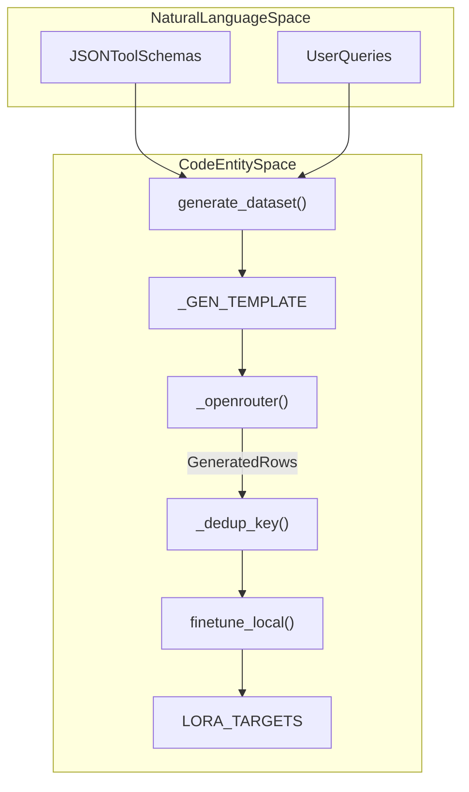
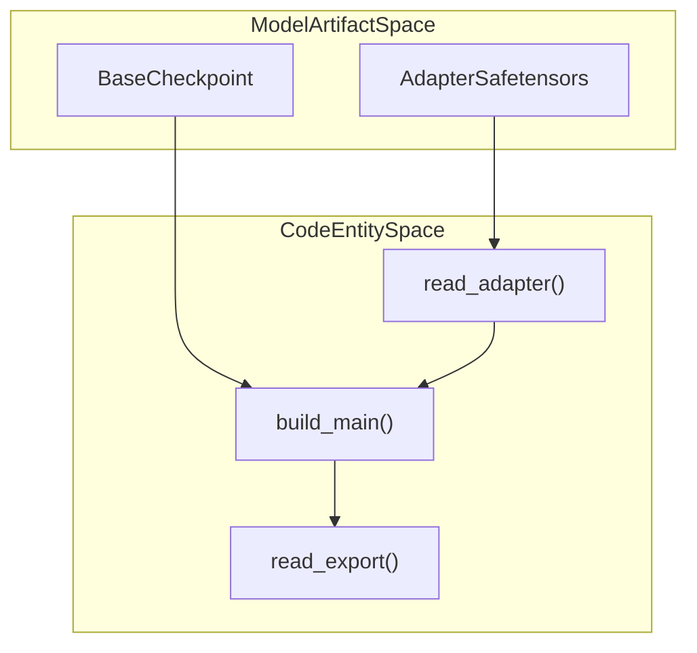

<!-- source: DeepWiki mcp.deepwiki.com · repo cactus-compute/needle · page 5 Fine-Tuning · fetched 2026-10-27 -->

# Fine-Tuning

Relevant source files

The following files were used as context for generating this wiki page:

- [needle/model/finetune.py](needle/model/finetune.py)
- [tests/test_finetune.py](tests/test_finetune.py)

This page provides an overview of the fine-tuning and adaptation pathways available in Needle. The framework supports multiple workflows to specialize the base `SimpleAttentionNetwork` (SAN) into domain-specific tool-calling and extraction agents, ranging from local Low-Rank Adaptation (LoRA) and synthetic data synthesis to cloud-hosted platform training.

### Overview

Fine-tuning in Needle focuses on modifying specific linear projection layers (`q_proj`, `k_proj`, `v_proj`, `gate_proj`, `out_proj`) via LoRA while keeping base weights frozen [needle/model/finetune.py:24](). The pipeline covers dataset generation via OpenRouter [needle/model/finetune.py:87-98](), local JAX-accelerated training [tests/test_finetune.py:33-45](), artifact export via `.cact` containers [tests/test_finetune.py:57-72](), and hosted training coordination through the Cactus platform client [tests/test_platform.py]().

### Fine-Tuning Pipeline Architecture

The following diagram illustrates how natural language requirements and tool schemas are transformed into a specialized model adapter through core routines in `needle/model/finetune.py`.

**Natural Language to Training Artifact Flow**

Sources: [needle/model/finetune.py:37-60](), [needle/model/finetune.py:101-151](), [needle/model/finetune.py:24-24]()

### Synthetic Data Generation

Needle provides a built-in synthetic dataset generator that coordinates large language models via OpenRouter to produce training pairs from raw tool schemas [needle/model/finetune.py:87-98](). The generation routine parallelizes requests using `ThreadPoolExecutor`, deduplicates samples using `_dedup_key()`, and outputs JSONL data suitable for local or platform training [needle/model/finetune.py:101-151]().

For details, see [Synthetic Data Generation](#5.2).

Sources: [needle/model/finetune.py:37-173]()

### LoRA Training Workflow

Local training is driven by `finetune_local()` in `needle/model/finetune.py`, executing gradient updates across `LORA_TARGETS` [needle/model/finetune.py:24]() using JAX. It manages adapter checkpointing via `read_adapter()` and `write_adapter()` [needle/model/finetune.py:5-5](), supporting quantized training numerics and loss masking for structured tool invocation.

For details, see [LoRA Training Workflow](#5.1).

Sources: [needle/model/finetune.py:5-25](), [tests/test_finetune.py:33-55]()

### Build and Deployment Pipeline

The build stage processes trained adapters via `build_main()`, merging LoRA weights back into the base model or packing them alongside quantized layers [tests/test_finetune.py:57-88](). The resulting model is exported into the optimized `.cact` format for execution or uploaded to remote repositories.

**Deployment Artifact Bridge**

Sources: [needle/model/finetune.py:5-5](), [tests/test_finetune.py:57-76]()

For details, see [Build and Deployment Pipeline](#5.3).

Sources: [needle/model/finetune.py:5-5]()

### Cactus Platform Client (Hosted Fine-Training)

Needle includes a platform client in `needle/platform.py` that interacts with `cactuscompute.com/v1` endpoints. It handles API key authentication (`NEEDLE_API_KEY`), error status parsing (`PlatformError`), request retries, tool schema normalization, and remote job submission for hosted fine-tuning, data generation, and model downloads.

For details, see [Cactus Platform Client (Hosted Fine-Tuning)](#5.4).

Sources: [needle/platform.py]()

### Child Pages
* [LoRA Training Workflow](#5.1) — Detailed documentation of `finetune_local()`, optimization schedules, loss masking, and CQ-STE quantization.
* [Synthetic Data Generation](#5.2) — Technical breakdown of prompt templates, parallel batch execution, and deduplication logic.
* [Build and Deployment Pipeline](#5.3) — Adapter merging, ladder slicing, quantization choices, and `.cact` export validation.
* [Cactus Platform Client (Hosted Fine-Tuning)](#5.4) — Hosted platform integration, authentication, and CLI verbs for remote training and billing.

---

