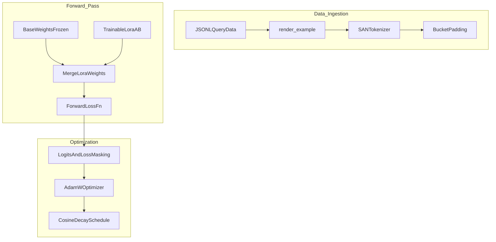
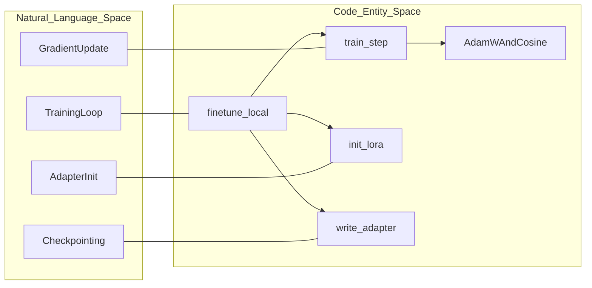

<!-- source: DeepWiki mcp.deepwiki.com · repo cactus-compute/needle · page 5.1 LoRA Training Workflow · fetched 2026-10-27 -->

# LoRA Training Workflow

Relevant source files

The following files were used as context for generating this wiki page:

- [needle/model/finetune.py](needle/model/finetune.py)
- [tests/test_finetune.py](tests/test_finetune.py)
- [tests/test_lora.py](tests/test_lora.py)

The LoRA (Low-Rank Adaptation) workflow in `needle` enables efficient fine-tuning of the frozen `SimpleAttentionNetwork` (SAN) base model. Instead of updating all parameters, `needle` injects low-rank trainable matrices into specific attention and projection layers. The process is orchestrated by `finetune_local()` in `needle/model/finetune.py` and is optimized for tool-calling and data extraction tasks through specific loss masking, adapter serialization, and CQ-STE (Cactus Quants Straight-Through Estimator) quantized training numerics.

## Training Architecture and Data Flow

The training pipeline transforms raw JSONL data into tokenized, masked batches for JAX-based optimization. The workflow supports CPU, NVIDIA GPU (CUDA), and Apple Silicon (Metal) backends via platform-specific environment handling [needle/model/finetune.py:10-14]().

### LoRA Target Projections and Initialization
LoRA adapters are initialized using `init_lora()`, which identifies eligible projection kernels across the model parameter tree (`lora_target_paths()`). For each target layer, it allocates two low-rank matrices, $A$ and $B$, such that their product scales the original weights [tests/test_lora.py:20-32]().

**Target Projections (`LORA_TARGETS`):**
*   `q_proj`, `k_proj`, `v_proj` (Attention queries, keys, values) [needle/model/finetune.py:24-24]()
*   `gate_proj` (MLP gating) [needle/model/finetune.py:24-24]()
*   `out_proj` (Attention output) [needle/model/finetune.py:24-24]()

### Data Flow Diagram
The following diagram illustrates the flow from the JSONL input format to the gradient update step during local fine-tuning.

**Fine-Tuning Data Flow**

Sources: [needle/model/finetune.py:24-25](), [tests/test_lora.py:20-46]()

## Implementation Details

### Data Format and JSONL Input
`needle` expects a JSONL format where each line represents a single structured interaction containing queries, tool schemas, reasoning traces, and expected tool answers [tests/test_finetune.py:14-25](). During training data loading, these fields are tokenized and aligned with model sequence buffers.

### Loss Masking and CQ-STE Numerics
To ensure the model learns to generate tool calls and reasoning rather than memorizing prompt tokens, loss masking is applied:
*   **Prompt Tokens**: Masked out (zero loss contribution).
*   **Target Tokens (Reasoning & Answers)**: Active in loss calculation.

Additionally, `needle` incorporates **CQ-STE** (Cactus Quants Straight-Through Estimator) quantized training numerics. This allows training against quantized base weights (such as W4/W8 codebooks) while maintaining gradient flow through quantized operations using the STE approximation [tests/test_finetune.py:44-45]().

### Code-to-Entity Mapping
The following diagram maps high-level training concepts to code entities within the codebase.

**Training Logic Mapping**

Sources: [needle/model/finetune.py:5-6](), [tests/test_finetune.py:34-42]()

## Adapter Output and Checkpointing

Upon completion of training, `finetune_local()` exports the trained LoRA adapter parameters. Depending on configuration and defaults, these are written to disk as a pickle (`.pkl`) or safetensors (`.safetensors`) file containing the adapter rank, scaling factor, base model reference, and the `A` and `B` weight matrices [tests/test_finetune.py:47-56](), [tests/test_finetune.py:139-144]().

These adapters can subsequently be merged into the base model using `build_main()` to generate a fully consolidated `.cact` deployment archive [tests/test_finetune.py:58-73]().

Sources: [needle/model/finetune.py:5-25](), [tests/test_finetune.py:34-149](), [tests/test_lora.py:4-56]()

---

