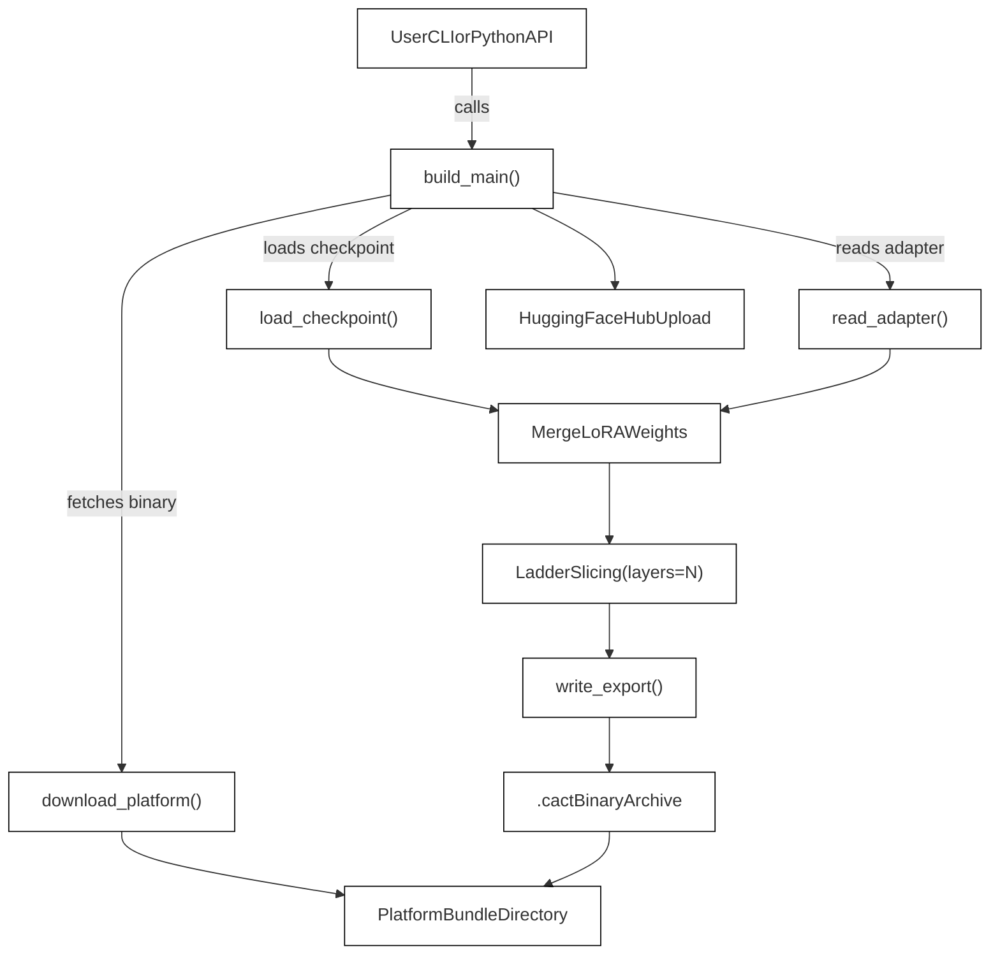
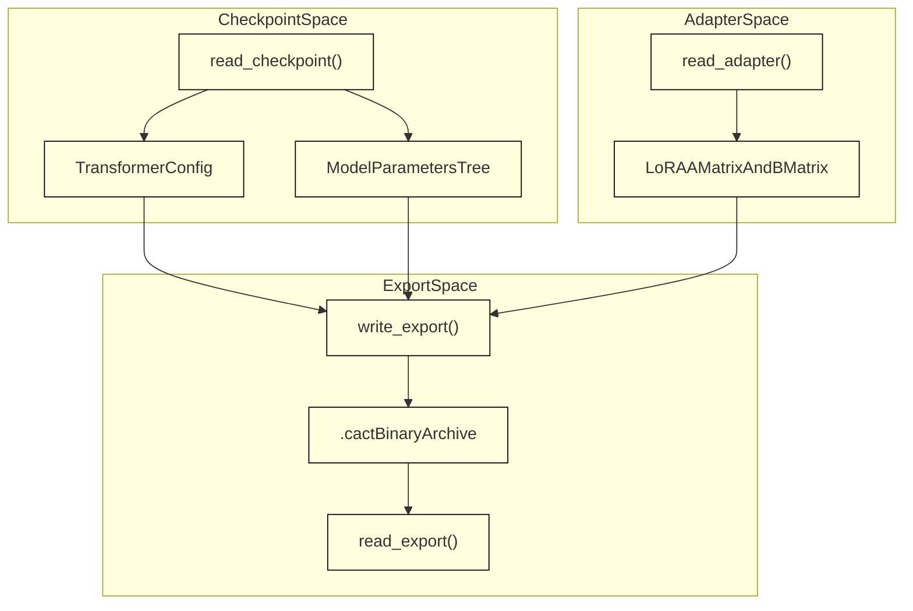
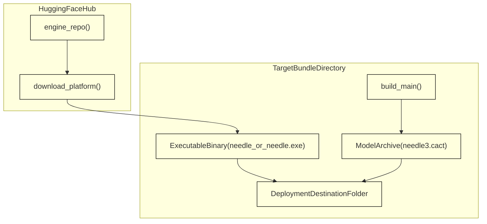

<!-- source: DeepWiki mcp.deepwiki.com · repo cactus-compute/needle · page 5.3 Build and Deployment Pipeline · fetched 2026-10-27 -->

# Build and Deployment Pipeline

Relevant source files

The following files were used as context for generating this wiki page:

- [needle/agent/fetch.py](needle/agent/fetch.py)
- [needle/model/finetune.py](needle/model/finetune.py)
- [tests/test_build.py](tests/test_build.py)

### Purpose and Scope
This page details the build and deployment pipeline orchestrated by `build_main()` within the `cactus-needle` codebase [needle/model/finetune.py:1-173](). The pipeline bridges training outputs (such as PyTorch/JAX checkpoints and LoRA adapters) with production deployment targets. Key operations include loading checkpoints, merging LoRA adapter weights, ladder slicing the transformer stack to $N$ layers, applying quantization, exporting to the `.cact` binary container format, platform-specific bundling via `download_platform()`, and publishing artifacts to the Hugging Face Hub [tests/test_build.py:9-12]().

Sources: `tests/test_build.py:9-12`, `needle/model/finetune.py:1-173`

---

## 1. Pipeline Architecture and `build_main()` Orchestration

The build pipeline takes raw checkpoints or LoRA adapters, processes model parameters through configuration slicing and quantization, and bundles them alongside native runtime binaries for target execution environments. 

The entry point configuration is represented as a namespace containing parameters such as `checkpoint`, `lora`, `out`, `layers`, `platform`, and `upload` [tests/test_build.py:9-12](). Depending on whether a target platform is specified, `build_main()` either produces a standalone `.cact` model archive or a complete platform deployment folder containing both the runtime engine binary (`needle` / `libneedle`) and the model weights [tests/test_build.py:98-114]().

Title: Pipeline Execution Flow

Sources: `tests/test_build.py:9-12`, `tests/test_build.py:98-118`, `needle/model/finetune.py:1-173`

---

## 2. LoRA Merging and Ladder Slicing

When fine-tuning models via LoRA, training produces decoupled adapter weights (`A` and `B` matrices) alongside metadata (`scale`, `base`, `rank`, `seed`) [needle/model/finetune.py:1-577](). During the build phase, these adapters are read using `read_adapter()` and merged back into the base model parameters before quantization and export.

Additionally, the pipeline supports **ladder slicing**, which truncates the transformer layer stack to a specified number of rungs (`layers=N`) [tests/test_build.py:86-97](). This allows downstream deployments to use smaller, faster model variants (e.g., edge devices with strict memory constraints) while retaining the initial layers of a pre-trained or fine-tuned stack. Multi-Token Prediction (MTP) combine blocks are stripped during checkpoint loading to ensure compatibility with standard execution runtimes [tests/test_build.py:30-43]().

Sources: `tests/test_build.py:30-43`, `tests/test_build.py:86-97`, `tests/test_build.py:9-12`

---

## 3. Quantization and `.cact` Export

Once parameters are merged and sliced, they undergo quantization and serialization into the `.cact` format via `write_export()` [tests/test_build.py:43-62](). 

The `.cact` container layout consists of:
1. **Header**: Contains metadata such as tensor counts, configuration parameters, hidden dimensions, and layer depths [tests/test_build.py:23-25]().
2. **Tokenizer Blobs**: Embedded tokenization dictionaries allowing the runtime engine to operate independently [tests/test_build.py:45-60]().
3. **Quantized Tensors**: Weights quantized using Cactus Quants Lloyd-Max codebooks or straight-through estimators (STE) (e.g., 4-bit quantization) [tests/test_build.py:54-54]().

The `read_export()` function validates the archive structure, returning the header and raw tensor blocks for verification and round-trip testing [tests/test_build.py:23-26]().

Title: Entity Space Mapping for Export and Checkpoint Handling

Sources: `tests/test_build.py:23-66`, `tests/test_build.py:43-62`

---

## 4. Platform Bundling and Asset Distribution

For cross-platform deployments (e.g., `linux-arm64`, `macos-arm64`, `windows-x86_64`), the pipeline uses `download_platform()` to fetch the matching pre-compiled C++ engine binary and assemble it alongside the generated `.cact` model weights [needle/agent/fetch.py:182-200]().

The `download_platform()` function interacts with the Hugging Face Hub (`engine_repo()`) to retrieve platform-specific asset trees, applying executable permissions to binaries like `needle` or `needle.exe` [needle/agent/fetch.py:182-200]().

Title: Platform Bundle Directory Structure

Sources: `needle/agent/fetch.py:158-200`, `tests/test_build.py:98-118`

---

## 5. Hugging Face Hub Uploads

When the `upload` flag is enabled in the build configuration, `build_main()` pushes the resulting `.cact` archive or platform bundle directly to the Hugging Face Hub repository [tests/test_build.py:9-12](). This integrates continuous deployment into the build script, ensuring that fine-tuned weights and exported engine bundles are automatically versioned and made accessible to remote inference workers or client applications [tests/test_build.py:9-12]().

Sources: `tests/test_build.py:9-12`, `needle/model/finetune.py:1-173`

---

