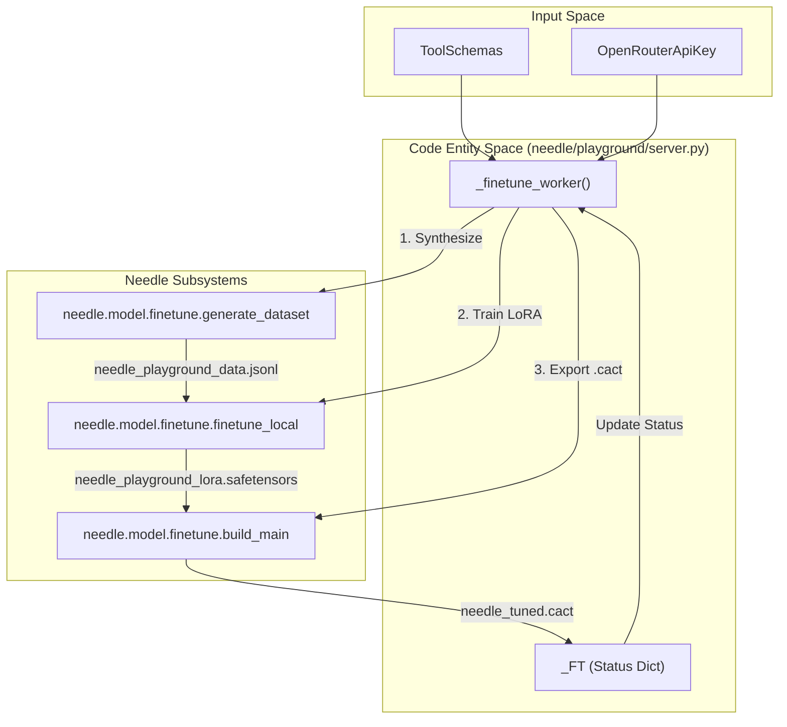
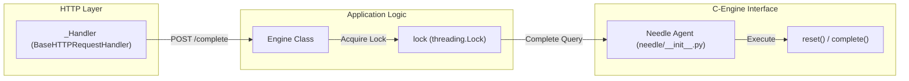

<!-- source: DeepWiki mcp.deepwiki.com · repo cactus-compute/needle · page 6.1 Server Backend · fetched 2026-10-27 -->

# Server Backend

Relevant source files

The following files were used as context for generating this wiki page:

- [needle/playground/server.py](needle/playground/server.py)
- [tests/test_playground.py](tests/test_playground.py)

The Needle Server Backend, implemented in [needle/playground/server.py](), provides a browser-accessible playground for model inference, real-time fine-tuning, and model management. It utilizes a `ThreadingHTTPServer` architecture to handle concurrent API requests while managing hardware resources through an internal `Engine` abstraction and background worker threads.

### Engine Class

The `Engine` class encapsulates the lifecycle of the Needle model within the server environment. It manages the underlying `Needle` agent instance and handles the transition between different weight sets.

| Method | Implementation | Description |
| :--- | :--- | :--- |
| `__init__` | [needle/playground/server.py:18-23]() | Initializes the engine with optional weights and a `threading.Lock` to serialize inference. |
| `load` | [needle/playground/server.py:25-28]() | Lazily imports the `Needle` agent and initializes it with the current weights. |
| `complete` | [needle/playground/server.py:30-38]() | Executes inference. If tools change, it re-instantiates the agent; otherwise, it calls `reset()` to clear KV caches. |
| `reset` | [needle/playground/server.py:40-46]() | Discards the current agent and resets the engine state, calling `close()` on the agent. |
| `load_weights` | [needle/playground/server.py:48-54]() | Updates the active weight path and triggers a reload of the agent. |

**Sources:**
- [needle/playground/server.py:17-56]()

---

### HTTP API Endpoints

The `_Handler` class (extending `BaseHTTPRequestHandler`) implements the REST-like API used by the playground frontend [needle/playground/server.py:98]().

#### GET Endpoints
*   `/`: Serves `index.html` and other static assets defined in `_STATIC` ([needle/playground/server.py:8-13](), [needle/playground/server.py:113-118]()).
*   `/model`: Returns the `name` of the currently loaded model engine ([needle/playground/server.py:118-119]()).
*   `/finetune/status`: Returns the `_FT` global status dictionary, which tracks training progress, logs, and errors ([needle/playground/server.py:56-62](), [needle/playground/server.py:120-121]()).
*   `/download/{name}`: Serves generated artifacts (like `.cact` files) from the temporary `_DOWNLOADS` directory ([needle/playground/server.py:14](), [needle/playground/server.py:122-128]()).

#### POST Endpoints
*   `/complete`: Accepts `tools` and `query` to generate model responses via `engine.complete()` ([needle/playground/server.py:134-139]()).
*   `/reset`: Clears the engine state ([needle/playground/server.py:140-142]()).
*   `/load-model`: Accepts a binary upload of a `.cact` file, saves it to `_DOWNLOADS`, and calls `engine.load_weights()` ([needle/playground/server.py:143-149]()).
*   `/finetune`: Initiates the background fine-tuning pipeline. It requires an OpenRouter `api_key` and a list of `tools` ([needle/playground/server.py:150-165]()).

**Sources:**
- [needle/playground/server.py:8-13]()
- [needle/playground/server.py:56-62]()
- [needle/playground/server.py:98-171]()

---

### Fine-Tuning Pipeline

The fine-tuning process is managed by `_finetune_worker`, which runs in a background thread to prevent blocking the HTTP server. It coordinates data synthesis, LoRA training, and model export [needle/playground/server.py:65-96]().

### Fine-Tuning Pipeline Data Flow

**Implementation Details:**
1.  **Dataset Generation**: Uses `generate_dataset` to create synthetic training examples via OpenRouter [needle/playground/server.py:72-78]().
2.  **Local Fine-tuning**: Invokes `finetune_local` using a `types.SimpleNamespace` to mimic CLI arguments [needle/playground/server.py:82-85](). The adapter is saved as a `.safetensors` file [needle/playground/server.py:81]().
3.  **Export**: Calls `build_main` to merge the new LoRA adapter into the `DEFAULT_BASE` model and produce a deployable `.cact` file [needle/playground/server.py:87-90]().
4.  **Auto-Reload**: Once finished, the engine automatically loads the newly tuned weights via `engine.load_weights(out)` [needle/playground/server.py:91]().

**Sources:**
- [needle/playground/server.py:56-97]()
- [needle/playground/server.py:150-165]()

---

### Concurrency and Lifecycle

The server architecture bridges the high-level Python API with the low-level inference engine using thread locks and state management.

### Server to Engine Interaction

**Sources:**
- [needle/playground/server.py:17-55]()
- [needle/playground/server.py:98-111]()

---

### Testing and Validation

The server backend logic is validated via unit tests in `tests/test_playground.py`, which mock out the underlying `Needle` agent to verify engine caching, tool comparison, and rewinding behavior:
- `test_a_second_query_on_the_same_tools_rewinds_that_agent`: Verifies that successive queries with identical tools invoke `reset()` on the existing agent rather than re-instantiating [tests/test_playground.py:41-50]().
- `test_new_tools_build_a_fresh_agent_without_rewinding`: Confirms that a change in tool definitions causes a fresh agent instance to be constructed [tests/test_playground.py:52-62]().
- `test_reset_closes_the_agent_it_drops`: Ensures `close()` is called when the engine is reset [tests/test_playground.py:64-74]().

**Sources:**
- [tests/test_playground.py:1-84]()

---

