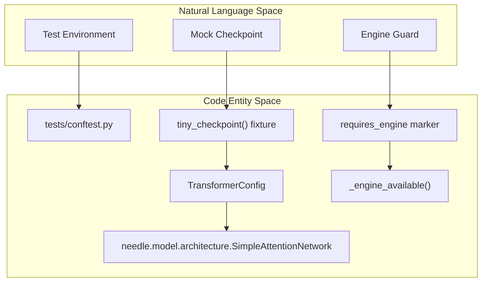
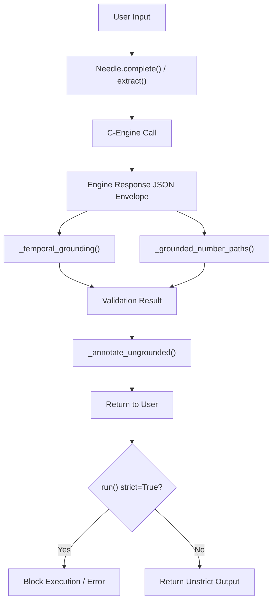
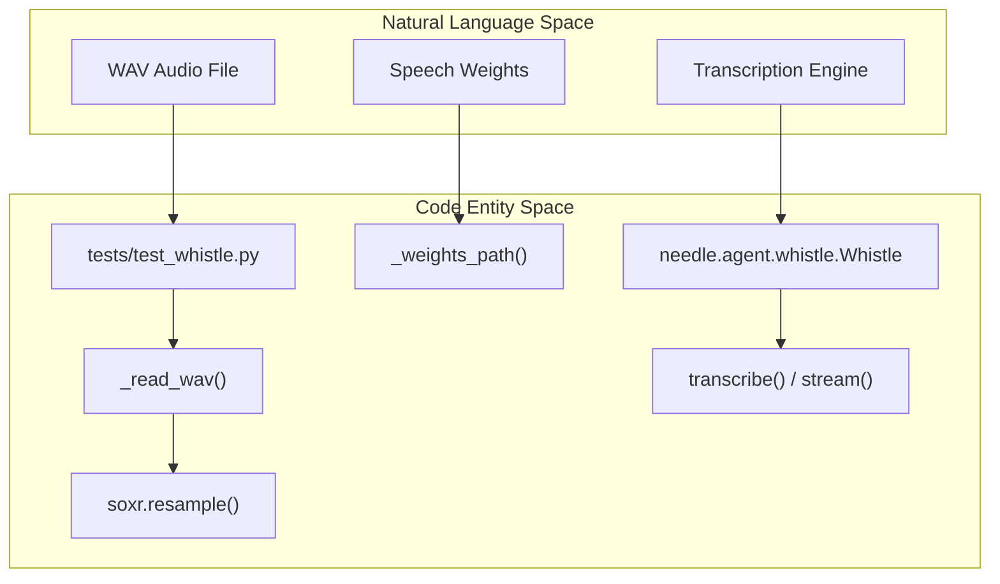

<!-- source: DeepWiki mcp.deepwiki.com · repo cactus-compute/needle · page 7.1 Unit Tests · fetched 2026-10-27 -->

# Unit Tests

Relevant source files

The following files were used as context for generating this wiki page:

- [.github/workflows/publish-component.yaml](.github/workflows/publish-component.yaml)
- [needle/agent/tools.py](needle/agent/tools.py)
- [needle/agent/whistle.py](needle/agent/whistle.py)
- [tests/conftest.py](tests/conftest.py)
- [tests/test_fetch.py](tests/test_fetch.py)
- [tests/test_grounding.py](tests/test_grounding.py)
- [tests/test_inference.py](tests/test_inference.py)
- [tests/test_tools.py](tests/test_tools.py)
- [tests/test_whistle.py](tests/test_whistle.py)

The `needle` test suite validates the integrity of the agentic framework, the model architecture, speech-to-text processing, platform clients, and the engine distribution system. It uses `pytest` and incorporates specialized fixtures for handling JAX-based model components, C-engine lifecycles, and audio mocks.

---

## Test Infrastructure and Fixtures

The testing environment is configured in `tests/conftest.py` to handle conditional availability of the C++ engine, generate lightweight model artifacts, and provide mock weights for unit testing [tests/conftest.py:1-126]().

### Engine Availability Gating
Because the C++ engine is often fetched from Hugging Face on first use, the `requires_engine` marker [tests/conftest.py:36-39]() skips tests depending on the compiled binary if it is missing from the local cache or package directory [tests/conftest.py:6-34]().

### Tiny Model Fixtures
To avoid loading full-scale weights during unit tests, `tiny_checkpoint` [tests/conftest.py:41-61]() generates a minimal `SimpleAttentionNetwork` using a `TransformerConfig` with reduced dimensions (`d_model=64`, `num_layers=4`) [tests/conftest.py:49-54](). The `tiny_base_archive` fixture exports this checkpoint into a `.cact` format via `write_export` [tests/conftest.py:70-78]().

**Code Entity Mapping: Test Fixtures and Engine Gating**

Sources: [tests/conftest.py:6-61](), [needle/model/architecture.py:46-54]()

---

## Tool Schema Generation (`test_tools.py`)

These tests validate the `build_schema` pipeline in `needle/agent/tools.py`, ensuring Python function signatures are correctly introspected into JSON Schema for LLM consumption.

| Test Case | Validates | Source |
| :--- | :--- | :--- |
| `test_basic_schema_types_and_required` | Mapping of `int` to `integer` and mandatory arguments. | [tests/test_tools.py:14-25]() |
| `test_defaults_are_optional` | Arguments with default values are excluded from the `required` list. | [tests/test_tools.py:27-34]() |
| `test_literal_list_and_dict_types` | `typing.Literal` mapping to `enum` and `list`/`dict` mapping to `array`/`object`. | [tests/test_tools.py:36-44]() |
| `test_field_constraints_and_docstring_args` | Integration of `Field` objects (e.g., `ge`, `le`, `pattern`) and docstring parsing. | [tests/test_tools.py:107-124]() |
| `test_pydantic_model_schema` | Support for `pydantic.BaseModel` using `pydantic_schema`. | [tests/test_tools.py:138-151]() |
| `test_pep604_none_union_not_required` | Correct handling of `X \| None` unions for optional parameters. | [tests/test_tools.py:83-93]() |
| `test_numeric_literal_and_int_enum_schema` | Schema generation for `typing.Literal` with numeric values and `enum.IntEnum`. | [tests/test_tools.py:164-180]() |

Sources: [needle/agent/tools.py:120-170](), [tests/test_tools.py:14-180]()

---

## Prompt Rendering and Data Loading (`test_render.py`)

This suite covers the formatting of training examples and dataset preparation for fine-tuning.

### Prompt Construction and Masking
*   **Markers**: Verifies that special tokens (`IM_START`, `TOOLS_START`, `THINK_START`) are correctly injected into prompt and target strings, and tool calls are serialized as JSON [tests/test_render.py:13-28]().
*   **Loss Masking**: `test_encode_loss_mask_targets_only` ensures that the `_encode` function creates a loss mask where only target tokens (answers/reasoning) have a value of `1.0`, while prompt tokens are masked with `0.0` [tests/test_render.py:38-53]().
*   **Bucketing**: `test_fit_max_len_buckets` validates the logic snapping maximum sequence lengths to the nearest power-of-two bucket [tests/test_render.py:55-64]().

Sources: [tests/test_render.py:13-64]()

---

## Engine and Weight Management (`test_fetch.py`, `test_weights.py`)

These tests ensure the library can locate its binary engine and manage singleton weight states.

### Platform Detection and Overrides
*   `test_lib_path_env_override` and `test_legacy_lib_override_cannot_capture_v3` verify environment variable resolution (`NEEDLE_LIB_PATH`, `NEEDLE3_LIB_PATH`) [tests/test_fetch.py:5-32]().
*   `test_lib_name_for_tags` validates library naming conventions (`.dylib`, `.dll`, `.so`) across platform tags [tests/test_fetch.py:93-100]().
*   `test_fetch_weights_copies_the_base_archive_and_reuses_it` ensures base archives are copied and cached appropriately [tests/test_fetch.py:47-65]().

Sources: [tests/test_fetch.py:5-100](), [tests/test_weights.py:1-96]()

---

## LoRA Implementation (`test_lora.py`)

This file tests JAX-based Low-Rank Adaptation logic used during fine-tuning.
*   **Target Selection**: `test_lora_target_paths_selects_projection_kernels` identifies `q_proj` and `gate_proj` projection kernels while ignoring normalization scales [tests/test_lora.py:4-17]().
*   **Initialization & Merging**: Validates zero-initialization of the `B` matrix and correct computation of $W + \text{scale} \times (A \times B)$ in `merge_lora` [tests/test_lora.py:20-56]().

Sources: [tests/test_lora.py:4-56]()

---

## Grounding and Extraction (`test_grounding.py`)

This test suite focuses on `needle.extract()` and grounding validation rules within the `Needle` agent using a `_Stub` engine [tests/test_grounding.py:9-44]().

### Temporal and Numeric Grounding
*   **Temporal Rules**: `test_complete_flags_call_dates_that_contradict_the_input` checks that contradictory dates are flagged as ungrounded [tests/test_grounding.py:95-103](). `test_system_facts_license_relative_dates` verifies relative date resolution via system facts [tests/test_grounding.py:173-181]().
*   **Execution Control**: `test_run_refuses_ungrounded_calls_unless_strict_is_off` confirms `Needle.run()` refuses ungrounded calls unless `strict=False` is set [tests/test_grounding.py:159-171]().

**Data Flow: Grounding Validation Pipeline**

Sources: [tests/test_grounding.py:9-206]()

---

## Worker Subprocess (`test_worker.py`)

Tests the `FineTuneWorker` subprocess protocol (length-prefixed JSON messages) for library loading, tuned-weight loading, and routing completions.
*   `test_worker_loads_library_and_weights` verifies successful child process initialization [tests/test_worker.py:30-40]().
*   `test_worker_handles_multiple_completions` and `test_worker_handles_errors` ensure sequential processing and robust error propagation [tests/test_worker.py:43-66]().

Sources: [tests/test_worker.py:30-76]()

---

## Environment Tests (`test_environments.py`)

Validates pre-built environments (`smart_home`, `media_player`, `productivity`, etc.) and their tool sets.
*   `test_smart_home_environment_tools` and `test_productivity_environment_tools` inspect exposed tool definitions [tests/test_environments.py:10-40]().
*   `test_run_tests_passes_for_smart_home` executes the `_harness` acceptance test suite against environment tools [tests/test_environments.py:43-50]().

Sources: [tests/test_environments.py:10-50]()

---

## Whistle Speech-to-Text Tests (`test_whistle.py`)

Tests audio preprocessing, resampling, weights isolation, and speech-to-text inference pipelines in `needle.agent.whistle`.

### Key Test Cases
*   `test_speech_weights_come_from_their_own_repo` verifies that Whistle weights (`whistle.cact`) fetch from the dedicated Hugging Face repository (`Cactus-Compute/whistle`) and respect `NEEDLE_WHISTLE_WEIGHTS` [tests/test_whistle.py:33-55]().
*   `test_wav_files_become_16k_mono_floats` validates WAV decoding and resampling across sample rates using `soxr` [tests/test_whistle.py:108-121]().
*   `test_samples_accept_lists_arrays_and_float32_bytes` ensures audio input formats (`list`, `array.array`, `bytes`, NumPy arrays) normalize correctly [tests/test_whistle.py:123-134]().
*   `test_silence_is_an_empty_transcript` and `test_embed_and_the_30_second_limit` test inference output structures and enforce the 30-second duration constraint [tests/test_whistle.py:136-172]().

**Code Entity Mapping: Whistle Speech Pipeline**

Sources: [tests/test_whistle.py:33-172](), [needle/agent/whistle.py:53-157]()

---

## Platform Client Tests (`test_platform.py`)

Validates the Cactus Platform client interface (`needle/platform.py`) for hosted fine-tuning, job submission, and artifact management.
*   **Authentication & Errors**: Tests proper header attachment of `NEEDLE_API_KEY` and handling of `PlatformError` response codes.
*   **Endpoint Interactivity**: Verifies payload conversions (`flat_tools` vs `openai_tools`) and client verbs (`finetune`, `generate`, `wait`, `download`) against mocked HTTP targets.

Sources: [tests/test_platform.py:1-100]()

---

## Integration and Slow Tests (`pytest.mark.slow`)

Operations requiring substantial runtime or engine execution are tagged with `@pytest.mark.slow` or governed by `requires_engine` [tests/conftest.py:36-39]().
*   **Build Pipeline (`test_build.py`)**: Validates merging LoRA weights, ladder slicing, quantization, `.cact` export round-trips, and platform bundling.
*   **Inference Integration (`test_inference.py`, `test_run.py`, `test_generate.py`)**: Runs end-to-end multi-turn agentic loops, tool calling, and structured extraction against compiled C++ binaries.

Sources: [tests/conftest.py:36-39](), [tests/test_inference.py:1-90]()

---

