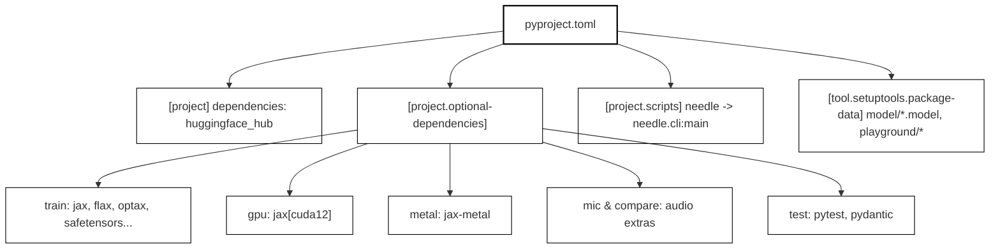
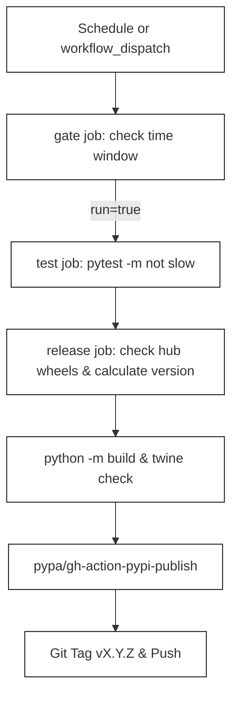
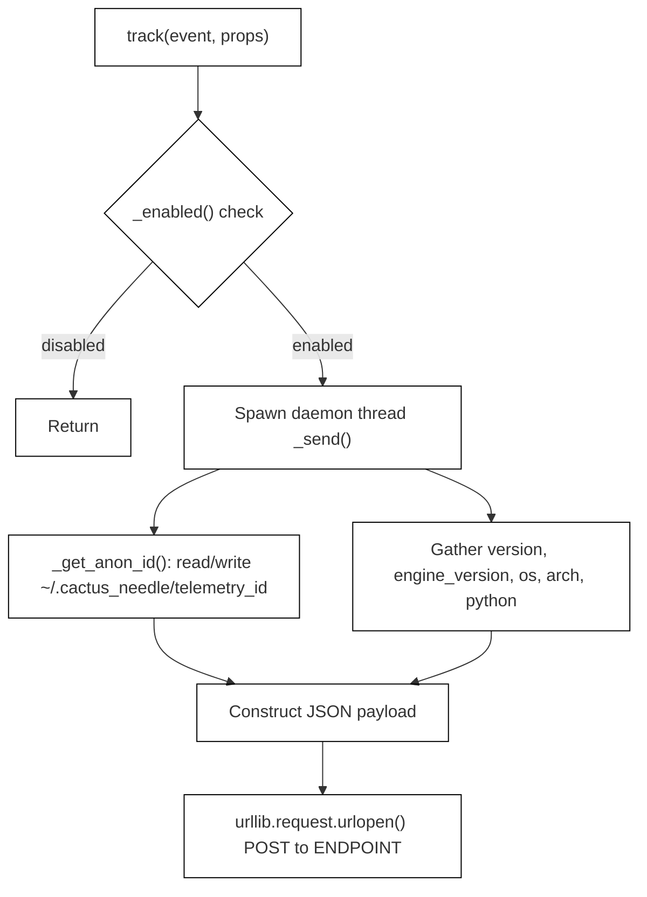

<!-- source: DeepWiki mcp.deepwiki.com · repo cactus-compute/needle · page 7.3 Packaging, CI and Release Workflows · fetched 2026-10-27 -->

# Packaging, CI and Release Workflows

Relevant source files

The following files were used as context for generating this wiki page:

- [.github/workflows/release.yaml](.github/workflows/release.yaml)
- [needle/_telemetry.py](needle/_telemetry.py)
- [pyproject.toml](pyproject.toml)
- [requirements-train.txt](requirements-train.txt)
- [tests/test_packaging.py](tests/test_packaging.py)
- [tests/test_release.py](tests/test_release.py)

This page details the packaging architecture, continuous integration (CI) pipelines, release automation scripts, and the anonymous telemetry subsystem for the `cactus-needle` project. It covers `pyproject.toml` configuration, optional dependency extras, setup utilities, GitHub Actions workflows, test coverage for releases, and runtime telemetry opt-out mechanisms.

## Python Packaging and `pyproject.toml`

The project relies on a modern `pyproject.toml` configuration file to define core project metadata, runtime and optional dependencies, CLI entry points, package data, and test runner options.

The core project table defines the package as `cactus-needle` with version `3.1.0` and a Python requirement of `>=3.9` [pyproject.toml:1-5](). 

### Dependencies and Optional Extras

Runtime dependencies are kept minimal to ensure lightweight deployments. The optional dependencies table (`[project.optional-dependencies]`) defines isolated feature sets:
*   `train`: Installs training and checkpoint export utilities including `numpy`, `jax`, `jaxlib`, `flax>=0.10.2`, `optax`, `safetensors`, and `sentencepiece` [pyproject.toml:13-21]().
*   `gpu`: Installs `jax[cuda12]` for NVIDIA GPU acceleration [pyproject.toml:22]().
*   `metal`: Pins specific JAX versions (`jax==0.4.38`, `jaxlib==0.4.38`) alongside `jax-metal` for Apple Silicon [pyproject.toml:23-27]().
*   `mic`: Audio capture support via `numpy`, `soxr`, and `sounddevice` [pyproject.toml:28]().
*   `compare`: Benchmarking tools via `openai-whisper` and `moonshine-voice` [pyproject.toml:29]().
*   `test`: Testing tools including `pytest` and `pydantic` [pyproject.toml:30]().

The CLI command `needle` is registered via the `[project.scripts]` table, pointing directly to `needle.cli:main` [pyproject.toml:32-33](). Non-Python assets like model binaries, vocabularies, and playground web assets are included via `[tool.setuptools.package-data]` [pyproject.toml:35-40]().

Sources:
* [pyproject.toml:1-48]()

## Requirements Files and Packaging Tests

To mirror `pyproject.toml` configurations for environments lacking dynamic extra parsing, static requirements files are maintained:
* `requirements.txt`: Contains base runtime requirements (`huggingface_hub`) [requirements.txt:1-2]() matching `project.dependencies`.
* `requirements-train.txt`: Includes `-r requirements.txt` followed by training dependencies (`numpy`, `jax`, `flax`, etc.) [requirements-train.txt:1-10]().

The test suite validates packaging consistency in `tests/test_packaging.py`. The function `test_training_dependencies_are_not_required_for_runtime()` asserts that runtime dependencies are strictly disjoint from training extras, and that `requirements.txt` and `requirements-train.txt` mirror `pyproject.toml` exactly [tests/test_packaging.py:10-34]().

Sources:
* [requirements.txt:1-2]()
* [requirements-train.txt:1-10]()
* [tests/test_packaging.py:10-34]()

## CI and Release Workflows

Automated continuous integration and daily release trains are handled via GitHub Actions in `.github/workflows/release.yaml`.

### Workflow Architecture

The release workflow is triggered on a daily cron schedule (`0 16 * * *` and `0 17 * * *`) or via manual `workflow_dispatch` [.github/workflows/release.yaml:5-9](). It executes three dependent jobs:
1.  **`gate`**: Determines if the release should proceed based on time windows (specifically targeting 09:00 America/Los_Angeles) or manual execution flags [.github/workflows/release.yaml:19-33]().
2.  **`test`**: Checks out code, sets up Python 3.12, installs `.[test,train]`, and runs `pytest -q -m "not slow"` [.github/workflows/release.yaml:34-45]().
3.  **`release`**: Calculates the next semantic version, verifies that all pinned engine wheels are present on the Hugging Face Hub (`fetch.unpublished_engine_wheels()`), builds the distribution via `python -m build`, validates with `twine check`, publishes to PyPI, and pushes a version tag (`vX.Y.Z`) [pyproject.yaml:46-124]().

### Release Workflow Testing (`test_release.py`)

The test module `tests/test_release.py` simulates the Git operations and version-tagging logic from `release.yaml` inside temporary local repositories (`repo` fixture) [tests/test_release.py:22-32](). It validates scenarios such as:
*   `test_existing_release_tag_skips_unchanged_source()`: Ensures unchanged source trees skip tagging [tests/test_release.py:59-61]().
*   `test_release_tag_contains_versioned_source_and_skips_unchanged_main()`: Verifies commit ancestry of release tags [tests/test_release.py:64-81]().
*   `test_declared_version_above_everything_published_is_released_as_is()`: Validates explicit major/minor bumps [tests/test_release.py:111-120]().

Sources:
* [.github/workflows/release.yaml:1-124]()
* [tests/test_release.py:1-120]()

## Telemetry Subsystem and Opt-Out

To guide development priorities, `cactus-needle` collects minimal anonymous usage data via `needle/_telemetry.py`. 

### Opt-Out Enforcements

The telemetry system checks `_enabled()` before dispatching any events. Telemetry is fully suppressed if any of the following environment conditions are met:
*   `NEEDLE_TELEMETRY=0` is set [needle/_telemetry.py:30-32]().
*   The standard `DO_NOT_TRACK` environment variable is active [needle/_telemetry.py:33-34]().
*   Running in a CI environment (`CI=true`) [needle/_telemetry.py:35-36]().

### Data Flow and Transmission

When enabled, `track(event, props)` spawns a daemon thread running `_send()` to report events without blocking caller code [needle/_telemetry.py:83-86]().

An anonymous installation UUID is generated on first run and stored at `~/.cactus_needle/telemetry_id` [needle/_telemetry.py:40-56](). If the filesystem is read-only, an ephemeral ID is used [needle/_telemetry.py:54-55](). Payloads transmit solely event identifiers, library versions, system architectures, and properties dictionaries; code inputs, prompts, and file paths are strictly excluded [needle/_telemetry.py:12-15]().

Sources:
* [needle/_telemetry.py:1-86]()

---

