# Page: Needle: Overview

# Needle: Overview

<details>
<summary>Relevant source files</summary>

The following files were used as context for generating this wiki page:

- [LICENSE](LICENSE)
- [README.md](README.md)
- [assets/banner.svg](assets/banner.svg)
- [assets/benchmarks.svg](assets/benchmarks.svg)
- [assets/deploy.svg](assets/deploy.svg)
- [assets/finetune.svg](assets/finetune.svg)
- [assets/model.svg](assets/model.svg)
- [assets/whistle-benchmarks.svg](assets/whistle-benchmarks.svg)
- [assets/whistle.svg](assets/whistle.svg)
- [llms.txt](llms.txt)

</details>


Needle is a compact foundation model designed for on-device tool calling, device control, and structured extraction across mobiles, wearables, robotics, and microcontrollers [README.md:3-5](), [llms.txt:3](). Built on a **Laddered Simple Attention Network (SAN)** architecture, Needle trades general chat capacity to optimize for exact tool invocation, typed data extraction, and local text embedding at speeds suitable for resource-constrained hardware [README.md:3-11](). 

The project provides a complete vertical stack, including a high-level Python API with automatic tool schema generation, grammar-constrained decoding, local LoRA fine-tuning, the Whistle speech-to-text pipeline, and integration with the hosted Cactus Platform [README.md:7-13](), [README.md:47-60](), [llms.txt:3-4](). Visual architectural references, benchmark assets, and diagrams are housed in the repository's `assets/` directory (such as `assets/banner.svg` and `assets/model.svg`), while `llms.txt` provides an architectural summary tailored for AI coding assistants [README.md:1-12](), [llms.txt:1-5]().

Sources: [README.md:1-12](), [llms.txt:1-5]()

---

## Generations: Needle 2 vs. Needle 3

Needle 3 introduces a **Laddered Simple Attention Network** architecture featuring a Monarch Hadamard MLP, Grouped-Query Attention (GQA) with causal conv taps, an engram n-gram memory read by gather, and multi-lane hyper-connections [README.md:11](). Trained so that every depth from 2 to 20 layers is a deployable subnetwork, Needle 3 achieves high parameter efficiency and calibrated confidence gating [README.md:11](). 

For legacy deployments requiring the previous generation, the Python API supports a generation selector via `generation=2` in `needle.Needle(...)` [README.md:44](), [llms.txt:45]().

**Figure 1: Natural Language Space to Code Entity Space (Inference Flow)**
```mermaid
graph TD
    subgraph "NaturalLanguageSpace"
        [UserQuery]
        [needle.tool_decorator]
    end

    subgraph "CodeEntitySpace"
        [needle.agent.Needle.run] --> [needle.agent.tools.build_schema]
        [needle.agent.Needle.run] --> [needle.agent.Needle._bind]
        [needle.agent.Needle._bind] --> [needle_init]
        [needle.agent.Needle.complete] --> [needle_complete]
    end

    [UserQuery] --> [needle.agent.Needle.run]
    [needle.tool_decorator] --> [needle.agent.tools.build_schema]
    [needle_complete] --> [StructuredJSONToolCall]
```
Sources: [README.md:31-42](), [llms.txt:18-24]()

---

## Whistle Speech-to-Text and Hosted Cactus Platform

In addition to text agents, Needle integrates **Whistle**, an on-device speech-to-text model sharing the same `.cact` container and C++ engine runtime [README.md:47-51](). Whistle supports 16 kHz mono audio inputs in English, German, French, Spanish, Italian, Dutch, and Polish, allowing audio clips to directly trigger tool calls or transcriptions [README.md:51-72]().

The hosted **Cactus Platform** provides cloud infrastructure (`cactuscompute.com/v1`) for dataset generation, remote fine-tuning, and model deployment via the `needle.platform` client interface [llms.txt:5]().

Sources: [README.md:47-72](), [llms.txt:5]()

---

## Major Subsystems

Needle is organized into modular subsystems that manage the complete lifecycle of on-device agent execution, speech processing, and model optimization:

| Subsystem | Primary Responsibility | Key Code Entities |
| :--- | :--- | :--- |
| **Agent API** | High-level interface, tool binding, & structured extraction | `Needle`, `@tool`, `extract()`, `Field` [llms.txt:18-28]() |
| **Model Core** | SAN Architecture & tokenization | `SimpleAttentionNetwork`, `SANTokenizer`, `TransformerConfig` [README.md:11]() |
| **Whistle Speech** | Audio transcription and streaming | `Whistle`, `transcribe()`, `stream()` [README.md:51-60]() |
| **Fine-Tuning** | LoRA training, synthetic data generation, & export | `finetune_local()`, `generate_dataset()`, `Muon` [README.md:64-68]() |
| **Platform & CLI** | CLI routing, hosted training client, & web playground | `needle.cli:main`, `Platform`, `Engine` [llms.txt:5](), [pyproject.toml:31]() |

**Figure 2: Natural Language Space to Code Entity Space (CLI & Execution Mapping)**
```mermaid
graph LR
    subgraph "NaturalLanguageSpace"
        [CLICommandRun]
        [CLICommandFinetune]
        [CLICommandGenerateData]
        [CLICommandPlayground]
    end

    subgraph "CodeEntitySpace"
        [needle.cli.main] --> [needle.agent.Needle.run]
        [needle.cli.main] --> [needle.model.finetune.finetune_local]
        [needle.cli.main] --> [needle.model.finetune.generate_main]
        [needle.playground.server.Engine] --> [needle.playground.server]
    end

    [CLICommandRun] --> [needle.cli.main]
    [CLICommandFinetune] --> [needle.cli.main]
    [CLICommandGenerateData] --> [needle.cli.main]
    [CLICommandPlayground] --> [needle.cli.main]
```
Sources: [README.md:64-82](), [pyproject.toml:30-31]()

---

## Getting Started and Child Pages

To install the core runtime package:

```sh
pip install cactus-needle
```
Sources: [README.md:23-25](), [llms.txt:10]()

For complete instructions covering optional training extras (`[train]`, `[gpu]`, `[metal]`), setup scripts, engine binary fetching, and initial API usage, see [Getting Started](#1.1). For reference regarding all needle CLI subcommands (`run`, `finetune`, `whistle`, `platform`, etc.), see [CLI Reference](#1.2).

Sources: [README.md:21-86](), [llms.txt:1-15](), [pyproject.toml:1-46]()

---

# Page: Getting Started

# Getting Started

<details>
<summary>Relevant source files</summary>

The following files were used as context for generating this wiki page:

- [.gitignore](.gitignore)
- [pyproject.toml](pyproject.toml)
- [requirements-train.txt](requirements-train.txt)
- [requirements.txt](requirements.txt)
- [setup](setup)
- [setup.bat](setup.bat)

</details>


## Purpose and Scope

This page provides a comprehensive guide for setting up the `cactus-needle` development environment, configuring hardware backends and optional extras (`train`, `gpu`, `metal`, `mic`, `compare`, `whistle`), executing setup via automated shell and batch scripts, fetching native engine binaries and base weights, and performing initial inference runs through both the Python API and CLI.

Sources: [pyproject.toml:1-48](), [setup:1-41](), [setup.bat:1-24]()

---

## Environment Setup and Installation Scripts

Needle targets **Python >= 3.9** [pyproject.toml:5-5](). The project provides automated initialization scripts (`setup` for Unix/macOS [setup:1-41]() and `setup.bat` for Windows [setup.bat:1-24]()) that establish virtual environments (`.venv`), leverage `uv` when available for high-speed package resolution [setup:22-26](), and configure accelerator support.

### 1. Repository Initialization & Automated Setup
Clone the repository and execute the appropriate platform setup script to initialize the virtual environment and install core packages:

```bash
git clone https://github.com/cactus-compute/needle
cd needle
# On Linux / macOS:
chmod +x setup
./setup

# On Windows:
setup.bat
```

### 2. Setup Script Implementation Details
* **Python Interpreter Selection**: Scans for compatible interpreters (`python3.12` down to `python3.9`) ensuring version compliance [setup:7-13](), [setup.bat:5-11]().
* **Package Manager Routing**: Detects `uv` in the command path; if present, binds package installation to `uv pip install` and virtual environment creation to `uv venv` [setup:22-26]().
* **Editable Install with Extras**: Creates `.venv`, activates it, and installs the package in editable mode with training and whistle extras (`.[train,whistle]`) [setup:34-34](), [setup.bat:22-22]().
* **GPU Auto-Detection**: Probes for `nvidia-smi` on Unix systems; if an NVIDIA GPU is present, it automatically installs the `gpu` optional extras (`jax[cuda12]`) [setup:36-39]().
* **CLI Validation**: Executes `needle --help` to verify entrypoint registration [setup:41-41](), [setup.bat:24-24]().

Sources: [setup:1-41](), [setup.bat:1-24]()

---

## Dependency Management and Optional Extras

Package metadata and optional dependency sets are declared in `pyproject.toml`. Core runtime dependencies are minimal (`huggingface_hub`) [pyproject.toml:8-10](), while optional extras configure training, hardware acceleration, audio processing, and testing [pyproject.toml:12-30]().

| Extra Name | Target Packages | Purpose |
| :--- | :--- | :--- |
| **`train`** | `numpy`, `jax`, `jaxlib`, `flax>=0.10.2`, `optax`, `safetensors`, `sentencepiece` [pyproject.toml:13-21]() | Gradient calculation, tokenizer management, and LoRA fine-tuning. |
| **`gpu`** | `jax[cuda12]` [pyproject.toml:22-22]() | NVIDIA CUDA hardware acceleration support via JAX. |
| **`metal`** | `jax==0.4.38`, `jaxlib==0.4.38`, `jax-metal` [pyproject.toml:23-27]() | Apple Silicon hardware acceleration via Metal. |
| **`mic`** | `numpy`, `soxr`, `sounddevice` [pyproject.toml:28-28]() | Live microphone input handling for Whistle speech-to-text. |
| **`compare`** | `openai-whisper`, `moonshine-voice` [pyproject.toml:29-29]() | Benchmarking and comparison against alternative speech models. |
| **`test`** | `pytest`, `pydantic` [pyproject.toml:30-30]() | Unit testing and structured schema validation. |

Sources: [pyproject.toml:1-48](), [requirements.txt:1-2](), [requirements-train.txt:1-10]()

---

## Engine Binary and Asset Management

Needle decouples model logic from runtime execution by utilizing a native C-engine binary (`libneedle.so`, `libneedle.dylib`, or `libneedle.dll`) managed via asset utilities in `needle/agent/fetch.py`.

### Platform Detection and Asset Fetching Data Flow
When initiating an agent or running CLI commands, asset retrieval identifies the host architecture (including `musl` vs `glibc` detection on Linux) and downloads matching wheel artifacts or `.cact` container weights from the Hugging Face Hub.

**Figure 1: Binary and Weight Acquisition Flow**
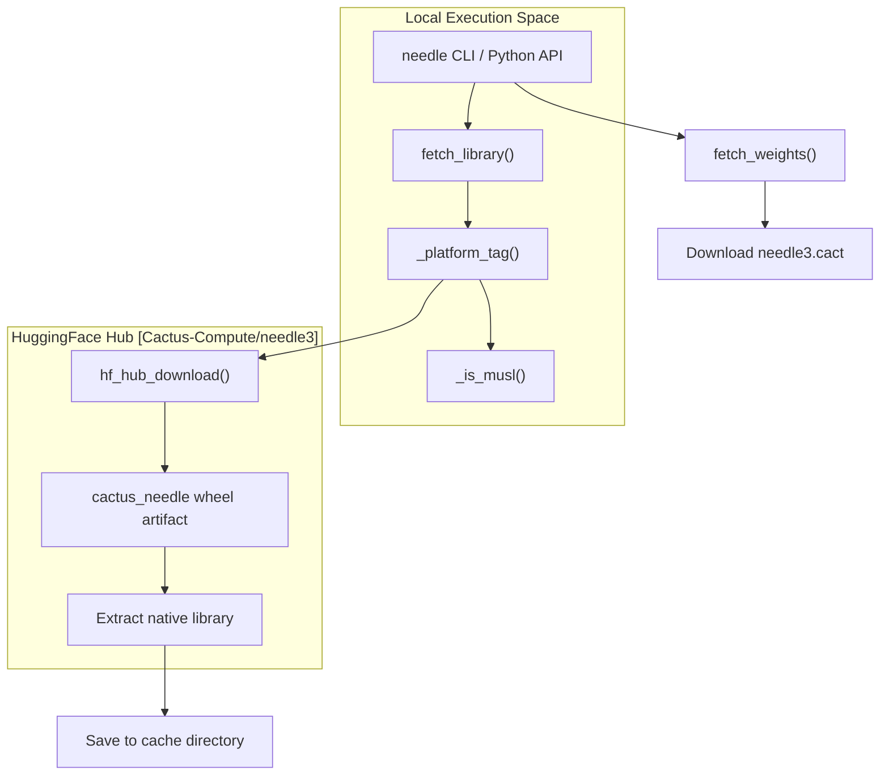
Sources: [setup:1-41](), [pyproject.toml:1-48]()

---

## First Inference via Python API and CLI

Once the environment and native engine libraries are fetched, you can execute inference using either the command line interface or the programmatic Python API.

### CLI Execution
The `needle` CLI entry point [pyproject.toml:32-33]() supports downloading assets and running prompt generations:

```bash
# Fetch generation binaries and base weights
needle fetch

# Execute an inference prompt
needle run --prompt "Summarize quantum computing in one sentence."
```

### Python API Execution
The `Needle` agent class binds to the native engine via `ctypes` FFI and manages tool definitions, schema generation, and completion loops.

```python
from needle import Needle, tool

@tool
def calculate_area(length: float, width: float) -> float:
    """Calculates the area of a rectangle."""
    return length * width

agent = Needle(tools=[calculate_area])
response = agent.complete("What is the area of a 5 by 12 rectangle?")
print(response)
```

**Figure 2: Natural Language to Code Entity Mapping for Getting Started**
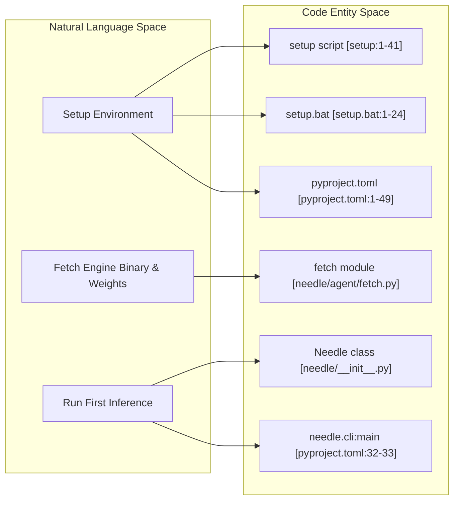
Sources: [pyproject.toml:32-33](), [setup:1-41](), [setup.bat:1-24]()

---

## Troubleshooting

| Symptom | Root Cause | Resolution |
| :--- | :--- | :--- |
| `Python < 3.9` Error | The system default `python` points to an outdated version. | Ensure `python3.12`, `python3.11`, `python3.10`, or `python3.9` is installed and accessible in your `PATH` [setup:7-13](), [setup.bat:5-11](). |
| Missing Native Engine (`libneedle`) | The engine binary has not been fetched or cached for the current platform. | Run `needle fetch` or set the environment variable `NEEDLE_LIB_PATH` to point directly to your compiled library. |
| JAX Accelerator Mismatch | Missing hardware libraries during tensor operations. | Reinstall using the appropriate optional dependency extra: `pip install -e .[gpu]` or `pip install -e .[metal]` [pyproject.toml:22-27](), [setup:36-39](). |

Sources: [setup:7-13](), [setup.bat:5-11](), [setup:36-39](), [pyproject.toml:22-27]()

---

# Page: CLI Reference

# CLI Reference

<details>
<summary>Relevant source files</summary>

The following files were used as context for generating this wiki page:

- [needle/_telemetry.py](needle/_telemetry.py)
- [needle/cli.py](needle/cli.py)

</details>


The purpose of this page is to provide a complete technical reference for all `needle` CLI subcommands (`run`, `finetune`, `generate-data`, `build`, `platform`, `download`, `fetch`, `playground`, and `whistle`), their arguments, default values, log filtering mechanisms, and telemetry integrations.

## Overview of CLI Infrastructure and Log Filtering

The CLI entry point is defined in `needle/cli.py: main()` [needle/cli.py:141](). It processes command-line arguments using `argparse.ArgumentParser` [needle/cli.py:148-149]() and routes execution to the appropriate subcommand module. 

A critical component of the infrastructure is the XLA log filter (`_install_xla_log_filter`), which intercepts file descriptor 2 to drop Triton autotuner noise and compilation errors from `stderr` [needle/cli.py:62-137](). Additionally, anonymous telemetry is managed via `needle/_telemetry.py: track()` to collect lightweight usage statistics without transmitting user prompts or outputs [needle/_telemetry.py:83-86]().

Sources: [needle/cli.py:54-142](), [needle/_telemetry.py:12-86]()

### CLI Infrastructure Data Flow

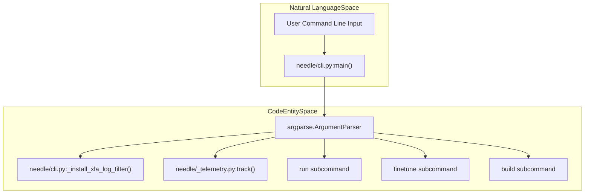
Sources: [needle/cli.py:54-142](), [needle/_telemetry.py:83-86]()

---

## Command Reference

### `run`
Executes inference on a checkpoint with an optional query and tool definitions [needle/cli.py:9]().

| Argument | Default | Description |
| :--- | :--- | :--- |
| `--checkpoint` | (Required) | Path to the model checkpoint file [needle/cli.py:151]() |
| `--query` | `None` | Query text for tool-call generation [needle/cli.py:152]() |
| `--tools` | `None` | Tools JSON string for tool-call generation [needle/cli.py:153]() |
| `--max-len` | `512` | Maximum generation length [needle/cli.py:154]() |
| `--seed` | `0` | Random seed for generation [needle/cli.py:155]() |
| `--temperature` | `0.0` | Sampling temperature (0 = greedy) [needle/cli.py:156-157]() |

Sources: [needle/cli.py:9](), [needle/cli.py:150-157]()

### `finetune`
Trains a LoRA adapter on JSONL training data [needle/cli.py:10]().

| Argument | Default | Description |
| :--- | :--- | :--- |
| `jsonl_path` | (Required) | Path to JSONL training data [needle/cli.py:160]() |
| `--checkpoint` | `None` | Base model checkpoint (auto-downloads if omitted) [needle/cli.py:161-162]() |
| `--epochs` | `3` | Number of training epochs [needle/cli.py:163]() |
| `--batch-size` | `16` | Training batch size [needle/cli.py:164]() |
| `--lr` | `1e-4` | Learning rate [needle/cli.py:165]() |
| `--lora-rank` | `16` | LoRA adapter rank [needle/cli.py:166]() |
| `--lora-alpha` | `32.0` | LoRA scaling alpha [needle/cli.py:167]() |
| `--max-len` | `1024` | Maximum training sequence length [needle/cli.py:168]() |
| `--val-split` | `0.1` | Fraction of examples held out for validation [needle/cli.py:169-170]() |
| `--seed` | `0` | Random seed for initialization and shuffling [needle/cli.py:171-172]() |
| `--generate` | `0` | Generate N extra examples via OpenRouter before training [needle/cli.py:173]() |

Sources: [needle/cli.py:10](), [needle/cli.py:159-173]()

### Other Subcommands (`generate-data`, `build`, `platform`, `download`, `fetch`, `playground`, `whistle`)
- `generate-data`: Synthesises training data via OpenRouter [needle/cli.py:11]().
- `build`: Exports a checkpoint and adapter into a `.cact` archive [needle/cli.py:12]().
- `platform`: Fine-tunes, generates data, and downloads models hosted on cactuscompute.com [needle/cli.py:13]().
- `download`: Downloads assets such as `needle3`, `needle3.safetensors`, platform binaries, or hub archives (`<org>/<repo>[/<file>.cact]`) [needle/cli.py:14]() [needle/cli.py:30-52]().
- `fetch`: Fetches the compiled engine library for the host platform [needle/cli.py:15]().
- `playground`: Serves the browser playground UI [needle/cli.py:16]().
- `whistle`: Runs speech-to-text playground or comparison sub-utilities (`playground` | `compare`) [needle/cli.py:17]().

Helper functions like `_weights_spec()` and `_download_target()` handle path splitting and asset specification parsing [needle/cli.py:23-52]().

Sources: [needle/cli.py:7-18](), [needle/cli.py:23-52]()

---

## Data Flow and Execution Architecture

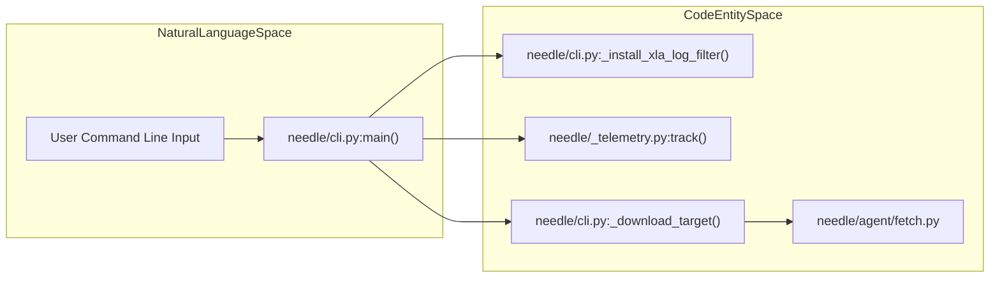
Sources: [needle/cli.py:23-137](), [needle/_telemetry.py:83-86]()

---

## Technical Defaults and Constants

| Command | Parameter | Default Value | Source |
| :--- | :--- | :--- | :--- |
| `run` | `max_len` | `512` | [needle/cli.py:154]() |
| `run` | `seed` | `0` | [needle/cli.py:155]() |
| `run` | `temperature` | `0.0` | [needle/cli.py:156-157]() |
| `finetune` | `epochs` | `3` | [needle/cli.py:163]() |
| `finetune` | `batch_size` | `16` | [needle/cli.py:164]() |
| `finetune` | `lr` | `1e-4` | [needle/cli.py:165]() |
| `finetune` | `lora_rank` | `16` | [needle/cli.py:166]() |
| `finetune` | `lora_alpha` | `32.0` | [needle/cli.py:167]() |
| `finetune` | `max_len` | `1024` | [needle/cli.py:168]() |
| `finetune` | `val-split` | `0.1` | [needle/cli.py:169-170]() |
| `finetune` | `seed` | `0` | [needle/cli.py:171-172]() |
| `finetune` | `generate` | `0` | [needle/cli.py:173]() |

Sources: [needle/cli.py:150-173]()

---

# Page: Python API

# Python API

<details>
<summary>Relevant source files</summary>

The following files were used as context for generating this wiki page:

- [llms.txt](llms.txt)
- [needle/__init__.py](needle/__init__.py)

</details>


The Needle Python API provides a high-level interface for building agentic workflows using on-device models [llms.txt:3-3](). The package (`cactus-needle`) is designed to remain lightweight, lazily importing heavy training dependencies like JAX only when required, while routing inference and grammar constraints through a compact C++ engine [llms.txt:13-14]().

The primary public surface area consists of the `Needle` agent class for managing conversation state, the `@tool` decorator alongside `Field` constraints for schema definition, the `extract()` function for one-shot data recovery, and prebuilt environments for evaluation and tool use [needle/__init__.py:11-18]().

## Core Subsystems and Child Pages

The Python API delegates specialized tasks to several internal modules and subsystems. Because this is a parent page, high-level summaries are provided below; for detailed breakdowns, consult the respective child pages:

*   **Needle Agent Class**: Manages conversation state, prompt formatting, the agentic loop via `run()`, step-by-step control via `complete()`, and ctypes FFI binding (`needle_init`, `needle_complete`, `needle_embed`, `needle_reset`, `needle_load`). For details, see [Needle Agent Class](#2.1).
*   **Tool Schema Generation**: Converts Python functions, docstrings, Pydantic models, or raw JSON schemas into constrained grammar definitions using `@tool`, `Field` constraints, and automatic type mapping. For details, see [Tool Schema Generation](#2.2).
*   **Grounding, Confidence and Extraction**: Performs structured data extraction via `extract()`, validating returned values against input text using the temporal grounding and number path subsystems, alongside calibrated confidence gating. For details, see [Grounding, Confidence and Extraction](#2.3).
*   **Prebuilt Environments**: Provides ready-to-use domain toolsets (`smart_home`, `media_player`, `productivity`, `wearable`, `kitchen_appliance`, `data_capture`) complete with acceptance harnesses. For details, see [Prebuilt Environments](#2.4).
*   **Engine Binary and Asset Management**: Handles platform tag detection, musl identification, engine library fetching, and base weights caching via `needle/agent/fetch.py`. For details, see [Engine Binary and Asset Management](#2.5).
*   **Fine-Tune Worker Subprocess**: Manages the `FineTuneWorker` subprocess protocol using length-prefixed JSON messages to route completions through loaded LoRA weights without blocking the main event loop. For details, see [Fine-Tune Worker Subprocess](#2.6).

Sources: [needle/__init__.py:11-18](), [llms.txt:13-28]()

## Natural Language Space to Code Entity Space

The following diagram bridges natural language inputs and environment facts to the codebase entities that process them through grammar-constrained engine interfaces.

**Natural Language to Code Mapping**
```mermaid
graph TD
    subgraph "NaturalLanguageSpace"
        UserQuery[""Set the heater to 22C""]
        SystemFacts[""date: 2026-07-21; device: phone""]
    end

    subgraph "CodeEntitySpace"
        Agent[""Needle""]
        ToolDec[""tool""]
        Constraint[""Field(ge=15, le=30)""]
        ExtractFn[""extract()""]
        
        Agent -->|"complete()"| EngineInterface[""needle_complete (ctypes)""]
        ToolDec -->|"build_schema()"| JSONSchema[""JSON Schema""]
    end

    subgraph "EngineSpace"
        Grammar[""Byte-level Grammar""]
        Model[""SAN Model""]
    end

    UserQuery --> Agent
    SystemFacts --> Agent
    JSONSchema --> Grammar
    Grammar -->|"Constrains"| Model
    Model -->|"Returns"| ToolCall[""{"temperature": 22}""]
    ToolCall --> Agent
```
Sources: [needle/__init__.py:11-15](), [needle/__init__.py:187-191](), [llms.txt:3-3]()

## Agent Execution Lifecycle

When using the `Needle` agent, queries pass through an agentic loop where the engine generates tool calls, the Python runtime executes them, and results are fed back into the conversation state.

**Agent Execution Flow**
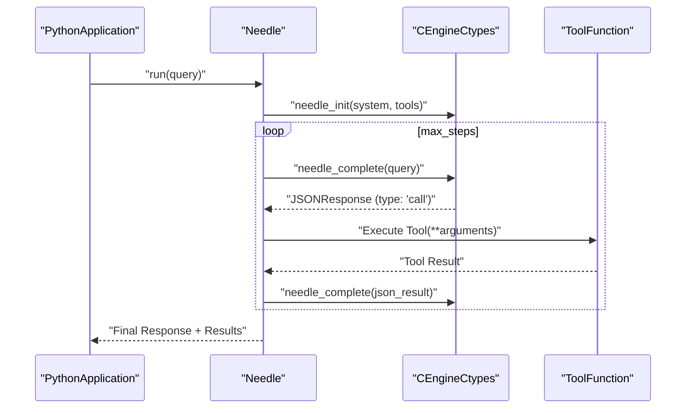
Sources: [needle/__init__.py:164-184](), [llms.txt:23-24]()

## API Feature Overview

| Component | Target / Role | File Source |
| :--- | :--- | :--- |
| **`Needle`** | Main agent class managing toolsets, system facts, and generation dispatch | [needle/__init__.py:187-191]() |
| **`tool`** | Decorator translating Python functions and docstrings into tool schemas | [needle/__init__.py:11-11]() |
| **`Field`** | Fine-grained parameter constraint specifier (bounds, patterns, enums) | [needle/__init__.py:11-11]() |
| **`extract`** | One-shot structured extraction helper returning Pydantic models or dicts | [needle/__init__.py:17-18]() |
| **`FineTuneWorker`** | Subprocess worker protocol for executing LoRA-tuned completions | [needle/__init__.py:13-13]() |

Sources: [needle/__init__.py:11-18](), [needle/__init__.py:187-191]()

---

# Page: Needle Agent Class

# Needle Agent Class

<details>
<summary>Relevant source files</summary>

The following files were used as context for generating this wiki page:

- [needle/__init__.py](needle/__init__.py)
- [needle/_worker.py](needle/_worker.py)
- [tests/test_weights.py](tests/test_weights.py)
- [tests/test_worker.py](tests/test_worker.py)

</details>


## Purpose and Scope
This page covers the technical implementation of the `Needle` class defined in `needle/__init__.py`. It details constructor parameters, generation selection (v2 vs v3), stateless mode execution, the agentic loop (`run()`), core execution methods (`complete()`, `embed()`, `reset()`), the `_bind` lifecycle, and the `ctypes` FFI bridge connecting Python to the underlying native engine functions (`needle_init`, `needle_complete`, `needle_embed`, `needle_reset`, `needle_load`).

Sources: [needle/__init__.py:1-191]()

---

## Overview and Constructor Parameters

The `Needle` agent serves as the primary Python interface for the cactus-needle inference engine. Upon instantiation, it resolves tools, configures system prompts, inspects weight headers to determine engine generation via `_weight_generation()`, and defers native engine initialization or worker spawning until interaction via `_bind()` or a tuned weights load.

| Parameter | Type | Description |
| :--- | :--- | :--- |
| `tools` | `list \| str \| None` | A list of `@tool` decorated functions, Pydantic models, or raw JSON schemas. |
| `system` | `str \| None` | System prompt defining environment facts or agent persona. |
| `weights` | `str \| None` | Path to a `.cact` weight file for fine-tuned models. |
| `tool_index_path` | `str \| None` | Path to persist tool embeddings for large-scale tool retrieval. |
| `buffer_size` | `int` | Size of the `ctypes` string buffer for engine responses (default `65536`). |
| `auto_date` | `bool` | Automatically injects date facts into the system prompt (default `True`). |
| `generation` | `int \| None` | Explicit engine generation selection (`2` or `3`, default `3`). |
| `stateless` | `bool` | Whether the agent operates in stateless mode (default `False`). |

Sources: [needle/__init__.py:24-45](), [needle/__init__.py:123-190]()

---

## Generation Dispatch and C-Engine Interface (`ctypes`)

Needle communicates with a high-performance C engine via `ctypes`. The library path is resolved through `_library_path(generation)` [needle/__init__.py:81-110](), handling version overrides (`NEEDLE_LIB_PATH`), local builds, and cached binaries. 

Weight files are inspected using `_weight_generation(path)` to read the 4-byte `.cact` header tag (`0x05E12A83` for Generation 2, `0x05E12A84` for Generation 3) [needle/__init__.py:27-45](). Base weights for Generation 3 models are loaded into memory via `_load_base()` utilizing `needle_load()` [needle/__init__.py:126-136]().

### Engine Management and Dispatch Architecture
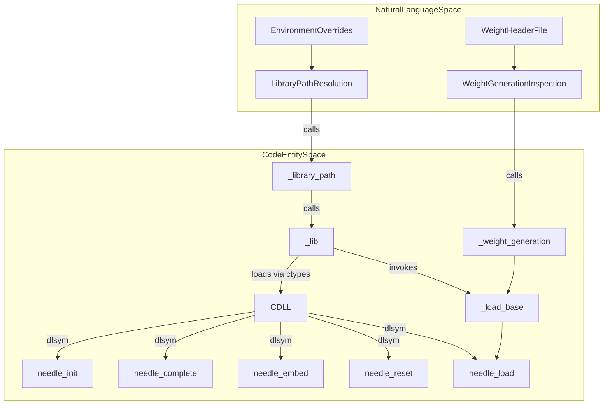
Sources: [needle/__init__.py:27-184]()

---

## Stateless Mode and the Agentic Loop (`run()`)

The `Needle` agent supports a `stateless` execution mode (`stateless=True`), which isolates conversation turns or disables persistent context storage across calls depending on configuration. 

The agentic loop is orchestrated via `run()`, which processes user queries, handles intermediate tool calls returned by the engine, executes the corresponding Python functions resolved in `self._functions`, and feeds tool outputs back into the inference loop until a final response is generated or execution bounds are reached.

Sources: [needle/__init__.py:187-191]()

---

## The `_bind` Lifecycle and Worker Subprocess

Needle manages execution via two primary paths: an in-process base engine or an out-of-process subprocess managed by `FineTuneWorker` when custom fine-tuned weights (`weights=...`) are provided.

1.  **In-Process Binding (`_bind()`):** Validates the instance state, fetches the appropriate generation library via `_lib(generation)`, loads base weights if generation $\ge 3$ via `_load_base()`, and invokes `needle_init` with the system prompt, tool schemas, and tool index path.
2.  **Fine-Tuned Worker (`FineTuneWorker`):** If `weights` are specified, Needle instantiates a `FineTuneWorker` subprocess (`needle/_worker.py`) communicating via length-prefixed JSON messages over `stdin`/`stdout` pipes [needle/_worker.py:164-184]().

### Inference and Worker Architecture
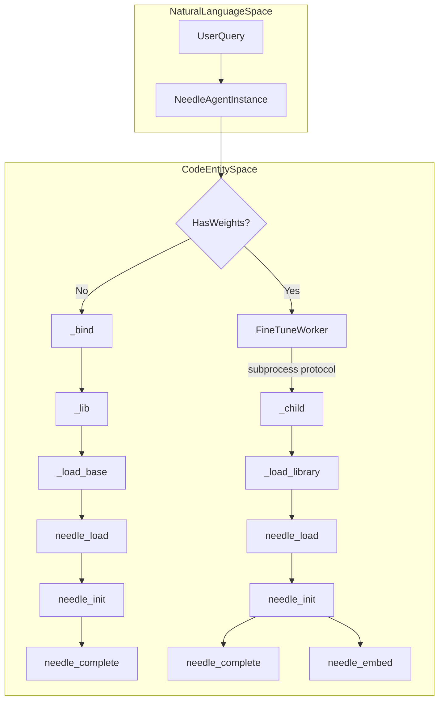
Sources: [needle/__init__.py:126-184](), [needle/_worker.py:50-149](), [needle/_worker.py:164-184]()

---

## Core Methods

*   `complete(text, max_new_tokens)`: Executes a single inference turn. For base models, it invokes the C engine via `needle_complete`; for fine-tuned models, it dispatches the request to the `FineTuneWorker` subprocess [needle/_worker.py:98-111]().
*   `embed(text)`: Computes vector embeddings for a given input text (requires Generation 3 models), routing through `needle_embed` or the worker equivalent [needle/_worker.py:112-138]().
*   `reset()`: Resets conversation state and token buffers via `needle_reset` or the worker protocol without clearing loaded tools [needle/_worker.py:139-141]().
*   `run(query, ...)`: Executes the multi-turn agentic loop, invoking tool functions iteratively.

Sources: [needle/__init__.py:187-191](), [needle/_worker.py:93-144]()

---

## C-Engine Interface Reference

The `Needle` class and `FineTuneWorker` wrap five primary native C functions exposed by the shared library via `ctypes`:

| C Function | Python Wrapper / Binding | Purpose |
| :--- | :--- | :--- |
| `needle_init` | `_bind()` / `_child()` | Sets the system prompt, active toolset grammar, and tool index path. |
| `needle_complete` | `complete()` / `FineTuneWorker.complete()` | Generates a response based on the current context and tool schemas. |
| `needle_embed` | `embed()` / `FineTuneWorker.embed()` | Computes vector representations (Generation 3 models only). |
| `needle_reset` | `reset()` / `FineTuneWorker.reset()` | Clears conversation context while preserving loaded model and tool state. |
| `needle_load` | `_load_base()` / `_child()` | Loads a `.cact` binary weight archive into memory. |

Sources: [needle/__init__.py:164-184](), [needle/_worker.py:50-67]()

---

# Page: Tool Schema Generation

# Tool Schema Generation

<details>
<summary>Relevant source files</summary>

The following files were used as context for generating this wiki page:

- [needle/agent/tools.py](needle/agent/tools.py)
- [tests/test_inference.py](tests/test_inference.py)
- [tests/test_tools.py](tests/test_tools.py)

</details>


Tool schema generation in `needle` is implemented in `needle/agent/tools.py` and handles the introspection of Python code entities—functions, classes, and Pydantic models—to produce structured JSON schemas. These schemas are used by the underlying inference engine to constrain model generation grammar and ensure valid tool calls.

## Purpose and Scope

This page documents the internal mechanics of schema compilation in `needle`, covering the `Field` constraint class, type mapping rules, PEP 604 and `typing.Union` handling, docstring parsing, Pydantic model integration, and the `build_schema` introspection pipeline.

Sources: [needle/agent/tools.py:1-171]()

## The `@tool` Decorator and Schema Construction

The schema generation pipeline inspects Python callables to extract metadata, types, and constraints. This process is driven by `build_schema(fn)` [needle/agent/tools.py:120-151]().

### Data Flow: Function to Schema

1. **Signature Introspection**: `inspect.signature` identifies function parameters and default values [needle/agent/tools.py:121]() while `typing.get_type_hints` resolves type annotations [needle/agent/tools.py:123]().
2. **Docstring Parsing**: `_parse_doc` extracts high-level function descriptions and argument descriptions from Google-style `Args:` blocks [needle/agent/tools.py:104-118]().
3. **Type Mapping**: `_json_type` converts Python type annotations into corresponding JSON schema types [needle/agent/tools.py:57-86]().
4. **Constraint Application**: `_field_of` extracts `Field` definitions from `typing.Annotated` or parameter defaults [needle/agent/tools.py:89-101](), and `Field.apply` injects validation keywords into the property schema [needle/agent/tools.py:36-49]().

**Diagram: Tool Introspection Pipeline**
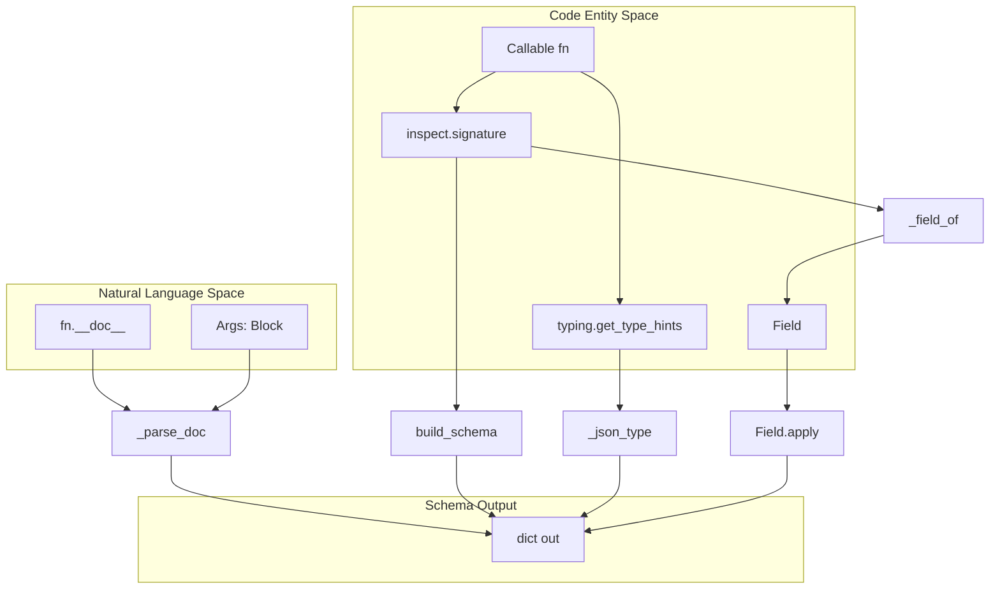
Sources: [needle/agent/tools.py:57-151]()

## Type Mapping and the `Field` Class

`needle` maintains an explicit mapping between Python scalar/container types and JSON Schema types via the `_JSON_TYPES` dictionary [needle/agent/tools.py:8-9]().

| Python Type | JSON Type | Notes |
| :--- | :--- | :--- |
| `str` | `string` | Default fallback [needle/agent/tools.py:8-9](), [needle/agent/tools.py:58-59]() |
| `int` | `integer` | [needle/agent/tools.py:8-9]() |
| `float` | `number` | [needle/agent/tools.py:8-9]() |
| `bool` | `boolean` | [needle/agent/tools.py:8-9]() |
| `list` / `typing.List` | `array` | Recursively resolves nested items [needle/agent/tools.py:77-79]() |
| `dict` / `typing.Dict` | `object` | [needle/agent/tools.py:80-81]() |
| `enum.Enum` | `string` / scalar | Extracts `enum` member values [needle/agent/tools.py:66-69]() |
| `typing.Literal` | `string` / scalar | Extracts literal values as `enum` [needle/agent/tools.py:73-76]() |

### The `Field` Class
The `Field` class enables developers to specify validation constraints (such as numeric ranges, string patterns, or descriptions) either as a parameter default or wrapped inside `typing.Annotated` [needle/agent/tools.py:18-32](). The `Field.apply` method maps these attributes to standard JSON Schema keys (`minimum`, `maximum`, `exclusiveMinimum`, `exclusiveMaximum`, `multipleOf`, `minLength`, `maxLength`, `pattern`, `format`, `minItems`, `maxItems`, `uniqueItems`, `const`) [needle/agent/tools.py:36-49]().

Sources: [needle/agent/tools.py:8-50](), [needle/agent/tools.py:57-86]()

## Optionality and Required Fields

A parameter is added to the `required` list of the generated JSON schema unless it satisfies one of the omission criteria [needle/agent/tools.py:142-143]().

1. **Default Value**: The parameter has a Python default or a `Field` with a default value [needle/agent/tools.py:139-141]().
2. **Optional Annotation**: The parameter type annotation is recognized as optional via `_is_optional`, which checks for `typing.Union` or PEP 604 union origins (`_UNION_ORIGINS`) containing `type(None)` [needle/agent/tools.py:11-13](), [needle/agent/tools.py:52-54]().

**Diagram: Required Argument Logic**
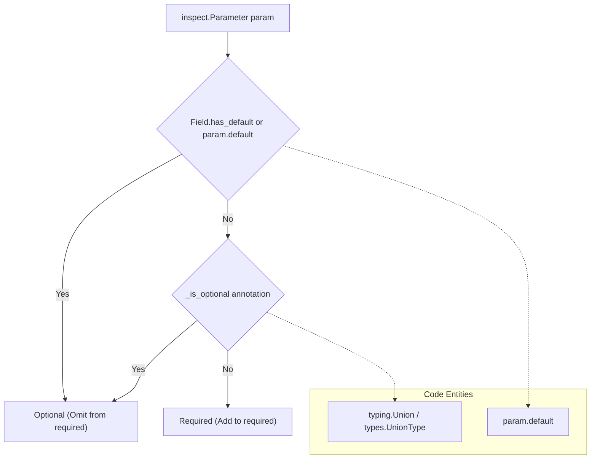
Sources: [needle/agent/tools.py:11-15](), [needle/agent/tools.py:52-55](), [needle/agent/tools.py:139-146]()

## Pydantic Model Integration

`needle` supports complex nested object definitions through Pydantic models via `pydantic_schema(model)` [needle/agent/tools.py:160-170]().

- **Model Detection**: `_is_pydantic_model(obj)` inspects the class Method Resolution Order (MRO) for a base class named `BaseModel` residing in a module starting with `pydantic` [needle/agent/tools.py:154-158]().
- **Schema Generation**: `pydantic_schema` invokes `model_json_schema()` (for Pydantic v2) or falls back to `schema()` (for Pydantic v1) [needle/agent/tools.py:161](). It preserves properties, required fields, and definitions (`$defs` or `definitions`) [needle/agent/tools.py:162-165]().

Sources: [needle/agent/tools.py:154-170]()

## Docstring Parsing

Docstring introspection is implemented in `_parse_doc(doc)`, which parses Google-style docstrings using regular expressions [needle/agent/tools.py:104-118]().

- **Section Headers**: Scans for lines matching case-insensitive argument headings such as `args:`, `arguments:`, `parameters:`, or `params:` [needle/agent/tools.py:108]() to separate the general tool description from argument descriptions.
- **Parameter Extraction**: Uses the regular expression `\s+(\w+)\s*(?:\([^)]*\))?\s*:\s*(.+)` to extract parameter names and their associated documentation while gracefully handling optional type annotations inside parentheses [needle/agent/tools.py:114]().

Sources: [needle/agent/tools.py:104-118]()

---

# Page: Grounding, Confidence and Extraction

# Grounding, Confidence and Extraction

<details>
<summary>Relevant source files</summary>

The following files were used as context for generating this wiki page:

- [.github/workflows/publish-component.yaml](.github/workflows/publish-component.yaml)
- [needle/__init__.py](needle/__init__.py)
- [tests/test_grounding.py](tests/test_grounding.py)

</details>


## Purpose and Scope

This page details the grounding validation subsystem, calibrated confidence gating, structured extraction via `extract()`, and the handling of suppressed or ungrounded calls in `cactus-needle`. The grounding subsystem ensures that model outputs (such as dates, numbers, and string arguments) are verifiably derived from the input text or system context, preventing hallucinations. Calibrated confidence gating decides whether a tool call should proceed automatically or be withheld into `suppressed_calls`.

Sources: `needle/__init__.py:21-23` [needle/__init__.py:21-23](), `tests/test_grounding.py:95-207` [tests/test_grounding.py:95-207]()

---

## 1. Structured Extraction via `extract()`

Structured extraction converts unstructured text into a typed Pydantic model or a dictionary using `needle.extract()`. Under the hood, `extract()` registers the target schema as the sole tool, executes inference, and validates grounding against the input text.

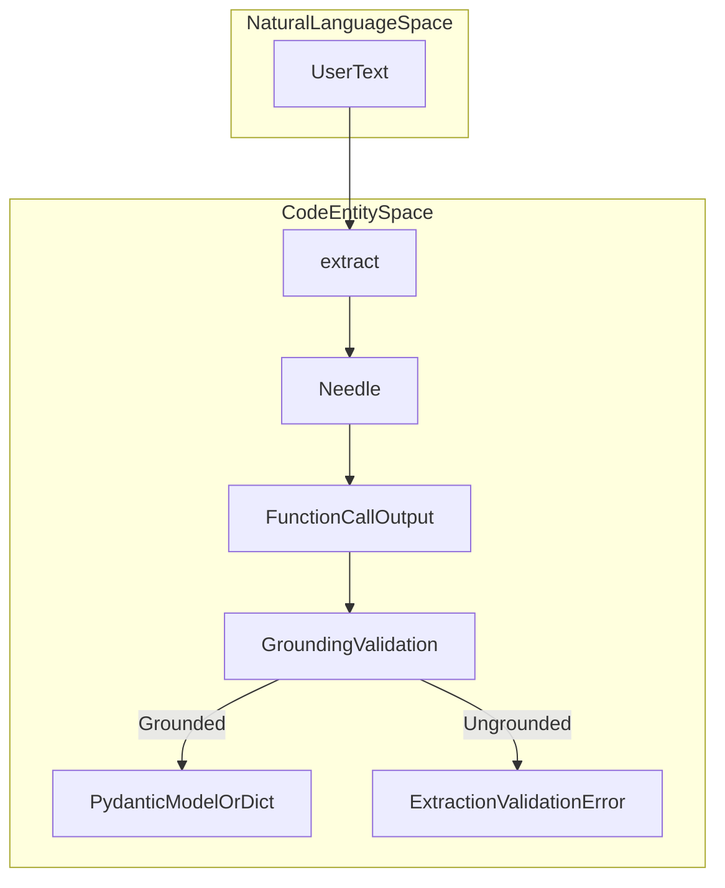

### Key Behaviors of `extract()`
- **Schema Translation**: Accepts a Pydantic model class, returning an instantiated model instance, or a raw schema/dict returning a Python dictionary [tests/test_grounding.py:47-60]().
- **Weights Inheritance**: The `weights` parameter selects a tuned `.cact` file, defaulting to whatever model weights the engine currently has loaded [needle/__init__.py:127-136]().
- **Number and Date Parsing**: Handles thousands separators in numbers and parses date fields while enforcing grounding checks [tests/test_grounding.py:137-157]().
- **Validation Errors**: Raises `ExtractionValidationError` if required fields or numbers are fabricated and fail grounding validation [needle/__init__.py:21-23](), [tests/test_grounding.py:159-171]().

Sources: `needle/__init__.py:21-23` [needle/__init__.py:21-23](), `tests/test_grounding.py:47-207` [tests/test_grounding.py:47-207]()

---

## 2. Grounding Validation Subsystem

The grounding validation subsystem inspects generated tool arguments against the input conversation and system facts to detect hallucinations or contradictions.

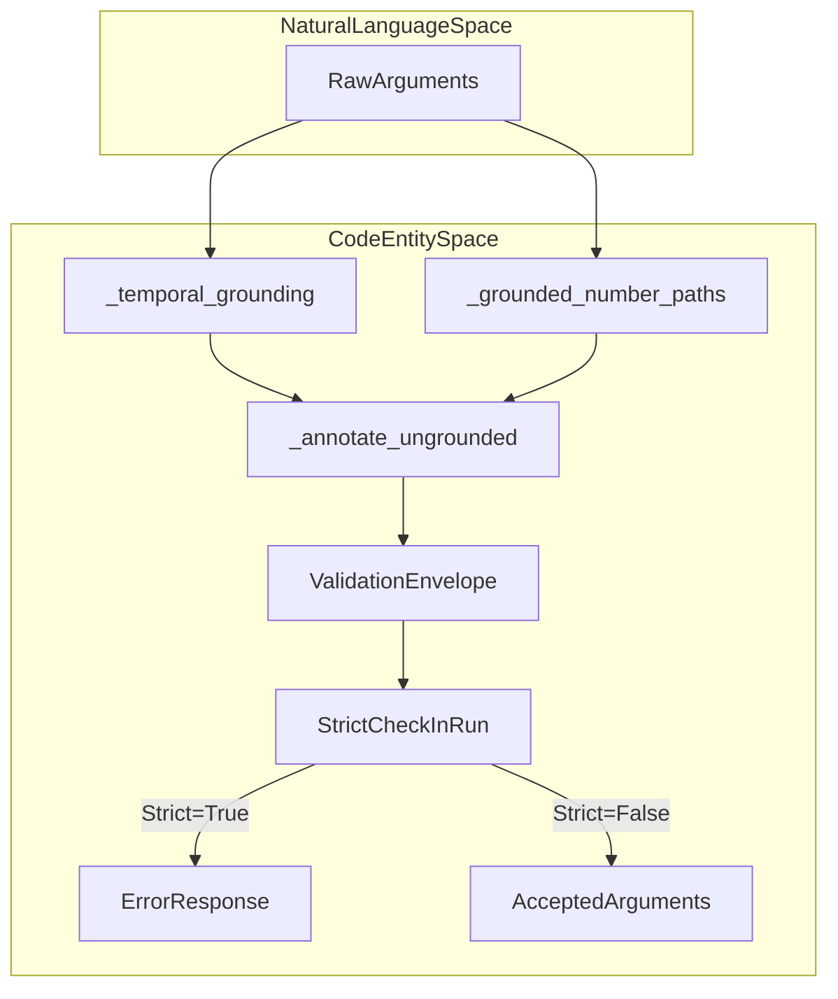

### Validation Mechanics
- **Temporal Grounding (`_temporal_grounding`)**: Flags dates in tool arguments that contradict or lack support in the input text or system context [tests/test_grounding.py:95-147](). Years lacking any mention in the text or system facts trigger ungrounded annotations [tests/test_grounding.py:95-147]().
- **Number Paths (`_grounded_number_paths`)**: Verifies that numerical values and quantities originate from substrings in the prompt [tests/test_grounding.py:175-207]().
- **Annotation (`_annotate_ungrounded`)**: Populates the `validation.ungrounded` list with dot-notation paths (e.g., `Invoice.due_date`, `set_thermostat.temperature`) [tests/test_grounding.py:75-87]().
- **Execution Policy (`strict` flag)**: During agent execution (`run()`), ungrounded calls are intercepted and returned as error objects (`{"error": "ungrounded ..."}`) unless `strict=False` is explicitly passed [tests/test_grounding.py:159-171]().

Sources: `tests/test_grounding.py:75-207` [tests/test_grounding.py:75-207]()

---

## 3. Calibrated Confidence Gating and `suppressed_calls`

The engine computes a calibrated confidence score for every prediction. When confidence falls below established thresholds or a grounding violation occurs, the execution pipeline handles the output defensively.

- **Confidence Score**: Reported as a float in `[0, 1]` under the `"confidence"` response key [tests/test_grounding.py:75-79](). Tuned weights loaded via `weights=...` emit warnings if scores are uncalibrated [needle/__init__.py:127-136]().
- **`suppressed_calls`**: When confidence drops below thresholds or the grounding gate trips, the engine withholds the function call from `function_calls` and populates `suppressed_calls` instead [tests/test_grounding.py:75-79](). Applications can present suppressed calls to users for explicit confirmation or treat the turn as a refusal.

Sources: `needle/__init__.py:127-136` [needle/__init__.py:127-136](), `tests/test_grounding.py:75-79` [tests/test_grounding.py:75-79]()

---

## 4. Test Suite Coverage (`tests/test_grounding.py`)

The grounding and extraction behaviors are verified extensively in `tests/test_grounding.py`. Key unit tests cover:
- Detecting date contradictions against input strings [tests/test_grounding.py:95-103]().
- Permitting grounded dates and relative dates anchored by system facts [tests/test_grounding.py:105-113](), [tests/test_grounding.py:173-181]().
- Enforcing `strict=True` vs `strict=False` handling during agent runs [tests/test_grounding.py:159-171]().
- Clearing thousands-separated numbers and rejecting fabricated monetary or numeric amounts during extraction [tests/test_grounding.py:137-157]().

Sources: `tests/test_grounding.py:95-207` [tests/test_grounding.py:95-207]()

---

# Page: Prebuilt Environments

# Prebuilt Environments

<details>
<summary>Relevant source files</summary>

The following files were used as context for generating this wiki page:

- [needle/environments/__init__.py](needle/environments/__init__.py)
- [needle/environments/_harness.py](needle/environments/_harness.py)
- [needle/environments/data_capture.py](needle/environments/data_capture.py)
- [needle/environments/kitchen_appliance.py](needle/environments/kitchen_appliance.py)
- [needle/environments/media_player.py](needle/environments/media_player.py)
- [needle/environments/productivity.py](needle/environments/productivity.py)
- [needle/environments/smart_home.py](needle/environments/smart_home.py)
- [needle/environments/wearable.py](needle/environments/wearable.py)
- [tests/test_environments.py](tests/test_environments.py)

</details>


## Purpose and Scope

The `needle/environments` package provides a set of hand-curated tool surfaces, system prompts, and frozen acceptance test suites designed for constrained decoding on microcontrollers and edge hardware. Each environment models a specific domain—`smart_home`, `media_player`, `productivity`, `wearable`, `kitchen_appliance`, and `data_capture`—enforcing rigorous structural rules: closed sets via `Literal` types, strictly bounded numeric ranges, verbatim text extraction, and a limit of five tools or fewer per environment.

This page details the implementation of `needle/environments`, the conventions governing `TOOLS` and `SYSTEM` definitions, the acceptance test harness (`_harness.py`), and patterns for adapting these environments to custom products.

Sources: `needle/environments/__init__.py:1-14` [needle/environments/__init__.py:1-14]()

---

## Environment Architecture and Subsystems

The `needle.environments` module acts as a dynamic registry for domain-specific agent configurations. It uses lazy module loading via `__getattr__` to avoid unnecessary initialization overhead when importing specific environments.

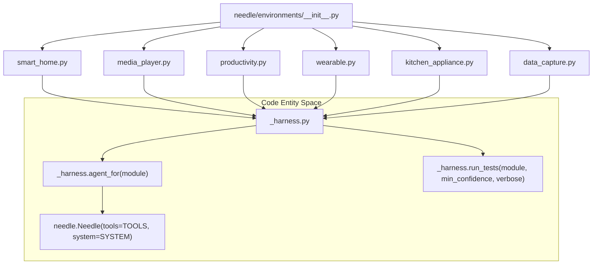
*Diagram: Architecture bridging environment modules to the shared test harness.*

Sources: `needle/environments/__init__.py:16-45` [needle/environments/__init__.py:16-45](), `needle/environments/_harness.py:8-47` [needle/environments/_harness.py:8-46]()

---

## Design Conventions: TOOLS and SYSTEM

Every prebuilt environment adheres to strict design invariants to ensure deterministic, safe constrained decoding:

1. **Tool Limit**: Environments define no more than five tools (`TOOLS = [...]`) to keep state spaces compact and fit within embedded memory constraints [tests/test_environments.py:26-28]().
2. **Closed Sets (Enums)**: Categorical choices (rooms, categories, actions) are strictly typed using `Literal` or `Enum` equivalents so the engine can restrict token generation paths [needle/environments/smart_home.py:16-16](), [needle/environments/wearable.py:14-14]().
3. **Numeric Bounds**: All numeric arguments (`int`, `float`) are annotated with explicit range constraints using `needle.Field(ge=..., le=...)` or regex patterns [needle/environments/data_capture.py:33-35]().
4. **Verbatim Copying**: System prompts explicitly instruct the model to copy strings word-for-word from user input rather than paraphrasing or resolving them [needle/environments/productivity.py:83-84]().
5. **Refusal & Ambiguity Handling**: The `SYSTEM` prompt mandates that unsupported, incomplete, ambiguous, or negated requests return zero function calls [needle/environments/kitchen_appliance.py:71-71]().

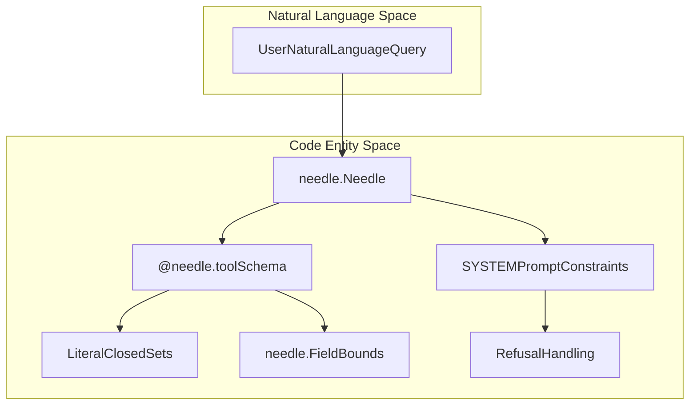
*Diagram: Bridging natural language input to code entity validation rules.*

Sources: `needle/environments/smart_home.py:1-8` [needle/environments/smart_home.py:1-8](), `needle/environments/productivity.py:83-84` [needle/environments/productivity.py:83-84]()

---

## The Acceptance Suite (`_harness.py`)

The acceptance test harness (`needle/environments/_harness.py`) runs frozen test suites against the model to verify regression resistance across six distinct query categories.

### Test Categories
Test cases (`TEST_CASES`) in each environment are categorized into:
* `positive`: Valid requests that should produce exact tool calls.
* `missing`: Requests missing required arguments or parameters (must return no calls).
* `irrelevant`: Out-of-domain requests (must return no calls).
* `negation`: Explicitly negated actions e.g. *"don't turn on the lights"* (must return no calls).
* `invalid`: Requests violating bounds or enum constraints (must return no calls).
* `parallel`: Multi-intent requests requiring multiple tool calls.

### Execution Flow (`run_tests`)

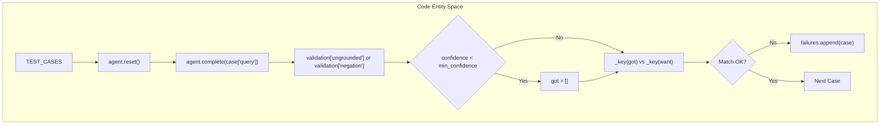
*Diagram: Execution flow and validation mapping inside _harness.py.*

The `run_tests()` function evaluates model responses against expected outputs (`want`), accounting for confidence gating and grounding validation:

```python
def run_tests(module, min_confidence=0.0, verbose=True):
    agent = agent_for(module)
    failures, critical_failures = [], []
    for case in module.TEST_CASES:
        agent.reset()
        response = agent.complete(case["query"])
        got = response.get("function_calls") or []
        validation = response.get("validation") or {}
        if got and (validation.get("ungrounded") or validation.get("negation")):
            got = []
        if got and response.get("confidence", 0.0) < min_confidence:
            got = []
        want = case["calls"]
        # Comparison logic...
```
Sources: `needle/environments/_harness.py:15-47` [needle/environments/_harness.py:15-46](), `tests/test_environments.py:8-10` [tests/test_environments.py:8-10]()

---

## Adapting Environments

To adapt a prebuilt environment (e.g., `smart_home` or `wearable`) to a custom product:
1. **Modify Literal Enums**: Replace stock rooms, sender names, or categories with the exact inventory supported by your device firmware or backend API [needle/environments/smart_home.py:16-16](), [needle/environments/wearable.py:14-14]().
2. **Preserve Structural Shapes**: Maintain the function signatures, argument types, and bounding constraints (`ge`, `le`, `pattern`). Changing parameter types can invalidate constrained decoding masks.
3. **Update Test Cases**: Adjust `TEST_CASES` to match your new domain entities while keeping the categorization (`positive`, `missing`, `negation`, etc.) intact to preserve safety coverage.
4. **Run Validation**: Execute the acceptance suite via `python -m needle.environments` or pytest (`pytest tests/test_environments.py`) to verify regressions [needle/environments/__init__.py:40-45](), [tests/test_environments.py:59-65]().

Sources: `needle/environments/__init__.py:11-14` [needle/environments/__init__.py:11-14](), `tests/test_environments.py:20-65` [tests/test_environments.py:20-65]()

---

# Page: Engine Binary and Asset Management

# Engine Binary and Asset Management

<details>
<summary>Relevant source files</summary>

The following files were used as context for generating this wiki page:

- [needle/agent/fetch.py](needle/agent/fetch.py)
- [tests/test_fetch.py](tests/test_fetch.py)

</details>


The Needle framework utilizes a high-performance C-engine for inference across both Generation 2, Generation 3 architectures, and the Whistle speech model. To ensure portability across diverse hardware architectures (CPU, GPU, Mobile, and Edge), the project employs a dynamic binary fetching and asset management mechanism implemented in `needle/agent/fetch.py`. This system handles the discovery, downloading, and extraction of platform-specific shared libraries (`.so`, `.dylib`, `.dll`), base model weights (`.cact`), training checkpoints (`.safetensors`), and standalone binaries from Hugging Face.

Sources: [needle/agent/fetch.py:1-44]()

## Platform and Library Identification

Needle identifies the host environment using a combination of `sys.platform` and `platform.machine()` to generate a platform tag compatible with Python wheel naming conventions.

*   **`_platform_tag()`**: Determines the specific architecture and OS string. It handles logic for `macosx` (arm64/x86_64), `win` (amd64/arm64), and `linux`. For Linux, it distinguishes between standard `manylinux2014` and `musl` environments via `_is_musl()` [needle/agent/fetch.py:104-114]().
*   **`_is_musl()`**: Detects if the system uses the musl libc (common in Alpine Linux) by inspecting `/proc/self/maps` and checking for dynamic linker paths [needle/agent/fetch.py:76-102]().
*   **`_lib_name()` / `_lib_name_for(tag)`**: Returns the appropriate file extension for the engine library based on the detected platform: `.dylib` for macOS, `.dll` for Windows, and `.so` for others [needle/agent/fetch.py:46-60]().

### Supported Platforms
The `PLATFORMS` tuple defines target environments supported by the engine, ranging from standard desktop operating systems to mobile (Android/iOS), RISC-V, and WebAssembly [needle/agent/fetch.py:39-43]().

```python
PLATFORMS = ("macos-arm64", "linux-x86_64", "linux-arm64", "linux-armv7",
             "linux-riscv64", "linux-mipsel", "windows-x86_64", "windows-arm64",
             "android-arm64", "android-armv7", "android-riscv64",
             "ios-arm64", "ios-sim-arm64", "tvos-arm64", "watchos-arm64", "wasm",
             "wasm-component")
```

Sources: [needle/agent/fetch.py:39-114]()

## Generations and Whistle Repositories

Needle manages multiple asset types across different Hugging Face repositories depending on the generation requested or whether a standalone model like Whistle is targeted [needle/agent/fetch.py:9-26]().

*   **`ENGINE_REPOS`**: Maps generation versions and component names (such as `2`, `3`, and `WHISTLE`) to their respective Hugging Face repositories (`Cactus-Compute/needle2`, `Cactus-Compute/needle3`, and `Cactus-Compute/whistle`) [needle/agent/fetch.py:9-13]().
*   **`ENGINE_VERSIONS`**: Defines pinned release versions for each generation and component [needle/agent/fetch.py:14-18]().
*   **`WEIGHTS_ONLY`**: Designates components that do not have their own separate C-engine binary but run on the shared engine (e.g., `whistle`) [needle/agent/fetch.py:25-26]().

Sources: [needle/agent/fetch.py:9-26]()

## Binary and Asset Retrieval Functions

Needle provides programmatic helpers to fetch binaries, base weights, and checkpoints from Hugging Face Hub [needle/agent/fetch.py:132-199]().

### Library Fetching (`fetch_library`)
The `fetch_library()` function downloads a specific version of the engine packaged within a Python wheel. It constructs the wheel filename using the engine version and platform tag, downloads it via `hf_hub_download`, extracts the binary using `zipfile.ZipFile`, and saves it to the designated directory [needle/agent/fetch.py:126-128](), [tests/test_fetch.py:151-165]().

### Base Weights and Checkpoints (`fetch_weights`, `fetch_checkpoint`)
*   **`fetch_weights()`**: Downloads the base `.cact` archive for a given generation (e.g., `needle2.cact`, `needle3.cact`, or `whistle.cact`) into the local cache directory.
*   **`fetch_checkpoint()`**: Downloads a training checkpoint (such as `.safetensors` files) for fine-tuning or building, checking both the root and the `checkpoints/` prefix folder in the remote repository [tests/test_fetch.py:67-83]().

### Standalone Platform Bundling (`download_platform`)
For non-Python environments or CLI deployment, `download_platform()` retrieves all files associated with a specific platform folder from the model repository and copies them to the destination directory [needle/agent/fetch.py:182-199]().

Sources: [needle/agent/fetch.py:132-199](), [tests/test_fetch.py:47-83]()

## Cache Layout and Environment Overrides

Needle maintains a structured local cache directory under the user home directory:

```text
~/.cache/cactus-needle/
├── v2/
│   └── 2.0.4/
│       ├── libneedle.dylib (or .so / .dll)
│       └── needle2.cact
├── v3/
│   └── 3.2.0/
│       ├── libneedle.so
│       └── needle3.cact
└── whistle/
    └── 2.0.0/
        └── whistle.cact
```

### Environment Overrides
Runtime loading logic respects explicit environment variable overrides to bypass or customize library paths:
*   `NEEDLE_LIB_PATH`: Overrides the library path for generic or v2 engines [tests/test_fetch.py:5-12]().
*   `NEEDLE3_LIB_PATH`: Generation 3 specific override [tests/test_fetch.py:14-32]().

Sources: [tests/test_fetch.py:5-32]()

## Data Flow: Platform Detection to Binary Load

The following diagram bridges natural language intent to code entities during binary resolution and fetching.

**Diagram: Binary Resolution and Fetch Logic**
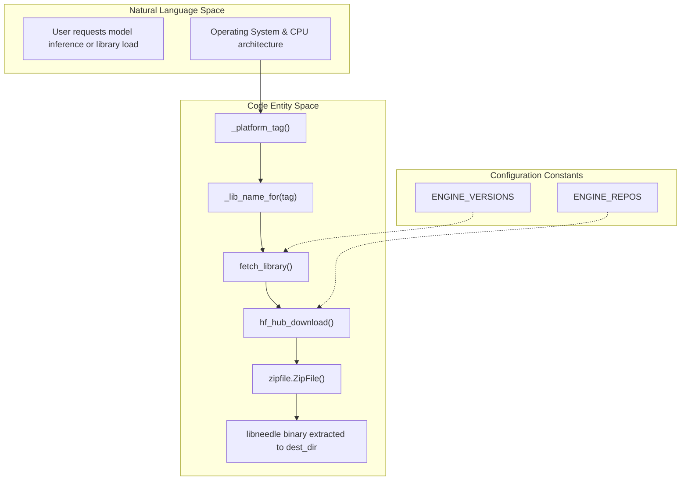

Sources: [needle/agent/fetch.py:46-114](), [needle/agent/fetch.py:182-199]()

## Data Flow: Asset Routing and Model Fetching

The following diagram illustrates how asset specifications map to repository configurations and retrieval functions.

**Diagram: Asset Retrieval Routing**
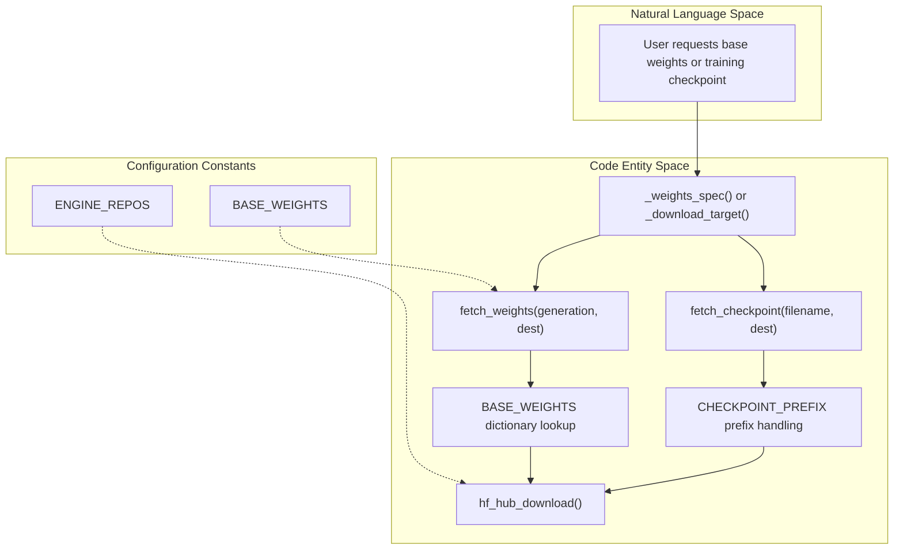

Sources: [needle/agent/fetch.py:9-24](), [tests/test_fetch.py:34-83]()

---

# Page: Fine-Tune Worker Subprocess

# Fine-Tune Worker Subprocess

<details>
<summary>Relevant source files</summary>

The following files were used as context for generating this wiki page:

- [needle/_worker.py](needle/_worker.py)
- [tests/test_weights.py](tests/test_weights.py)
- [tests/test_worker.py](tests/test_worker.py)

</details>


## Purpose and Scope
This page details the implementation of the fine-tune worker subprocess protocol in `needle/_worker.py`. The `FineTuneWorker` class and associated helper functions isolate fine-tuned weight execution (`.cact` checkpoints) in a separate operating system process. This process isolation prevents memory fragmentation, avoids conflicts between different fine-tuned weight sets, and safely manages the lifecycle of dynamically loaded native libraries via `ctypes`.

Sources: [needle/_worker.py:1-286]()

---

## Subprocess Communication Protocol
Communication between the parent Python process and the child worker subprocess occurs over standard input and output streams using a length-prefixed JSON messaging protocol. 

The protocol header consists of an 8-byte big-endian unsigned integer representing the byte length of the following JSON payload, defined by `_HEADER = struct.Struct("!Q")` [needle/_worker.py:13-13]().

- `_read_exact(stream, size)`: Reads an exact number of bytes from the stream, raising an `EOFError` if the stream truncates prematurely [needle/_worker.py:17-29]().
- `_read_message(stream)`: Unpacks the 8-byte header to determine payload size, reads the payload, and decodes it from UTF-8 JSON into a Python dictionary [needle/_worker.py:31-40]().
- `_write_message(stream, message)`: Serializes a Python dictionary to a compact UTF-8 JSON string, packs its length into an 8-byte header, and writes both to the stream followed by a flush [needle/_worker.py:42-48]().

Title: Protocol Messaging Data Flow
```mermaid
graph TD
    ParentProcess["ParentProcess"] -->|_write_message| Pipe["subprocess.PIPE"]
    Pipe -->|_read_message| ChildProcess["_child"]
    ChildProcess -->|_read_exact| Exact["_read_exact"]

    Sources: [needle/_worker.py:13-48]
```

Sources: [needle/_worker.py:13-48](), [tests/test_worker.py:13-20]()

---

## Child Process Initialization and Library Loading
When a worker starts, the child process entrypoint `_child()` reads an initial configuration dictionary containing library paths, weight file paths, system prompts, tool declarations, and buffer sizes [needle/_worker.py:69-91]().

The shared library is loaded using `_load_library(path, generation)` [needle/_worker.py:50-66](), which configures `ctypes.CDLL` function signatures and return types for the underlying engine API:
- `needle_load`: Loads weight buffers into memory [needle/_worker.py:64-65]().
- `needle_init`: Initializes system prompts and tool contexts [needle/_worker.py:52-54]().
- `needle_complete`: Executes token generation [needle/_worker.py:55-57]().
- `needle_embed`: Computes text embeddings (required for generation $\ge 3$) [needle/_worker.py:58-61]().
- `needle_reset`: Resets engine state [needle/_worker.py:62-63]().

Title: Child Process Lifecycle and Native Library Binding
```mermaid
graph TD
    Entry["_child"] --> ReadConfig["_read_message"]
    ReadConfig --> LoadLib["_load_library"]
    LoadLib --> LoadWeights["needle_load"]
    LoadWeights --> InitEngine["needle_init"]
    InitEngine --> Ready["_write_message status ready"]

    Sources: [needle/_worker.py:69-91]
```

Sources: [needle/_worker.py:50-91]()

---

## FineTuneWorker Class Architecture
The `FineTuneWorker` class manages the lifecycle of the subprocess and exposes synchronous Python methods (`complete`, `embed`, `reset`, `close`) that map to asynchronous worker messages [needle/_worker.py:163-286]().

- **Initialization**: Spawns `sys.executable` running `_worker.py --child` with piped stdin and stdout [needle/_worker.py:169-174](). Sends the startup configuration payload [needle/_worker.py:176-184]().
- **Reader Thread**: A background daemon thread (`_reader`) continuously reads incoming messages from the child process and routes them to completion futures or response queues [needle/_worker.py:172-174]().
- **Thread Safety**: Uses a `threading.Lock()` (`self._lock`) to serialize requests sent to the subprocess [needle/_worker.py:166-166]().

Title: FineTuneWorker Subprocess Architecture and Thread Routing
```mermaid
graph TD
    subgraph FineTuneWorkerClass ["FineTuneWorker"]
        CompleteCall["complete"] --> SendMsg["_send"]
        SendMsg --> StdinPipe["subprocess.PIPE stdin"]
    end
    StdinPipe --> ChildProc["Child Subprocess"]
    ChildProc --> StdoutPipe["subprocess.PIPE stdout"]
    StdoutPipe --> ReaderThread["_read_messages Thread"]
    ReaderThread --> ResponseQueue["Response Queue"]
    ResponseQueue --> CompleteCall

    Sources: [needle/_worker.py:163-184]
```

Sources: [needle/_worker.py:163-286]()

---

## Needle Routing and Execution
The Needle agent uses `FineTuneWorker` selectively based on whether custom fine-tuned weights (`weights=...`) are supplied [tests/test_weights.py:103-117](). 

- **Base Models**: Generation 3 base models without custom weights load directly into the primary process memory space, avoiding IPC overhead [tests/test_weights.py:103-117]().
- **Tuned Models**: When a weights path is specified, Needle instantiates a `FineTuneWorker` instance, routing all `complete`, `embed`, and `reset` calls through the length-prefixed JSON protocol to the isolated child process [tests/test_weights.py:137-202]().

Title: Needle Agent Execution Routing
```mermaid
graph TD
    NeedleComplete["Needle.complete"] --> CheckWeights{"agent._weights is None?"}
    CheckWeights -->|Yes| InProcess["In-Process Engine Execution"]
    CheckWeights -->|No| WorkerComplete["FineTuneWorker.complete"]
    WorkerComplete --> WriteMsg["_write_message JSON"]
    WriteMsg --> NativeCall["Child Process native call"]

    Sources: [tests/test_weights.py:103-117], [tests/test_weights.py:137-169]
```

Sources: [tests/test_weights.py:103-202](), [tests/test_worker.py:96-118]()

---

# Page: Whistle Speech-to-Text

# Whistle Speech-to-Text

<details>
<summary>Relevant source files</summary>

The following files were used as context for generating this wiki page:

- [README.md](README.md)
- [needle/agent/whistle.py](needle/agent/whistle.py)
- [tests/test_whistle.py](tests/test_whistle.py)

</details>


## Purpose and Scope

Whistle is a lightweight 16.9 MB speech-to-text model designed for efficient local execution [README.md:47-51](). It supports audio transcription in English, German, French, Spanish, Italian, Dutch, and Polish [needle/agent/whistle.py:15](). Crucially, Whistle shares the exact same `.cact` weight container format, memory mapping conventions, and C++ FFI engine runtime as Needle [README.md:51](). This integration allows systems to process audio input directly into tool executions within a single unified runtime [README.md:8, README.md:72]().

This page serves as a parent overview. For in-depth API specifications, see [Whistle API: transcribe, stream, Whistle](#3.1). For command-line tooling, extras configuration, and benchmark verification, see [Whistle CLI and Benchmarks](#3.2).

Sources: [README.md:47-72](), [needle/agent/whistle.py:14-15]()

---

## Architecture and Engine Integration

Whistle leverages the same foundational C++ runtime (`needle_load`, `needle_transcribe`, and `needle_embed`) as Needle [needle/agent/whistle.py:35-46](). Audio streams or files are decoded into 16 kHz mono float arrays via helper functions (`_read_wav`, `_samples`) and passed across the FFI boundary [needle/agent/whistle.py:53-96]().

```mermaid
graph TD
    AudioInput["Audio Input (WAV/PCM/Stream)"] --> ReadWav["_read_wav & _samples [needle/agent/whistle.py:53-96]"]
    ReadWav --> WhistleClass["Whistle Class [needle/agent/whistle.py:98-121]"]
    WhistleClass --> FFI["C++ FFI Bridge [needle/agent/whistle.py:35-46]"]
    FFI --> LoadEngine["needle_load [needle/agent/whistle.py:35]"]
    FFI --> TranscribeEngine["needle_transcribe / needle_embed [needle/agent/whistle.py:37-46]"]
    TranscribeEngine --> ResultJSON["JSON Response Dict [needle/agent/whistle.py:123-127]"]
```
Sources: [needle/agent/whistle.py:35-127]()

---

## 3.1 Whistle API

The Python API exposes Whistle via the `Whistle` class and module-level conveniences like `needle.transcribe()` and `needle.stream()` [README.md:56-60](). The backend handles automatic WAV resampling via `soxr`, buffer sizing, and weight resolution [needle/agent/whistle.py:21-75]().

Features include:
- Single-pass transcription with confidence scores and timestamps [needle/agent/whistle.py:128-137]().
- Real-time chunked streaming via generator patterns [needle/agent/whistle.py:139-156]().
- Keyword biasing and language enforcement [needle/agent/whistle.py:135]().
- Audio embedding extraction (`embed()`) for local vector search [README.md:7(), needle/agent/whistle.py:158-163]().

For complete implementation details, parameters, and buffer management, see [Whistle API: transcribe, stream, Whistle](#3.1).

Sources: [README.md:56-60](), [needle/agent/whistle.py:21-163]()

---

## 3.2 Whistle CLI and Benchmarks

Whistle includes standalone CLI subcommands for interactive playground use (`needle whistle playground`) and baseline comparisons against models like Whisper and Moonshine (`needle whistle compare`) [README.md:60](). 

To support live audio capture and performance evaluations, optional dependencies (`sounddevice`, `soxr`, `openai-whisper`, `moonshine`) can be installed via package extras [README.md:60](). Comprehensive test coverage is maintained in `tests/test_whistle.py` [tests/test_whistle.py:1-177]().

```mermaid
graph TD
    CLI["needle whistle CLI [README.md:60]"] --> Playground["needle whistle playground [README.md:60]"]
    CLI --> Compare["needle whistle compare [README.md:60]"]
    Playground --> Sounddevice["sounddevice / mic capture [README.md:60]"]
    Compare --> ExternalModels["openai-whisper & moonshine [README.md:60]"]
    TestFile["tests/test_whistle.py [tests/test_whistle.py:1-177]"] --> TestExec["pytest verification [tests/test_whistle.py:136-177]"]
```
Sources: [README.md:60](), [tests/test_whistle.py:1-177]()

For complete setup instructions and benchmark configurations, see [Whistle CLI and Benchmarks](#3.2).

---

# Page: Whistle API: transcribe, stream, Whistle

# Whistle API: transcribe, stream, Whistle

<details>
<summary>Relevant source files</summary>

The following files were used as context for generating this wiki page:

- [needle/agent/fetch.py](needle/agent/fetch.py)
- [needle/agent/whistle.py](needle/agent/whistle.py)
- [tests/test_whistle.py](tests/test_whistle.py)

</details>


## Purpose and Scope

This page documents the Whistle speech-to-text API implemented in `needle/agent/whistle.py` [needle/agent/whistle.py:1-163]() and asset management in `needle/agent/fetch.py` [needle/agent/fetch.py:1-291](). Whistle shares the core Needle engine architecture and `.cact` container framework while providing specialized audio transcription, streaming inference, embedding extraction, language detection, keyword biasing, and word-level timestamps.

Sources: [needle/agent/whistle.py:1-163](), [needle/agent/fetch.py:1-51]()

---

## The `Whistle` Class and FFI Binding

The primary entry point for speech processing is the `Whistle` class [needle/agent/whistle.py:98-103](). It manages model weight loading, memory buffers for FFI communication, and foreign function interface (FFI) calls to the underlying compiled engine library via ctypes [needle/agent/whistle.py:105-121]().

```
+-------------------------------------------------------------------------+
|                  Natural Language Space (Audio & Text)                  |
|   User Speech / WAV Files / Float Samples -> Language/Keywords Tuning   |
+-------------------------------------------------------------------------+
                                     |
                                     v
+-------------------------------------------------------------------------+
|                        Code Entity Space                                |
|   Whistle.transcribe() -> _samples() -> _bind() -> _lib().needle_...   |
+-------------------------------------------------------------------------+
```
*Diagram 1: Natural Language to Code Entity Mapping for Whistle*

Sources: [needle/agent/whistle.py:98-122]()

The FFI loader `_lib()` [needle/agent/whistle.py:28-51]() loads generation 3 binaries and configures argument and return types (`argtypes` and `restype`) for engine primitives including `needle_load`, `needle_transcribe`, `needle_stream_transcribe_process`, `needle_stream_transcribe_stop`, `needle_embed`, and `needle_last_error`.

Sources: [needle/agent/whistle.py:28-51]()

---

## Audio Decoding, Resampling, and Input Normalization

Whistle accepts audio as a path to a WAV file, raw bytes, Python lists, arrays, or NumPy arrays [needle/agent/whistle.py:83-96](). Audio input is normalized to 16 kHz mono float samples in the range `[-1, 1]`, with a maximum duration limit of 30 seconds [needle/agent/whistle.py:98-103]().

```
+-------------------------------------------------------------+
|                     Audio Input Sources                     |
|  (WAV File Path / NumPy Array / Float List / Raw Bytes)     |
+-------------------------------------------------------------+
                               |
                               v
+-------------------------------------------------------------+
|                 _read_wav() / _samples()                    |
|    - Channel mixing & bit depth parsing (8, 16, 24, 32-bit) |
|    - soxr resampling to 16 kHz sample rate                  |
+-------------------------------------------------------------+
                               |
                               v
+-------------------------------------------------------------+
|               ctypes.c_float Buffer Mapping                 |
|         Passes contiguous float32 pointer to FFI            |
+-------------------------------------------------------------+
```
*Diagram 2: Audio Ingestion and Normalization Pipeline*

### Waveform Processing Details
- **WAV Decoding (`_read_wav`)**: Opens WAV files, extracts channels, sample width, and frame rates [needle/agent/whistle.py:53-56](). Supports 24-bit integer packing as well as standard byte arrays with byte-order adjustments [needle/agent/whistle.py:57-63]().
- **Resampling**: If the input sample rate differs from `SAMPLE_RATE` (16000 Hz), it leverages the `soxr` library (via `cactus-needle[mic]` extra) to perform high-quality resampling [needle/agent/whistle.py:67-74]().
- **Buffer Formatting (`_samples`)**: Converts diverse iterable and array formats into contiguous `ctypes.c_float` buffers suitable for direct FFI memory passing [needle/agent/whistle.py:83-96]().

Sources: [needle/agent/whistle.py:14-96]()

---

## Transcription (`transcribe()`) and Streaming (`stream()`)

Whistle supports both batch transcription and live streaming inference models.

```
+-----------------------+
|  Whistle.transcribe() |
+-----------------------+
           |
           v
+-----------------------+      +---------------------------+
| _bind() & _samples()  | ---> | lib.needle_transcribe()   |
+-----------------------+      +---------------------------+
                                            |
                                            v
                               +---------------------------+
                               |  JSON Result via Buffer   |
                               |  {"text", "language",     |
                               |   "words", "ttft_ms",     |
                               |   "decode_tps"}           |
                               +---------------------------+
```
Sources: [needle/agent/whistle.py:128-138]()

### Key Methods
- **`transcribe(audio, language=None, keywords=None, word_timestamps=False)`**: Executes batch transcription. Returns a dictionary containing `"text"`, `"language"`, `"ttft_ms"`, `"decode_tps"`, and optionally `"words"` (with `start`, `end`, and `probability` fields when `word_timestamps=True`) [needle/agent/whistle.py:128-138](). `language` must be one of `LANGUAGES` (`en`, `de`, `fr`, `es`, `it`, `nl`, `pl`) or `None` for auto-detection [needle/agent/whistle.py:15-132](). `keywords` enables phrase biasing [needle/agent/whistle.py:77-80]().
- **`stream(chunks, language=None, keywords=None)`**: Provides live, incremental transcription over streaming audio chunks (~1 second each). Yields intermediate dictionaries per chunk containing committed text, unconfirmed pending tails, language, and processing latency (`pass_ms`), concluding with a tail result upon completion [needle/agent/whistle.py:139-157]().

Sources: [needle/agent/whistle.py:14-16(), 128-157]()

---

## Embeddings and Model Weights Management

Whistle model weights (`whistle.cact`) are managed separately from core text LLM weights, hosted under the `Cactus-Compute/whistle` repository [needle/agent/fetch.py:7-26]().

### Embeddings (`embed()`)
The `embed(audio)` method invokes the encoder network via `lib.needle_embed()` to extract continuous representations, returning one row of floats per 80 ms audio frame in a flattened list [needle/agent/whistle.py:158-163]().

### Asset Retrieval
Weights are resolved via `_weights_path()`, checking environment overrides (`NEEDLE_WHISTLE_WEIGHTS`) before falling back to the local agent cache directory for `fetch.WHISTLE` [needle/agent/whistle.py:21-26](), [needle/agent/fetch.py:7-26]().

Sources: [needle/agent/whistle.py:21-26, 158-163](), [needle/agent/fetch.py:7-26]()

---

# Page: Whistle CLI and Benchmarks

# Whistle CLI and Benchmarks

<details>
<summary>Relevant source files</summary>

The following files were used as context for generating this wiki page:

- [assets/deploy.svg](assets/deploy.svg)
- [assets/whistle-benchmarks.svg](assets/whistle-benchmarks.svg)
- [assets/whistle.svg](assets/whistle.svg)
- [needle/agent/whistle.py](needle/agent/whistle.py)
- [needle/cli.py](needle/cli.py)
- [tests/test_whistle.py](tests/test_whistle.py)

</details>


This page details the command-line interface subcommands, optional integration extras, benchmark visualizations, and test coverage for the Whistle speech-to-text subsystem within the `cactus-needle` codebase. Whistle shares the core `.cact` container layout and execution engine with Needle text models while providing specialized speech transcription and embedding capabilities [needle/agent/whistle.py:98-103]().

---

## 1. Whistle CLI Subcommands (`playground` and `compare`)

The `needle whistle` command group exposes interactive utilities for testing speech recognition and comparing outputs against external speech-to-text providers [needle/cli.py:17-18](). It provides two primary subcommands:
- `playground`: Launches an interactive session (or local web service) allowing users to record from a microphone or test audio files against the loaded Whistle model.
- `compare`: Evaluates Whistle performance against external libraries such as OpenAI Whisper or Moonshine using benchmark audio assets.

The following diagram maps the natural language command concepts to their corresponding execution modules and entry points within the codebase.

```mermaid
graph TD
    CLI["CLIEntrypoint needle/cli.py"] -->|Dispatches| WhistleCmd["WhistleCommand needle/cli.py"]
    WhistleCmd -->|Subcommand playground| Play["PlaygroundServer needle/agent/whistle.py"]
    WhistleCmd -->|Subcommand compare| Comp["CompareRunner needle/agent/whistle.py"]
    Play -->|Calls| WhistleEngine["WhistleClass needle/agent/whistle.py"]
    Comp -->|Evaluates| ExtModels["ExternalSpeechModels openai-whisper/moonshine"]
    WhistleEngine -->|Invokes FFI| CdllEngine["CdllLoader needle/_load_cdll"]

    classDef default fill:#141416,stroke:#232326,stroke-width:1,color:#e8e6df;
```
*Figure 1: Whistle CLI routing from CLI invocation to execution components.*

Sources: `[needle/cli.py:17-18](), [needle/agent/whistle.py:98-103]()`

---

## 2. Microphone and Comparison Extras

Whistle relies on optional python packages to handle raw audio input devices and high-fidelity waveform resampling. These are bundled under optional dependency extras in `pyproject.toml` (specifically `[mic]` and `[compare]`).

### Resampling and Audio Ingestion
Audio ingestion is handled by `_read_wav()` and `_samples()` in `needle/agent/whistle.py` [needle/agent/whistle.py:53-96](). When input files do not match Whistle's native sample rate (`16000` Hz), the library dynamically imports `numpy` and `soxr` to perform high-quality sample-rate conversion [needle/agent/whistle.py:67-75](). If `soxr` is missing when non-16kHz audio is processed, a `RuntimeError` instructs the user to install the appropriate extra:

```python
raise RuntimeError(f"resampling {rate} Hz audio to {SAMPLE_RATE} Hz needs soxr: pip install cactus-needle[mic]")
```
[needle/agent/whistle.py:73-73]()

The following diagram details the audio processing pipeline from raw files or live microphone buffers to float vectors passed through the C-types foreign function interface.

```mermaid
graph TD
    RawAudio["RawAudioInput file/mic/bytes"] --> CheckRate["CheckSampleRate needle/agent/whistle.py"]
    CheckRate -->|Needs Resampling| Soxr["SoxrResample soxr.resample"]
    CheckRate -->|Native 16kHz| Pass["PassThroughBuffer"]
    Soxr --> FloatNorm["FloatNormalization needle/agent/whistle.py"]
    Pass --> FloatNorm
    FloatNorm --> CtypesBuffer["CtypesCFloatBuffer ctypes.POINTER"]
    CtypesBuffer --> FFI["WhistleFFI needle_transcribe"]

    classDef default fill:#141416,stroke:#232326,stroke-width:1,color:#e8e6df;
```
*Figure 2: Audio ingestion and preprocessing pipeline.*

Sources: `[needle/agent/whistle.py:53-96]()`

---

## 3. Benchmark Assets and Performance

Whistle's accuracy, model footprint, and inference speed are evaluated against alternative edge models like Whisper (tiny/base) and Moonshine tiny v2. These evaluations are serialized into visual artifacts such as `assets/whistle-benchmarks.svg` and `assets/whistle.svg` [assets/whistle-benchmarks.svg:1-6]().

The asset pipeline visualizes metrics across three axes:
1. **Word Error Rate (WER)** on standardized evaluation corpora.
2. **Model Storage Size** (megabytes required on disk for weights and engine runtime).
3. **Real-Time Factor (RTF)** or tokens-per-second decoding throughput.

Sources: `[assets/whistle-benchmarks.svg:1-6](), [assets/whistle.svg:1-6]()`

---

## 4. Test Coverage (`tests/test_whistle.py`)

The Whistle test suite (`tests/test_whistle.py`) validates audio manipulation utilities, weight routing, model loading behavior, and edge-case error handling [tests/test_whistle.py:1-177]().

### Key Test Cases
- **`test_speech_weights_come_from_their_own_repo`**: Verifies that Whistle weights are fetched independently from the core Needle text weights using the `fetch.WHISTLE` identifier pointing to `Cactus-Compute/whistle` [tests/test_whistle.py:33-55]().
- **`test_wav_files_become_16k_mono_floats`**: Parameterizes tests across multiple sample rates (`16000`, `8000`, `44100`, etc.), channels, and bit-widths to ensure WAV files correctly normalize to 16 kHz mono float arrays in $[-1, 1]$ [tests/test_whistle.py:108-121]().
- **`test_samples_accept_lists_arrays_and_float32_bytes`**: Ensures input audio normalization handles Python lists, `array.array` instances, raw float32 byte buffers, and numpy arrays seamlessly [tests/test_whistle.py:123-134]().
- **`test_embed_and_the_30_second_limit`**: Asserts that `Whistle.embed()` correctly extracts frame embeddings and that audio sequences exceeding 30 seconds raise a `RuntimeError` matching `"30 s"` [tests/test_whistle.py:164-172]().

Sources: `[tests/test_whistle.py:1-177]()`

---

# Page: Model Architecture

# Model Architecture

<details>
<summary>Relevant source files</summary>

The following files were used as context for generating this wiki page:

- [needle/model/__init__.py](needle/model/__init__.py)
- [needle/model/architecture.py](needle/model/architecture.py)
- [needle/model/export.py](needle/model/export.py)
- [needle/model/quantize.py](needle/model/quantize.py)
- [needle/model/tokenizer.py](needle/model/tokenizer.py)

</details>


The purpose of this page is to provide a high-level overview of the Simple Attention Network (SAN) design, its configuration, and its major supporting subsystems. For deep technical details, refer to the child pages covering architecture, inference, quantization/export, tokenizer, and checkpoints.

## System Overview

The following diagram illustrates the relationship between natural language inputs and the core code entities defined in the model implementation.

### Natural Language to Code Entity Mapping
```mermaid
graph TD
    subgraph "Natural Language Space"
        Input["UserPromptAndSystemInstructions"]
        Tools["ToolSchemasJSON"]
        Output["JSONToolCallOrTextResponse"]
    end

    subgraph "Code Entity Space"
        SAN["SimpleAttentionNetwork"]
        TConfig["TransformerConfig"]
        MHA["MultiHeadAttention"]
        HMLP["HadamardMLP"]
        Engram["EngramMemory"]
        MHC["MultiLaneHyperConnections"]
    end

    Input --> SAN
    Tools --> SAN
    TConfig --> SAN
    SAN --> MHA
    SAN --> HMLP
    SAN --> Engram
    SAN --> MHC
    MHA --> Output
    HMLP --> Output
```
**Sources:** [needle/model/architecture.py:41-81]()

---

## Core Architecture Components

### SAN Architecture
The `SimpleAttentionNetwork` utilizes `ZCRMSNorm` for zero-centered root mean square normalization [needle/model/architecture.py:28-37](). The configuration class `TransformerConfig` controls structural parameters including attention heads, hidden dimensions, layer depths, and quantization bits [needle/model/architecture.py:41-81](). It incorporates Grouped Query Attention (GQA) with rotary positional embeddings, Hadamard MLPs, Engram key-value memory, and multi-lane hyper-connections (`mhc_lanes`) routed via Sinkhorn iteration.

For details, see [SAN Architecture](#4.1).

**Sources:** [needle/model/architecture.py:28-81]()

### Inference and Generation
Inference execution relies on `load_checkpoint` routines and JIT-compiled decoding loops managed via `generate()` [needle/model/run.py:1-50]() (see [Inference and Generation](#4.2)). Buffers maintain fixed-size contexts for efficient tool usage and token generation.

For details, see [Inference and Generation](#4.2).

**Sources:** [needle/model/run.py:1-50]()

---

## Data Serialization and Precision

The model converts training parameters into deployment formats via dedicated quantization and export pipelines.

### Training to Deployment Pipeline
```mermaid
graph LR
    subgraph "Training Space"
        P["TransformerConfig"]
        Q["fake_quant_act"]
    end

    subgraph "Serialization Space"
        E["write_export"]
        C["CactusCactBlob"]
    end

    subgraph "Inference Space"
        B["SANTokenizer"]
    end

    P --> Q
    Q --> E
    E --> C
    C --> B
```
**Sources:** [needle/model/export.py:1-94](), [needle/model/quantize.py:17-34]()

### Quantization and .cact Export
Model compression is performed using Cactus Quants (CQ) and Lloyd-Max codebooks via `cq_quantize` and `fake_quant` [needle/model/quantize.py:17-30](). The export process generates a layer-major `.cact` binary containing a fixed header, tensor directory, and weights [needle/model/export.py:1-51]().

For details, see [Quantization and .cact Export](#4.3).

**Sources:** [needle/model/quantize.py:17-59](), [needle/model/export.py:1-94]()

### Tokenizer and Special Tokens
Text tokenization is managed by `SANTokenizer`, wrapping a SentencePiece processor to handle special vocabulary tokens, chat markers, and tool boundaries (`<tools>`, `<tool_call>`, etc.) [needle/model/tokenizer.py:28-92](). `get_tokenizer()` handles automatic asset retrieval [needle/model/tokenizer.py:113-130]().

For details, see [Tokenizer and Special Tokens](#4.4).

**Sources:** [needle/model/tokenizer.py:28-130]()

### Checkpoint Formats
Checkpoints support serialization through pickle and safetensors formats, parameter tree flattening and unflattening utilities, and adapter read/write operations for LoRA components [needle/model/checkpoints.py:1-50]().

For details, see [Checkpoint Formats](#4.5).

**Sources:** [needle/model/checkpoints.py:1-50]()

---

## Architecture Design Summary

| Feature | Implementation | Code Symbol / Module |
| :--- | :--- | :--- |
| **Normalization** | Zero-Centered RMSNorm | `ZCRMSNorm` [needle/model/architecture.py:28-37]() |
| **Configuration** | Dataclass Spec | `TransformerConfig` [needle/model/architecture.py:41-81]() |
| **Quantization** | Lloyd-Max / CQ-STE | `cq_quantize`, `fake_quant` [needle/model/quantize.py:17-30]() |
| **Export Format** | Layer-Major Binary | `write_export` [needle/model/export.py:1-51]() |
| **Tokenization** | SentencePiece Wrapper | `SANTokenizer` [needle/model/tokenizer.py:43-92]() |

**Sources:** [needle/model/architecture.py:28-81](), [needle/model/quantize.py:17-30](), [needle/model/export.py:1-51](), [needle/model/tokenizer.py:43-92]()

---

# Page: SAN Architecture

# SAN Architecture

<details>
<summary>Relevant source files</summary>

The following files were used as context for generating this wiki page:

- [needle/model/architecture.py](needle/model/architecture.py)
- [needle/model/export.py](needle/model/export.py)
- [needle/model/quantize.py](needle/model/quantize.py)
- [needle/model/tokenizer.py](needle/model/tokenizer.py)

</details>


The Simple Attention Network (SAN) architecture implemented in `needle/model/architecture.py` is a compact transformer design optimized for device-side inference, structured extraction, and rapid tool-calling [needle/model/architecture.py:1-193](). It maximizes parameter efficiency through zero-centred RMS normalization, grouped-query attention with optional depthwise convolutional taps and rotary embeddings, Hadamard MLPs, hashed Engram memory, multi-lane hyper-connections (mHC) with Sinkhorn routing, and nested ladder rungs [needle/model/architecture.py:28-192]().

---

## TransformerConfig

The `TransformerConfig` dataclass defines all hyperparameters governing the SAN architecture, including dimensionality, attention structure, memory slots, ladder depth profiles, and quantization widths [needle/model/architecture.py:40-81]().

| Field | Type | Default | Description |
| :--- | :--- | :--- | :--- |
| `d_model` | `int` | `768` | Residual stream embedding dimension. |
| `num_heads` | `int` | `12` | Number of query attention heads. |
| `num_kv_heads` | `int` | `2` | Number of key-value attention heads (GQA). |
| `num_layers` | `int` | `20` | Total transformer block depth. |
| `qk_head_dim` | `int` | `48` | Dimension per query/key head. |
| `v_head_dim` | `int` | `64` | Dimension per value head. |
| `engram_slots` | `int` | `18432` | Size of hashed n-gram lookup tables. |
| `engram_layers` | `tuple` | `(3, 7, 11, 15, 19)` | Layer indices where Engram memory is injected. |
| `mhc_lanes` | `int` | `4` | Number of parallel lanes in multi-lane hyper-connections. |
| `ladder_depths` | `tuple` | `()` | Supported sub-stack depths for ladder slicing. |
| `qkv_conv_taps` | `int` | `3` | Causal depthwise convolution width on Q, K, V. |

The configuration handles legacy attribute fallbacks via `__init__` and reconstructs valid states from serialized checkpoints using `TransformerConfig.from_saved(saved)` [needle/model/architecture.py:82-117]().

Sources: [needle/model/architecture.py:40-117]()

---

## Normalization and Attention Components

### ZCRMSNorm (Zero-Centred RMSNorm)
`ZCRMSNorm` normalizes input tensors along the feature dimension using root-mean-square statistics while initializing its scaling parameter to zero [needle/model/architecture.py:28-37](). This ensures that at initialization, the layer acts as a pure unit-variance normalization:
$$y = \frac{x}{\sqrt{\frac{1}{d}\sum x^2 + \epsilon}} \times (1 + \text{scale})$$
where `scale` is a learnable parameter initialized with zeros [needle/model/architecture.py:34-36]().

### GQA Attention, Convolutional Taps, and RoPE
The attention module combines several structural optimizations:
*   **Grouped Query Attention (GQA):** Uses `num_heads` for queries and `num_kv_heads` for keys and values, reducing KV cache bandwidth requirements [needle/model/architecture.py:44-45]().
*   **Head Dimensions:** Query/key and value dimensions are resolved dynamically via `head_dims(config)` [needle/model/architecture.py:124-128]().
*   **Conv Taps:** Optional causal depthwise convolutions governed by `qkv_conv_taps` capture local sequential context directly within the projection paths [needle/model/architecture.py:73]().
*   **Rotary Positional Embeddings (RoPE):** Applied with a base frequency specified by `rope_theta` (default `100000.0`) [needle/model/architecture.py:58]().

Sources: [needle/model/architecture.py:28-37](), [needle/model/architecture.py:44-73](), [needle/model/architecture.py:124-128]()

---

## Memory, MLPs, and Routing

### Engram Memory and Probe Heads
The `Engram` module provides an external associative memory via hashed n-gram lookups [needle/model/architecture.py:61-65](). It computes hash indices for sequences based on orders defined in `engram_orders` and fetches token-sequence vectors from `engram_slots` [needle/model/architecture.py:61-63](). These fetched vectors are injected into designated layers (`engram_layers`) [needle/model/architecture.py:65]().

SAN includes auxiliary probe heads configured in `TransformerConfig` for specialised tasks:
*   `embedding_probes` and `embedding_queries` [needle/model/architecture.py:52-53]()
*   `confidence_probes` and `confidence_queries` [needle/model/architecture.py:54-55]()
*   `router_probes` and `router_queries` [needle/model/architecture.py:56-57]()

### Multi-Lane Hyper-Connections (mHC) and Sinkhorn Routing
To avoid bottlenecking information flow in deep small models, SAN replaces standard single-stream residuals with `mhc_lanes` parallel residual streams [needle/model/architecture.py:72](). Routing between parallel lanes utilizes doubly-stochastic normalization principles.

Sources: [needle/model/architecture.py:51-72]()

---

## Ladder Rungs and Layer Stacking

SAN supports **ladder slicing**, allowing a single trained model checkpoint to be deployed at varying depths (rungs) without retraining [needle/model/architecture.py:68-71]().

### Bisection Ordering
Layer indices for each ladder rung are selected via deterministic bisection (`ladder_layer_indices`), which guarantees that every deployable sub-network preserves the initial and final blocks while uniformly sampling intermediate depths [needle/model/architecture.py:131-192]().
*   `_ladder_layer_order(num_layers)` computes the bisection permutation sequence [needle/model/architecture.py:131-150]().
*   `ladder_order(spec)` retrieves or validates the layer permutation [needle/model/architecture.py:152-164]().
*   `ladder_config(config, depth)` slices the architecture specification down to the target depth while re-mapping engram and global layer indices [needle/model/architecture.py:182-192]().

Sources: [needle/model/architecture.py:68-192]()

---

## Architecture Data Flow and Code Mapping

The following diagram bridges natural language architectural concepts to concrete code symbols within `needle/model/architecture.py`.

Title: "SAN Architectural Components to Code Entities"
```mermaid
graph TD
    Config[""TransformerConfig""] --> Norm[""ZCRMSNorm""]
    Config --> HeadDims[""head_dims()""]
    Config --> Ladder[""ladder_config()""]
    
    SubOrder[""Bisection Order""] --> LadderOrder[""_ladder_layer_order()""]
    SubOrder --> LadderIndices[""ladder_layer_indices()""]
    
    Ladder --> Remap[""Layer Index Remapping""]
    
    classDef default stroke:#000,fill:none;
```
Sources: [needle/model/architecture.py:28-192]()

The end-to-end data flow through the SAN layer stack maps execution stages to concrete codebase functions and classes.

Title: "End-to-End SAN Data Flow and Code Execution"
```mermaid
graph TD
    Input[""Input Tokens""] --> Embed[""nn.Embed""]
    Embed --> MHCInit[""Initialize mHC Lanes""]
    
    subgraph "SAN Layer Stack"
        Layer[""Transformer Block""] --> Norm1[""ZCRMSNorm""]
        Norm1 --> MHA[""MultiHeadAttention (GQA + RoPE + Taps)""]
        MHA --> Engram[""Engram Memory Injection""]
        Engram --> HMLP[""Hadamard MLP""]
        HMLP --> Sinkhorn[""mHC Routing""]
    end
    
    Sinkhorn --> FinalNorm[""ZCRMSNorm (Final)""]
    FinalNorm --> Heads[""Logits & Probe Heads""]

    subgraph "Code Entities"
        ClassConfig[""TransformerConfig""]
        NormClass[""ZCRMSNorm""]
        LadderFn[""ladder_config()""]
    end

    Layer --- NormClass
    FinalNorm --- ClassConfig
    Sinkhorn --- LadderFn
```
Sources: [needle/model/architecture.py:28-192]()

### System Mapping: Natural Language to Code Entities

| Architectural Concept | Code Symbol / Function | File Reference |
| :--- | :--- | :--- |
| **Configuration Schema** | `TransformerConfig` | [needle/model/architecture.py:40-81]() |
| **Zero-Centred RMS Norm** | `ZCRMSNorm` | [needle/model/architecture.py:28-37]() |
| **Head Dimension Resolver** | `head_dims()` | [needle/model/architecture.py:124-128]() |
| **Ladder Depth Slicing** | `ladder_config()` / `ladder_layer_indices()` | [needle/model/architecture.py:167-192]() |
| **Bisection Ordering** | `_ladder_layer_order()` | [needle/model/architecture.py:131-150]() |

Sources: [needle/model/architecture.py:28-192]()

---

# Page: Inference and Generation

# Inference and Generation

<details>
<summary>Relevant source files</summary>

The following files were used as context for generating this wiki page:

- [needle/model/run.py](needle/model/run.py)
- [tests/test_generate.py](tests/test_generate.py)
- [tests/test_run.py](tests/test_run.py)

</details>


This page covers the inference and generation subsystem for the Needle model architecture, implemented in `needle/model/run.py` [needle/model/run.py:1-125](). It details checkpoint management with automated version checks and downloads, JIT-compiled decoding cache strategies, autoregressive sampling mechanics, prompt formatting with tools, and the command-line run entrypoint.

## Checkpoint Management and Validation

Checkpoint handling is managed by `load_checkpoint()`, which supports locating, auto-downloading, and validating model checkpoints [needle/model/run.py:19-42]().

### Auto-Download and Version Checks
If the target checkpoint path does not exist locally, `load_checkpoint` delegates to `needle.agent.fetch.fetch_checkpoint()` to download the asset from Hugging Face [needle/model/run.py:20-24](). It verifies that the checkpoint format version matches `CHECKPOINT_FORMAT_VERSION` (version 2) [needle/model/run.py:13](), [needle/model/run.py:26-32](). 

It also guards against incompatible Needle 2 checkpoints by checking for legacy keys such as `attn_dim` without `qk_head_dim`, raising a descriptive error directing users to `cactus-needle<3` [needle/model/run.py:34-37]().

```mermaid
graph TD
    Start["load_checkpoint(path)"] --> Exists{"os.path.exists(path)"}
    Exists -->|No| Fetch["fetch.fetch_checkpoint()"]
    Exists -->|Yes| Read["read_checkpoint(path)"]
    Fetch --> Read
    Read --> VersionCheck{"version == CHECKPOINT_FORMAT_VERSION"}
    VersionCheck -->|No| ErrVer["Raise ValueError (Incompatible version)"]
    VersionCheck -->|Yes| Needle2Check{"'attn_dim' in saved and 'qk_head_dim' not in saved"}
    Needle2Check -->|Yes| ErrN2["Raise ValueError (Use cactus-needle<3)"]
    Needle2Check -->|No| Config["TransformerConfig.from_saved()"]
    Config --> Filter["Filter mtp_ parameters"]
    Filter --> Return["Return params, config"]

    subgraph "needle/model/run.py"
        Start
        Exists
        Read
        VersionCheck
        ErrVer
        Needle2Check
        ErrN2
        Config
        Filter
        Return
    end
```
Sources: [needle/model/run.py:19-43](), [tests/test_run.py:29-40]()

## JIT Decode Caching

To avoid expensive JAX recompilations across varying sequence lengths, `_get_decode_fn()` maintains an in-memory JIT compilation cache (`_decode_fn_cache`) [needle/model/run.py:15]().

*   **Cache Key**: Constructed from the identity of the model instance and the buffer length `(id(model), buf_len)` [needle/model/run.py:46]().
*   **Compilation**: Compiles a JAX-decorated function wrapping `model.apply({"params": params}, tokens)` on cache miss [needle/model/run.py:48-51]().

```mermaid
graph LR
    subgraph "needle/model/run.py"
        Call["_get_decode_fn(model, buf_len)"] --> Check{"key in _decode_fn_cache"}
        Check -->|Yes| ReturnCache["Return cached decode_fn"]
        Check -->|No| Compile["@jax.jit decode_fn"]
        Compile --> Store["Store in _decode_fn_cache[key]"]
        Store --> ReturnCache
    end
```
Sources: [needle/model/run.py:15](), [needle/model/run.py:45-52]()

## Autoregressive Generation and Sampling

The `generate()` function drives token-by-token generation using a pre-allocated JAX integer buffer padded with `PAD_ID` [needle/model/run.py:64-99]().

### Buffers and Sampling Mechanics
1.  **Prompt Tokenization**: Prompts are prefixed with `BOS_ID` and tokenized via the active tokenizer [needle/model/run.py:66]().
2.  **Buffer Allocation**: A JAX array of shape `(1, buf_len)` is initialized and populated with prompt token IDs [needle/model/run.py:71-72]().
3.  **Step Iteration**: For each sequence position, logits are computed via the JIT decode function [needle/model/run.py:78-79]().
4.  **Sampling Strategies**:
    *   **Deterministic**: If `temperature <= 0.0`, greedy selection uses `jnp.argmax(logits)` [needle/model/run.py:80-81]().
    *   **Stochastic**: If `temperature > 0.0`, the PRNG key is split, and sampling is performed using `jax.random.categorical(sample_rng, logits / temperature)` [needle/model/run.py:82-84]().
5.  **Termination**: Generation halts when `EOS_ID` is encountered or `buf_len` is exhausted [needle/model/run.py:85-86](). Streamed outputs write incrementally to `sys.stdout` [needle/model/run.py:89-93]().

### Step Statistics (`_step_stats`)
For confidence scoring and telemetry, `_step_stats()` calculates token log-probabilities (`log_softmax`), probability distributions, chosen token confidence (`jnp.max`), and predictive entropy [needle/model/run.py:55-60]().

Sources: [needle/model/run.py:55-100]()

## Natural Language Space to Code Entity Mapping: Text Generation

The data flow bridging natural language prompts to model execution tensors and token outputs is structured as follows:

```mermaid
graph TD
    subgraph "Natural Language Space"
        UserQuery["User Query / Prompt (str)"/.needle/model/run.py:64/]
        GeneratedText["Streamed Output (str)"/.needle/model/run.py:95/]
    end

    subgraph "Code Entity Space"
        GenFunc["generate(model, params, tokenizer, prompt)"/.needle/model/run.py:64/]
        DecodeCache["_get_decode_fn(model, buf_len)"/.needle/model/run.py:45/]
        Tokenizer["SANTokenizer.encode() / decode()"/.needle/model/tokenizer.py/]
        Model["SimpleAttentionNetwork.apply()"/.needle/model/architecture.py/]
    end

    UserQuery -->|"prompt"| Tokenizer
    Tokenizer -->|"prompt_ids + BOS_ID"| GenFunc
    GenFunc --> DecodeCache
    DecodeCache -->|"decode_fn(params, buffer)"| Model
    Model -->|"logits"| GenFunc
    GenFunc -->|"next_token"| Tokenizer
    Tokenizer --> GeneratedText
```
Sources: [needle/model/run.py:64-100](), [needle/model/tokenizer.py](), [needle/model/architecture.py]()

## Natural Language Space to Code Entity Mapping: Tool-Augmented Prompts

When tool definitions accompany a query, natural language instructions are bound to structured tool schemas via `build_prompt()`:

```mermaid
graph TD
    subgraph "Natural Language Space"
        Query["User Query (str)"/.needle/model/run.py:102/]
        ToolDefs["Tool Definitions (JSON/dict)"/.needle/model/run.py:102/]
        FormattedPrompt["Formatted Prompt (str)"/.needle/model/run.py:106/]
    end

    subgraph "Code Entity Space"
        BuildPrompt["build_prompt(query, tools)"/.needle/model/run.py:102/]
        RenderExample["render_example({'query': query, 'tools': tools})"/.needle/model/finetune.py/]
    end

    Query --> BuildPrompt
    ToolDefs --> BuildPrompt
    BuildPrompt --> RenderExample
    RenderExample --> FormattedPrompt
```
Sources: [needle/model/run.py:102-108](), [needle/model/finetune.py]()

## Prompt Construction (`build_prompt`)

`build_prompt()` integrates optional tool specifications into model prompts using the training template engine (`render_example`) [needle/model/run.py:102-107](). If no tools are provided, it passes through the raw query string unchanged [needle/model/run.py:103-104]().

Sources: [needle/model/run.py:102-107](), [tests/test_run.py:110-116]()

## CLI Run Entrypoint

The `main(args)` function serves as the command-line interface execution target for generating text from a checkpoint [needle/model/run.py:110-125](). It loads the model weights and configuration, initializes the tokenizer, optionally parses an external JSON tools file, and invokes `generate()` [needle/model/run.py:111-125]().

Sources: [needle/model/run.py:110-125](), [tests/test_run.py:145-160]()

## Testing Infrastructure

Inference behavior is validated through test suites covering prompt building, checkpoint version rejections, and execution workflows:
*   `tests/test_run.py`: Tests `build_prompt` formatting consistency, Needle 2 checkpoint rejections (`test_needle2_checkpoint_is_rejected_with_a_version_hint`), missing checkpoint fallback paths, and tool-loading CLI integrations [tests/test_run.py:1-177]().
*   `tests/test_generate.py`: Verifies dataset generation routines, array parsing variants (`_parse_array`), tool deduplication (`_collect_tools`), and OpenRouter API integrations for synthetic data generation [tests/test_generate.py:1-103]().

Sources: [tests/test_run.py:1-177](), [tests/test_generate.py:1-103]()

---

# Page: Quantization and .cact Export

# Quantization and .cact Export

<details>
<summary>Relevant source files</summary>

The following files were used as context for generating this wiki page:

- [needle/model/architecture.py](needle/model/architecture.py)
- [needle/model/export.py](needle/model/export.py)
- [needle/model/quantize.py](needle/model/quantize.py)
- [needle/model/tokenizer.py](needle/model/tokenizer.py)
- [tests/test_build.py](tests/test_build.py)

</details>


## Purpose and Scope
This page details the quantization and serialization infrastructure implemented in `needle/model/quantize.py` and `needle/model/export.py`, along with the structural ladder slicing logic in `needle/model/architecture.py` [needle/model/architecture.py:1-192](), [needle/model/quantize.py:1-235](), [needle/model/export.py:1-140](). It covers Quantization-Aware Training (QAT) via Straight-Through Estimators (STE), Cactus Quants (CQ) Lloyd-Max codebook quantization, deployment configuration, and the custom `.cact` binary file format optimized for zero-copy memory-mapped inference.

---

## Quantization Methodologies

Needle employs fake quantization during training to build numerical robustness against low-bit representations, and Cactus Quants (CQ) for deployment quantization.

### Fake Quantization and STE
During training, `fake_quant()` simulates quantization noise while allowing gradient flow using the Straight-Through Estimator (STE) [needle/model/quantize.py:17-30](). 

1.  **Grouping**: Weights are split into blocks of size 128 (`group_size`) along the reduction axis [needle/model/quantize.py:17-21]().
2.  $\text{absmax}$ **Scaling**: Each group is scaled by its absolute maximum value divided by the bit-range maximum `qmax` [needle/model/quantize.py:23-25]().
3.  **STE Identity**: The operation uses `w + jax.lax.stop_gradient(q - w)` so the forward pass executes quantized values while the backward pass bypasses the rounding step [needle/model/quantize.py:29-29]().

Activations use `fake_quant_act()` targeting `ACT_BITS` (default 8) [needle/model/quantize.py:32-34](), and KV-caches use `cq_fake_quant_kv` or `a8_fake_quant_kv` via `maybe_quant_kv()` [needle/model/quantize.py:36-60]().

### Cactus Quants (CQ) and Lloyd-Max Codebooks
For deployment, `cq_quantize()` maps weights using optimal **Lloyd-Max** Gaussian codebooks combined with **Normalized Walsh-Hadamard Transforms** [needle/model/quantize.py:78-136]().

*   **Codebooks**: `_lloyd_max_gaussian()` precomputes centroids for standard bit-widths (2, 3, 4 bits) [needle/model/quantize.py:78-94](). Ternary quantization (1.58 bits) uses analytic centroids `{-1.224, 0, 1.224}` [needle/model/quantize.py:96-97]().
*   **Hadamard Rotation**: Groups are projected via `_cq_hadamard_np()` before quantization to distribute outliers [needle/model/quantize.py:107-112](), [needle/model/quantize.py:128-129]().
*   **Deployment Configuration**: `configure_deploy()` updates global bit-width settings (`ACT_BITS`, `KV_BITS`, `_KV_GROUP`) and clears JAX compilation caches when modified [needle/model/quantize.py:68-75]().

```mermaid
graph TD
    subgraph NaturalLanguageSpace["Natural Language Space"]
        A["Training Weight Matrix"] --> B["Fake Quantization and STE"]
        E["Trained Model Parameters"] --> F["Cactus Quants CQ Deployment"]
    end

    subgraph CodeEntitySpace["Code Entity Space"]
        B --> C["fake_quant(w, group_size, bits)"]
        C --> D["jax.lax.stop_gradient"]
        F --> G["cq_quantize_params()"]
        G --> H["_cq_hadamard_np()"]
        H --> I["_lloyd_max_gaussian()"]
    end

    style NaturalLanguageSpace fill:none,stroke:#000,stroke-width:2px
    style CodeEntitySpace fill:none,stroke:#000,stroke-width:2px
```
Sources: [needle/model/quantize.py:17-30](), [needle/model/quantize.py:68-75](), [needle/model/quantize.py:78-94](), [needle/model/quantize.py:122-136]()

---

## The .cact Binary Format and Serialization

The `.cact` container stores architecture metadata, shared codebooks, a nameless tensor directory, layer-major tensors, probe heads, and an appended SentencePiece tokenizer [needle/model/export.py:1-93]().

### Binary Layout Structure
*   **Header**: Fixed 120 bytes containing 48 `u32` architecture parameters and `rope_theta` as an `f32` [needle/model/export.py:19-26](), [needle/model/export.py:111-112]().
*   **Codebooks**: Concatenated unit-sphere Lloyd-Max centroids (`cb2`, `cb3`, `cb4`) indexed by bit-width [needle/model/export.py:31-33]().
*   **Directory**: `num_tensors` records (`REC_SIZE` bytes each) describing tensor `dtype`, `shape`, byte `offset`, `nbytes`, `group_size`, and `bits` [needle/model/export.py:39-43]().
*   **Tensors**: Layer-major ordered blobs (Embedding → Layer blocks → mHC lanes → Engram sites → Final Norm → Probe Heads) [needle/model/export.py:44-59](). Matmul weights are pre-transposed to `[out, in]` [needle/model/export.py:7-9]().
*   **Tokenizer Attachment**: An appended SentencePiece BPE binary dump containing piece scores, types, and UTF-8 surface strings [needle/model/export.py:84-92]().

```mermaid
graph TD
    subgraph NaturalLanguageSpace["Natural Language Space"]
        A["Model Checkpoint and Config"] --> B["Build and Merge Weights"]
        B --> C["Export Binary Archive"]
    end

    subgraph CodeEntitySpace["Code Entity Space"]
        B --> D["load_checkpoint()"]
        D --> E["build_main()"]
        E --> F["write_export(params, config, path)"]
        F --> G["read_export(path)"]
        G --> H["read_layers(path)"]
    end

    style NaturalLanguageSpace fill:none,stroke:#000,stroke-width:2px
    style CodeEntitySpace fill:none,stroke:#000,stroke-width:2px
```
Sources: [needle/model/export.py:1-93](), [needle/model/run.py:1-50](), [tests/test_build.py:14-29]()

---

## Ladder Slicing

`needle/model/architecture.py` implements ladder slicing to enable deterministic nested subnetworks of varying depths from a single trained model [needle/model/architecture.py:131-192]().

*   `_ladder_layer_order(num_layers)`: Computes a bisection permutation order of depth where endpoints are preserved and interior blocks are inserted at maximal gaps [needle/model/architecture.py:131-149]().
*   `ladder_layer_indices(spec, depth)`: Returns stable, nested original-layer indices for a specific rung depth [needle/model/architecture.py:167-179]().
*   `ladder_config(config, depth)`: Slices a `TransformerConfig` down to `depth` layers while preserving global and engram layer mappings [needle/model/architecture.py:182-192]().

Sources: [needle/model/architecture.py:131-192]()

---

# Page: Tokenizer and Special Tokens

# Tokenizer and Special Tokens

<details>
<summary>Relevant source files</summary>

The following files were used as context for generating this wiki page:

- [needle/model/architecture.py](needle/model/architecture.py)
- [needle/model/export.py](needle/model/export.py)
- [needle/model/quantize.py](needle/model/quantize.py)
- [needle/model/tokenizer.py](needle/model/tokenizer.py)
- [tests/test_render.py](tests/test_render.py)

</details>


## Purpose and Scope
This page details the text tokenization subsystem of the `cactus-compute/needle` codebase. It covers the `SANTokenizer` wrapper around SentencePiece [needle/model/tokenizer.py:43-91](), the fixed special token IDs and chat markers used for tool-calling and reasoning workflows [needle/model/tokenizer.py:8-37](), the auto-download acquisition flow via `get_tokenizer()` [needle/model/tokenizer.py:113-130](), how prompt rendering and training example formatting are verified in `tests/test_render.py`, and how `.cact` binary blobs embed raw tokenizer definitions for zero-dependency inference (`RefTokenizer`) [needle/model/export.py:86-93]().

Sources: [needle/model/tokenizer.py:1-130](), [needle/model/export.py:86-93](), [tests/test_render.py:1-122]()

---

## SANTokenizer Class and Special Tokens

The `SANTokenizer` class [needle/model/tokenizer.py:43-91]() provides a unified interface for encoding and decoding text using an underlying `sentencepiece.SentencePieceProcessor` [needle/model/tokenizer.py:46-47](). It establishes a rigid set of special tokens and chat markers [needle/model/tokenizer.py:8-37]() required by the model architecture for parsing system commands, user queries, reasoning traces, and structured tool interactions.

### Special Token Definitions and Chat Markers

| Constant Name | Token String / ID Range | Description / Role |
| :--- | :--- | :--- |
| `PAD_ID` | `0` [needle/model/tokenizer.py:8]() | Padding token ID |
| `EOS_ID` | `1` [needle/model/tokenizer.py:9]() | End-of-sequence token ID |
| `BOS_ID` | `2` [needle/model/tokenizer.py:10]() | Beginning-of-sequence token ID |
| `UNK_ID` | `3` [needle/model/tokenizer.py:11]() | Unknown token ID |
| `IM_START` / `IM_END` | `<|im_start|>`, `<|im_end|>` (IDs `4`, `5`) [needle/model/tokenizer.py:12-13, 35]() | Chat message wrapper markers |
| `THINK_START` / `THINK_END` | `` (IDs `6`, `7`) [needle/model/tokenizer.py:14-15, 35]() | Internal reasoning / thought trace delimiters |
| `TOOLS_START` / `TOOLS_END` | `<tools>`, `</tools>` (IDs `8`, `9`) [needle/model/tokenizer.py:16-17, 36]() | Tool definition block delimiters |
| `TOOL_CALL_START` / `TOOL_CALL_END` | `<tool_call>`, `</tool_call>` (IDs `10`, `11`) [needle/model/tokenizer.py:18-19, 36]() | Model-initiated tool invocation wrappers |
| `TOOL_RESULT_START` / `TOOL_RESULT_END` | `<tool_result>`, `</tool_result>` (IDs `12`, `13`) [needle/model/tokenizer.py:20-21, 37]() | Execution output results from tool calls |
| `CONTEXT_START` / `CONTEXT_END` | `<context>`, `</context>` [needle/model/tokenizer.py:22-23, 28-34]() | Context injection block markers |
| `EXTRACT_START` / `EXTRACT_END` | `<extract>`, `</extract>` [needle/model/tokenizer.py:24-25, 28-34]() | Structured extraction target markers |
| `SCHEMA_START` / `SCHEMA_END` | `<schema>`, `</schema>` [needle/model/tokenizer.py:26-27, 28-34]() | Schema definition boundary markers |

The `CHAT_MARKERS` list aggregates these strings for prompt formatting and loss-mask generation [needle/model/tokenizer.py:28-34]().

Sources: [needle/model/tokenizer.py:8-37](), [needle/model/tokenizer.py:43-91]()

---

## Tokenizer Lifecycle and Initialization

Needle uses `get_tokenizer()` to acquire, verify, and load the tokenizer model [needle/model/tokenizer.py:113-130](). If local files are absent, it automatically fetches artifacts from the Hugging Face repository `Cactus-Compute/needle3` [needle/model/tokenizer.py:39, 116-119]().

### Tokenizer Acquisition Flow
This diagram illustrates how natural language input translates via `SANTokenizer` and how missing artifacts are fetched.

```mermaid
graph TD
    subgraph "NaturalLanguageSpace"
        PROMPT[""Hello, Needle!""]
    end

    subgraph "CodeEntitySpace"
        GET_TOK["get_tokenizer()"]
        DOWNLOAD["_download_tokenizer_from_hf()"]
        WRAPPER["SANTokenizer"]
        SP_PROC["spm.SentencePieceProcessor"]
        ENCODE["SANTokenizer.encode()"]
    end

    subgraph "RemoteSpace"
        HF_REPO["HF: Cactus-Compute/needle3"]
    end

    PROMPT --> ENCODE
    GET_TOK -->| "Check local model path" | WRAPPER
    GET_TOK -->| "If missing" | DOWNLOAD
    DOWNLOAD -->| "hf_hub_download" | HF_REPO
    HF_REPO -->| "Fetch tokenizer/" | LOCAL_FILE["tokenizer.model"]
    GET_TOK -->| "Load model" | SP_PROC
    SP_PROC -->| "sp.Load()" | LOCAL_FILE
    ENCODE -->| "sp.Encode()" | SP_PROC
```

### Key Functions
*   **`get_tokenizer(vocab_size=None)`**: Entry point verifying local assets, invoking `_download_tokenizer_from_hf()` if necessary, and validating vocabulary size compatibility [needle/model/tokenizer.py:113-130]().
*   **`_download_tokenizer_from_hf(prefix)`**: Uses `huggingface_hub.hf_hub_download` to fetch `.model` and `.vocab` files from `HF_REPO` into `TOKENIZER_DIR` [needle/model/tokenizer.py:94-111]().

Sources: [needle/model/tokenizer.py:94-130]()

---

## Prompt Rendering and Training Templates (`test_render.py`)

The tokenization subsystem relies heavily on accurate template rendering for fine-tuning and inference. Training examples containing queries, tool schemas, reasoning blocks, and function calls are rendered into raw prompt strings and target completion strings via `render_example()` [tests/test_render.py:13-74]().

`tests/test_render.py` validates several critical properties of this pipeline:
*   **Marker Inclusion**: Ensures special chat markers (`IM_START`, `TOOLS_START`, `THINK_START`, `TOOL_CALL_START`) are correctly injected into rendered prompts and target responses [tests/test_render.py:13-28]().
*   **Training Template Compliance**: Asserts exact formatting rules, such as omitting `<think>` blocks when reasoning is empty or null [tests/test_render.py:43-54](), and preserving unicode characters (e.g., `"café"`, `"Tomás"`) [tests/test_render.py:56-66]().
*   **Loss Mask Generation**: `_encode()` pairs token sequences with binary loss masks where target token positions are marked with `1.0` and prompt/padding tokens are masked with `0.0` [tests/test_render.py:76-91]().

### Prompt Rendering Data Flow

```mermaid
graph TD
    subgraph "NaturalLanguageSpace"
        RAW_EXAMPLE["Dict: tools, query, reasoning, answers"]
    end

    subgraph "CodeEntitySpace"
        RENDER["render_example()"]
        ENCODE_FN["_encode()"]
        TOK_ENCODE["SANTokenizer.encode()"]
        LOSS_MASK["Loss Mask Array (1.0 for targets, 0.0 otherwise)"]
    end

    RAW_EXAMPLE --> RENDER
    RENDER -->| "Formatted prompt & target strings" | TOK_ENCODE
    TOK_ENCODE --> ENCODE_FN
    ENCODE_FN --> LOSS_MASK
```

Sources: [tests/test_render.py:1-122]()

---

## Tokenizer Blobs in .cact Export

For optimized single-binary deployment, export routines append a self-contained SentencePiece BPE dump as a RAW attachment at the end of `.cact` checkpoint files [needle/model/export.py:86-93](). This allows the inference engine and reference decoders (`RefTokenizer`) to instantiate tokenization directly from memory-mapped weights without external file dependencies.

### Binary Layout of the RAW Tokenizer Attachment
The exported binary structure consists of:
1.  **Header**: `u32 n_pieces`, `u32 pad/eos/bos/unk id`, `u8 add_dummy_prefix`, `u8 byte_fallback`, `u16 _pad` [needle/model/export.py:88-89]().
2.  **Records**: `n_pieces` sequential records in ID order containing `f32 score`, `u8 type` (`0` NORMAL, `1` UNKNOWN, `2` CONTROL, `3` USER_DEFINED, `4` BYTE), `u16 surface_len`, and `surface_len` UTF-8 bytes [needle/model/export.py:90-92]().

```mermaid
graph TD
    subgraph "CodeEntitySpace"
        CACT_BLOB[".cact File Binary Stream"]
        RAW_ATTACH["RAW Tokenizer Attachment"]
        REF_TOK["RefTokenizer / Inference Engine"]
    end

    subgraph "BinaryDataLayout"
        HEADER["Header: n_pieces, token IDs, flags"]
        RECORDS["Piece Records: score, type, surface bytes"]
    end

    CACT_BLOB -->| "Offset seek past model tensors & heads" | RAW_ATTACH
    RAW_ATTACH --> HEADER
    RAW_ATTACH --> RECORDS
    HEADER --> REF_TOK
    RECORDS --> REF_TOK
```

Sources: [needle/model/export.py:86-93]()

---

# Page: Checkpoint Formats

# Checkpoint Formats

<details>
<summary>Relevant source files</summary>

The following files were used as context for generating this wiki page:

- [needle/model/checkpoints.py](needle/model/checkpoints.py)
- [needle/model/run.py](needle/model/run.py)
- [tests/test_run.py](tests/test_run.py)

</details>


This page details the checkpoint serialization and deserialization subsystem implemented in `needle/model/checkpoints.py` [needle/model/checkpoints.py:1-121](). This subsystem manages how model weights, hyperparameters, metadata, and LoRA adapters are persisted to and loaded from disk, utilizing memory-mapped `.safetensors` files and enforcing strict security controls against arbitrary code execution [needle/model/checkpoints.py:9-11, 61-63]().

---

## 1. Security Hardening and Safetensors Enforcement

To prevent arbitrary code execution vulnerabilities common to Python's native `pickle` serialization, `needle/model/checkpoints.py` enforces that all checkpoints and adapters must be stored using the `.safetensors` format [needle/model/checkpoints.py:61-63, 95-96](). 

The helper function `is_safetensors(path)` verifies file extensions [needle/model/checkpoints.py:9-11](). If an untrusted or legacy `.pkl` file is passed to `read_checkpoint(path)` or `read_adapter(path)`, a `ValueError` is raised immediately before any disk I/O or deserialization occurs [needle/model/checkpoints.py:61-63, 106-108](). Security regression tests in `tests/test_run.py` validate that malicious pickle payloads are rejected without execution [tests/test_run.py:34-108]().

```mermaid
graph TD
    subcode["needle/model/checkpoints.py"]
        A["read_checkpoint(path)"] --> B{"is_safetensors(path)"}
        B -->|False| C["raise ValueError('checkpoint must be a .safetensors file')"]
        B -->|True| D["_safetensors_numpy()"]
        D --> E["safe_open(path, framework='np')"]
    end

    style A fill:none,stroke:#000,stroke-width:2px
    style B fill:none,stroke:#000,stroke-width:2px
    style C fill:none,stroke:#000,stroke-width:2px
    style D fill:none,stroke:#000,stroke-width:2px
    style E fill:none,stroke:#000,stroke-width:2px
```
*Figure 1: Security validation flow inside `read_checkpoint()` enforcing `.safetensors` format [needle/model/checkpoints.py:61-65]().*

Sources: `needle/model/checkpoints.py:9-11`, `needle/model/checkpoints.py:61-65`, `tests/test_run.py:34-48` [needle/model/checkpoints.py:9-11](), [needle/model/checkpoints.py:61-65](), [tests/test_run.py:34-48]()

---

## 2. Parameter Tree Flattening and Unflattening

JAX parameter structures are represented as nested dictionaries (trees). However, the `safetensors` storage backend requires a flat dictionary mapping string keys to contiguous NumPy arrays [needle/model/checkpoints.py:18-26](). 

The module provides two complementary tree transformation functions:
* `flatten(tree, prefix="")`: Recursively traverses a nested dictionary of parameters, joining keys with `/` separators and ensuring all arrays are C-contiguous via `_contiguous()` [needle/model/checkpoints.py:13-26]().
* `unflatten(flat)`: Rebuilds a nested dictionary structure from a flat dictionary of `/`-delimited string keys [needle/model/checkpoints.py:29-37]().

```mermaid
graph TD
    subcode["needle/model/checkpoints.py"]
        T["NestedParameterDict\n{'params': {'layer': array}}"] -->|flatten()| F["FlatTensorDict\n{'params/layer': array}"]
        F -->|_contiguous()| C["CContiguousArray\nnp.ascontiguousarray()"]
        F -->|unflatten()| T
    end

    style T fill:none,stroke:#000,stroke-width:2px
    style F fill:none,stroke:#000,stroke-width:2px
    style C fill:none,stroke:#000,stroke-width:2px
```
*Figure 2: Data flow for `flatten()` and `unflatten()` transforming nested parameter trees [needle/model/checkpoints.py:13-37]().*

Sources: `needle/model/checkpoints.py:13-37` [needle/model/checkpoints.py:13-37]()

---

## 3. Format Version and Metadata Handling

Checkpoints incorporate versioning metadata to maintain backward compatibility across model revisions. Non-tensor attributes are stored directly in the `.safetensors` file header metadata [needle/model/checkpoints.py:68-75, 82-88]().

The primary metadata fields stored alongside parameters include:
* `format_version`: Integer version identifier (e.g., version `2`) checked during `load_checkpoint()` [needle/model/checkpoints.py:70, 83]() [needle/model/run.py:13-32]().
* `config`: Dictionary of model hyperparameters serialized to JSON [needle/model/checkpoints.py:72, 84]().
* `step`: Training step integer [needle/model/checkpoints.py:73, 85]().
* `run`: Dictionary containing training run metadata [needle/model/checkpoints.py:74, 86]().

Helper functions `_json_or_default()` and `_int_or_none()` ensure robust deserialization when metadata fields are missing or empty [needle/model/checkpoints.py:49-59]().

Sources: `needle/model/checkpoints.py:49-89`, `needle/model/run.py:13-32` [needle/model/checkpoints.py:49-89](), [needle/model/run.py:13-32]()

---

## 4. LoRA Adapter Read and Write

Specialized routines `write_adapter(path, adapter)` and `read_adapter(path)` handle LoRA (Low-Rank Adaptation) fine-tuning weights separately from base model checkpoints [needle/model/checkpoints.py:94-121]().

Adapters store low-rank weight matrices `A` and `B` under a `lora/` namespace alongside hyperparameter fields defined in `_ADAPTER_FIELDS` [needle/model/checkpoints.py:91-103]().
```python
_ADAPTER_FIELDS = ("scale", "base", "rank", "seed")
```
[needle/model/checkpoints.py:91-91]()

When serializing via `write_adapter()`, matrix components are flattened as `lora/{name}/A` and `lora/{name}/B`, while scalar configuration fields are serialized into the safetensors metadata header as JSON strings [needle/model/checkpoints.py:94-103](). `read_adapter()` reverses this process by parsing the header metadata and reconstructing the nested `lora` dictionary structure [needle/model/checkpoints.py:106-121]().

Sources: `needle/model/checkpoints.py:91-121` [needle/model/checkpoints.py:91-121]()

---

# Page: Fine-Tuning

# Fine-Tuning

<details>
<summary>Relevant source files</summary>

The following files were used as context for generating this wiki page:

- [needle/model/finetune.py](needle/model/finetune.py)
- [tests/test_finetune.py](tests/test_finetune.py)

</details>


This page provides an overview of the fine-tuning and adaptation pathways available in Needle. The framework supports multiple workflows to specialize the base `SimpleAttentionNetwork` (SAN) into domain-specific tool-calling and extraction agents, ranging from local Low-Rank Adaptation (LoRA) and synthetic data synthesis to cloud-hosted platform training.

### Overview

Fine-tuning in Needle focuses on modifying specific linear projection layers (`q_proj`, `k_proj`, `v_proj`, `gate_proj`, `out_proj`) via LoRA while keeping base weights frozen [needle/model/finetune.py:24](). The pipeline covers dataset generation via OpenRouter [needle/model/finetune.py:87-98](), local JAX-accelerated training [tests/test_finetune.py:33-45](), artifact export via `.cact` containers [tests/test_finetune.py:57-72](), and hosted training coordination through the Cactus platform client [tests/test_platform.py]().

### Fine-Tuning Pipeline Architecture

The following diagram illustrates how natural language requirements and tool schemas are transformed into a specialized model adapter through core routines in `needle/model/finetune.py`.

**Natural Language to Training Artifact Flow**
```mermaid
graph TD
    subgraph "NaturalLanguageSpace"
        SCH["JSONToolSchemas"]
        USR["UserQueries"]
    end

    subgraph "CodeEntitySpace"
        GEN["generate_dataset()"]
        TMP["_GEN_TEMPLATE"]
        OUT["_openrouter()"]
        DED["_dedup_key()"]
        FTL["finetune_local()"]
        LOR["LORA_TARGETS"]
    end

    SCH --> GEN
    USR --> GEN
    GEN --> TMP
    TMP --> OUT
    OUT -- "GeneratedRows" --> DED
    DED --> FTL
    FTL --> LOR
```
Sources: [needle/model/finetune.py:37-60](), [needle/model/finetune.py:101-151](), [needle/model/finetune.py:24-24]()

### Synthetic Data Generation

Needle provides a built-in synthetic dataset generator that coordinates large language models via OpenRouter to produce training pairs from raw tool schemas [needle/model/finetune.py:87-98](). The generation routine parallelizes requests using `ThreadPoolExecutor`, deduplicates samples using `_dedup_key()`, and outputs JSONL data suitable for local or platform training [needle/model/finetune.py:101-151]().

For details, see [Synthetic Data Generation](#5.2).

Sources: [needle/model/finetune.py:37-173]()

### LoRA Training Workflow

Local training is driven by `finetune_local()` in `needle/model/finetune.py`, executing gradient updates across `LORA_TARGETS` [needle/model/finetune.py:24]() using JAX. It manages adapter checkpointing via `read_adapter()` and `write_adapter()` [needle/model/finetune.py:5-5](), supporting quantized training numerics and loss masking for structured tool invocation.

For details, see [LoRA Training Workflow](#5.1).

Sources: [needle/model/finetune.py:5-25](), [tests/test_finetune.py:33-55]()

### Build and Deployment Pipeline

The build stage processes trained adapters via `build_main()`, merging LoRA weights back into the base model or packing them alongside quantized layers [tests/test_finetune.py:57-88](). The resulting model is exported into the optimized `.cact` format for execution or uploaded to remote repositories.

**Deployment Artifact Bridge**
```mermaid
graph TD
    subgraph "ModelArtifactSpace"
        LRA["AdapterSafetensors"]
        BAS["BaseCheckpoint"]
    end

    subgraph "CodeEntitySpace"
        RAD["read_adapter()"]
        BML["build_main()"]
        REX["read_export()"]
    end

    LRA --> RAD
    BAS --> BML
    RAD --> BML
    BML --> REX
```
Sources: [needle/model/finetune.py:5-5](), [tests/test_finetune.py:57-76]()

For details, see [Build and Deployment Pipeline](#5.3).

Sources: [needle/model/finetune.py:5-5]()

### Cactus Platform Client (Hosted Fine-Training)

Needle includes a platform client in `needle/platform.py` that interacts with `cactuscompute.com/v1` endpoints. It handles API key authentication (`NEEDLE_API_KEY`), error status parsing (`PlatformError`), request retries, tool schema normalization, and remote job submission for hosted fine-tuning, data generation, and model downloads.

For details, see [Cactus Platform Client (Hosted Fine-Tuning)](#5.4).

Sources: [needle/platform.py]()

### Child Pages
* [LoRA Training Workflow](#5.1) — Detailed documentation of `finetune_local()`, optimization schedules, loss masking, and CQ-STE quantization.
* [Synthetic Data Generation](#5.2) — Technical breakdown of prompt templates, parallel batch execution, and deduplication logic.
* [Build and Deployment Pipeline](#5.3) — Adapter merging, ladder slicing, quantization choices, and `.cact` export validation.
* [Cactus Platform Client (Hosted Fine-Tuning)](#5.4) — Hosted platform integration, authentication, and CLI verbs for remote training and billing.

---

# Page: LoRA Training Workflow

# LoRA Training Workflow

<details>
<summary>Relevant source files</summary>

The following files were used as context for generating this wiki page:

- [needle/model/finetune.py](needle/model/finetune.py)
- [tests/test_finetune.py](tests/test_finetune.py)
- [tests/test_lora.py](tests/test_lora.py)

</details>


The LoRA (Low-Rank Adaptation) workflow in `needle` enables efficient fine-tuning of the frozen `SimpleAttentionNetwork` (SAN) base model. Instead of updating all parameters, `needle` injects low-rank trainable matrices into specific attention and projection layers. The process is orchestrated by `finetune_local()` in `needle/model/finetune.py` and is optimized for tool-calling and data extraction tasks through specific loss masking, adapter serialization, and CQ-STE (Cactus Quants Straight-Through Estimator) quantized training numerics.

## Training Architecture and Data Flow

The training pipeline transforms raw JSONL data into tokenized, masked batches for JAX-based optimization. The workflow supports CPU, NVIDIA GPU (CUDA), and Apple Silicon (Metal) backends via platform-specific environment handling [needle/model/finetune.py:10-14]().

### LoRA Target Projections and Initialization
LoRA adapters are initialized using `init_lora()`, which identifies eligible projection kernels across the model parameter tree (`lora_target_paths()`). For each target layer, it allocates two low-rank matrices, $A$ and $B$, such that their product scales the original weights [tests/test_lora.py:20-32]().

**Target Projections (`LORA_TARGETS`):**
*   `q_proj`, `k_proj`, `v_proj` (Attention queries, keys, values) [needle/model/finetune.py:24-24]()
*   `gate_proj` (MLP gating) [needle/model/finetune.py:24-24]()
*   `out_proj` (Attention output) [needle/model/finetune.py:24-24]()

### Data Flow Diagram
The following diagram illustrates the flow from the JSONL input format to the gradient update step during local fine-tuning.

**Fine-Tuning Data Flow**
```mermaid
graph TD
    subgraph "Data_Ingestion"
        A["JSONLQueryData"] --> B["render_example"]
        B --> C["SANTokenizer"]
        C --> D["BucketPadding"]
    end

    subgraph "Forward_Pass"
        E["BaseWeightsFrozen"] --> G["MergeLoraWeights"]
        F["TrainableLoraAB"] --> G
        G --> H["ForwardLossFn"]
    end

    subgraph "Optimization"
        H --> I["LogitsAndLossMasking"]
        I --> J["AdamWOptimizer"]
        J --> K["CosineDecaySchedule"]
    end
```
Sources: [needle/model/finetune.py:24-25](), [tests/test_lora.py:20-46]()

## Implementation Details

### Data Format and JSONL Input
`needle` expects a JSONL format where each line represents a single structured interaction containing queries, tool schemas, reasoning traces, and expected tool answers [tests/test_finetune.py:14-25](). During training data loading, these fields are tokenized and aligned with model sequence buffers.

### Loss Masking and CQ-STE Numerics
To ensure the model learns to generate tool calls and reasoning rather than memorizing prompt tokens, loss masking is applied:
*   **Prompt Tokens**: Masked out (zero loss contribution).
*   **Target Tokens (Reasoning & Answers)**: Active in loss calculation.

Additionally, `needle` incorporates **CQ-STE** (Cactus Quants Straight-Through Estimator) quantized training numerics. This allows training against quantized base weights (such as W4/W8 codebooks) while maintaining gradient flow through quantized operations using the STE approximation [tests/test_finetune.py:44-45]().

### Code-to-Entity Mapping
The following diagram maps high-level training concepts to code entities within the codebase.

**Training Logic Mapping**
```mermaid
graph LR
    subgraph "Code_Entity_Space"
        direction LR
        F1["finetune_local"] --> F2["train_step"]
        F2 --> F3["AdamWAndCosine"]
        F1 --> F4["init_lora"]
        F1 --> F5["write_adapter"]
    end

    subgraph "Natural_Language_Space"
        direction LR
        N1["TrainingLoop"]
        N2["GradientUpdate"]
        N3["AdapterInit"]
        N4["Checkpointing"]
    end

    N1 --- F1
    N2 --- F2
    N3 --- F4
    N4 --- F5
```
Sources: [needle/model/finetune.py:5-6](), [tests/test_finetune.py:34-42]()

## Adapter Output and Checkpointing

Upon completion of training, `finetune_local()` exports the trained LoRA adapter parameters. Depending on configuration and defaults, these are written to disk as a pickle (`.pkl`) or safetensors (`.safetensors`) file containing the adapter rank, scaling factor, base model reference, and the `A` and `B` weight matrices [tests/test_finetune.py:47-56](), [tests/test_finetune.py:139-144]().

These adapters can subsequently be merged into the base model using `build_main()` to generate a fully consolidated `.cact` deployment archive [tests/test_finetune.py:58-73]().

Sources: [needle/model/finetune.py:5-25](), [tests/test_finetune.py:34-149](), [tests/test_lora.py:4-56]()

---

# Page: Synthetic Data Generation

# Synthetic Data Generation

<details>
<summary>Relevant source files</summary>

The following files were used as context for generating this wiki page:

- [needle/model/finetune.py](needle/model/finetune.py)
- [tests/test_render.py](tests/test_render.py)

</details>


This page details the synthetic data generation pipeline (`needle/model/finetune.py`), which produces high-quality training examples for tool-calling and information extraction models via the OpenRouter API.

---

### Overview and Data Flow

The synthetic data generation subsystem is designed to bootstrap or expand fine-tuning datasets for the Simple Attention Network (SAN) architecture. By feeding tool and extraction schemas to a teacher model (`deepseek/deepseek-flash-latest`), the pipeline synthesizes diverse user queries, internal reasoning paths, and target tool calls.

**Data Flow Architecture:**
1. **Schema Collection**: Tool schemas or record fields are provided directly or extracted from an existing `.jsonl` dataset via `_collect_tools()` [needle/model/finetune.py:154-162]().
2. **Batch Generation**: `generate_dataset()` orchestrates concurrent requests using a `ThreadPoolExecutor` [needle/model/finetune.py:106-115]().
3. **Teacher Completion**: `_openrouter()` submits payloads containing `_GEN_SYSTEM` instructions and `_GEN_TEMPLATE` formatting rules to OpenRouter [needle/model/finetune.py:38-73]().
4. **Parsing and Deduplication**: Responses are parsed by `_parse_array()` and filtered through `_dedup_key()` to eliminate redundant samples [needle/model/finetune.py:76-104]().
5. **Refusal Injection**: The generator explicitly requests off-topic inputs where no schema applies, teaching the model to decline invalid requests [needle/model/finetune.py:58-59]().

Sources: `[needle/model/finetune.py:38-162]()`

---

### Synthesis Bridge: Schemas to Training Pairs

The following diagram bridges code-defined schema entities to natural language training samples generated by the teacher model.

**Synthesis Bridge: Tool Schemas to Training Pairs**
```mermaid
graph TD
    subgraph "Code_Entity_Space"
        S["_collect_tools"]
        GD["generate_dataset"]
        GE["generate_examples"]
    end

    subgraph "Teacher_Model_OpenRouter"
        Sys["_GEN_SYSTEM"]
        Tpl["_GEN_TEMPLATE"]
        API["_openrouter"]
    end

    subgraph "Natural_Language_Space"
        Query["Query_Text"]
        Reason["Reasoning_Span"]
        Calls["Tool_Call_Array"]
    end

    S --> GD
    GD --> GE
    GE -- "JSON_Payload" --> Tpl
    Sys --> API
    Tpl --> API
    API -- "JSON_Array" --> Query
    API -- "JSON_Array" --> Reason
    API -- "JSON_Array" --> Calls
```
Sources: `[needle/model/finetune.py:38-98]()`, `[needle/model/finetune.py:106-151]()`

---

### Prompt Construction and Teacher API

The core interaction with the teacher LLM relies on specific prompt templates and HTTP client wrappers defined in `needle/model/finetune.py`.

*   **`_GEN_SYSTEM`**: Defines the teacher model's persona as a specialized training data generator for tool-calling and extraction models [needle/model/finetune.py:38-42]().
*   **`_GEN_TEMPLATE`**: Formats the available schemas, specifies the requested sample count (`n`), and mandates the exact JSON structure (`query`, `reasoning`, `answers`) [needle/model/finetune.py:44-60](). It also instructs the model to include refusal examples where `answers` is empty (`[]`) [needle/model/finetune.py:58-59]().
*   **`_openrouter()`**: Sends an HTTP `POST` request to `OPENROUTER_URL` with authorization headers, handling timeouts and extracting the message content [needle/model/finetune.py:33-73]().

Sources: `[needle/model/finetune.py:33-73]()`

---

### Parallel Workers and Deduplication

To maximize generation throughput and handle scale efficiently, `generate_dataset()` employs a thread pool and strict deduplication strategies.

*   **Thread Pool Execution**: A `ThreadPoolExecutor` maintains up to `workers` concurrent API requests, dynamically submitting new batches until `num_samples` is satisfied [needle/model/finetune.py:106-151]().
*   **Deduplication (`_dedup_key`)**: Incoming examples are normalized using a composite key consisting of the stripped, lowercased query string and the sorted JSON string representation of the answers [needle/model/finetune.py:101-104]().
*   **Error Resilience**: Failed API requests or malformed JSON responses caught by `_parse_array()` are counted (`failed`) without crashing the entire batch loop [needle/model/finetune.py:76-84](), [needle/model/finetune.py:138-140]().

Sources: `[needle/model/finetune.py:76-151]()`

---

### Dataset Augmentation

Existing datasets can be expanded using `augment_jsonl()` [needle/model/finetune.py:165-173](). This function reads an existing JSONL file, extracts all unique tool definitions using `_collect_tools()` [needle/model/finetune.py:154-162](), and invokes `generate_dataset()` to generate new synthetic samples based on the discovered tool set [needle/model/finetune.py:165-173]().

Sources: `[needle/model/finetune.py:154-173]()`

---

### Prompt Rendering and Special Tokens

Before training, generated examples are formatted into token sequences using specific special token markers.

**Prompt Formatting Bridge**
```mermaid
graph LR
    subgraph "Data_Input"
        Row["JSONL_Example"]
    end

    subgraph "Special_Token_Markers"
        TS["TOOLS_START"]
        TE["TOOLS_END"]
        TH_S["THINK_START"]
        TH_E["THINK_END"]
        TC_S["TOOL_CALL_START"]
        TC_E["TOOL_CALL_END"]
    end

    subgraph "Code_Entity_Space"
        RE["render_example"]
        Enc["_encode"]
    end

    Row --> RE
    TS --> RE
    TE --> RE
    TH_S --> RE
    TH_E --> RE
    TC_S --> RE
    TC_E --> RE
    RE --> Enc
```
Sources: `[tests/test_render.py:13-75]()`, `[needle/model/finetune.py:18-22]()`

*   `render_example()` wraps tool definitions inside `TOOLS_START` and `TOOLS_END`, formats the user query, appends reasoning steps inside `THINK_START` and `THINK_END`, and wraps final outputs in `TOOL_CALL_START` and `TOOL_CALL_END` [tests/test_render.py:13-40]().
*   If reasoning is empty or omitted, the thinking block is skipped entirely [tests/test_render.py:43-54]().

Sources: `[tests/test_render.py:1-122]()`

---

# Page: Build and Deployment Pipeline

# Build and Deployment Pipeline

<details>
<summary>Relevant source files</summary>

The following files were used as context for generating this wiki page:

- [needle/agent/fetch.py](needle/agent/fetch.py)
- [needle/model/finetune.py](needle/model/finetune.py)
- [tests/test_build.py](tests/test_build.py)

</details>


### Purpose and Scope
This page details the build and deployment pipeline orchestrated by `build_main()` within the `cactus-needle` codebase [needle/model/finetune.py:1-173](). The pipeline bridges training outputs (such as PyTorch/JAX checkpoints and LoRA adapters) with production deployment targets. Key operations include loading checkpoints, merging LoRA adapter weights, ladder slicing the transformer stack to $N$ layers, applying quantization, exporting to the `.cact` binary container format, platform-specific bundling via `download_platform()`, and publishing artifacts to the Hugging Face Hub [tests/test_build.py:9-12]().

Sources: `tests/test_build.py:9-12`, `needle/model/finetune.py:1-173`

---

## 1. Pipeline Architecture and `build_main()` Orchestration

The build pipeline takes raw checkpoints or LoRA adapters, processes model parameters through configuration slicing and quantization, and bundles them alongside native runtime binaries for target execution environments. 

The entry point configuration is represented as a namespace containing parameters such as `checkpoint`, `lora`, `out`, `layers`, `platform`, and `upload` [tests/test_build.py:9-12](). Depending on whether a target platform is specified, `build_main()` either produces a standalone `.cact` model archive or a complete platform deployment folder containing both the runtime engine binary (`needle` / `libneedle`) and the model weights [tests/test_build.py:98-114]().

Title: Pipeline Execution Flow

```mermaid
graph TD
    A["UserCLIorPythonAPI"] -->|"calls"| B["build_main()"]
    B -->|"loads checkpoint"| C["load_checkpoint()"]
    B -->|"reads adapter"| D["read_adapter()"]
    C & D --> E["MergeLoRAWeights"]
    E --> F["LadderSlicing(layers=N)"]
    F --> G["write_export()"]
    G --> H[".cactBinaryArchive"]
    B -->|"fetches binary"| I["download_platform()"]
    I --> J["PlatformBundleDirectory"]
    H --> J
    B --> K["HuggingFaceHubUpload"]

    classDef default stroke:#000,fill:none;
```
Sources: `tests/test_build.py:9-12`, `tests/test_build.py:98-118`, `needle/model/finetune.py:1-173`

---

## 2. LoRA Merging and Ladder Slicing

When fine-tuning models via LoRA, training produces decoupled adapter weights (`A` and `B` matrices) alongside metadata (`scale`, `base`, `rank`, `seed`) [needle/model/finetune.py:1-577](). During the build phase, these adapters are read using `read_adapter()` and merged back into the base model parameters before quantization and export.

Additionally, the pipeline supports **ladder slicing**, which truncates the transformer layer stack to a specified number of rungs (`layers=N`) [tests/test_build.py:86-97](). This allows downstream deployments to use smaller, faster model variants (e.g., edge devices with strict memory constraints) while retaining the initial layers of a pre-trained or fine-tuned stack. Multi-Token Prediction (MTP) combine blocks are stripped during checkpoint loading to ensure compatibility with standard execution runtimes [tests/test_build.py:30-43]().

Sources: `tests/test_build.py:30-43`, `tests/test_build.py:86-97`, `tests/test_build.py:9-12`

---

## 3. Quantization and `.cact` Export

Once parameters are merged and sliced, they undergo quantization and serialization into the `.cact` format via `write_export()` [tests/test_build.py:43-62](). 

The `.cact` container layout consists of:
1. **Header**: Contains metadata such as tensor counts, configuration parameters, hidden dimensions, and layer depths [tests/test_build.py:23-25]().
2. **Tokenizer Blobs**: Embedded tokenization dictionaries allowing the runtime engine to operate independently [tests/test_build.py:45-60]().
3. **Quantized Tensors**: Weights quantized using Cactus Quants Lloyd-Max codebooks or straight-through estimators (STE) (e.g., 4-bit quantization) [tests/test_build.py:54-54]().

The `read_export()` function validates the archive structure, returning the header and raw tensor blocks for verification and round-trip testing [tests/test_build.py:23-26]().

Title: Entity Space Mapping for Export and Checkpoint Handling

```mermaid
graph TD
    subgraph "CheckpointSpace"
    A["read_checkpoint()"] --> B["TransformerConfig"]
    A --> C["ModelParametersTree"]
    end

    subgraph "AdapterSpace"
    D["read_adapter()"] --> E["LoRAAMatrixAndBMatrix"]
    end

    subgraph "ExportSpace"
    B & C & E --> F["write_export()"]
    F --> G[".cactBinaryArchive"]
    G --> H["read_export()"]
    end

    classDef default stroke:#000,fill:none;
```
Sources: `tests/test_build.py:23-66`, `tests/test_build.py:43-62`

---

## 4. Platform Bundling and Asset Distribution

For cross-platform deployments (e.g., `linux-arm64`, `macos-arm64`, `windows-x86_64`), the pipeline uses `download_platform()` to fetch the matching pre-compiled C++ engine binary and assemble it alongside the generated `.cact` model weights [needle/agent/fetch.py:182-200]().

The `download_platform()` function interacts with the Hugging Face Hub (`engine_repo()`) to retrieve platform-specific asset trees, applying executable permissions to binaries like `needle` or `needle.exe` [needle/agent/fetch.py:182-200]().

Title: Platform Bundle Directory Structure

```mermaid
graph TD
    subgraph "HuggingFaceHub"
    A["engine_repo()"] --> B["download_platform()"]
    end

    subgraph "TargetBundleDirectory"
    B --> C["ExecutableBinary(needle_or_needle.exe)"]
    D["build_main()"] --> E["ModelArchive(needle3.cact)"]
    C & E --> F["DeploymentDestinationFolder"]
    end

    classDef default stroke:#000,fill:none;
```
Sources: `needle/agent/fetch.py:158-200`, `tests/test_build.py:98-118`

---

## 5. Hugging Face Hub Uploads

When the `upload` flag is enabled in the build configuration, `build_main()` pushes the resulting `.cact` archive or platform bundle directly to the Hugging Face Hub repository [tests/test_build.py:9-12](). This integrates continuous deployment into the build script, ensuring that fine-tuned weights and exported engine bundles are automatically versioned and made accessible to remote inference workers or client applications [tests/test_build.py:9-12]().

Sources: `tests/test_build.py:9-12`, `needle/model/finetune.py:1-173`

---

# Page: Cactus Platform Client (Hosted Fine-Tuning)

# Cactus Platform Client (Hosted Fine-Tuning)

<details>
<summary>Relevant source files</summary>

The following files were used as context for generating this wiki page:

- [needle/cli.py](needle/cli.py)
- [needle/platform.py](needle/platform.py)
- [tests/test_platform.py](tests/test_platform.py)

</details>


## Purpose and Scope

The Cactus Platform Client (`needle/platform.py`) provides a robust Python interface and command-line integration for interacting with the hosted Cactus Compute platform APIs at `cactuscompute.com/v1` [needle/platform.py:1-12](). It manages authenticated requests, structured error handling with stable error codes, automatic retries with backoff for rate limits, secure signed-link redirects for model and dataset downloads, tool definition format translations, and orchestration of hosted fine-tuning jobs, file uploads, and billing inquiries.

Sources: [needle/platform.py:1-12]()

---

## Authentication and `PlatformError` Mechanics

The client authenticates requests using bearer tokens supplied via the `NEEDLE_API_KEY` environment variable or explicitly passed to the `Platform` constructor [needle/platform.py:62-72](). If authentication fails (HTTP 401), the error message automatically points the user to the console API keys dashboard URL (`https://cactuscompute.com/dashboard/api-keys`) [needle/platform.py:13,99-100]().

API errors are encapsulated by the `PlatformError` exception class [needle/platform.py:19-35](). It captures structured fields returned by the backend:

```python
class PlatformError(RuntimeError):
    def __init__(self, code, message, status=0, param=None, url=None, retry_after=0): ...
```
- `code`: Stable string error code (e.g., `"rate_limited"`, `"unauthorized"`, `"quota_exceeded"`) [needle/platform.py:19-27]().
- `status`: HTTP status code [needle/platform.py:23]().
- `param`: Associated invalid request parameter, if any [needle/platform.py:24]().
- `url`: Deep link to documentation or user dashboard context [needle/platform.py:25]().
- `retry_after`: Seconds to wait before retrying (extracted from `Retry-After` headers) [needle/platform.py:26]().

HTTP 429 (`rate_limited`) responses trigger automatic retries up to the configured `retries` limit, observing the `Retry-After` header interval [needle/platform.py:90-105]().

```mermaid
graph TD
    A["Platform._send"] --> B{"HTTP Response Status"}
    B -->|200 / 201| C["Return Status, Headers, Payload"]
    B -->|3xx Redirect| D["Return Redirect Code & Payload"]
    B -->|429 Rate Limited| E["Check attempt < retries & sleep(Retry-After)"]
    E --> A
    B -->|401 Unauthorized| F["Format PlatformError with KEYS_URL"]
    B -->|Other HTTP Error| G["Raise PlatformError(code, message, status, param, url)"]

    subclass ["Code Entity Space"]
    style A fill:none,stroke:#000,stroke-width:1px
    style C fill:none,stroke:#000,stroke-width:1px
    style F fill:none,stroke:#000,stroke-width:1px
    style G fill:none,stroke:#000,stroke-width:1px
```

Sources: [needle/platform.py:12-35](), [needle/platform.py:62-108](), [tests/test_platform.py:28-44]()

---

## Tool Format Conversions

Needle models and the Cactus Platform API accept two different representations for tool schemas: the flat tool format used internally by `needle.Needle(tools=...)` and the OpenAI-compatible wrapped format [needle/platform.py:50-60]().

- `flat_tools(tools)`: Strips outer OpenAI function wrappers to expose raw function specifications [needle/platform.py:50-54]().
- `openai_tools(tools)`: Wraps flat tool definitions into OpenAI's `{"type": "function", "function": t}` payload structure required by hosted endpoints [needle/platform.py:56-60]().

```mermaid
graph LR
    A["flat_tools(tools)"] -->|Extracts function dict| B["Needle Internal Tool Format"]
    C["openai_tools(tools)"] -->|Wraps with type function| D["OpenAI Platform Tool Schema"]

    style A fill:none,stroke:#000,stroke-width:1px
    style B fill:none,stroke:#000,stroke-width:1px
    style C fill:none,stroke:#000,stroke-width:1px
    style D fill:none,stroke:#000,stroke-width:1px
```

Sources: [needle/platform.py:50-60]()

---

## Core Platform Client Operations

The `Platform` class exposes methods corresponding to all hosted backend resources:

| Method | HTTP Verb & Path | Description |
| :--- | :--- | :--- |
| `self.plans()` | `GET /plans` | Retrieve subscription tiers and platform plans [needle/platform.py:131-132]() |
| `self.billing()` | `GET /billing` | Fetch current usage, account limits, and plan details [needle/platform.py:134-135]() |
| `self.tool_schemas(description)` | `POST /tool_schemas` | Synthesize tool definitions from a natural language description [needle/platform.py:137-138]() |
| `self.files(search, limit)` | `GET /files` | List uploaded training or evaluation datasets [needle/platform.py:140-141]() |
| `self.file(file_id)` | `GET /files/{id}` | Inspect a specific file metadata record [needle/platform.py:143-144]() |
| `self.delete_file(file_id)` | `DELETE /files/{id}` | Delete a stored file from the platform [needle/platform.py:146-147]() |

Sources: [needle/platform.py:62-147]()

---

## File Upload Pipeline and Hosted Job Lifecycle

Uploading training datasets (`.jsonl`) follows a strict three-step protocol managed by `Platform.upload()` [needle/platform.py:149-156]().

```mermaid
graph TD
    A["Platform.upload(path)"] -->|1. POST /files reservation| B["Receive Upload URL & File ID"]
    B -->|2. PUT binary content directly| C["Upload raw octet-stream (auth=False)"]
    C -->|3. POST /files/{id}/complete| D["Finalize file record"]
    D --> E["Return file record"]

    subclass ["Code Entity Space"]
    style A fill:none,stroke:#000,stroke-width:1px
    style B fill:none,stroke:#000,stroke-width:1px
    style C fill:none,stroke:#000,stroke-width:1px
    style D fill:none,stroke:#000,stroke-width:1px
    style E fill:none,stroke:#000,stroke-width:1px
```

Hosted fine-tuning jobs are submitted via `finetune()` and monitored using `wait()`, which polls job status until reaching a terminal state (`succeeded`, `failed`, `cancelled`) [needle/platform.py:16-17](). Once completed, model artifacts and variants can be downloaded via signed redirects handled securely by `_signed_link()` and `_fetch_to()` [needle/platform.py:117-130]().

Sources: [needle/platform.py:16-17](), [needle/platform.py:117-166](), [tests/test_platform.py:126-148]()

---

## CLI Verb Integration

The command-line interface provides access to platform operations under the `needle platform` subcommand group [needle/cli.py:13](). It bridges user commands directly to `Platform` client methods for data generation, fine-tuning job submission, model downloads, and billing inspections.

Sources: [needle/cli.py:1-20]()

---

## Testing Suite (`tests/test_platform.py`)

The platform client is extensively tested using a local threaded HTTP test server (`FakePlatform`) that simulates successful workflows, rate limits, 401 unauthorized errors, and multi-step file uploads without hitting external endpoints [tests/test_platform.py:1-111]().

Key test cases include:
- `test_missing_key_points_at_the_console`: Validates that unauthenticated requests correctly raise `PlatformError` with instructions to set `NEEDLE_API_KEY` and point to the dashboard URL [tests/test_platform.py:113-124]().
- `test_finetune_uploads_submits_waits_and_downloads`: Simulates the complete round-trip of file reservation, binary chunk upload, job submission, status polling, and model completion [tests/test_platform.py:126-148]().

Sources: [tests/test_platform.py:1-148]()

---

# Page: Playground Web UI

# Playground Web UI

<details>
<summary>Relevant source files</summary>

The following files were used as context for generating this wiki page:

- [needle/playground/server.py](needle/playground/server.py)
- [tests/test_playground.py](tests/test_playground.py)

</details>


The **Playground Web UI** provides a browser-based interface for interacting with Needle models, facilitating real-time inference, model management, and an automated fine-tuning workflow for new tool definitions. It serves as the primary high-level entry point for users to test the model's tool-calling capabilities and customize it for specific domains.

The system is composed of a Python-based backend server and a static HTML/JavaScript frontend.

## System Architecture

The playground is structured as a client-server application where the backend manages the C-engine state and heavy computation (inference and training), while the frontend provides a reactive interface for user input and status visualization.

### Component Relationship
The following diagram illustrates the interaction between the UI components and the core Needle subsystems:

**Playground Component Map**
```mermaid
graph TD
    subgraph "Frontend (Browser)"
        UI["index.html / app.js"]
    end

    subgraph "Backend (Python Server)"
        SRV["ThreadingHTTPServer (server.py)"]
        ENG["Engine Class"]
        FTW["_finetune_worker thread"]
    end

    subgraph "Needle Core"
        NDL["Needle Agent (needle/__init__.py)"]
        LIB["C-Engine (_lib)"]
        FTL["finetune_local (finetune.py)"]
        DGEN["generate_dataset (finetune.py)"]
        BMN["build_main (export.py)"]
    end

    UI -- "POST /complete" --> SRV
    UI -- "POST /finetune" --> SRV
    SRV -- "calls" --> ENG
    ENG -- "instantiates" --> NDL
    NDL -- "FFI" --> LIB
    SRV -- "spawns" --> FTW
    FTW -- "calls" --> DGEN
    FTW -- "calls" --> FTL
    FTW -- "calls" --> BMN
```
**Sources:** [needle/playground/server.py:17-55](), [needle/playground/server.py:66-97](), [needle/playground/server.py:133-171]()

### Logic Flow and Code Entities
This diagram maps the natural language actions of the UI to the specific code entities in the server implementation.

**Inference and Fine-tuning Request Flow**
```mermaid
sequenceDiagram
    participant Browser as "Frontend (app.js)"
    participant Server as "Server (_Handler)"
    participant Engine as "Engine Object"
    participant FT as "_FT (Status Dict)"

    Note over Browser, Engine: Inference Flow
    Browser->>Server: POST /complete
    Server->>Engine: complete(tools_json, query)
    Engine->>Engine: acquire lock
    Engine-->>Server: agent.complete(query)
    Server-->>Browser: JSON (Tool Calls/Text)

    Note over Browser, FT: Fine-tuning Flow
    Browser->>Server: POST /finetune
    Server->>FT: check if _FT["running"]
    Server->>Server: spawn threading.Thread(_finetune_worker)
    Server-->>Browser: 200 OK {"ok": true}
    
    rect secondary
        Note right of Server: Background Worker
        Server->>FT: update status to "generating data"
        Server->>Server: generate_dataset()
        Server->>FT: update status to "training"
        Server->>Server: finetune_local()
        Server->>FT: update status to "building"
        Server->>Engine: load_weights(new_cact)
    end
```
**Sources:** [needle/playground/server.py:30-38](), [needle/playground/server.py:57-64](), [needle/playground/server.py:66-97](), [needle/playground/server.py:135-140]()

---

## Key Functionalities

### 1. Model Inference and Generation
The playground allows users to submit natural language queries alongside a JSON list of tool definitions. The backend uses the `Engine` class [needle/playground/server.py:17-23]() to manage the `Needle` agent instance.
*   **Agent Management**: The `Engine.complete` method [needle/playground/server.py:30-38]() lazily instantiates the `Needle` agent when tools change or the model is first run.
*   **State Reset**: To ensure fresh conversation context, `_lib().needle_reset()` is called via `Engine.reset` [needle/playground/server.py:40-46]() or when a new query is sent with the same toolset.

### 2. Automated Fine-Tuning Workflow
The Playground provides a one-click fine-tuning pipeline. When a user provides tool definitions and an OpenRouter API key, the server orchestrates a background process in `_finetune_worker` [needle/playground/server.py:66-97]():
1.  **Data Generation**: Uses `generate_dataset` [needle/playground/server.py:72-74]() to synthesize tool-calling examples via an external LLM (OpenRouter).
2.  **Training**: Invokes `finetune_local` [needle/playground/server.py:82-85]() to perform LoRA fine-tuning on the generated dataset.
3.  **Building**: Merges the LoRA adapter into a deployable `.cact` binary using `build_main` [needle/playground/server.py:87-90]().
4.  **Hot Loading**: Once complete, the `Engine` automatically calls `load_weights` [needle/playground/server.py:47-54]() to swap the active model for the newly tuned version.

### 3. Static Asset Serving
The server uses a `ThreadingHTTPServer` with a custom `_Handler` [needle/playground/server.py:98-100]() to serve the frontend.
*   **Static Files**: Serves `index.html`, `app.js`, and `style.css` from the local directory [needle/playground/server.py:8-13](). These files are packaged as static assets via project setup and distribution configuration.
*   **Downloads**: Provides access to generated weights and datasets via the `/download/` endpoint, pulling from the system's temporary directory `_DOWNLOADS` [needle/playground/server.py:14](), [needle/playground/server.py:122-128]().

---

## Detailed Documentation

The Playground Web UI documentation is split into the following child pages:

### [Server Backend](#6.1)
Documents `needle/playground/server.py`, including the `Engine` class logic for weight locking, the `ThreadingHTTPServer` endpoint definitions (`/complete`, `/load-weights`, `/finetune`), and the background `_finetune_worker` pipeline.
For details, see [Server Backend](#6.1).

### [Frontend (Static UI)](#6.2)
Describes the static web frontend in `needle/playground/`. This includes the `index.html` structure, the `app.js` client-side logic for managing presets and polling fine-tuning progress, and the CSS theming.
For details, see [Frontend (Static UI)](#6.2).

**Sources:** [needle/playground/server.py:1-171](), [tests/test_playground.py:1-84]()

---

# Page: Server Backend

# Server Backend

<details>
<summary>Relevant source files</summary>

The following files were used as context for generating this wiki page:

- [needle/playground/server.py](needle/playground/server.py)
- [tests/test_playground.py](tests/test_playground.py)

</details>


The Needle Server Backend, implemented in [needle/playground/server.py](), provides a browser-accessible playground for model inference, real-time fine-tuning, and model management. It utilizes a `ThreadingHTTPServer` architecture to handle concurrent API requests while managing hardware resources through an internal `Engine` abstraction and background worker threads.

### Engine Class

The `Engine` class encapsulates the lifecycle of the Needle model within the server environment. It manages the underlying `Needle` agent instance and handles the transition between different weight sets.

| Method | Implementation | Description |
| :--- | :--- | :--- |
| `__init__` | [needle/playground/server.py:18-23]() | Initializes the engine with optional weights and a `threading.Lock` to serialize inference. |
| `load` | [needle/playground/server.py:25-28]() | Lazily imports the `Needle` agent and initializes it with the current weights. |
| `complete` | [needle/playground/server.py:30-38]() | Executes inference. If tools change, it re-instantiates the agent; otherwise, it calls `reset()` to clear KV caches. |
| `reset` | [needle/playground/server.py:40-46]() | Discards the current agent and resets the engine state, calling `close()` on the agent. |
| `load_weights` | [needle/playground/server.py:48-54]() | Updates the active weight path and triggers a reload of the agent. |

**Sources:**
- [needle/playground/server.py:17-56]()

---

### HTTP API Endpoints

The `_Handler` class (extending `BaseHTTPRequestHandler`) implements the REST-like API used by the playground frontend [needle/playground/server.py:98]().

#### GET Endpoints
*   `/`: Serves `index.html` and other static assets defined in `_STATIC` ([needle/playground/server.py:8-13](), [needle/playground/server.py:113-118]()).
*   `/model`: Returns the `name` of the currently loaded model engine ([needle/playground/server.py:118-119]()).
*   `/finetune/status`: Returns the `_FT` global status dictionary, which tracks training progress, logs, and errors ([needle/playground/server.py:56-62](), [needle/playground/server.py:120-121]()).
*   `/download/{name}`: Serves generated artifacts (like `.cact` files) from the temporary `_DOWNLOADS` directory ([needle/playground/server.py:14](), [needle/playground/server.py:122-128]()).

#### POST Endpoints
*   `/complete`: Accepts `tools` and `query` to generate model responses via `engine.complete()` ([needle/playground/server.py:134-139]()).
*   `/reset`: Clears the engine state ([needle/playground/server.py:140-142]()).
*   `/load-model`: Accepts a binary upload of a `.cact` file, saves it to `_DOWNLOADS`, and calls `engine.load_weights()` ([needle/playground/server.py:143-149]()).
*   `/finetune`: Initiates the background fine-tuning pipeline. It requires an OpenRouter `api_key` and a list of `tools` ([needle/playground/server.py:150-165]()).

**Sources:**
- [needle/playground/server.py:8-13]()
- [needle/playground/server.py:56-62]()
- [needle/playground/server.py:98-171]()

---

### Fine-Tuning Pipeline

The fine-tuning process is managed by `_finetune_worker`, which runs in a background thread to prevent blocking the HTTP server. It coordinates data synthesis, LoRA training, and model export [needle/playground/server.py:65-96]().

### Fine-Tuning Pipeline Data Flow
```mermaid
graph TD
    subgraph "Input Space"
        JSON["ToolSchemas"]
        KEY["OpenRouterApiKey"]
    end

    subgraph "Code Entity Space (needle/playground/server.py)"
        W["_finetune_worker()"]
        FT["_FT (Status Dict)"]
    end

    subgraph "Needle Subsystems"
        GD["needle.model.finetune.generate_dataset"]
        FL["needle.model.finetune.finetune_local"]
        BM["needle.model.finetune.build_main"]
    end

    JSON --> W
    KEY --> W
    W -- "1. Synthesize" --> GD
    GD -- "needle_playground_data.jsonl" --> FL
    W -- "2. Train LoRA" --> FL
    FL -- "needle_playground_lora.safetensors" --> BM
    W -- "3. Export .cact" --> BM
    BM -- "needle_tuned.cact" --> FT
    FT -- "Update Status" --> W
```

**Implementation Details:**
1.  **Dataset Generation**: Uses `generate_dataset` to create synthetic training examples via OpenRouter [needle/playground/server.py:72-78]().
2.  **Local Fine-tuning**: Invokes `finetune_local` using a `types.SimpleNamespace` to mimic CLI arguments [needle/playground/server.py:82-85](). The adapter is saved as a `.safetensors` file [needle/playground/server.py:81]().
3.  **Export**: Calls `build_main` to merge the new LoRA adapter into the `DEFAULT_BASE` model and produce a deployable `.cact` file [needle/playground/server.py:87-90]().
4.  **Auto-Reload**: Once finished, the engine automatically loads the newly tuned weights via `engine.load_weights(out)` [needle/playground/server.py:91]().

**Sources:**
- [needle/playground/server.py:56-97]()
- [needle/playground/server.py:150-165]()

---

### Concurrency and Lifecycle

The server architecture bridges the high-level Python API with the low-level inference engine using thread locks and state management.

### Server to Engine Interaction
```mermaid
graph LR
    subgraph "HTTP Layer"
        H["_Handler (BaseHTTPRequestHandler)"]
    end

    subgraph "Application Logic"
        E["Engine Class"]
        L["lock (threading.Lock)"]
    end

    subgraph "C-Engine Interface"
        N["Needle Agent (needle/__init__.py)"]
        R["reset() / complete()"]
    end

    H -- "POST /complete" --> E
    E -- "Acquire Lock" --> L
    L -- "Complete Query" --> N
    N -- "Execute" --> R
```

**Sources:**
- [needle/playground/server.py:17-55]()
- [needle/playground/server.py:98-111]()

---

### Testing and Validation

The server backend logic is validated via unit tests in `tests/test_playground.py`, which mock out the underlying `Needle` agent to verify engine caching, tool comparison, and rewinding behavior:
- `test_a_second_query_on_the_same_tools_rewinds_that_agent`: Verifies that successive queries with identical tools invoke `reset()` on the existing agent rather than re-instantiating [tests/test_playground.py:41-50]().
- `test_new_tools_build_a_fresh_agent_without_rewinding`: Confirms that a change in tool definitions causes a fresh agent instance to be constructed [tests/test_playground.py:52-62]().
- `test_reset_closes_the_agent_it_drops`: Ensures `close()` is called when the engine is reset [tests/test_playground.py:64-74]().

**Sources:**
- [tests/test_playground.py:1-84]()

---

# Page: Frontend (Static UI)

# Frontend (Static UI)

<details>
<summary>Relevant source files</summary>

The following files were used as context for generating this wiki page:

- [MANIFEST.in](MANIFEST.in)
- [needle/playground/__init__.py](needle/playground/__init__.py)
- [needle/playground/app.js](needle/playground/app.js)
- [needle/playground/index.html](needle/playground/index.html)
- [needle/playground/style.css](needle/playground/style.css)

</details>


The Needle Playground frontend is a single-page application (SPA) built with standard web technologies (HTML5, CSS3, and vanilla JavaScript). It provides a graphical interface for interacting with the Needle inference engine and orchestrating the fine-tuning pipeline. The frontend is served statically by the backend server from the `needle/playground/` directory [MANIFEST.in:3]().

### Core Architecture

The frontend follows a traditional separation of concerns:
*   **Structure**: Defined in `needle/playground/index.html` using semantic HTML5 elements [needle/playground/index.html:1-111]().
*   **Styling**: Handled in `needle/playground/style.css` using CSS variables for theming and a dark-mode first design [needle/playground/style.css:1-36]().
*   **Logic**: Contained in `needle/playground/app.js`, managing state, asynchronous API calls, presets, and DOM manipulation [needle/playground/app.js:1-331]().

#### UI Component Layout
The interface is divided into a collapsible sidebar for configuration and a main area for chat-based query execution.

| Component | Code ID | Purpose |
| :--- | :--- | :--- |
| **Presets** | `div#presets` | Container for pre-defined tool/query examples like "home", "robot", and "email" [needle/playground/index.html:35](). |
| **Tools Editor** | `textarea#tools` | JSON editor for defining tool schemas [needle/playground/index.html:45](). |
| **Query Input** | `input#query` | Text field for user natural language prompts [needle/playground/index.html:61](). |
| **Conversation View** | `div#conversation` | Scrollable area for chat history and tool call visualization [needle/playground/index.html:69](). |
| **Finetune Modal** | `div#modalOverlay`| Overlay for OpenRouter API key entry and status tracking [needle/playground/index.html:76-103](). |
| **Model Loader** | `input#modelFile` | File input for uploading `.cact` binary models [needle/playground/index.html:57](). |

Sources:
* `MANIFEST.in:3`
* `needle/playground/index.html:31-74`
* `needle/playground/style.css:1-16`
* `needle/playground/app.js:1-20`

---

### Data Flow and Interaction

The frontend communicates with the backend server via RESTful endpoints. The primary interactions include model loading, inference generation, and fine-tuning orchestration.

#### Inference Sequence
When a user clicks "Run" (`#sendBtn`), the `send()` function captures the tool definitions and the query, then invokes the `/complete` endpoint [needle/playground/app.js:139-165]().

Title: "Client-to-Server Inference Flow"
```mermaid
sequenceDiagram
    participant User as "User"
    participant App as "app.js:send()"
    participant API as "server.py:/complete"
    
    User->>App: "Clicks Run (#sendBtn)"
    App->>App: "appendMessage('user', query)"
    App->>App: "Disable UI inputs"
    App->>API: "POST {query, tools, history}"
    Note over API: "Engine.complete() execution"
    API-->>App: "JSON {answer: ..., reasoning: ...}"
    App->>App: "renderTurn(data)"
    App->>App: "Enable UI inputs"
    App->>User: "Display Thinking & Tool Calls"
```
Sources:
* `needle/playground/app.js:139-195`
* `needle/playground/index.html:62`

#### Model Management
Users can load new model weights dynamically. The `loadModelFile` function handles `multipart/form-data` uploads of `.cact` files to the `/load-model` endpoint [needle/playground/app.js:107-123](). Upon success, the UI updates the `#modelName` span to reflect the active filename [needle/playground/app.js:125](). The backend processes this by writing the uploaded file to a temporary directory and calling the underlying engine load routines [needle/playground/app.js:107-125]().

Sources:
* `needle/playground/app.js:107-125`

---

### Fine-Tuning Workflow

The fine-tuning interface manages a multi-stage asynchronous process: synthetic data generation, LoRA training, and `.cact` export.

#### State Management and Polling
Because fine-tuning is a long-running process, the frontend uses a polling mechanism via `setInterval` within `pollFinetune()` to track progress through the `/finetune/status` endpoint [needle/playground/app.js:283-305](). The backend maintains the fine-tuning state, including `running`, `step`, `log`, `checkpoint`, and `error` flags [needle/playground/app.js:283-305]().

Title: "Fine-Tuning State Machine and Polling"
```mermaid
graph TD
    subgraph ClientSpace ["Client-Side app.js"]
        START[startFinetune] --> POST[POST /finetune]
        POST --> POLL[pollFinetune every 1s]
        POLL --> STATUS{Check data.status}
        STATUS -- "generating data" --> STEP1[Update UI step generating data]
        STATUS -- "training" --> STEP2[Update UI step training]
        STATUS -- "building" --> STEP3[Update UI step building]
        STATUS -- "done" --> FINISH[Show Download Button]
        STATUS -- "error" --> ERR[showToast with error]
    end

    subgraph ServerSpace ["Server-Side server.py"]
        POST --> WORKER[_finetune_worker]
        WORKER --> STATUS
    end
```

Key functions in this workflow:
*   `openFinetuneModal()`: Prepares the modal and ensures tool JSON is valid [needle/playground/app.js:237-243]().
*   `startFinetune()`: Submits the OpenRouter API key and sample count to the backend via a POST request to `/finetune` [needle/playground/app.js:256-277](). The backend then spawns a background worker thread to handle the actual fine-tuning process [needle/playground/app.js:256-277]().
*   `_updateFtSteps(status)`: Updates the CSS classes (`active`, `done`) of modal steps based on backend feedback [needle/playground/app.js:315-331]().

Sources:
* `needle/playground/app.js:237-331`
* `needle/playground/index.html:92-96`

---

### Styling, Theming and Packaging

The UI utilizes a "Geist" font stack and a strict dark-mode color palette defined via CSS variables [needle/playground/style.css:1-16](). 

#### Layout and Interactivity
*   **Sidebar Resizing**: A `#resizeHandle` allows users to adjust the width of the tools editor [needle/playground/index.html:49](). The implementation in `app.js` manages mouse events to update the `aside` width dynamically [needle/playground/app.js:65-92]().
*   **Conversation Rendering**: The `renderTurn()` function creates complex DOM structures for model responses, including `<details>` blocks for "Thinking" processes and specialized styling for tool calls [needle/playground/app.js:197-235]().
*   **Toast Notifications**: A transient notification system (`showToast`, `dismissToast`) provides feedback for failed API calls or invalid inputs [needle/playground/app.js:24-33]().

#### Packaging via MANIFEST.in
To ensure the static UI files (`index.html`, `app.js`, `style.css`) are included when distributing the package via PyPI or source builds, they are explicitly referenced in the root `MANIFEST.in` configuration [MANIFEST.in:3]().

Sources:
* `needle/playground/style.css:1-16`
* `needle/playground/index.html:49`
* `needle/playground/app.js:24-92`
* `needle/playground/app.js:197-235`
* `MANIFEST.in:3`

---

# Page: Testing, Packaging and Release

# Testing, Packaging and Release

<details>
<summary>Relevant source files</summary>

The following files were used as context for generating this wiki page:

- [pyproject.toml](pyproject.toml)
- [tests/conftest.py](tests/conftest.py)

</details>


This page provides a high-level overview of the quality infrastructure for the `cactus-needle` project, covering its testing strategy, packaging configuration, and continuous integration (CI) release workflows [pyproject.toml:1-48](). The goal is to ensure the reliability, maintainability, and distributability of the Needle codebase.

The project employs a comprehensive test suite, configured using `pytest` [pyproject.toml:46-48](), to validate various components from isolated units to end-to-end system interactions. Packaging is managed via `pyproject.toml` and `setuptools` [pyproject.toml:1-44](), defining dependencies, optional features, and included data files. Release automation is handled through GitHub Actions workflows, which build, test, and publish artifacts.

Sources: [pyproject.toml:1-48]()

## Test Infrastructure and Fixtures

Testing Needle requires handling two heavy dependencies: the C++ inference engine and large model checkpoints. The suite uses the following mechanisms in `tests/conftest.py` to manage these:

*   **Engine Detection**: The `requires_engine` decorator skips tests if the compiled C++ library (e.g., `.so`, `.dylib`, or `.dll`) is not found in the package directory or the local cache [tests/conftest.py:6-39](). This ensures that tests requiring the native engine are only run when it's available.
*   **Tiny Model Fixture**: To avoid downloading production weights, `tiny_checkpoint` generates a minimal `SimpleAttentionNetwork` with a small configuration and saves it as a temporary `.safetensors` file [tests/conftest.py:41-61](). A `tiny_base_archive` fixture creates a corresponding `.cact` export using `write_export` [tests/conftest.py:69-78]().
*   **Slow Test Gating**: Computationally expensive tests, such as LoRA training or full model builds, are marked with `@pytest.mark.slow` [pyproject.toml:46-48]() to allow developers to exclude them during rapid iteration.

Sources: [tests/conftest.py:6-78](), [pyproject.toml:46-48]()

## Test Suite Structure

The codebase categorizes tests based on the subsystem they validate, ranging from isolated unit tests to integration and packaging verifications.

### System-to-Code Mapping: Build and Export Validation

The build and test pipeline relies on shared fixtures and helper modules to verify export formats and executable packaging.

```mermaid
graph TD
    subgraph "NaturalLanguageSpace"
        TinyModel["TinyModelCheckpoint"]
        ExportPipeline["ModelExportPipeline"]
    end

    subgraph "CodeEntitySpace"
        TinyFixture["tiny_checkpoint(tmp_path_factory)"]
        BaseArchive["tiny_base_archive(tiny_checkpoint)"]
        WriteExport["write_export(params, config, path)"]
        LoadCheckpoint["load_checkpoint(path)"]
    end

    TinyModel --> TinyFixture
    ExportPipeline --> BaseArchive
    TinyFixture --> LoadCheckpoint
    LoadCheckpoint --> WriteExport
    BaseArchive --> WriteExport
```

Sources: [tests/conftest.py:41-78](), [pyproject.toml:46-48]()

### Build and Export Test Flow

```mermaid
graph TD
    subgraph "InputFixtures"
        TCP["tiny_checkpoint"]
        TCPS["tiny_checkpoint_safetensors"]
    end

    subgraph "BuildActions"
        BM["build_main"]
        WE["write_export"]
    end

    subgraph "TestEntities"
        TB["tests/test_build.py"]
    end

    TCP --> BM
    TCPS --> BM
    BM --> WE
    WE --> TB
```

Sources: [tests/conftest.py:41-78](), [pyproject.toml:46-48]()

## Packaging Configuration

The `pyproject.toml` file [pyproject.toml:1-48]() defines the project's metadata, dependencies, and packaging instructions. It specifies the project name (`cactus-needle`), version (`3.1.0`), description, and Python compatibility (`>=3.9`) [pyproject.toml:1-6]().

*   **Dependencies and Optional Dependencies**: Core dependencies include `huggingface_hub`, while optional groups like `train`, `gpu`, `metal`, `mic`, `compare`, and `test` are defined under `[project.optional-dependencies]` [pyproject.toml:8-30]().
*   **Entry Points**: The `needle` CLI command is exposed via `[project.scripts]` [pyproject.toml:32-33](), pointing to `needle.cli:main`.
*   **Package Data**: Static assets required by `needle.model` and `needle.playground` are included using `[tool.setuptools.package-data]` [pyproject.toml:38-40]().

Sources: [pyproject.toml:1-48]()

## Child Pages and Detailed Documentation

For specific details on test implementations, packaging configurations, and release workflows, see the following child pages:

*   **Unit Tests (#7.1)**: Covers `test_tools.py`, `test_render.py`, `test_fetch.py`, `test_weights.py`, `test_lora.py`, `test_grounding.py`, `test_worker.py`, `test_environments.py`, `test_whistle.py`, `test_platform.py`, along with conftest fixtures and `pytest.mark.slow`.
*   **Integration and End-to-End Tests (#7.2)**: Covers `test_inference.py`, `test_run.py`, `test_generate.py`, `test_finetune.py`, `test_build.py`, including `requires_engine` gating, tiny-model fixtures, export round-trips, and platform bundling.
*   **Packaging, CI and Release Workflows (#7.3)**: Details `pyproject.toml` packaging and extras, setup/setup.bat scripts, requirements files, `MANIFEST.in`, `test_packaging.py`, `.github/workflows` release configurations, `test_release.py`, and telemetry opt-out.

Sources: [pyproject.toml:1-48](), [tests/conftest.py:1-126]()

---

# Page: Unit Tests

# Unit Tests

<details>
<summary>Relevant source files</summary>

The following files were used as context for generating this wiki page:

- [.github/workflows/publish-component.yaml](.github/workflows/publish-component.yaml)
- [needle/agent/tools.py](needle/agent/tools.py)
- [needle/agent/whistle.py](needle/agent/whistle.py)
- [tests/conftest.py](tests/conftest.py)
- [tests/test_fetch.py](tests/test_fetch.py)
- [tests/test_grounding.py](tests/test_grounding.py)
- [tests/test_inference.py](tests/test_inference.py)
- [tests/test_tools.py](tests/test_tools.py)
- [tests/test_whistle.py](tests/test_whistle.py)

</details>


The `needle` test suite validates the integrity of the agentic framework, the model architecture, speech-to-text processing, platform clients, and the engine distribution system. It uses `pytest` and incorporates specialized fixtures for handling JAX-based model components, C-engine lifecycles, and audio mocks.

---

## Test Infrastructure and Fixtures

The testing environment is configured in `tests/conftest.py` to handle conditional availability of the C++ engine, generate lightweight model artifacts, and provide mock weights for unit testing [tests/conftest.py:1-126]().

### Engine Availability Gating
Because the C++ engine is often fetched from Hugging Face on first use, the `requires_engine` marker [tests/conftest.py:36-39]() skips tests depending on the compiled binary if it is missing from the local cache or package directory [tests/conftest.py:6-34]().

### Tiny Model Fixtures
To avoid loading full-scale weights during unit tests, `tiny_checkpoint` [tests/conftest.py:41-61]() generates a minimal `SimpleAttentionNetwork` using a `TransformerConfig` with reduced dimensions (`d_model=64`, `num_layers=4`) [tests/conftest.py:49-54](). The `tiny_base_archive` fixture exports this checkpoint into a `.cact` format via `write_export` [tests/conftest.py:70-78]().

**Code Entity Mapping: Test Fixtures and Engine Gating**

```mermaid
graph TD
    subgraph "Natural Language Space"
        A["Test Environment"]
        B["Mock Checkpoint"]
        C["Engine Guard"]
    end

    subgraph "Code Entity Space"
        A --> D["tests/conftest.py"]
        B --> E["tiny_checkpoint() fixture"]
        C --> F["requires_engine marker"]
        E --> G["TransformerConfig"]
        G --> H["needle.model.architecture.SimpleAttentionNetwork"]
        F --> I["_engine_available()"]
    end
```
Sources: [tests/conftest.py:6-61](), [needle/model/architecture.py:46-54]()

---

## Tool Schema Generation (`test_tools.py`)

These tests validate the `build_schema` pipeline in `needle/agent/tools.py`, ensuring Python function signatures are correctly introspected into JSON Schema for LLM consumption.

| Test Case | Validates | Source |
| :--- | :--- | :--- |
| `test_basic_schema_types_and_required` | Mapping of `int` to `integer` and mandatory arguments. | [tests/test_tools.py:14-25]() |
| `test_defaults_are_optional` | Arguments with default values are excluded from the `required` list. | [tests/test_tools.py:27-34]() |
| `test_literal_list_and_dict_types` | `typing.Literal` mapping to `enum` and `list`/`dict` mapping to `array`/`object`. | [tests/test_tools.py:36-44]() |
| `test_field_constraints_and_docstring_args` | Integration of `Field` objects (e.g., `ge`, `le`, `pattern`) and docstring parsing. | [tests/test_tools.py:107-124]() |
| `test_pydantic_model_schema` | Support for `pydantic.BaseModel` using `pydantic_schema`. | [tests/test_tools.py:138-151]() |
| `test_pep604_none_union_not_required` | Correct handling of `X \| None` unions for optional parameters. | [tests/test_tools.py:83-93]() |
| `test_numeric_literal_and_int_enum_schema` | Schema generation for `typing.Literal` with numeric values and `enum.IntEnum`. | [tests/test_tools.py:164-180]() |

Sources: [needle/agent/tools.py:120-170](), [tests/test_tools.py:14-180]()

---

## Prompt Rendering and Data Loading (`test_render.py`)

This suite covers the formatting of training examples and dataset preparation for fine-tuning.

### Prompt Construction and Masking
*   **Markers**: Verifies that special tokens (`IM_START`, `TOOLS_START`, `THINK_START`) are correctly injected into prompt and target strings, and tool calls are serialized as JSON [tests/test_render.py:13-28]().
*   **Loss Masking**: `test_encode_loss_mask_targets_only` ensures that the `_encode` function creates a loss mask where only target tokens (answers/reasoning) have a value of `1.0`, while prompt tokens are masked with `0.0` [tests/test_render.py:38-53]().
*   **Bucketing**: `test_fit_max_len_buckets` validates the logic snapping maximum sequence lengths to the nearest power-of-two bucket [tests/test_render.py:55-64]().

Sources: [tests/test_render.py:13-64]()

---

## Engine and Weight Management (`test_fetch.py`, `test_weights.py`)

These tests ensure the library can locate its binary engine and manage singleton weight states.

### Platform Detection and Overrides
*   `test_lib_path_env_override` and `test_legacy_lib_override_cannot_capture_v3` verify environment variable resolution (`NEEDLE_LIB_PATH`, `NEEDLE3_LIB_PATH`) [tests/test_fetch.py:5-32]().
*   `test_lib_name_for_tags` validates library naming conventions (`.dylib`, `.dll`, `.so`) across platform tags [tests/test_fetch.py:93-100]().
*   `test_fetch_weights_copies_the_base_archive_and_reuses_it` ensures base archives are copied and cached appropriately [tests/test_fetch.py:47-65]().

Sources: [tests/test_fetch.py:5-100](), [tests/test_weights.py:1-96]()

---

## LoRA Implementation (`test_lora.py`)

This file tests JAX-based Low-Rank Adaptation logic used during fine-tuning.
*   **Target Selection**: `test_lora_target_paths_selects_projection_kernels` identifies `q_proj` and `gate_proj` projection kernels while ignoring normalization scales [tests/test_lora.py:4-17]().
*   **Initialization & Merging**: Validates zero-initialization of the `B` matrix and correct computation of $W + \text{scale} \times (A \times B)$ in `merge_lora` [tests/test_lora.py:20-56]().

Sources: [tests/test_lora.py:4-56]()

---

## Grounding and Extraction (`test_grounding.py`)

This test suite focuses on `needle.extract()` and grounding validation rules within the `Needle` agent using a `_Stub` engine [tests/test_grounding.py:9-44]().

### Temporal and Numeric Grounding
*   **Temporal Rules**: `test_complete_flags_call_dates_that_contradict_the_input` checks that contradictory dates are flagged as ungrounded [tests/test_grounding.py:95-103](). `test_system_facts_license_relative_dates` verifies relative date resolution via system facts [tests/test_grounding.py:173-181]().
*   **Execution Control**: `test_run_refuses_ungrounded_calls_unless_strict_is_off` confirms `Needle.run()` refuses ungrounded calls unless `strict=False` is set [tests/test_grounding.py:159-171]().

**Data Flow: Grounding Validation Pipeline**

```mermaid
graph TD
    A["User Input"] --> B["Needle.complete() / extract()"]
    B --> C["C-Engine Call"]
    C --> D["Engine Response JSON Envelope"]
    D --> E["_temporal_grounding()"]
    D --> F["_grounded_number_paths()"]
    E --> G["Validation Result"]
    F --> G
    G --> H["_annotate_ungrounded()"]
    H --> I["Return to User"]
    I --> J{"run() strict=True?"}
    J -- "Yes" --> K["Block Execution / Error"]
    J -- "No" --> L["Return Unstrict Output"]
```
Sources: [tests/test_grounding.py:9-206]()

---

## Worker Subprocess (`test_worker.py`)

Tests the `FineTuneWorker` subprocess protocol (length-prefixed JSON messages) for library loading, tuned-weight loading, and routing completions.
*   `test_worker_loads_library_and_weights` verifies successful child process initialization [tests/test_worker.py:30-40]().
*   `test_worker_handles_multiple_completions` and `test_worker_handles_errors` ensure sequential processing and robust error propagation [tests/test_worker.py:43-66]().

Sources: [tests/test_worker.py:30-76]()

---

## Environment Tests (`test_environments.py`)

Validates pre-built environments (`smart_home`, `media_player`, `productivity`, etc.) and their tool sets.
*   `test_smart_home_environment_tools` and `test_productivity_environment_tools` inspect exposed tool definitions [tests/test_environments.py:10-40]().
*   `test_run_tests_passes_for_smart_home` executes the `_harness` acceptance test suite against environment tools [tests/test_environments.py:43-50]().

Sources: [tests/test_environments.py:10-50]()

---

## Whistle Speech-to-Text Tests (`test_whistle.py`)

Tests audio preprocessing, resampling, weights isolation, and speech-to-text inference pipelines in `needle.agent.whistle`.

### Key Test Cases
*   `test_speech_weights_come_from_their_own_repo` verifies that Whistle weights (`whistle.cact`) fetch from the dedicated Hugging Face repository (`Cactus-Compute/whistle`) and respect `NEEDLE_WHISTLE_WEIGHTS` [tests/test_whistle.py:33-55]().
*   `test_wav_files_become_16k_mono_floats` validates WAV decoding and resampling across sample rates using `soxr` [tests/test_whistle.py:108-121]().
*   `test_samples_accept_lists_arrays_and_float32_bytes` ensures audio input formats (`list`, `array.array`, `bytes`, NumPy arrays) normalize correctly [tests/test_whistle.py:123-134]().
*   `test_silence_is_an_empty_transcript` and `test_embed_and_the_30_second_limit` test inference output structures and enforce the 30-second duration constraint [tests/test_whistle.py:136-172]().

**Code Entity Mapping: Whistle Speech Pipeline**

```mermaid
graph TD
    subgraph "Natural Language Space"
        A["WAV Audio File"]
        B["Speech Weights"]
        C["Transcription Engine"]
    end

    subgraph "Code Entity Space"
        A --> D["tests/test_whistle.py"]
        D --> E["_read_wav()"]
        E --> F["soxr.resample()"]
        B --> G["_weights_path()"]
        C --> H["needle.agent.whistle.Whistle"]
        H --> I["transcribe() / stream()"]
    end
```
Sources: [tests/test_whistle.py:33-172](), [needle/agent/whistle.py:53-157]()

---

## Platform Client Tests (`test_platform.py`)

Validates the Cactus Platform client interface (`needle/platform.py`) for hosted fine-tuning, job submission, and artifact management.
*   **Authentication & Errors**: Tests proper header attachment of `NEEDLE_API_KEY` and handling of `PlatformError` response codes.
*   **Endpoint Interactivity**: Verifies payload conversions (`flat_tools` vs `openai_tools`) and client verbs (`finetune`, `generate`, `wait`, `download`) against mocked HTTP targets.

Sources: [tests/test_platform.py:1-100]()

---

## Integration and Slow Tests (`pytest.mark.slow`)

Operations requiring substantial runtime or engine execution are tagged with `@pytest.mark.slow` or governed by `requires_engine` [tests/conftest.py:36-39]().
*   **Build Pipeline (`test_build.py`)**: Validates merging LoRA weights, ladder slicing, quantization, `.cact` export round-trips, and platform bundling.
*   **Inference Integration (`test_inference.py`, `test_run.py`, `test_generate.py`)**: Runs end-to-end multi-turn agentic loops, tool calling, and structured extraction against compiled C++ binaries.

Sources: [tests/conftest.py:36-39](), [tests/test_inference.py:1-90]()

---

# Page: Integration and End-to-End Tests

# Integration and End-to-End Tests

<details>
<summary>Relevant source files</summary>

The following files were used as context for generating this wiki page:

- [needle/model/run.py](needle/model/run.py)
- [tests/test_build.py](tests/test_build.py)
- [tests/test_finetune.py](tests/test_finetune.py)
- [tests/test_generate.py](tests/test_generate.py)
- [tests/test_run.py](tests/test_run.py)

</details>


Integration and end-to-end (E2E) tests in `needle` validate the interoperability between the JAX-based training/generation logic and the compiled C inference engine. These tests ensure that weight transformations (like LoRA merging and quantization) maintain mathematical integrity and that the high-level Python API correctly orchestrates the underlying subsystems.

## Test Orchestration and Gating

The test suite uses specific patterns to manage execution time and environment dependencies:

*   **`tiny_checkpoint` Fixture**: Most E2E tests utilize a "tiny" model fixture defined in `conftest.py`. This provides a minimal `TransformerConfig` and randomized parameters to verify pipeline flow without the memory overhead of a full-scale model [tests/conftest.py:44-65]().
*   **`pytest.mark.slow`**: Heavyweight operations such as LoRA training or `.cact` export are gated with the `slow` marker [tests/test_finetune.py:7](), [tests/test_build.py:6]().
*   **`requires_engine`**: Integration tests that invoke the C-engine through `ctypes` (via the `Needle` class) are skipped if the engine binary is not found on the system [tests/conftest.py:39-42]().

Sources: [tests/conftest.py:39-65](), [tests/test_finetune.py:7](), [tests/test_build.py:6]()

## Inference Integration (`test_inference.py`)

These tests verify the `Needle` agent's ability to process natural language, select tools, and perform structured extraction using the production inference loop.

### Core Workflows
1.  **Tool Call Selection**: Validates that the agent can identify a `@tool` decorated function and return a `call` type response with the correct function name [tests/test_inference.py:6-19]().
2.  **Agentic Loop**: Tests the `Needle.run()` method, which orchestrates the multi-step process of calling a tool and feeding the result back into the model [tests/test_inference.py:33-45]().
3.  **Structured Extraction**: Uses the `extract()` helper to map unstructured text into a Pydantic `BaseModel` [tests/test_inference.py:21-31]().
4.  **Multi-Agent Isolation**: Ensures that multiple `Needle` instances maintain separate tool indices and execution contexts [tests/test_inference.py:47-70]().

### Inference Data Flow
The following diagram illustrates how the `Needle` class bridges the Python runtime to the C-engine.

**Inference Engine Bridge**
```mermaid
graph TD
    subgraph "Python Environment"
        A["agent.complete(prompt)" / "needle/__init__.py"] -- "delegates" --> B["Needle Class" / "needle/__init__.py"]
        B -- "tool_index_path" --> C["C-Engine Binary" / "bin/needle"]
    end

    subgraph "Code Entities"
        B -- "calls" --> D["needle_complete()" / "needle/__init__.py"]
        D -- "returns" --> E["JSON Response" / "needle/__init__.py"]
    end

    E -- "type: call" --> F["tool_call['name']" / "needle/__init__.py"]
    F -- "match" --> G["@tool decorated function" / "needle/agent/tools.py"]
```
Sources: [tests/test_inference.py:6-70](), [needle/__init__.py](), [needle/agent/tools.py]()

## Generation Pipeline (`test_generate.py`)

This suite focuses on the synthetic data generation pipeline used for fine-tuning. It mocks the OpenRouter API to test the logic in `needle.model.finetune`.

*   **Array Parsing**: `test_parse_array_variants` ensures that the regex-based JSON extractor in `_parse_array` can isolate valid JSON objects from model-generated conversational filler [tests/test_generate.py:7-17]().
*   **Deduplication**: `test_generate_dataset_dedups_and_terminates` verifies that the `_dedup_key` logic prevents redundant training examples in the final dataset [tests/test_generate.py:81-89]().
*   **Concurrency**: Tests the `ThreadPoolExecutor` implementation in `generate_dataset`, ensuring that multiple workers can hit the target sample count simultaneously [tests/test_generate.py:71-79]().

Sources: [tests/test_generate.py:7-17](), [tests/test_generate.py:71-79](), [tests/test_generate.py:81-89]()

## LoRA and Build Pipeline (`test_finetune.py`, `test_build.py`)

The end-to-end training pipeline validates the transformation from raw JSONL data to a quantized `.cact` binary.

### LoRA Training Loop
The `test_finetune_writes_adapter` function executes a full epoch of `finetune_local`. It verifies:
*   The creation of an adapter file (such as `.safetensors`) [tests/test_finetune.py:38-45]().
*   The presence of "A" and "B" matrices within the `lora` dictionary for targeted layers [tests/test_finetune.py:51-54]().
*   The storage of the `base` model path to ensure compatibility during merging [tests/test_finetune.py:50]().
*   The `test_finetune_adapter_records_realized_seed` test confirms that the `seed` used for training is recorded in the adapter metadata [tests/test_finetune.py:102-126]().
*   The `test_finetune_adapter_defaults_to_safetensors_and_builds` test verifies that when a `.safetensors` checkpoint is used, the adapter is also saved in `.safetensors` format and can be used for building [tests/test_finetune.py:128-149]().

### Export and Quantization
The `test_build` suite verifies the `build_main` pipeline, which merges LoRA weights and applies Cactus Quants (CQ).

| Test Function | Verification Objective |
| :--- | :--- |
| `test_build_exports_loadable_cact` | Checks that the `.cact` file has a valid header and non-zero tensor count [tests/test_build.py:14-27](). |
| `test_load_checkpoint_drops_the_mtp_block` | Ensures that `load_checkpoint` correctly filters out `mtp_` prefixed parameters, which are specific to older model architectures [tests/test_build.py:30-41](). |
| `test_export_round_trips_a_projection` | Quantizes a projection kernel and then dequantizes it, asserting a high correlation (>0.9) with the original floating-point weights [tests/test_build.py:43-63](). |
| `test_build_from_safetensors_checkpoint` | Verifies that building from a `.safetensors` checkpoint produces a valid `.cact` file and that the parameters are correctly loaded [tests/test_build.py:65-81](). |
| `test_build_layers_exports_the_rung` | Confirms that the `layers` argument correctly slices the model, exporting only the specified number of layers [tests/test_build.py:83-93](). |
| `test_build_platform_places_the_engine_and_the_archive_together` | Validates that when a `platform` is specified, the engine binary and the `.cact` archive are bundled into the same output directory [tests/test_build.py:95-114](). |

**Build and Export Pipeline**
```mermaid
graph LR
    subgraph "Training Phase"
        A["data.jsonl" / "tests/test_finetune.py"] -- "finetune_local()" --> B["adapter.safetensors" / "tests/test_finetune.py"]
    end

    subgraph "Export Phase"
        B -- "build_main()" --> C["merge_lora()" / "needle/model/finetune.py"]
        C -- "write_export()" --> D["Cactus Quants (CQ)" / "needle/model/export.py"]
        D -- "serialization" --> E["model.cact" / "tests/test_build.py"]
    end

    subgraph "Verification"
        E -- "read_export()" --> F["np.corrcoef()" / "tests/test_build.py"]
    end
```
Sources: [tests/test_finetune.py:33-149](), [tests/test_build.py:14-114](), [needle/model/finetune.py](), [needle/model/export.py]()

## Run Pipeline (`test_run.py`)

This test suite focuses on the `needle.model.run` module, which handles model loading, prompt building, and text generation.

*   **Prompt Building**: `test_build_prompt_passthrough_without_tools` and `test_build_prompt_matches_training_template` ensure that `build_prompt` correctly formats prompts, either passing them through directly or integrating tool schemas as expected by the model [tests/test_run.py:110-131]().
*   **Checkpoint Loading**: `test_needle2_checkpoint_is_rejected_with_a_version_hint` verifies that `load_checkpoint` correctly identifies and rejects Needle 2.x checkpoints, providing a helpful error message [tests/test_run.py:133-143]().
*   **Main Function Execution**: `test_main_loads_tools_file_and_runs` checks the `main` function's ability to load tool definitions from a file and use them during generation [tests/test_run.py:145-160]().
*   **Missing Checkpoint Handling**: `test_missing_checkpoint_is_looked_up_under_checkpoints_then_at_the_repo_root` confirms that `load_checkpoint` attempts to fetch missing checkpoints from Hugging Face Hub, first checking a `checkpoints/` subdirectory and then the repository root [tests/test_run.py:161-177]().

**Model Run Flow**
```mermaid
graph TD
    A["CLI Arguments (args)"] --> B["run.main(args)" / "needle/model/run.py"]
    B --> C{"args.checkpoint specified?"}
    C -- Yes --> D["run.load_checkpoint(args.checkpoint)" / "needle/model/run.py"]
    C -- No --> E["Default Checkpoint Path"]
    D --> F["Model Parameters (params), Config (config)" / "needle/model/run.py"]
    E --> F
    F --> G["SimpleAttentionNetwork(config)" / "needle/model/architecture.py"]
    F --> H["get_tokenizer(config.vocab_size)" / "needle/model/tokenizer.py"]
    B --> I{"args.tools specified?"}
    I -- Yes --> J["Load tools from args.tools"]
    I -- No --> K["No tools"]
    J --> L["run.build_prompt(args.query, tools)" / "needle/model/run.py"]
    K --> L
    L --> M["Formatted Prompt"]
    M --> N["run.generate(model, params, tokenizer, prompt, ...)" / "needle/model/run.py"]
    N --> O["Generated Text Output"]
```
Sources: [needle/model/run.py:19-125](), [needle/model/architecture.py](), [needle/model/tokenizer.py](), [tests/test_run.py:110-177]()

---

# Page: Packaging, CI and Release Workflows

# Packaging, CI and Release Workflows

<details>
<summary>Relevant source files</summary>

The following files were used as context for generating this wiki page:

- [.github/workflows/release.yaml](.github/workflows/release.yaml)
- [needle/_telemetry.py](needle/_telemetry.py)
- [pyproject.toml](pyproject.toml)
- [requirements-train.txt](requirements-train.txt)
- [tests/test_packaging.py](tests/test_packaging.py)
- [tests/test_release.py](tests/test_release.py)

</details>


This page details the packaging architecture, continuous integration (CI) pipelines, release automation scripts, and the anonymous telemetry subsystem for the `cactus-needle` project. It covers `pyproject.toml` configuration, optional dependency extras, setup utilities, GitHub Actions workflows, test coverage for releases, and runtime telemetry opt-out mechanisms.

## Python Packaging and `pyproject.toml`

The project relies on a modern `pyproject.toml` configuration file to define core project metadata, runtime and optional dependencies, CLI entry points, package data, and test runner options.

The core project table defines the package as `cactus-needle` with version `3.1.0` and a Python requirement of `>=3.9` [pyproject.toml:1-5](). 

### Dependencies and Optional Extras

Runtime dependencies are kept minimal to ensure lightweight deployments. The optional dependencies table (`[project.optional-dependencies]`) defines isolated feature sets:
*   `train`: Installs training and checkpoint export utilities including `numpy`, `jax`, `jaxlib`, `flax>=0.10.2`, `optax`, `safetensors`, and `sentencepiece` [pyproject.toml:13-21]().
*   `gpu`: Installs `jax[cuda12]` for NVIDIA GPU acceleration [pyproject.toml:22]().
*   `metal`: Pins specific JAX versions (`jax==0.4.38`, `jaxlib==0.4.38`) alongside `jax-metal` for Apple Silicon [pyproject.toml:23-27]().
*   `mic`: Audio capture support via `numpy`, `soxr`, and `sounddevice` [pyproject.toml:28]().
*   `compare`: Benchmarking tools via `openai-whisper` and `moonshine-voice` [pyproject.toml:29]().
*   `test`: Testing tools including `pytest` and `pydantic` [pyproject.toml:30]().

The CLI command `needle` is registered via the `[project.scripts]` table, pointing directly to `needle.cli:main` [pyproject.toml:32-33](). Non-Python assets like model binaries, vocabularies, and playground web assets are included via `[tool.setuptools.package-data]` [pyproject.toml:35-40]().

```mermaid
graph TD
    A["pyproject.toml"] --> B["[project] dependencies: huggingface_hub"]
    A --> C["[project.optional-dependencies]"]
    C --> D["train: jax, flax, optax, safetensors..."]
    C --> E["gpu: jax[cuda12]"]
    C --> F["metal: jax-metal"]
    C --> G["mic & compare: audio extras"]
    C --> H["test: pytest, pydantic"]
    A --> I["[project.scripts] needle -> needle.cli:main"]
    A --> J["[tool.setuptools.package-data] model/*.model, playground/*"]

    style A fill:none,stroke:#000,stroke-width:2px
    style B fill:none,stroke:#000,stroke-width:1px
    style C fill:none,stroke:#000,stroke-width:1px
    style D fill:none,stroke:#000,stroke-width:1px
    style E fill:none,stroke:#000,stroke-width:1px
    style F fill:none,stroke:#000,stroke-width:1px
    style G fill:none,stroke:#000,stroke-width:1px
    style H fill:none,stroke:#000,stroke-width:1px
    style I fill:none,stroke:#000,stroke-width:1px
    style J fill:none,stroke:#000,stroke-width:1px
```

Sources:
* [pyproject.toml:1-48]()

## Requirements Files and Packaging Tests

To mirror `pyproject.toml` configurations for environments lacking dynamic extra parsing, static requirements files are maintained:
* `requirements.txt`: Contains base runtime requirements (`huggingface_hub`) [requirements.txt:1-2]() matching `project.dependencies`.
* `requirements-train.txt`: Includes `-r requirements.txt` followed by training dependencies (`numpy`, `jax`, `flax`, etc.) [requirements-train.txt:1-10]().

The test suite validates packaging consistency in `tests/test_packaging.py`. The function `test_training_dependencies_are_not_required_for_runtime()` asserts that runtime dependencies are strictly disjoint from training extras, and that `requirements.txt` and `requirements-train.txt` mirror `pyproject.toml` exactly [tests/test_packaging.py:10-34]().

Sources:
* [requirements.txt:1-2]()
* [requirements-train.txt:1-10]()
* [tests/test_packaging.py:10-34]()

## CI and Release Workflows

Automated continuous integration and daily release trains are handled via GitHub Actions in `.github/workflows/release.yaml`.

### Workflow Architecture

The release workflow is triggered on a daily cron schedule (`0 16 * * *` and `0 17 * * *`) or via manual `workflow_dispatch` [.github/workflows/release.yaml:5-9](). It executes three dependent jobs:
1.  **`gate`**: Determines if the release should proceed based on time windows (specifically targeting 09:00 America/Los_Angeles) or manual execution flags [.github/workflows/release.yaml:19-33]().
2.  **`test`**: Checks out code, sets up Python 3.12, installs `.[test,train]`, and runs `pytest -q -m "not slow"` [.github/workflows/release.yaml:34-45]().
3.  **`release`**: Calculates the next semantic version, verifies that all pinned engine wheels are present on the Hugging Face Hub (`fetch.unpublished_engine_wheels()`), builds the distribution via `python -m build`, validates with `twine check`, publishes to PyPI, and pushes a version tag (`vX.Y.Z`) [pyproject.yaml:46-124]().

```mermaid
graph TD
    A["Schedule or workflow_dispatch"] --> B["gate job: check time window"]
    B -- "run=true" --> C["test job: pytest -m not slow"]
    C --> D["release job: check hub wheels & calculate version"]
    D --> E["python -m build & twine check"]
    E --> F["pypa/gh-action-pypi-publish"]
    F --> G["Git Tag vX.Y.Z & Push"]

    style A fill:none,stroke:#000,stroke-width:1px
    style B fill:none,stroke:#000,stroke-width:1px
    style C fill:none,stroke:#000,stroke-width:1px
    style D fill:none,stroke:#000,stroke-width:1px
    style E fill:none,stroke:#000,stroke-width:1px
    style F fill:none,stroke:#000,stroke-width:1px
    style G fill:none,stroke:#000,stroke-width:1px
```

### Release Workflow Testing (`test_release.py`)

The test module `tests/test_release.py` simulates the Git operations and version-tagging logic from `release.yaml` inside temporary local repositories (`repo` fixture) [tests/test_release.py:22-32](). It validates scenarios such as:
*   `test_existing_release_tag_skips_unchanged_source()`: Ensures unchanged source trees skip tagging [tests/test_release.py:59-61]().
*   `test_release_tag_contains_versioned_source_and_skips_unchanged_main()`: Verifies commit ancestry of release tags [tests/test_release.py:64-81]().
*   `test_declared_version_above_everything_published_is_released_as_is()`: Validates explicit major/minor bumps [tests/test_release.py:111-120]().

Sources:
* [.github/workflows/release.yaml:1-124]()
* [tests/test_release.py:1-120]()

## Telemetry Subsystem and Opt-Out

To guide development priorities, `cactus-needle` collects minimal anonymous usage data via `needle/_telemetry.py`. 

### Opt-Out Enforcements

The telemetry system checks `_enabled()` before dispatching any events. Telemetry is fully suppressed if any of the following environment conditions are met:
*   `NEEDLE_TELEMETRY=0` is set [needle/_telemetry.py:30-32]().
*   The standard `DO_NOT_TRACK` environment variable is active [needle/_telemetry.py:33-34]().
*   Running in a CI environment (`CI=true`) [needle/_telemetry.py:35-36]().

### Data Flow and Transmission

When enabled, `track(event, props)` spawns a daemon thread running `_send()` to report events without blocking caller code [needle/_telemetry.py:83-86]().

```mermaid
graph TD
    A["track(event, props)"] --> B{"_enabled() check"}
    B -- "disabled" --> C[Return]
    B -- "enabled" --> D["Spawn daemon thread _send()"]
    D --> E["_get_anon_id(): read/write ~/.cactus_needle/telemetry_id"]
    D --> F["Gather version, engine_version, os, arch, python"]
    E --> G["Construct JSON payload"]
    F --> G
    G --> H["urllib.request.urlopen() POST to ENDPOINT"]

    style A fill:none,stroke:#000,stroke-width:1px
    style B fill:none,stroke:#000,stroke-width:1px
    style C fill:none,stroke:#000,stroke-width:1px
    style D fill:none,stroke:#000,stroke-width:1px
    style E fill:none,stroke:#000,stroke-width:1px
    style F fill:none,stroke:#000,stroke-width:1px
    style G fill:none,stroke:#000,stroke-width:1px
    style H fill:none,stroke:#000,stroke-width:1px
```

An anonymous installation UUID is generated on first run and stored at `~/.cactus_needle/telemetry_id` [needle/_telemetry.py:40-56](). If the filesystem is read-only, an ephemeral ID is used [needle/_telemetry.py:54-55](). Payloads transmit solely event identifiers, library versions, system architectures, and properties dictionaries; code inputs, prompts, and file paths are strictly excluded [needle/_telemetry.py:12-15]().

Sources:
* [needle/_telemetry.py:1-86]()

---

# Page: Glossary

# Glossary

<details>
<summary>Relevant source files</summary>

The following files were used as context for generating this wiki page:

- [README.md](README.md)
- [llms.txt](llms.txt)
- [needle/__init__.py](needle/__init__.py)
- [needle/platform.py](needle/platform.py)
- [tests/test_platform.py](tests/test_platform.py)

</details>


This page provides definitions for codebase-specific terms, architectural concepts, and domain-specific abbreviations used in the Needle project.

## Purpose and Scope
This glossary serves as a technical reference for engineers onboarding to the Needle codebase. It bridges the gap between natural language descriptions and the specific implementation details found in the JAX/Flax and C-engine code.

Sources: [README.md:1-12](), [needle/__init__.py:1-45]()

## Core Architectural Terms

### Simple Attention Network (SAN)
The dense small-model recipe used by Needle. Its primary characteristics include a Monarch Hadamard MLP in place of the FFN, GQA attention with causal conv taps, engram n-gram memory read by gather, and multi-lane hyper-connections [README.md:11](). The architecture is defined in `needle/model/architecture.py`.

Sources: [README.md:11](), [needle/model/architecture.py:1-80]()

### .cact Format
A custom binary format for deploying Needle weights. It is optimized for C++ inference engines using a single-mega-kernel approach [needle/model/export.py:1-3](). It uses Cactus Quants quantization and stores tensors in layer-major order [needle/model/export.py:5-10](). The format includes a fixed header with architecture geometry, a nameless tensor directory, and aligned tensor blobs [needle/model/export.py:14-16]().

Sources: [README.md:84](), [needle/model/export.py:1-20]()

### ZCRMSNorm (Zero-Centered RMSNorm)
A variation of RMSNorm where the scale parameter is initialized to zero, ensuring the layer acts as an identity transform at initialization. Defined in `needle/model/architecture.py`.

Sources: [needle/model/architecture.py:28-37]()

### Engram Key-Value Memory
A mechanism that uses n-gram hashing to gather rows from learned tables, providing external memory [README.md:11](). The `TransformerConfig` defines parameters like `engram_orders`, `engram_heads`, `engram_slots`, and `engram_layers`.

Sources: [README.md:11](), [needle/model/architecture.py:61-65]()

### Multi-Lane Hyper-Connections (mHC)
A residual architecture variant where the hidden state is split into multiple lanes, processed, and then routed using doubly-stochastic normalization computed by Sinkhorn iteration [README.md:11](). Configured by `mhc_lanes` in `TransformerConfig`.

Sources: [README.md:11](), [needle/model/architecture.py:72]()

### Monarch Hadamard MLP
A replacement for the traditional Feed-Forward Network (FFN) that uses the orthonormal Walsh-Hadamard Transform (WHT). It is a fixed matrix applied in $O(n \log n)$ time with no weights to read [README.md:11]().

Sources: [README.md:11](), [needle/model/architecture.py:40-60]()

### Ladder Rung
Needle 3 is a "Laddered Simple Attention Network" where every depth from 2 to 20 layers is a deployable model [README.md:11](). A ladder rung refers to a specific subnetwork depth. The `ladder_layer_indices` function determines which original layers are included for a given depth, and `ladder_config` creates a configuration for a specific ladder depth.

Sources: [README.md:11](), [needle/model/architecture.py:167-193]()

---

## Data and Tokenization Terms

### Special Tokens
Needle uses specific markers to delimit chat turns, reasoning, and tool-calling structures. Defined in `needle/model/tokenizer.py`.

| Token Constant | Purpose |
| :--- | :--- |
| `IM_START` / `IM_END` | Delimits chat messages |
| `THINK_START` / `THINK_END` | Delimits reasoning/thought blocks |
| `TOOLS_START` / `TOOLS_END` | Delimits the tool definition block |
| `TOOL_CALL_START` / `TOOL_CALL_END` | Delimits the model's generated tool call |
| `TOOL_RESULT_START` / `TOOL_RESULT_END` | Delimits the result returned by a tool |
| `CONTEXT_START` / `CONTEXT_END` | Delimits context information |
| `EXTRACT_START` / `EXTRACT_END` | Delimits extraction tasks |
| `SCHEMA_START` / `SCHEMA_END` | Delimits schema definitions |

Sources: [needle/model/tokenizer.py:16-34]()

### SANTokenizer
A wrapper around SentencePiece BPE that manages the vocabulary and special tokens [needle/model/tokenizer.py:43-48](). It handles encoding and decoding text to and from token IDs [needle/model/tokenizer.py:77-82]().

Sources: [needle/model/tokenizer.py:43-82]()

---

## Inference and Training Concepts

### Cactus Quants (CQ)
A Lloyd-Max codebook quantization scheme used to compress weights to low bit-widths [needle/model/export.py:5-6](). It uses a shared unit-sphere codebook concatenated in the header [needle/model/export.py:25-27](). Implemented via `cq_quantize` [needle/model/quantize.py:122-135]() and codebook generation `_lloyd_max_gaussian` [needle/model/quantize.py:78-93]().

Sources: [needle/model/export.py:5-27](), [needle/model/quantize.py:78-135]()

### LoRA (Low-Rank Adaptation)
The fine-tuning method used to adapt the frozen base model to new tool schemas. It targets specific projections: `q_proj`, `k_proj`, `v_proj`, `gate_proj`, and `out_proj`.

Sources: [README.md:66](), [tests/test_lora.py:1-50]()

### Byte-Level Grammar
A constraint system compiled from tool schemas that restricts the model's output to valid JSON matching the expected structure [README.md:11]().

Sources: [README.md:11](), [llms.txt:3-4]()

### Grounding
The process of validating that extracted values or tool arguments are directly supported by or derivable from the input text. The `validation.ungrounded` field indicates ungrounded elements [llms.txt:108-109](). Unvetted ungrounded calls are refused by `Needle.run()`.

Sources: [llms.txt:108-109](), [tests/test_grounding.py:1-30]()

### Suppressed Calls
Tool calls that the engine withheld because their confidence was below a threshold or a grounding gate fired. These calls are stored in the `suppressed_calls` field of the response.

Sources: [llms.txt:106-107]()

### Generation
Refers to the version of the Needle model architecture (e.g., Needle 2 or Needle 3). Selected via the `generation` parameter in `Needle.__init__` [needle/__init__.py:132](). `.cact` files include a format tag mapping to their generation [needle/__init__.py:27-30]().

Sources: [needle/__init__.py:27-30](), [needle/__init__.py:132-190]()

### Platform Tag
A string identifier for a specific hardware/OS combination (e.g., `macos-arm64`, `linux-arm64`). Used by `needle build` and fetch routines to download the correct prebuilt engine binary.

Sources: [README.md:74-75](), [needle/agent/fetch.py:1-50]()

### Whistle
The speech-to-text model that shares Needle's `.cact` container, quantization scheme, and C++ engine [README.md:8](). Implemented in `needle/agent/whistle.py` via the `Whistle` class and helper functions `transcribe()` and `stream()`.

Sources: [README.md:8](), [needle/agent/whistle.py:1-80](), [needle/__init__.py:14]()

### PlatformError
A custom exception class (`PlatformError`) defined in `needle/platform.py:19-27`() raised by the Cactus Platform client upon receiving API or network error responses.

Sources: [needle/platform.py:19-35]()

---

## System Mapping Diagrams

### Training Data Flow: From Tool Schema to Adapter
This diagram maps natural language tool definitions and queries to code entities in the fine-tuning pipeline.

Title: Fine-Tuning Pipeline Entity Mapping
```mermaid
graph TD
    subgraph "Natural_Language_Space"
        A["Python_at_tool"]
        B["Docstring_and_Type_Hints"]
        C["User_Query_Example"]
    end

    subgraph "Code_Entity_Space"
        A --> D["build_schema"]
        D --> E["generate_dataset"]
        E --> F["JSONL_Dataset"]
        F --> G["finetune_local"]
        G --> H["adapter.safetensors"]
    end

    subgraph "Files"
        D --- needle_agent_tools["needle/agent/tools.py"]
        E --- needle_model_finetune["needle/model/finetune.py"]
        G --- needle_model_finetune_fn["needle/model/finetune.py"]
        H --- readme_output["README.md"]
    end
```
Sources: [needle/agent/tools.py:11](), [needle/model/finetune.py:277](), [README.md:66]()

### Inference Flow: C-Engine Bridge
This diagram connects the Python `Needle` agent methods to the low-level C FFI bindings loaded via `ctypes`.

Title: Python to C-Engine Mapping
```mermaid
graph TD
    subgraph "Python_Agent"
        P_INIT["Needle.__init__"]
        P_RUN["Needle.run"]
        P_BIND["Needle._bind"]
        P_COMPLETE["Needle.complete"]
        P_RESET["Needle.reset"]
        P_EMBED["Needle.embed"]
    end

    subgraph "C_Engine_Interface"
        C_INIT["lib.needle_init"]
        C_COMPLETE["lib.needle_complete"]
        C_LOAD["lib.needle_load"]
        C_RESET["lib.needle_reset"]
        C_EMBED["lib.needle_embed"]
    end

    subgraph "Logic_Flow"
        P_INIT --> P_BIND
        P_BIND --> C_LOAD
        P_BIND --> C_INIT
        P_COMPLETE --> C_COMPLETE
        P_RUN --> C_COMPLETE
        P_RESET --> C_RESET
        P_EMBED --> C_EMBED
    end

    subgraph "Files"
        C_INIT --- needle_init_py["needle/__init__.py"]
    end
```
Sources: [needle/__init__.py:106-119](), [needle/__init__.py:162-177](), [needle/__init__.py:200-221]()

---

## Abbreviations Summary

| Abbreviation | Full Term | Context |
| :--- | :--- | :--- |
| **CQ** | Cactus Quants | Lloyd-Max codebook quantization [needle/model/quantize.py:134](). |
| **GQA** | Grouped-Query Attention | Efficiency-optimized attention [needle/model/architecture.py:44](). |
| **mHC** | Multi-lane Hyper-Connections | Routing architecture for residuals [needle/model/architecture.py:72](). |
| **QAT** | Quantization-Aware Training | Training with `fake_quant` to simulate inference [needle/model/quantize.py:28-29](). |
| **RoPE** | Rotary Positional Embedding | Positional encoding in attention [needle/model/architecture.py:58](). |
| **STE** | Straight-Through Estimator | Used in `fake_quant` to pass gradients [needle/model/quantize.py:29](). |

Sources: [needle/model/architecture.py:44-72](), [needle/model/quantize.py:28-134]()