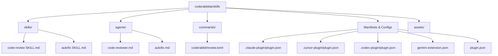
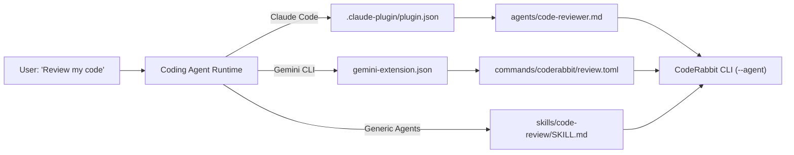

<!-- source: DeepWiki mcp.deepwiki.com · repo coderabbitai/skills · page 1 Overview · fetched 2026-10-27 -->

# Overview

Relevant source files

The following files were used as context for generating this wiki page:

- [CHANGELOG.md](CHANGELOG.md)
- [DISTRIBUTION_CHANNELS.md](DISTRIBUTION_CHANNELS.md)
- [README.md](README.md)

## Purpose and Scope

The `coderabbitai/skills` repository serves as the canonical home for CodeRabbit's agent-native skills and multi-agent plugin packaging [`[README.md:1-10]()`]. It equips over 35 coding agents—including Claude Code, Cursor, Gemini CLI, Antigravity CLI, and Codex—with portable AI-powered code review and autofix capabilities (`[README.md:5-9]()`). 

This parent page provides a high-level overview of the repository's structural architecture, layout mapping, and cross-agent integration ecosystem. For detailed setup guides, refer to [Installation & Getting Started](#1.1); for version evolution and changelog details, see [Release History & Versioning](#1.2).

Sources: `[README.md:1-10]()`, `[README.md:121-135]()`

---

## Repository Layout Map

The repository is organized into core portable skill definitions, agent-specific marketplace manifests, native CLI extensions, and branding assets (`[README.md:121-135]()`). 

| Path | Purpose |
| --- | --- |
| `skills/` | Portable CodeRabbit skills (`SKILL.md`) for agents supporting skills-based injection (`[README.md:125-125]()`). |
| `.claude-plugin/` | Claude Code plugin marketplace metadata (`[README.md:126-126]()`). |
| `commands/` | Native review commands for Gemini CLI and Antigravity CLI (`[README.md:127-127]()`). |
| `agents/` | `code-reviewer` and `autofix` subagent definitions (`[README.md:128-128]()`). |
| `.cursor-plugin/` | Cursor marketplace metadata (`[README.md:129-129]()`). |
| `.codex-plugin/` | Codex metadata referencing shared skills (`[README.md:130-130]()`). |
| `gemini-extension.json` | Gemini CLI extension manifest (`[README.md:131-131]()`). |
| `plugin.json` | Antigravity CLI plugin manifest (`[README.md:132-132]()`). |
| `assets/` | Shared marketplace and brand logos (`[README.md:133-133]()`). |
| `DISTRIBUTION_CHANNELS.md` | Maintainer operating inventory for live and packaged distribution paths (`[README.md:134-134]()`). |

*Figure 1: Repository layout mapping logical boundaries to underlying filesystem entities.*

Sources: `[README.md:121-135]()`

---

## Natural Language to Code Entity Space

To bridge natural language review prompts to concrete repository execution, agent runtimes invoke specific plugin manifests, CLI flags, and skill handlers.

*Figure 2: Execution path mapping natural language prompts through agent plugins and subagents to the CodeRabbit CLI.*

Sources: `[README.md:1-120](), [CHANGELOG.md:34-44]()`

---

## 1.1. Installation & Getting Started

CodeRabbit installation spans prerequisites (the CodeRabbit CLI and `gh`) and environment-specific integration paths (`[README.md:13-120]()`). Portable agent environments consume `npx skills add coderabbitai/skills` (`[README.md:35-37]()`), while host-native agents load custom plugin manifests (`[README.md:48-116]()`). 

For step-by-step instructions across agents (including `claude`, `cursor`, `gemini`, `agy`, and `codex`), first-time authentication flows, and sandbox execution boundaries, see the child page:
👉 **[Installation & Getting Started](#1.1)**

Sources: `[README.md:13-120]()`, `[DISTRIBUTION_CHANNELS.md:7-21]()`

---

## 1.2. Release History & Versioning

The repository tracks evolution through a structured `CHANGELOG.md` (`[CHANGELOG.md:1-111]()`), moving from initial multi-agent support (`v1.0.0`) to advanced manifest packaging, deprecations of legacy commands (such as `/coderabbit:coderabbit-review`), and the addition of the read-only `autofix` subagent in `v1.2.0` (`[CHANGELOG.md:5-66]()`).

For complete version histories, breaking changes, deprecated flags, and manifest version synchronization rules, see the child page:
👉 **[Release History & Versioning](#1.2)**

Sources: `[CHANGELOG.md:1-111]()`

---

