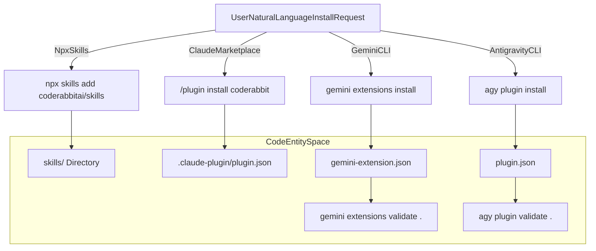
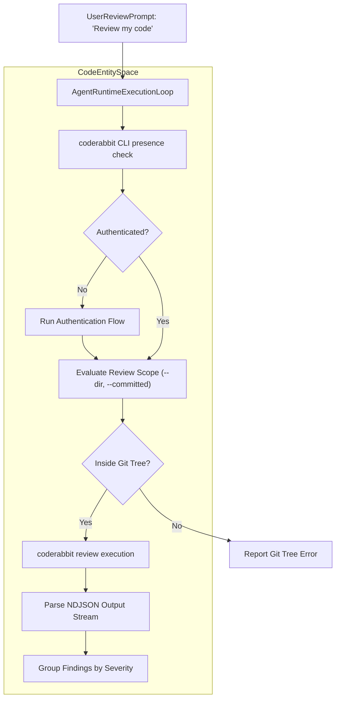

<!-- source: DeepWiki mcp.deepwiki.com · repo coderabbitai/skills · page 1.1 Installation & Getting Started · fetched 2026-10-27 -->

# Installation & Getting Started

<details>
<summary>Relevant source files</summary>

The following files were used as context for generating this wiki page:

- [DISTRIBUTION_CHANNELS.md](DISTRIBUTION_CHANNELS.md)
- [README.md](README.md)

</details>


## Purpose & Scope
This page details the technical installation paths, agent-specific integration manifests, environment prerequisites, and first review invocation workflows for `coderabbitai/skills` [README.md:1-12](). It covers multi-agent distribution mechanics ranging from the portable skills installer (`npx skills`) to native marketplace extensions across 35+ supported coding agents [README.md:5-10](), [DISTRIBUTION_CHANNELS.md:7-21]().

Sources: `[README.md:1-12]()`, `[DISTRIBUTION_CHANNELS.md:7-21]()`

---

## Prerequisites
Before installing CodeRabbit skills or plugins into your coding agent environment, ensure the following core requirements are met:
1. **CodeRabbit CLI**: Installed via the official installation scripts or Homebrew [README.md:21-24](). The CLI acts as the execution engine for local repository analysis and authentication.
2. **GitHub CLI (`gh`)**: Required for advanced PR workflows, authentication checks, and fetching GitHub review threads [DISTRIBUTION_CHANNELS.md:12]().
3. **Agent Environment**: A supported coding agent (such as Claude Code, Cursor, Gemini CLI, Antigravity CLI, or Codex) with write access to project or global configuration directories [README.md:164-176]().

Sources: `[README.md:21-24]()`, `[DISTRIBUTION_CHANNELS.md:12]()`

---

## Agent Installation Paths
Depending on the host agent, installation is routed through specific package managers, marketplace registries, or direct repository cloning.

### 1. Portable Skills Installer (`npx skills`)
For agents that consume portable `SKILL.md` definitions (supporting 35+ agents like Amp, Kimi Code, Cline, Continue, Crush, Droid, etc.), use the skills CLI [README.md:30-47](), [README.md:164-176]().
```bash
npx skills add coderabbitai/skills
```
Supported installer flags:
* `-g, --global`: Installs skills to the user-level global configuration directory rather than the local project directory [README.md:41-43]().
* `-a, --agent`: Targets specific agent runtimes (e.g., `claude-code`) [README.md:41-44]().
* `-s, --skill`: Installs specific named skills [README.md:41-45]().
* `--all`: Installs all bundled skills to all detected agents without interactive prompts [README.md:41-46]().

### 2. Claude Code Plugin Marketplace
For Claude Code environments, the plugin is loaded directly from the official marketplace registry using `.claude-plugin/plugin.json` [README.md:48-64](), [DISTRIBUTION_CHANNELS.md:13-14]().
```text
/plugin marketplace update
/plugin install coderabbit@claude-plugins-official
```

### 3. Cursor Plugin Marketplace
Cursor installations reference the metadata packaged in `.cursor-plugin/plugin.json` [README.md:66-79](), [DISTRIBUTION_CHANNELS.md:15]().
```text
/add-plugin coderabbit
```

### 4. Gemini CLI Native Extension
Gemini CLI environments load extensions defined by `gemini-extension.json` [README.md:80-95](), [DISTRIBUTION_CHANNELS.md:16]() and validated via CLI validation commands [DISTRIBUTION_CHANNELS.md:27]().
```bash
gemini extensions install https://github.com/coderabbitai/skills --ref main
gemini extensions list
gemini extensions validate .
```

### 5. Antigravity CLI Plugin
Antigravity installations utilize the root `plugin.json` manifest and can be installed directly from the repository source [README.md:96-108](), [DISTRIBUTION_CHANNELS.md:17]() with schema validation [DISTRIBUTION_CHANNELS.md:28]().
```bash
agy plugin install https://github.com/coderabbitai/skills
agy plugin list
agy plugin validate .
```

### 6. Codex App
Codex integrations load via `.codex-plugin/plugin.json`, which references the core `skills/` directory [README.md:109-117](), [DISTRIBUTION_CHANNELS.md:18]().

Sources: `[README.md:30-117]`, `[DISTRIBUTION_CHANNELS.md:11-18]`, `[DISTRIBUTION_CHANNELS.md:27-28]`

---

## Installation Routing & Manifest Architecture
The following diagram maps natural language installation requests and agent commands to their corresponding internal repository manifests and package structures.


Sources: `[README.md:30-117]`, `[DISTRIBUTION_CHANNELS.md:11-28]`

---

## First Review Invocation & Execution Flow
Once installed, trigger a code review by prompting your coding agent in natural language [README.md:136-147](). 

Example user prompts recognized by agent runtimes:
* `"Review my code"` [README.md:141]()
* `"Check for security issues"` [README.md:142]()
* `"Review my PR"` [README.md:145]()
* `"Review the directory at ../my-service"` [README.md:146]()

### Execution Steps
When an invocation occurs, the agent runtime executes the following sequence:
1. **CLI Presence Check**: Verifies that the CodeRabbit CLI is available in the execution path [README.md:149-150]().
2. **Authentication Check**: Initiates the authentication flow if credentials are missing or expired [README.md:16-17]().
3. **Scope Resolution**: Evaluates working tree state (committed vs. uncommitted changes) or parses explicit directory arguments (`--dir <path>`) after validating that the target path resides within an initialized Git working tree [README.md:156-158]().
4. **Analysis & Presentation**: Runs the review pipeline, groups findings by severity level, and presents actionable fixes or autofix options [README.md:151-154]().

Sources: `[README.md:15-17]`, `[README.md:136-159]`

---

## Review Invocation & Execution Flow Architecture
The following diagram illustrates the relationship between natural language review prompts and the underlying CLI execution routines.


Sources: `[README.md:15-17]`, `[README.md:136-159]`

---

