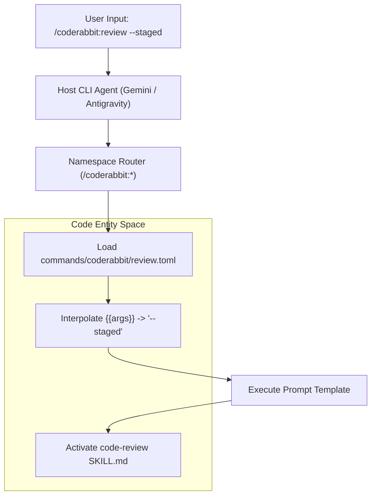
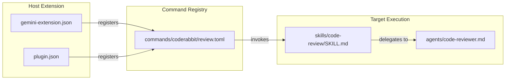

<!-- source: DeepWiki mcp.deepwiki.com · repo coderabbitai/skills · page 3.3 Slash Commands · fetched 2026-10-27 -->

# Slash Commands

<details>
<summary>Relevant source files</summary>

The following files were used as context for generating this wiki page:

- [README.md](README.md)
- [commands/coderabbit/review.toml](commands/coderabbit/review.toml)
- [gemini-extension.json](gemini-extension.json)

</details>


## Purpose and Scope

This section covers the implementation and architecture of native slash commands within the CodeRabbit skills repository, focusing specifically on `commands/coderabbit/review.toml` and the `/coderabbit:*` command namespace across host agents such as Gemini CLI and Antigravity CLI [README.md:126-128](). Slash commands provide a deterministic entry point for users to trigger AI-powered code reviews directly through host CLI interfaces, bypassing unstructured prompt translation by mapping directly to core agent skills.

---

## Command Configuration (`commands/coderabbit/review.toml`)

The primary command definition for native agent extensions is housed in `commands/coderabbit/review.toml` [README.md:126-128](). This file defines the metadata, user-facing description, and prompt template executed when a user invokes the review command.

### TOML Structure and Interpolation

The command configuration utilizes a simple TOML schema containing a human-readable description and a multi-line prompt template [commands/coderabbit/review.toml:1-5]():

```toml
description = "Run CodeRabbit AI code review on your changes"
prompt = """
Activate the `code-review` skill and follow its workflow to review the current changes.
Apply this requested scope or additional instruction when provided: {{args}}
"""
```

*   `description`: Exposes a concise summary of the command's capability to the host agent's command registry and auto-completion UI [commands/coderabbit/review.toml:1-1]().
*   `prompt`: Defines the execution instructions passed to the underlying model. It leverages `{{args}}` variable interpolation to capture any trailing parameters or review scopes supplied by the user during invocation [commands/coderabbit/review.toml:2-5]().

Sources: [commands/coderabbit/review.toml:1-5](), [README.md:126-128]()

---

## The `/coderabbit:*` Command Namespace & Data Flow

When integrated into host environments like Gemini CLI (`gemini-extension.json`) or Antigravity CLI (`plugin.json`), commands located under the `commands/` directory are registered under the `/coderabbit:*` namespace [README.md:126-128](). 

### Execution Data Flow

The following diagram illustrates how a user invocation of `/coderabbit:review` traverses from the natural language and command space down to code-level skill activation.



Sources: [commands/coderabbit/review.toml:1-5](), [README.md:126-128]()

---

## Host Integration and Packaging

Native slash commands are packaged alongside portable skills and subagents within extension manifests. For instance, the Gemini CLI extension manifest (`gemini-extension.json`) and the Antigravity CLI manifest (`plugin.json`) discover and bundle the `commands/` directory [README.md:91-95, 106-108]().

### Namespace Mapping Architecture



*   **Manifest Binding**: Host manifests declare extension metadata (`name: coderabbit`, `version: 1.2.0`) [gemini-extension.json:1-5](), binding the `commands/coderabbit/` directory to the runtime environment.
*   **Skill Bridging**: The execution of `/coderabbit:review` resolves directly to the `code-review` skill contract, initiating context gathering and validation pipelines [commands/coderabbit/review.toml:1-5]().

Sources: [commands/coderabbit/review.toml:1-5](), [gemini-extension.json:1-5](), [README.md:91-95, 106-108]()

---

