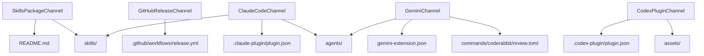
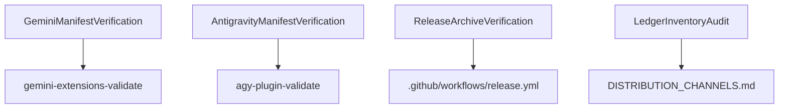

<!-- source: DeepWiki mcp.deepwiki.com · repo coderabbitai/skills · page 4.4 Distribution Channel Inventory · fetched 2026-10-27 -->

# Distribution Channel Inventory

Relevant source files

The following files were used as context for generating this wiki page:

- [DISTRIBUTION_CHANNELS.md](DISTRIBUTION_CHANNELS.md)

The purpose of this section is to document `DISTRIBUTION_CHNNELS.md` as the repository's operating ledger for tracking distribution channels, sources of truth, and maintenance procedures for CodeRabbit skills and adjacent agent integrations (`[DISTRIBUTION_CHANNELS.md:1-6]()`). Public user-facing installation instructions are maintained in `README.md`, whereas in-development and maintainer-only channels are tracked here (`[DISTRIBUTION_CHANNELS.md:1-6]()`).

## Channels Inventory Matrix

The inventory details all live, pending, and packaged distribution vectors for the repository's contents. Each channel maps to specific source manifests and asset directories within the codebase (`[DISTRIBUTION_CHANNELS.md:7-21]()`).

| Channel | Status | Source of Truth | Notes |
| --- | --- | --- | --- |
| Skills package (`npx skills add coderabbitai/skills`) | Live | `README.md`, `skills/` | Canonical multi-agent distribution path for 35+ skills-compatible agents (`[DISTRIBUTION_CHANNELS.md:11-11]()`). |
| Tagged GitHub release archive (`coderabbit skills`) | Live; `v1.2.0` pending | `.github/workflows/release.yml`, [skills install docs](https://docs.coderabbit.ai/cli/skills) | CLI installs the latest published release after manifest and checksum verification (`[DISTRIBUTION_CHNNELS.md:12-12]()`). |
| Claude Code plugin marketplace | Live | `.claude-plugin/plugin.json`, `skills/`, `agents/` | Official marketplace source: `coderabbitai/skills` (`[DISTRIBUTION_CHANNELS.md:13-13]()`). |
| Claude directory (claude.ai, desktop, Cowork) | Submission in progress | `.claude-plugin/plugin.json`, `skills/`, `agents/`, `README.md` | Submitted from the CodeRabbit claude.ai organization through the developer portal (`[DISTRIBUTION_CHANNELS.md:14-14]()`). |
| Cursor native plugin marketplace | Repo-packaged, publication should be verified | `.cursor-plugin/plugin.json` | Repo contains marketplace manifest; treat public listing as separate verification work (`[DISTRIBUTION_CHANNELS.md:15-15]()`). |
| Gemini CLI native extension | Repo-packaged, release pending | `gemini-extension.json`, `skills/`, `commands/coderabbit/review.toml`, `agents/` | Publish direct installation after `v1.2.0`; verify gallery listing separately (`[DISTRIBUTION_CHANNELS.md:16-16]()`). |
| Antigravity CLI native plugin | GitHub-installable | `plugin.json`, `skills/` | Install directly with `agy plugin install https://github.com/coderabbitai/skills` (`[DISTRIBUTION_CHANNELS.md:17-17]()`). |
| Codex plugin marketplace | Live; native source added, upload pending | `.codex-plugin/plugin.json`, `skills/`, `assets/` | The root manifest uses existing review and autofix skills at `1.2.0` (`[DISTRIBUTION_CHANNELS.md:18-18]()`). |
| VS Code / Cursor / Windsurf IDE extension | Live, separate distribution | CodeRabbit IDE extension docs | Complements skills; not a replacement for `SKILL.md` installs (`[DISTRIBUTION_CHANNELS.md:19-19]()`). |
| GitHub Marketplace app (PR reviews) | Live, separate product channel | CodeRabbit GitHub Marketplace listing | Product distribution, not a skills install path (`[DISTRIBUTION_CHANNELS.md:20-20]()`). |

Sources: `[DISTRIBUTION_CHANNELS.md:1-21]()`

## Channel-to-Code Entity Mapping

This diagram bridges the natural language concepts of distribution channels to the exact file paths and manifests residing in the repository.

Sources: `[DISTRIBUTION_CHANNELS.md:11-18]()`

## Maintenance Validation Workflow

This diagram associates operational ledger checks with specific validation commands and automated scripts executed during maintenance cycles.

Sources: `[DISTRIBUTION_CHANNELS.md:22-30]()`

## Maintenance Checklist & Operational Protocol

The maintainer checklist defines concrete invariant rules and triggers for updating `DISTRIBUTION_CHANNELS.md` (`[DISTRIBUTION_CHANNELS.md:22-30]()`):

* **README Updates**: When `README.md` install documentation changes, verify that the matrix table accurately reflects the recommended paths (`[DISTRIBUTION_CHANNELS.md:24-24]()`).
* **Release Artifact Changes**: When release workflows or asset naming structures change, update the tagged GitHub release archive row and associated validation notes (`[DISTRIBUTION_CHANNELS.md:25-25]()`).
* **Marketplace Manifest Additions**: When a new marketplace manifest is introduced, explicitly document whether it is packaged locally in-repo or published publicly (`[DISTRIBUTION_CHANNELS.md:26-26]()`).
* **Gemini Validation**: When `gemini-extension.json` or bundled components are modified, execute `gemini extensions validate .` (`[DISTRIBUTION_CHANNELS.md:27-27]()`).
* **Antigravity Validation**: When the Antigravity plugin schema or manifest is altered, execute `agy plugin validate .` (`[DISTRIBUTION_CHANNELS.md:28-28]()`).
* **Repository Migration**: If any distribution channel migrates to an external repository, preserve its status entry and link the new owner repository in the notes column (`[DISTRIBUTION_CHANNELS.md:29-29]()`).
* **Channel Deprecation**: If a channel is deprecated, retain the entry within `DISTRIBUTION_CHANNELS.md` until all downstream documentation and installation references are fully pruned (`[DISTRIBUTION_CHANNELS.md:30-30]()`).

Sources: `[DISTRIBUTION_CHANNELS.md:22-30]()`

---

