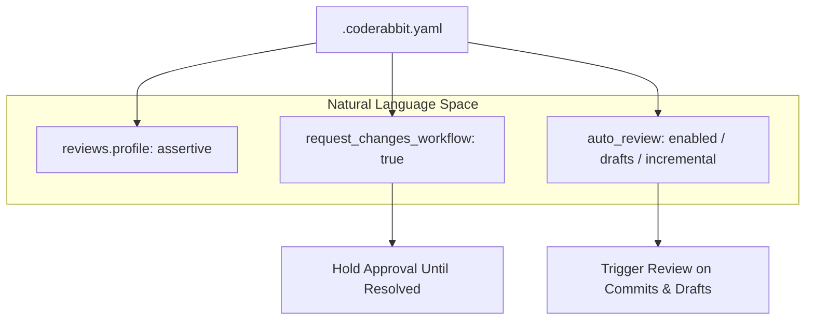
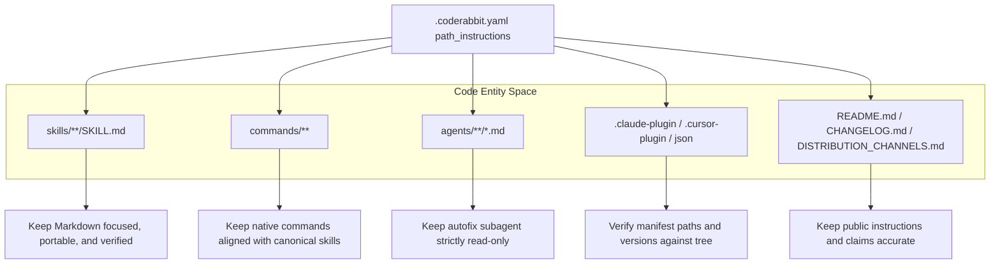

<!-- source: DeepWiki mcp.deepwiki.com · repo coderabbitai/skills · page 5.1 CodeRabbit Review Policy (.coderabbit.yaml) · fetched 2026-10-27 -->

# CodeRabbit Review Policy (.coderabbit.yaml)

Relevant source files

The following files were used as context for generating this wiki page:

- [.coderabbit.yaml](.coderabbit.yaml)

## Purpose and Scope
This page documents the repository review policy configured in `[.coderabbit.yaml:1-126]()`. The CodeRabbit review policy enforces strict quality control, assertive review profiles, pre-merge validation checks, custom agent guidance evaluations, static analysis tool integrations (such as `actionlint`, `zizmor`, and `skillspector`), and granular path-specific instructions across the codebase.

Sources: `[.coderabbit.yaml:1-126]()`

---

## Policy Structure & General Settings
The root configuration disables inheritance (`inheritance: false`), ensuring that the repository relies solely on its explicitly defined configuration rather than organization-level inherited defaults `[.coderabbit.yaml:3-4]()`. 

Key review profile settings include:
- **Profile**: Set to `assertive` for rigorous feedback and thorough code inspection `[.coderabbit.yaml:6-7]`.
- **Request Changes Workflow**: Enabled (`request_changes_workflow: true`), which holds CodeRabbit approval until every comment—including nitpicks and out-of-diff remarks—is completely resolved and all pre-merge checks pass `[.coderabbit.yaml:9-11]`.
- **Auto-Review & Finishing Touches**: Configured to automatically review drafts and incremental commits (`auto_incremental_review: true`), while disabling automated unit tests and enabling code simplification (`simplify: enabled: true`) `[.coderabbit.yaml:45-56]`.

Sources: `[.coderabbit.yaml:3-56]()`

---

## Pre-Merge Checks & Custom Agent Guidance
Pre-merge checks act as strict quality gates before a pull request can merge `[.coderabbit.yaml:13-38]`. The policy enforces strict validation modes (`mode: error`) for pull request metadata and issue assessments.

### Pre-Merge Gate Configuration
- `title`: Enforced with error severity (`[.coderabbit.yaml:15-16]()`)
- `description`: Enforced with error severity (`[.coderabbit.yaml:17-18]()`)
- `issue_assessment`: Enforced with error severity (`[.coderabbit.yaml:19-20]()`)
- `override_requested_reviewers_only`: Set to `true` (`[.coderabbit.yaml:14]`)

### Custom Check: "Agent guidance structure"
The policy defines a custom error check named `Agent guidance structure` (`[.coderabbit.yaml:21-38]()`). This check triggers when a pull request modifies skills, agent guidance, native commands, or their manifests, requiring:
1. `SKILL.md` files maintain concise activation, routing, domain context, and workflow framing `[.coderabbit.yaml:27-28]()`.
2. Detailed material loads via focused references, and deterministic operations use scripts or tools `[.coderabbit.yaml:29-31]()`.
3. Referenced files, scripts, tools, and commands exist and align with public documentation `[.coderabbit.yaml:32-33]()`.
4. Compliance with the Agent Skills specification, `AGENTS.md` open format, and host agent guidance `[.coderabbit.yaml:34-35]()`.
5. Behavioral alignment between native commands, agents, manifests, and their canonical skills `[.coderabbit.yaml:36-37]()`.

Sources: `[.coderabbit.yaml:13-38]()`

---

## CodeRabbit Tools Integration
CodeRabbit is configured to invoke specialized security and linting tools during review cycles `[.coderabbit.yaml:57-64]()`:
- `actionlint`: Enabled for validating GitHub Actions workflow files `[.coderabbit.yaml:58-59]()`.
- `zizmor`: Enabled for security analysis of GitHub Actions `[.coderabbit.yaml:60-61]()`.
- `skillspector`: Enabled for auditing agent skills and plugin metadata structures `[.coderabbit.yaml:62-63]()`.

Sources: `[.coderabbit.yaml:57-64]()`

---

## Path-Specific Instructions
The configuration applies targeted instructions based on file path globs to enforce design consistency across agents, manifests, documentation, and skills `[.coderabbit.yaml:65-99]()`.

Sources: `[.coderabbit.yaml:65-99]()`

### Path Rule Breakdown
- **`skills/**/SKILL.md`**: Requires focused Markdown, portable guidance across declared agents, script utilization for deterministic operations, and verification against current public documentation `[.coderabbit.yaml:66-75]()`.
- **`commands/**`**: Enforces behavioral alignment with canonical skills and flags stale CLI options or duplicated prerequisites `[.coderabbit.yaml:77-80]()`.
- **`agents/**/*.md`**: Mandates behavioral alignment and strictly enforces that `autofix` remains read-only (prohibiting file edits, commits, pushes, PR creation, or comment posting) `[.coderabbit.yaml:82-86]()`.
- **`{.claude-plugin,.cursor-plugin}/**/*.json` & root JSON manifests**: Verifies manifest paths, versions, metadata, and packaged components against the repository tree `[.coderabbit.yaml:88-94]()`.
- **Documentation (`README.md`, `CHANGELOG.md`, `DISTRIBUTION_CHANNELS.md`)**: Ensures public installation commands, release status, and source-of-truth claims remain accurate and mutually consistent `[.coderabbit.yaml:96-98]()`.

Sources: `[.coderabbit.yaml:65-99]()`

---

## Auxiliary Configurations (Chat, Knowledge Base, Issue Enrichment)
The remaining blocks configure auxiliary integration boundaries:
- **Chat**: Disallows non-org members and enables auto-reply while disabling Jira and Linear integrations `[.coderabbit.yaml:100-108]()`.
- **Knowledge Base**: Scopes learnings, issues, and pull requests locally (`scope: local`), disables automatic repository linking, and turns off external integrations (Jira, Linear, MCP) `[.coderabbit.yaml:109-123]()`.
- **Issue Enrichment**: Enables auto-enrichment (`auto_enrich: enabled: true`) `[.coderabbit.yaml:124-126]()`.

Sources: `[.coderabbit.yaml:100-126]()`

---

