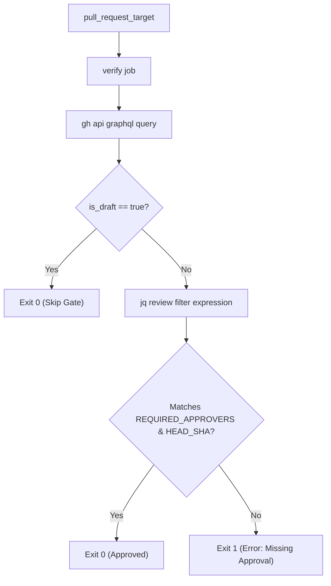
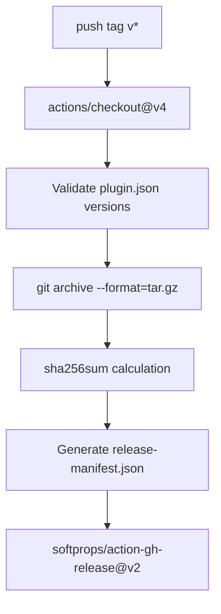

<!-- source: DeepWiki mcp.deepwiki.com · repo coderabbitai/skills · page 5.2 GitHub Workflows & Governance · fetched 2026-10-27 -->

# GitHub Workflows & Governance

<details>
<summary>Relevant source files</summary>

The following files were used as context for generating this wiki page:

- [.github/CODEOWNERS](.github/CODEOWNERS)
- [.github/workflows/release.yml](.github/workflows/release.yml)
- [.github/workflows/required-approver.yml](.github/workflows/required-approver.yml)

</details>


## Purpose and Scope
This section details the GitHub Actions workflows and governance policies implemented in `coderabbitai/skills`. It covers the pull request review verification logic inside [.github/workflows/required-approver.yml](), the repository ownership structure defined in [.github/CODEOWNERS](), and the release and artifact packaging pipeline defined in [.github/workflows/release.yml]().

Sources: [.github/workflows/required-approver.yml](), [.github/CODEOWNERS](), [.github/workflows/release.yml]()

---

## 1. Required Approver Gate Logic (`required-approver.yml`)

The workflow defined in [.github/workflows/required-approver.yml]() enforces a mandatory code review gate for pull requests. It ensures that incoming changes receive an approval from designated repository owners (`nehal-a2z` or `juanpflores`) specifically targeting the latest commit hash (`HEAD_SHA`).

### Workflow Triggers and Permissions
The workflow executes under `pull_request_target` and `pull_request_review` events, tracking lifecycle events such as `opened`, `reopened`, `synchronize`, `ready_for_review`, `converted_to_draft`, `submitted`, and `dismissed` [.github/workflows/required-approver.yml:3-15]. It operates with restricted permissions (`contents: read`, `pull-requests: read`) [.github/workflows/required-approver.yml:16-19].

### GraphQL Query & Evaluation Flow
The `verify` job queries GitHub's GraphQL API to retrieve pull request properties, including the draft status and up to the last 100 reviews containing author logins, commit object identifiers (`oid`), review states, and submission timestamps [.github/workflows/required-approver.yml:38-64].

If the pull request is marked as a draft (`is_draft == "true"`), the workflow exits early with a status of `0` since draft code is not eligible for merging [.github/workflows/required-approver.yml:66-70]. 

For non-draft pull requests, a `jq` expression processes the review nodes [.github/workflows/required-approver.yml:72-85]:
1. Maps reviews to filter authors matching `REQUIRED_APPROVERS` (`nehal-a2z,juanpflores`) [.github/workflows/required-approver.yml:75-78].
2. Groups and sorts reviews by author login to isolate the latest submission per reviewer (`max_by(.submittedAt)`) [.github/workflows/required-approver.yml:79-81].
3. Asserts that the review state is `APPROVED` and that the associated commit `oid` matches the current `HEAD_SHA` [.github/workflows/required-approver.yml:82].
4. Outputs the approved author login or fails the job (`exit 1`) with an error message if no valid approval is found [.github/workflows/required-approver.yml:83-90].


*Figure 1: Execution flow of the required-approver verification job.*

Sources: [.github/workflows/required-approver.yml:1-92]()

---

## 2. Code Ownership Configuration (`CODEOWNERS`)

Repository code ownership is governed via [.github/CODEOWNERS](), which assigns global review responsibilities across the entire repository (`*`) to the core maintainers:

```text
* @nehal-a2z @juanpflores @esthor
```

This configuration ensures that any modification across all paths requires review oversight from the designated engineering owners.

Sources: [.github/CODEOWNERS:1]()

---

## 3. Release Pipeline and Manifest Generation (`release.yml`)

The automated release workflow in [.github/workflows/release.yml]() triggers upon pushing a version tag matching `v*` (`push: tags: - "v*"`) [.github/workflows/release.yml:3-7]. 

### Release Pipeline Steps

1. **Checkout Code**: Checks out the tagged source with full depth (`fetch-depth: 0`) using `actions/checkout@v4` [.github/workflows/release.yml:16-19].
2. **Manifest Version Verification**: Iterates through `.claude-plugin/plugin.json`, `.cursor-plugin/plugin.json`, and `gemini-extension.json` to verify that their declared `.version` fields precisely match the tag name minus the `v` prefix [.github/workflows/release.yml:22-35].
3. **Archive & Checksum Construction**: 
   - Generates a gzipped tarball archive using `git archive` prefixed with `coderabbit-skills-${VERSION}/` [.github/workflows/release.yml:49-53].
   - Computes the SHA256 checksum of the archive via `sha256sum` [.github/workflows/release.yml:54-55].
   - Constructs `release-manifest.json` containing metadata such as version, tag, publication timestamp, archive attributes, checksum URL, and source tarball URL [.github/workflows/release.yml:56-73].
4. **Publishing**: Uploads the `.tar.gz` archive, `.sha256` file, and `release-manifest.json` to GitHub Releases using `softprops/action-gh-release@v2` [.github/workflows/release.yml:75-82].


*File Sources: [.github/workflows/release.yml:1-82]()*

Sources: [.github/workflows/release.yml:1-82]()

---

