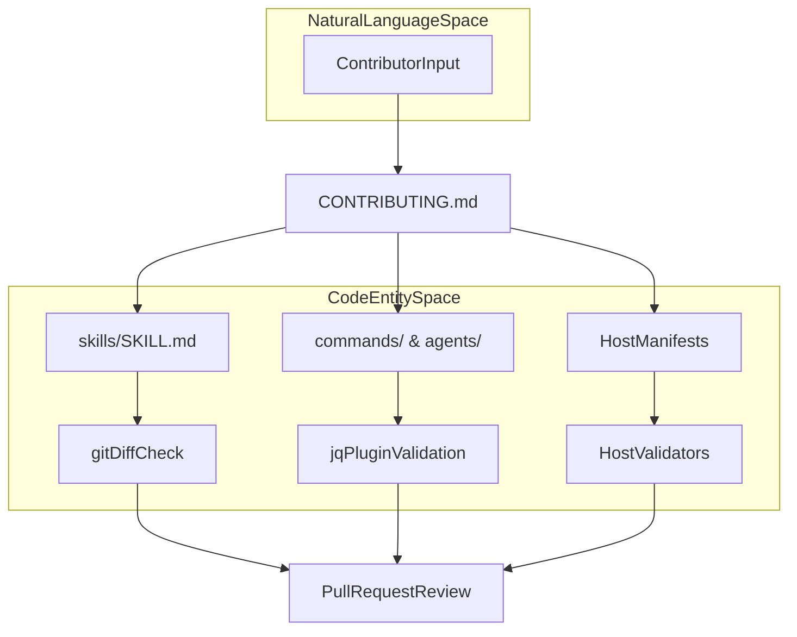
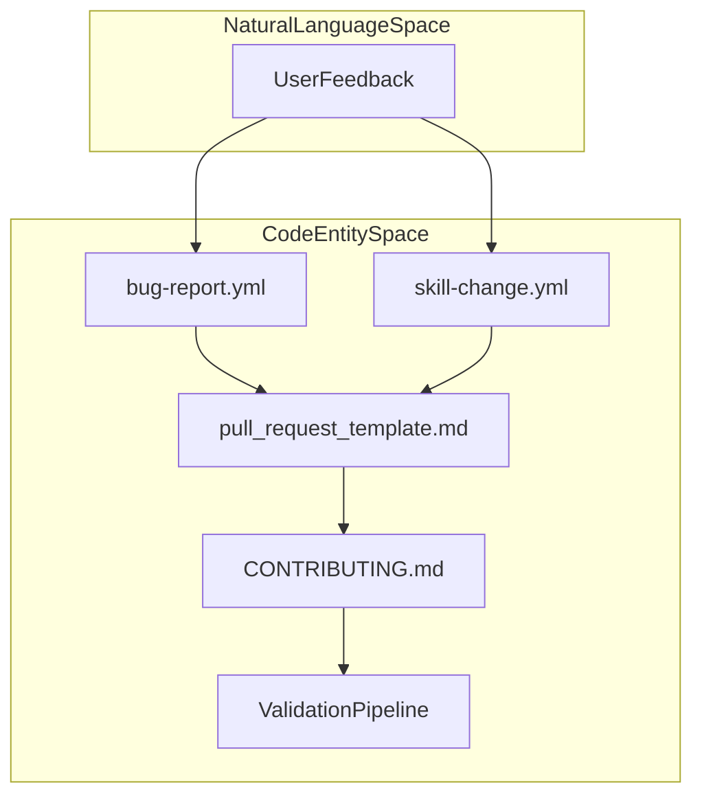

<!-- source: DeepWiki mcp.deepwiki.com · repo coderabbitai/skills · page 5.3 Contributing, Templates & Licensing · fetched 2026-10-27 -->

# Contributing, Templates & Licensing

Relevant source files

The following files were used as context for generating this wiki page:

- [.github/ISSUE_TEMPLATE/bug-report.yml](.github/ISSUE_TEMPLATE/bug-report.yml)
- [.github/ISSUE_TEMPLATE/config.yml](.github/ISSUE_TEMPLATE/config.yml)
- [.github/ISSUE_TEMPLATE/skill-change.yml](.github/ISSUE_TEMPLATE/skill-change.yml)
- [.github/pull_request_template.md](.github/pull_request_template.md)
- [.gitignore](.gitignore)
- [CONTRIBUTING.md](CONTRIBUTING.md)
- [LICENSE](LICENSE)

## Purpose and Scope
This page details the repository governance, contribution workflows, issue and pull request templates, workspace ignore rules, and licensing terms for `coderabbitai/skills`. It defines how contributors propose changes, adhere to progressive disclosure design [CONTRIBUTING.md:25-42](), use validation commands [CONTRIBUTING.md:43-64](), file bug reports [.github/ISSUE_TEMPLATE/bug-report.yml:1-71](), propose skill alterations [.github/ISSUE_TEMPLATE/skill-change.yml:1-61](), and comply with the MIT `LICENSE` [LICENSE:1-21]().

---

## 1. Contribution Framework (`CONTRIBUTING.md`)

The contribution pipeline enforces strict guidelines for maintaining portable agent skills, native subagents, command configurations, and multi-agent plugins.

### Pre-Contribution & Repository Structure
Contributors must open an issue before proposing major structural changes, new skills, or novel distribution channels [CONTRIBUTING.md:5-10](). Security vulnerabilities must be reported privately rather than via public issues [.github/ISSUE_TEMPLATE/config.yml:1-6, CONTRIBUTING.md:11-14](). 

The repository layout partitions concerns across several top-level entities:
- Canonical portable skills reside in `skills/` [CONTRIBUTING.md:15-17]().
- Native command and agent packaging reside in `commands/` and `agents/` [CONTRIBUTING.md:18-19]().
- Host-specific packaging resides in `.claude-plugin/`, `.cursor-plugin/`, `gemini-extension.json`, and `plugin.json` [CONTRIBUTING.md:20-21]().
- Distribution tracking resides in `DISTRIBUTION_CHANNELS.md` [CONTRIBUTING.md:22-23]().

### Designing Agent Guidance
Contributions must comply with the Agent Skills specification and the `AGENTS.md` open format [CONTRIBUTING.md:25-30](). Key architectural rules include:
1. Keeping `SKILL.md` files focused strictly on activation, routing, domain context, and workflow framing [CONTRIBUTING.md:31-32]().
2. Utilizing progressive disclosure by segregating workflow-specific details into `references/` directories [CONTRIBUTING.md:33-34]().
3. Delegating deterministic logic to `scripts/` or tool invocations [CONTRIBUTING.md:35-35]().
4. Synchronizing updates across native commands, agent definitions, manifests, and documentation in a single atomic pull request [CONTRIBUTING.md:36-41]().

### Validation Workflow
Contributors must run targeted verification scripts depending on the modified surface [CONTRIBUTING.md:43-64]():
- Standard diff validation: `git diff --check` [CONTRIBUTING.md:47-48]()
- JSON manifest validation: `jq empty .claude-plugin/plugin.json .cursor-plugin/plugin.json gemini-extension.json plugin.json` [CONTRIBUTING.md:49-50]()
- CodeRabbit configuration validation: `coderabbit config validate .coderabbit.yaml` [CONTRIBUTING.md:52-56]()
- Host-specific extension checks like `gemini extensions validate .` or `agy plugin validate .` [CONTRIBUTING.md:58-61]()

*Diagram 1: Mapping contribution policies from Natural Language Space to repository code entities and validation scripts.*

Sources: `CONTRIBUTING.md:1-78`, `.github/ISSUE_TEMPLATE/config.yml:1-6`

---

## 2. Governance Templates & Issue/PR Lifecycle

The repository enforces structured input formats via GitHub issue templates and a pull request template to ensure sufficient technical context accompany submissions.

### Issue Templates
1. **Bug Report (`bug-report.yml`)**: Requires identifying the affected integration surface (portable skill, Claude Code plugin, Cursor plugin, Gemini CLI extension, Antigravity CLI plugin, Codex plugin guidance, release archive, or other packaging) [.github/ISSUE_TEMPLATE/bug-report.yml:1-24](), installed version/commit [.github/ISSUE_TEMPLATE/bug-report.yml:26-33](), observed vs. expected behavior [.github/ISSUE_TEMPLATE/bug-report.yml:34-56](), public evidence [.github/ISSUE_TEMPLATE/bug-report.yml:57-62](), and credential redaction checkboxes [.github/ISSUE_TEMPLATE/bug-report.yml:63-71]().
2. **Skill or Integration Proposal (`skill-change.yml`)**: Captures the problem statement [.github/ISSUE_TEMPLATE/skill-change.yml:5-11](), target agent surfaces [.github/ISSUE_TEMPLATE/skill-change.yml:13-19](), public authoritative references [.github/ISSUE_TEMPLATE/skill-change.yml:21-27](), progressive-disclosure design strategy [.github/ISSUE_TEMPLATE/skill-change.yml:29-36](), deterministic tooling plans [.github/ISSUE_TEMPLATE/skill-change.yml:37-44](), and migration considerations [.github/ISSUE_TEMPLATE/skill-change.yml:45-52]().
3. **Configuration (`config.yml`)**: Disables blank issue creation and directs security vulnerability reports to the private advisory form [.github/ISSUE_TEMPLATE/config.yml:1-5]().

### Pull Request Template (`pull_request_template.md`)
PRs must outline:
- Summary of user outcome changes [.github/ISSUE_TEMPLATE/pull_request_template.md:1-3]()
- Affected canonical skills, commands, agents, manifests, and distribution channels [.github/ISSUE_TEMPLATE/pull_request_template.md:5-7]()
- Public authoritative references [.github/ISSUE_TEMPLATE/pull_request_template.md:9-11]()
- Exact validation commands and results [.github/ISSUE_TEMPLATE/pull_request_template.md:13-15]()
- A comprehensive checklist verifying scope boundaries, progressive disclosure adherence, and zero leakage of private configurations [.github/ISSUE_TEMPLATE/pull_request_template.md:17-26]()

*Diagram 2: Governance template transition from issue submission to pull request validation.*

Sources: `.github/ISSUE_TEMPLATE/bug-report.yml:1-72`, `.github/ISSUE_TEMPLATE/config.yml:1-6`, `.github/ISSUE_TEMPLATE/skill-change.yml:1-62`, `.github/pull_request_template.md:1-26`

---

## 3. Workspace Exclusions & Licensing

### Exclusions (`.gitignore`)
The root `.gitignore` file prevents local operational artifacts, editor states, local environments, and package caches from being committed [.gitignore:1-5]():
- `.DS_Store` [.gitignore:1-1]()
- `.claude/settings.local.json` [.gitignore:2-2]()
- `.venv/` and `.venv-*/` [.gitignore:3-4]()
- `node_modules/` [.gitignore:5-5]()

### Licensing (`LICENSE`)
The repository is licensed under the **MIT License**, copyright 2026 CodeRabbit AI [LICENSE:1-3](). It permits unrestricted use, modification, distribution, and sublicensing of the software under the condition that the copyright and permission notices are included in all copies or substantial portions of the software [LICENSE:5-21]().

Sources: `.gitignore:1-6`, `LICENSE:1-22`

---

