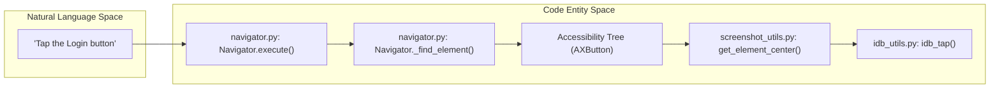
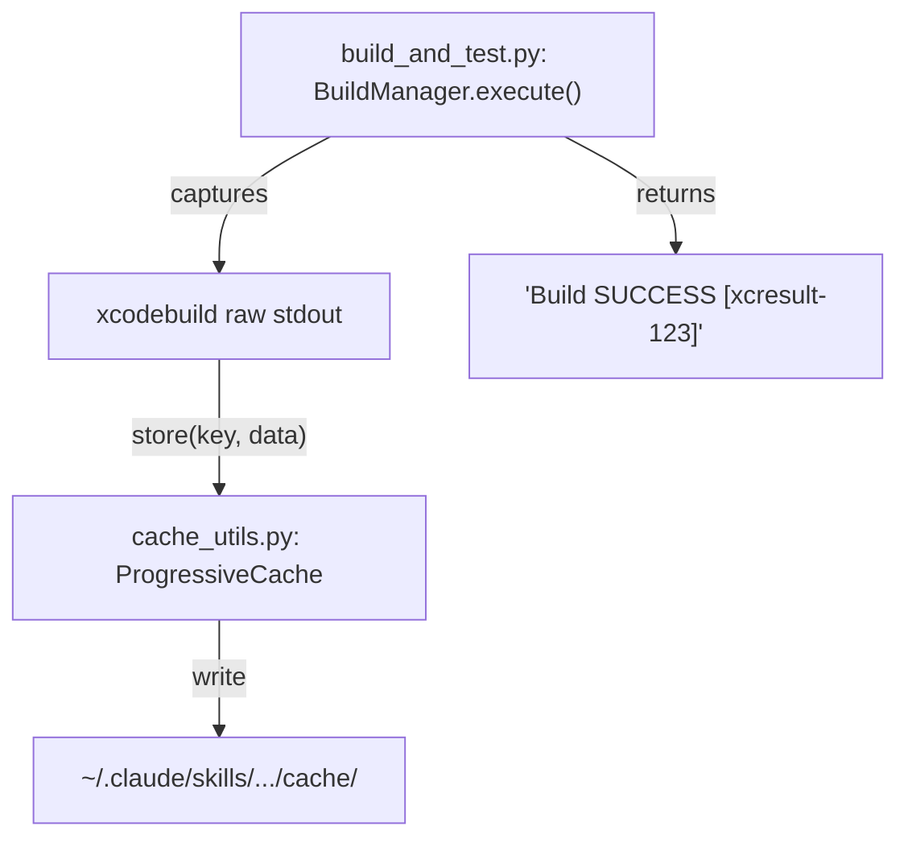

<!-- source: DeepWiki mcp.deepwiki.com · repo conorluddy/ios-simulator-skill · page 1.2 Design Principles · fetched 2026-10-27 -->

# Design Principles

<details>
<summary>Relevant source files</summary>

The following files were used as context for generating this wiki page:

- [CLAUDE.md](CLAUDE.md)
- [README.md](README.md)
- [pyproject.toml](pyproject.toml)

</details>


This page documents the six core design principles that govern the architecture and implementation of the `ios-simulator-skill`. These principles ensure the skill remains efficient for AI agents, robust against UI changes, and easy to maintain across its 22+ scripts.

---

## Summary

The design philosophy focuses on bridging the gap between high-level natural language intents and low-level system commands. These principles are summarized in `CLAUDE.md` and the main `README.md`.

| Principle | Technical Implementation | Primary Code Entities |
|---|---|---|
| **Semantic** | Finding elements by meaning/type rather than pixels | `Navigator`, `ScreenMapper` |
| **Progressive** | Caching large outputs; returning summary IDs | `ProgressiveCache`, `build_and_test.py` |
| **Accessible** | Native iOS Accessibility API integration | `idb ui describe-all`, `AX` attributes |
| **Zero-Config** | Automatic UDID and project detection | `resolve_device_identifier`, `Config` |
| **Structured** | Unified class-based `execute()` pattern | `Manager` classes, `--json` flags |
| **Reusable** | Shared utility modules for common logic | `common/`, `xcode/` directories |

**Sources:** [CLAUDE.md:202-216](), [README.md:203-217]()

---

## Semantic Navigation

**Problem:** Pixel-based automation (e.g., `tap 320 400`) is fragile. It breaks if the screen size changes, if a new element is added above the target, or if the app is localized.

**Solution:** The skill uses semantic lookup. It queries the iOS accessibility tree to find elements by their properties—label, type, or identifier—and then calculates the interaction point. This bridges "Natural Language Space" to "Code Entity Space."

**Mapping Intent to Code:**


The `Navigator` class in `scripts/navigator.py` implements this via several lookup strategies [scripts/navigator.py:107-107]():
- `--find-text`: Fuzzy substring match on `AXLabel` [README.md:76-77]().
- `--find-exact`: Exact string match on `AXLabel`.
- `--find-id`: Match on `accessibilityIdentifier` [README.md:107-107]().
- `--find-type`: Match on element class (e.g., `AXButton`, `AXTextField`) [README.md:107-107]().

**Sources:** [README.md:67-79](), [CLAUDE.md:204-204](), [scripts/navigator.py:107-107](), [scripts/common/idb_utils.py:153-153]()

---

## Progressive Disclosure & Token Efficiency

**Problem:** Standard Xcode and Simulator tools are extremely verbose. A single build log or accessibility tree can exceed 5,000 tokens, quickly exhausting an AI agent's context window.

**Solution:** Scripts implement a "summary-first" approach. They return a 1-line summary and a `cache_id`. Detailed logs are stored on disk and only retrieved if the agent explicitly asks for them.

**Token Savings Table:**
| Task | Raw Tool Output | Skill Default Output | Savings |
|---|---|---|---|
| Screen Analysis | 200+ lines | 5 lines | 97.5% |
| Build & Test | 1000+ lines | 1 line + ID | 99.9% |
| Device Listing | 50+ lines | 3 lines | 94.0% |

**Implementation: The Caching Data Flow**


This is primarily handled by the `ProgressiveCache` class in `scripts/common/cache_utils.py`, which manages TTL-based (Time-To-Live) expiration for these cached logs [scripts/common/cache_utils.py:161-163]().

**Sources:** [README.md:49-65](), [README.md:81-90](), [CLAUDE.md:174-182](), [scripts/common/cache_utils.py:161-163]()

---

## Accessibility-First

**Problem:** Visual-only analysis cannot identify if a button is missing a label for screen readers or if a touch target is too small.

**Solution:** By building navigation on top of `idb ui describe-all`, the skill treats the accessibility tree as the "source of truth." This allows for:
1. **Robust Navigation**: Finding elements that are off-screen but in the hierarchy.
2. **Automated Auditing**: The `accessibility_audit.py` script uses this same data to check for WCAG compliance, such as missing labels or insufficient contrast [README.md:116-116]().

**Sources:** [README.md:67-79](), [CLAUDE.md:208-208](), [scripts/accessibility_audit.py:130-130]()

---

## Zero Configuration

**Problem:** Manually passing UDIDs (e.g., `--udid 78B...`) for every command is tedious for humans and error-prone for agents.

**Solution:** The skill employs "intelligent defaults." It scans the environment to find the most logical target.

**Targeting Hierarchy (in `device_utils.py`):**
1. **Explicit**: Use the provided `--udid` flag [CLAUDE.md:80-88]().
2. **Preferred**: Check `scripts/xcode/config.py` for the `last_used_simulator`.
3. **Active**: Find the first currently `Booted` simulator [scripts/common/device_utils.py:151-154]().
4. **Heuristic**: Find the newest iPhone simulator available [scripts/common/device_utils.py:155-155]().

The `Config` class in `scripts/xcode/config.py` automatically "learns" the developer's preferences by saving the UDID of the last successfully targeted device [CLAUDE.md:160-160]().

**Sources:** [CLAUDE.md:78-88](), [CLAUDE.md:210-210](), [scripts/common/device_utils.py:151-155](), [scripts/xcode/config.py:1-100]()

---

## Structured Output & Class-Based Design

**Problem:** Scripts that just print to stdout are hard to test and hard for AI to parse reliably.

**Solution:** Every script follows a strict architectural pattern. Logic is encapsulated in a `Manager` class with an `execute()` method that returns a `(success, message)` tuple.

**Class Pattern Example:**
```python
class DeviceManager:
    def __init__(self, udid: str | None = None):
        self.udid = udid

    def execute(self, **kwargs) -> tuple[bool, str]:
        # Returns (success, message) tuple
        pass
```

Additionally, all scripts support a `--json` flag. When enabled, the script outputs a structured JSON object instead of human-readable text, allowing for programmatic integration [CLAUDE.md:90-105]().

**Sources:** [CLAUDE.md:57-76](), [CLAUDE.md:90-105](), [CLAUDE.md:186-194]()

---

## Reusable Components

**Problem:** Redundant logic for screenshotting, UDID resolution, and error handling leads to "code rot."

**Solution:** Shared logic is abstracted into the `scripts/common/` and `scripts/xcode/` directories.

| Module | Core Responsibility |
|---|---|
| `device_utils.py` | Simulator discovery, state filtering, and UDID resolution [scripts/common/device_utils.py:151-155](). |
| `screenshot_utils.py` | Capturing screen, semantic naming, and resizing for token efficiency [scripts/common/screenshot_utils.py:156-160](). |
| `cache_utils.py` | Managing the local filesystem cache for progressive disclosure [scripts/common/cache_utils.py:161-163](). |
| `idb_utils.py` | Wrapper for `idb` commands with fallback handling [scripts/common/idb_utils.py:153-153](). |

**Sources:** [CLAUDE.md:149-163](), [scripts/common/device_utils.py:1-450](), [scripts/common/screenshot_utils.py:1-346]()

---

