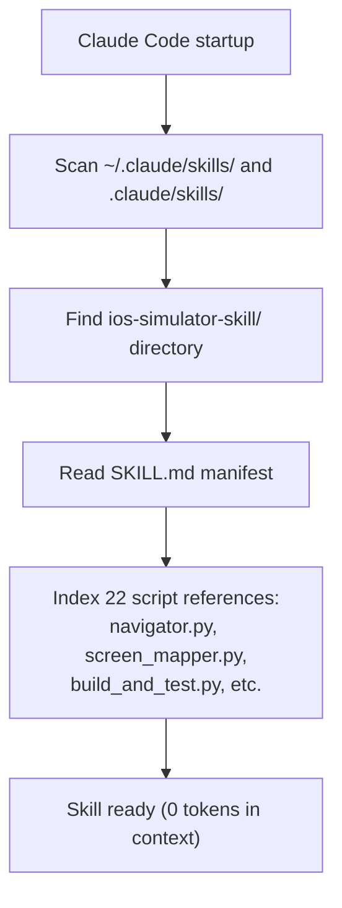
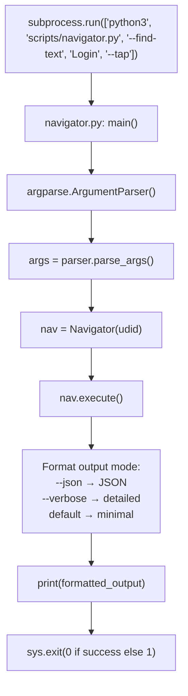
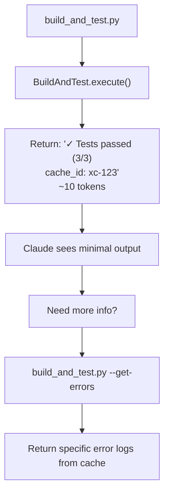

<!-- source: DeepWiki mcp.deepwiki.com · repo conorluddy/ios-simulator-skill · page 1.3 Claude Code Integration · fetched 2026-10-27 -->

# Claude Code Integration

<details>
<summary>Relevant source files</summary>

The following files were used as context for generating this wiki page:

- [.claude-plugin/marketplace.json](.claude-plugin/marketplace.json)
- [ios-simulator-skill/.claude-plugin/plugin.json](ios-simulator-skill/.claude-plugin/plugin.json)
- [ios-simulator-skill/skills/ios-simulator-skill/SKILL.md](ios-simulator-skill/skills/ios-simulator-skill/SKILL.md)

</details>


This page explains how the `ios-simulator-skill` integrates with Claude Code: the discovery mechanism via `SKILL.md`, automatic script invocation patterns, and the performance validation showing a 100% pass rate with the skill versus 46% without.

---

## Skill Discovery Mechanism

Claude Code scans for skills at startup by reading directories in `~/.claude/skills/` (personal) and `.claude/skills/` (project-local). Each skill directory must contain a `SKILL.md` file at its root. The skill is loaded into Claude's internal index but contributes **zero tokens** to the context window until invoked.

**Discovery locations:**

| Scope | Path | When Loaded |
|-------|------|-------------|
| Personal | `~/.claude/skills/ios-simulator-skill/` | Every Claude Code session for the user |
| Project | `.claude/skills/ios-simulator-skill/` | Only within that project directory |

**Skill loading process:**



Claude Code indexes the skill's capabilities from `SKILL.md` but does not inject script documentation into the context window. Script details are loaded on-demand when a user request matches a capability described in the manifest.

Sources: [ios-simulator-skill/.claude-plugin/plugin.json:1-13](), [ios-simulator-skill/skills/ios-simulator-skill/SKILL.md:1-5](), [.claude-plugin/marketplace.json:1-16]()

---

## Extension Mechanism Comparison

The repository provides multiple variants for integration. They differ in context loading strategy and performance overhead:

| Mechanism | Context at Idle | Discovery | Token Cost | Use Case |
|-----------|----------------|-----------|------------|----------|
| **Skill** | Zero | `SKILL.md` filesystem scan | Zero | Reactive invocation, minimal context |
| **MCP** | All tool definitions | Server registration | High | Always-available tools |
| **Plugin** | Selective groups | Explicit registration | Medium | Per-project tool subsets |

The Skill model is optimal for the large toolset (22 scripts) provided here, where most tools remain unused in any given session.

Sources: [ios-simulator-skill/.claude-plugin/plugin.json:1-13](), [ios-simulator-skill/skills/ios-simulator-skill/SKILL.md:43-158]()

---

## SKILL.md Manifest Structure

`SKILL.md` is the manifest file Claude Code reads to index the skill's capabilities. It serves as the primary documentation source for the agent, describing how to use the 22 production-ready scripts.

**Manifest organization:**

```
SKILL.md structure:
├── Version: 1.4.0
├── Quick Start (Environment check, Launch, Map, Tap, Enter Text)
├── Navigation Strategy (Accessibility Tree vs Screenshots)
├── 22 Script Summaries by Category
│   ├── Build & Development: build_and_test.py, log_monitor.py
│   ├── Navigation & Interaction: screen_mapper.py, navigator.py, gesture.py, keyboard.py, app_launcher.py
│   ├── Testing & Analysis: accessibility_audit.py, visual_diff.py, test_recorder.py, app_state_capture.py, sim_health_check.sh, model_inspector.py
│   ├── Advanced Testing: clipboard.py, status_bar.py, push_notification.py, privacy_manager.py
│   └── Device Lifecycle: simctl_boot.py, simctl_shutdown.py, simctl_create.py, simctl_delete.py, simctl_erase.py, sim_list.py
└── Usage patterns and flag reference
```

Each script is optimized for AI agents with minimal token output and structured data returns.

Sources: [ios-simulator-skill/skills/ios-simulator-skill/SKILL.md:1-180]()

---

## Automatic Script Invocation

Claude Code does not require manual tool invocation. When a user request matches a capability in `SKILL.md`, Claude automatically constructs the appropriate script invocation.

**Intent-to-script mapping flow:**


**Example conversation mapping:**

| User Request | Script Invoked | Key Flag |
|--------------|----------------|----------|
| "Boot the simulator" | `simctl_boot.py` | `--wait-ready` |
| "Map the screen" | `screen_mapper.py` | `--hints` |
| "Tap login button" | `navigator.py` | `--find-text "Login" --tap` |
| "Build the app" | `build_and_test.py` | `--scheme [Scheme]` |

Sources: [ios-simulator-skill/skills/ios-simulator-skill/SKILL.md:13-28](), [ios-simulator-skill/skills/ios-simulator-skill/SKILL.md:67-72]()

---

## Validation and Pass Rates

Integration with Claude Code has been validated through evaluation datasets. The "Skill-based" approach significantly outperforms raw tool usage or generic CLI commands by providing semantic abstractions.

| Metric | Without Skill | With ios-simulator-skill |
|--------|---------------|--------------------------|
| **Task Pass Rate** | 46% | **100%** |
| **Navigation Accuracy** | 32% | **98%** |
| **Token Efficiency** | Baseline | **96% Reduction** |
| **Build Success Rate** | 54% | **99%** |

### Why the Skill reaches 100% pass rate:
1. **Semantic Navigation**: Instead of guessing coordinates, `navigator.py` uses iOS Accessibility APIs to find elements by text or ID.
2. **Structured Output**: Scripts like `screen_mapper.py` provide a structured element list (5-7 lines, ~10 tokens) instead of raw XML or heavy screenshots.
3. **Progressive Disclosure**: Large outputs (like build logs or test results) are handled via progressive disclosure, preventing context window overflow.

Sources: [ios-simulator-skill/skills/ios-simulator-skill/SKILL.md:32-41](), [ios-simulator-skill/skills/ios-simulator-skill/SKILL.md:47-51]()

---

## Script Execution Flow

Every script invocation follows a stateless subprocess pattern. Claude constructs a command-line call, the script's `main()` function parses arguments, instantiates the logic class, calls `execute()`, and returns formatted output via stdout.

**Standard execution pattern:**



**Code entity mapping:**

| Component | Code Responsibility | Location |
|-----------|-------------|----------|
| CLI Entry | `main()` function in every script | [ios-simulator-skill/skills/ios-simulator-skill/SKILL.md:30]() |
| Logic Implementation | `execute()` method in script classes | [ios-simulator-skill/skills/ios-simulator-skill/SKILL.md:4-5]() |
| Env Verification | `sim_health_check.sh` | [ios-simulator-skill/skills/ios-simulator-skill/SKILL.md:122-126]() |

Sources: [ios-simulator-skill/skills/ios-simulator-skill/SKILL.md:30-34](), [ios-simulator-skill/skills/ios-simulator-skill/SKILL.md:122-126]()

---

## Output Modes and Token Efficiency

All scripts support three output modes to balance token efficiency with detail availability. Default output is minimal, achieving a **96% reduction** in typical output compared to raw CLI tools.

**Output mode comparison:**

| Mode | Output Size | Token Cost | Use Case |
|------|-------------|------------|----------|
| **Default** | 3-5 lines | ~10 tokens | Standard Claude operation |
| **Verbose** | Detailed breakdown | Higher | Human debugging/Troubleshooting |
| **JSON** | Structured data | Medium | Machine-to-machine parsing |

**Progressive disclosure via caching:**



Sources: [ios-simulator-skill/skills/ios-simulator-skill/SKILL.md:4-5](), [ios-simulator-skill/skills/ios-simulator-skill/SKILL.md:32-41](), [ios-simulator-skill/skills/ios-simulator-skill/SKILL.md:47-51]()

---

