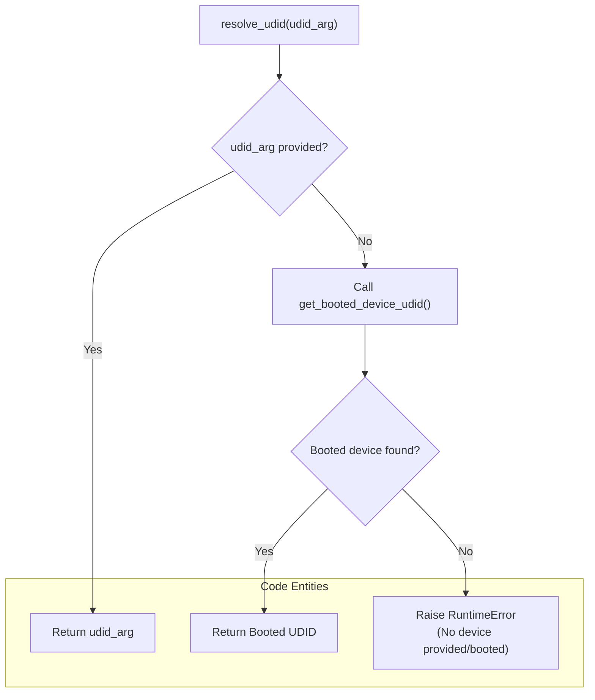
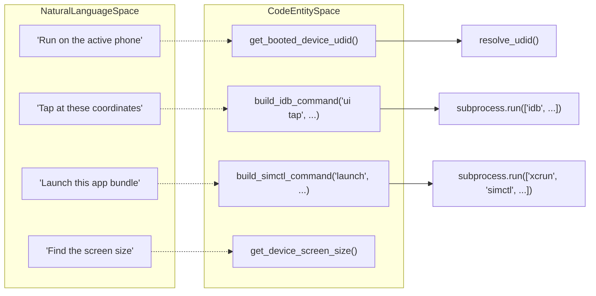

<!-- source: DeepWiki mcp.deepwiki.com · repo conorluddy/ios-simulator-skill · page 10.1 device_utils.py · fetched 2026-10-27 -->

# device_utils.py

Relevant source files

The following files were used as context for generating this wiki page:

- [ios-simulator-skill/skills/ios-simulator-skill/scripts/common/device_utils.py](ios-simulator-skill/skills/ios-simulator-skill/scripts/common/device_utils.py)

`common/device_utils.py` is the shared utility module responsible for all simulator device discovery, UDID resolution, and command standardization across the skill's scripts. Every script that targets a specific simulator—whether by explicit UDID, device name, or automatic detection—routes through this module to ensure consistent interaction with `simctl` and `idb`.

This module follows **Jackson's Law**, extracting only genuinely reused patterns to prevent device targeting bugs [ios-simulator-skill/scripts/common/device_utils.py:8-15]().

---

## Location and Role

| Property | Value |
|---|---|
| File path | `ios-simulator-skill/scripts/common/device_utils.py` |
| Approximate size | ~450 lines |
| Import path | `from common.device_utils import ...` |
| Primary Consumers | `app_launcher.py`, `navigator.py`, `gesture.py`, `simctl_boot.py` |

The module provides a functional interface for building CLI commands and resolving device identifiers, ensuring that scripts don't need to manually handle `xcrun simctl` or `idb` argument formatting.

Sources: [ios-simulator-skill/scripts/common/device_utils.py:1-15]()

---

## Core Command Builders

### `build_simctl_command()`

**Signature:** `build_simctl_command(operation: str, udid: str | None = None, *args) -> list[str]`

Standardizes `xcrun simctl` command construction. It automatically inserts `"booted"` as the target device if no UDID is provided, preventing common targeting errors in app lifecycle management [ios-simulator-skill/scripts/common/device_utils.py:22-32]().

**Example Transformation:**
*   **Input:** `build_simctl_command("launch", None, "com.apple.Maps")`
*   **Output:** `["xcrun", "simctl", "launch", "booted", "com.apple.Maps"]` [ios-simulator-skill/scripts/common/device_utils.py:46-48]()

### `build_idb_command()`

**Signature:** `build_idb_command(operation: str, udid: str | None = None, *args) -> list[str]`

Wraps Facebook's `idb` tool. Unlike `simctl`, `idb` uses a `--udid` flag for targeting. This function handles the conditional inclusion of that flag [ios-simulator-skill/scripts/common/device_utils.py:69-84]().

**Example Transformation:**
*   **Input:** `build_idb_command("ui tap", "ABC-123", "200", "400")`
*   **Output:** `["idb", "ui", "tap", "200", "400", "--udid", "ABC-123"]` [ios-simulator-skill/scripts/common/device_utils.py:99-101]()

Sources: [ios-simulator-skill/scripts/common/device_utils.py:22-121]()

---

## Device Identifier Resolution

The skill uses a multi-stage resolution strategy to find the correct simulator, supporting explicit UDIDs, device names, or automatic detection of currently running simulators.

### `resolve_udid()`

**Signature:** `resolve_udid(udid_arg: str | None) -> str`

The primary entry point for scripts to obtain a valid UDID. If the user provides a UDID via CLI, it is used directly; otherwise, it falls back to `get_booted_device_udid()` [ios-simulator-skill/scripts/common/device_utils.py:161-191]().

**Resolution Flow:**

*UDID resolution logic in `resolve_udid`*

Sources: [ios-simulator-skill/scripts/common/device_utils.py:161-198]()

### `get_booted_device_udid()`

**Signature:** `get_booted_device_udid() -> str | None`

Queries `xcrun simctl list devices booted` and uses a regular expression `r"\(([A-F0-9\-]{36})\)"` to extract the UDID from the first matching line of output [ios-simulator-skill/scripts/common/device_utils.py:124-156]().

---

## Hardware and Screen Utilities

### `get_device_screen_size()`

**Signature:** `get_device_screen_size(udid: str) -> tuple[int, int]`

Determines the actual device resolution by querying the IDB accessibility tree (`ui describe-all`). This is critical for scripts like `navigator.py` and `gesture.py` that need to transform semantic coordinates into pixel values [ios-simulator-skill/scripts/common/device_utils.py:201-220]().

*   **Data Flow:** Executes `idb ui describe-all --json` -> Parses root "frame" -> Returns `(width, height)`.
*   **Fallback:** If detection fails, it defaults to iPhone 14 dimensions (390x844) [ios-simulator-skill/scripts/common/device_utils.py:206-213]().

---

## Consumption Map: Natural Language to Code

This diagram maps common automation requirements to the specific utility functions in `device_utils.py`.

*Mapping user intent to device utility functions*

Sources: [ios-simulator-skill/scripts/common/device_utils.py:22-26](), [ios-simulator-skill/scripts/common/device_utils.py:69-73](), [ios-simulator-skill/scripts/common/device_utils.py:124-126](), [ios-simulator-skill/scripts/common/device_utils.py:201-203]()

---

## Error Handling Contract

All public functions in this module propagate errors as `RuntimeError` with actionable messages. The calling scripts are responsible for catching these and presenting them to the user.

| Function | Failure Condition | Error Message Context |
|---|---|---|
| `resolve_udid()` | No UDID provided AND no simulator booted | Instructions to boot a simulator or provide `--udid` [ios-simulator-skill/scripts/common/device_utils.py:193-198]() |
| `get_booted_device_udid()` | `simctl` command fails | Returns `None` (silently handled by resolver) [ios-simulator-skill/scripts/common/device_utils.py:157-158]() |
| `get_device_screen_size()` | IDB tree unparseable | Defaults to iPhone 14 size (390x844) [ios-simulator-skill/scripts/common/device_utils.py:206-207]() |

Sources: [ios-simulator-skill/scripts/common/device_utils.py:157-158](), [ios-simulator-skill/scripts/common/device_utils.py:193-198](), [ios-simulator-skill/scripts/common/device_utils.py:206-207]()

---

