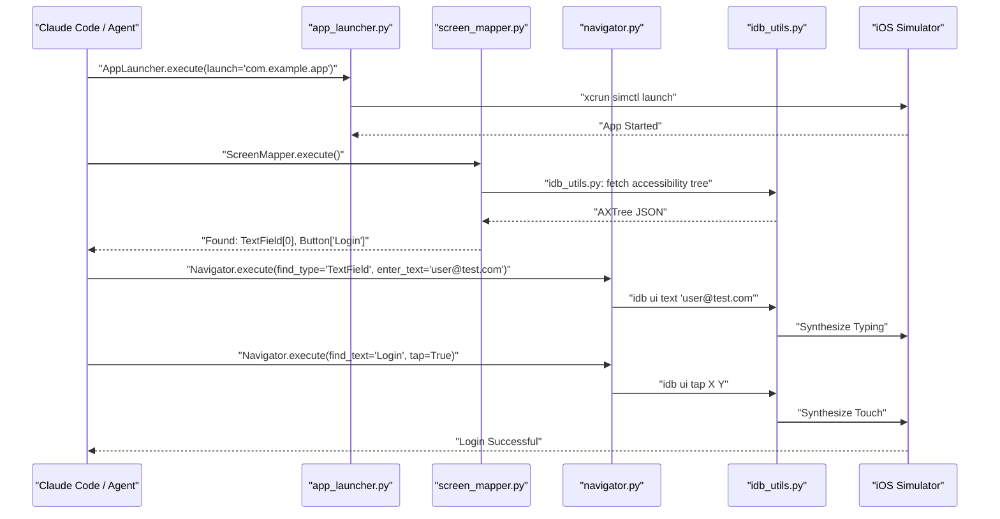
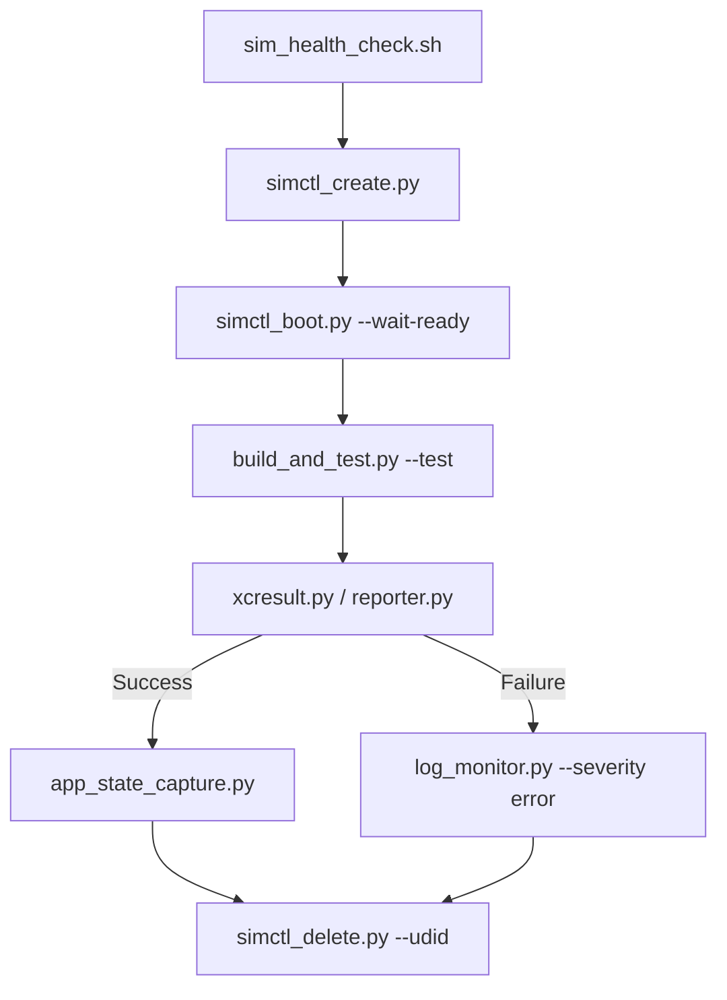

<!-- source: DeepWiki mcp.deepwiki.com · repo conorluddy/ios-simulator-skill · page 11 Examples and Workflows · fetched 2026-10-27 -->

# Examples and Workflows

Relevant source files

The following files were used as context for generating this wiki page:

- [README.md](README.md)
- [references/test_patterns.md](references/test_patterns.md)

This page provides high-level examples of common automation patterns and integration scenarios using the `ios-simulator-skill`. It demonstrates how the 22+ production-ready scripts [README.md:91-94]() can be composed into powerful workflows for development and testing.

**Key Concept**: Scripts are designed for composition. Each produces token-optimized output (3-5 lines by default) that can be consumed by subsequent scripts or parsed in CI/CD pipelines [README.md:81-90]().

---

## Workflow Patterns Overview

The skill supports three primary composition patterns for interacting with the iOS environment:

| Pattern | Description | Use Case | Example Scripts |
|---------|-------------|----------|-----------------|
| **Sequential** | Scripts execute in order, each using previous output | Login flows, test scenarios | `app_launcher.py` → `navigator.py` → `accessibility_audit.py` |
| **Parallel** | Multiple simulators/operations at once | Batch testing, device matrix | `simctl_boot.py --all` → test suite across devices |
| **Progressive** | Incremental disclosure with `--get-errors` and `--json` | Debugging, CI/CD integration | `build_and_test.py` summary → drill down on failure |

Sources: [README.md:49-65](), [README.md:91-141]()

---

## Login Flow Automation

Automate a complete login flow by launching an app, finding input fields via the accessibility tree, entering credentials, and tapping buttons. This workflow prioritizes semantic navigation over screenshots to save tokens and increase reliability [README.md:67-79]().

**For details, see [Login Flow Example](#11.1).**

### Login Interaction Sequence

Sources: [README.md:102-110](), [references/test_patterns.md:60-72]()

---

## CI/CD Integration Patterns

Integrate the skill into automated pipelines (e.g., GitHub Actions) to verify code quality. This includes environment health checks, ephemeral simulator creation, building projects, and parsing test results [README.md:142-153]().

**For details, see [CI/CD Integration Patterns](#11.2).**

### CI/CD Logic Flow

Sources: [README.md:118-121](), [README.md:132-141](), [references/test_patterns.md:37-47]()

---

## Visual Regression Testing Workflow

Demonstrate visual regression testing by capturing baseline screenshots and comparing them against current UI states using pixel-by-pixel analysis with adjustable thresholds [README.md:112-122]().

**For details, see [Visual Regression Testing Workflow](#11.3).**

### Visual Comparison Logic

| Step | Script | Purpose |
|------|--------|---------|
| **Baseline** | `simctl io booted screenshot` | Capture reference screenshot [references/test_patterns.md:14]() |
| **Current** | `simctl io booted screenshot` | Capture current state after changes [references/test_patterns.md:17]() |
| **Compare** | `visual_diff.py` | Run pixel-by-pixel comparison with `--threshold` [README.md:117]() |
| **Report** | `test_recorder.py` | Generate documentation with screenshots [README.md:118]() |

Sources: [README.md:112-122](), [references/test_patterns.md:11-19]()

---

## Summary of Advanced Capabilities

Beyond basic flows, the skill supports edge-case testing:
*   **Permissions**: Grant/revoke camera, location, and photo access via `privacy_manager.py` [README.md:130]().
*   **Push Notifications**: Simulate remote notifications with custom JSON payloads via `push_notification.py` [README.md:129]().
*   **Device State**: Override status bar time, battery, and signal strength for consistent marketing screenshots via `status_bar.py` [README.md:128]().
*   **Data Models**: Inspect Core Data and SwiftData schemas using `model_inspector.py` [README.md:121]().

Sources: [README.md:123-131]()

---

