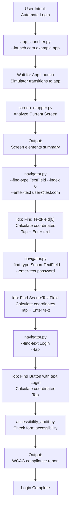
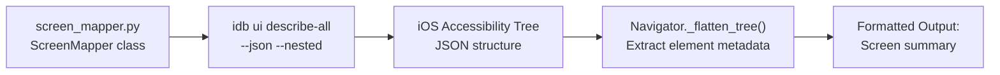
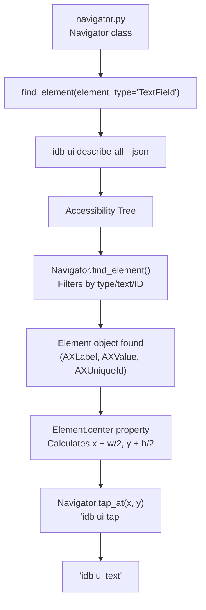
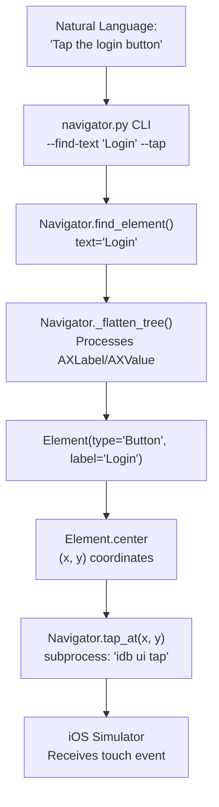

<!-- source: DeepWiki mcp.deepwiki.com · repo conorluddy/ios-simulator-skill · page 11.1 Login Flow Example · fetched 2026-10-27 -->

# Login Flow Example

<details>
<summary>Relevant source files</summary>

The following files were used as context for generating this wiki page:

- [ios-simulator-skill/skills/ios-simulator-skill/scripts/app_launcher.py](ios-simulator-skill/skills/ios-simulator-skill/scripts/app_launcher.py)
- [ios-simulator-skill/skills/ios-simulator-skill/scripts/keyboard.py](ios-simulator-skill/skills/ios-simulator-skill/scripts/keyboard.py)
- [ios-simulator-skill/skills/ios-simulator-skill/scripts/navigator.py](ios-simulator-skill/skills/ios-simulator-skill/scripts/navigator.py)

</details>


This document provides a complete walkthrough of automating a login flow using `ios-simulator-skill` scripts. It demonstrates the core principles of semantic navigation, progressive disclosure, and accessibility-first design in a practical context. This example shows how scripts chain together to accomplish a multi-step UI automation task.

---

## Overview

The login flow example automates a typical authentication scenario: launching an app, entering credentials into text fields, tapping the login button, and verifying the result. This workflow demonstrates:

- **Script composition**: Using multiple scripts in sequence to accomplish a complex task.
- **Semantic element discovery**: Finding UI elements by their meaning rather than coordinates.
- **Zero-configuration execution**: No hardcoded device IDs or screen positions required.
- **Progressive disclosure**: Minimal output by default, detailed inspection on demand.

The example assumes an iOS app with a standard login screen containing email and password fields and a login button.

Sources: [ios-simulator-skill/skills/ios-simulator-skill/scripts/navigator.py:1-55](), [ios-simulator-skill/skills/ios-simulator-skill/scripts/app_launcher.py:1-9]()

---

## Sequential Flow Diagram

The following diagram illustrates the data flow and script execution order for a standard login automation.

Title: Login Automation Sequence


Sources: [ios-simulator-skill/skills/ios-simulator-skill/scripts/navigator.py:21-35](), [ios-simulator-skill/skills/ios-simulator-skill/scripts/app_launcher.py:27-55]()

---

## Step 1: Launch the Application

The first step uses `app_launcher.py` to start the target application. The script resolves the device automatically if only one simulator is booted or uses preferences from `Config`.

```bash
python scripts/app_launcher.py --launch com.example.app
```

### What Happens

| Component | Action |
|-----------|--------|
| `AppLauncher.__init__` | Initializes with optional UDID. [ios-simulator-skill/skills/ios-simulator-skill/scripts/app_launcher.py:23-25]() |
| `AppLauncher.launch()` | Invokes `simctl launch` via `build_simctl_command`. [ios-simulator-skill/skills/ios-simulator-skill/scripts/app_launcher.py:27-55]() |
| `resolve_udid` | (Internal) Checks for preferred simulator or active device. [ios-simulator-skill/skills/ios-simulator-skill/scripts/app_launcher.py:17-17]() |

Sources: [ios-simulator-skill/skills/ios-simulator-skill/scripts/app_launcher.py:27-55](), [ios-simulator-skill/skills/ios-simulator-skill/scripts/app_launcher.py:220-225]()

---

## Step 2: Map the Screen

`screen_mapper.py` (referenced in workflow patterns) queries the accessibility tree to discover what elements are present. This provides context for the next steps.

Title: Screen Mapping Data Flow


### Technical Details
The `Navigator` class uses `get_accessibility_tree` (which calls `idb ui describe-all --json --nested`) and caches the result for efficiency. [ios-simulator-skill/skills/ios-simulator-skill/scripts/navigator.py:106-113](). The tree is then flattened into a list of `Element` objects. [ios-simulator-skill/skills/ios-simulator-skill/scripts/navigator.py:115-137]().

Sources: [ios-simulator-skill/skills/ios-simulator-skill/scripts/navigator.py:106-142]()

---

## Step 3: Enter Credentials

With knowledge of the screen structure, `navigator.py` finds the `TextField` elements and enters data.

```bash
# Enter email
python scripts/navigator.py --find-type TextField --index 0 --enter-text "user@test.com"

# Enter password
python scripts/navigator.py --find-type SecureTextField --enter-text "password"
```

### Element Resolution Flow

Title: Element Discovery and Interaction


### Implementation Details
1. **Finding**: `Navigator.find_element` iterates through flattened elements, checking `elem.type`, `elem.identifier` (AXUniqueId), and `elem.label` (AXLabel). [ios-simulator-skill/skills/ios-simulator-skill/scripts/navigator.py:144-197]()
2. **Coordinates**: `Element.center` calculates the midpoint of the element's frame. [ios-simulator-skill/skills/ios-simulator-skill/scripts/navigator.py:84-89]()
3. **Interaction**: `Navigator.tap` calls `idb ui tap`. [ios-simulator-skill/skills/ios-simulator-skill/scripts/navigator.py:199-214]() Text entry is handled by `idb ui text` within the `Navigator.enter_text` logic or by the `KeyboardController`. [ios-simulator-skill/skills/ios-simulator-skill/scripts/keyboard.py:110-141]()

Sources: [ios-simulator-skill/skills/ios-simulator-skill/scripts/navigator.py:73-96](), [ios-simulator-skill/skills/ios-simulator-skill/scripts/navigator.py:144-214](), [ios-simulator-skill/skills/ios-simulator-skill/scripts/keyboard.py:110-141]()

---

## Step 4: Tap Login Button

The script finds and taps the login button by its text label.

```bash
python scripts/navigator.py --find-text "Login" --tap
```

### What Happens
The `Navigator` uses fuzzy matching by default to find an element where "Login" appears in the `label` or `value`. [ios-simulator-skill/skills/ios-simulator-skill/scripts/navigator.py:184-190](). Once found, it calculates the center and performs the tap using `idb ui tap`. [ios-simulator-skill/skills/ios-simulator-skill/scripts/navigator.py:199-214]()

Sources: [ios-simulator-skill/skills/ios-simulator-skill/scripts/navigator.py:184-214]()

---

## Data Flow: Natural Language to Code Execution

This diagram bridges the conceptual "tap the login button" operation to the actual code entities and iOS APIs.

Title: Natural Language to Code Entity Space


Sources: [ios-simulator-skill/skills/ios-simulator-skill/scripts/navigator.py:73-96](), [ios-simulator-skill/skills/ios-simulator-skill/scripts/navigator.py:144-214]()

---

## Complex Input: Using the Keyboard Controller

For scenarios requiring hardware buttons or special keys (like `Return` to submit), `keyboard.py` is used.

```bash
# Type text with delay for realism
python scripts/keyboard.py --type "user@example.com" --delay 0.1

# Press Return key
python scripts/keyboard.py --key return
```

### Keyboard Implementation
The `KeyboardController` maps logical keys like "return" to HID codes (e.g., 40) and executes them via `idb ui key`. [ios-simulator-skill/skills/ios-simulator-skill/scripts/keyboard.py:79-93](), [ios-simulator-skill/skills/ios-simulator-skill/scripts/keyboard.py:143-175]()

Sources: [ios-simulator-skill/skills/ios-simulator-skill/scripts/keyboard.py:79-175]()

---

## Summary of Key Classes

| Class | Responsibility | Key Methods |
|-------|----------------|-------------|
| `AppLauncher` | Manages app lifecycle via `simctl`. | `launch()`, `terminate()`, `install()` |
| `Navigator` | High-level semantic interaction. | `find_element()`, `tap()`, `list_elements()` |
| `Element` | Data model for accessibility elements. | `center`, `description` |
| `KeyboardController` | Text entry and hardware button simulation. | `type_text()`, `press_key()`, `press_hardware_button()` |

Sources: [ios-simulator-skill/skills/ios-simulator-skill/scripts/app_launcher.py:20-21](), [ios-simulator-skill/skills/ios-simulator-skill/scripts/navigator.py:73-100](), [ios-simulator-skill/skills/ios-simulator-skill/scripts/keyboard.py:76-77]()

---

