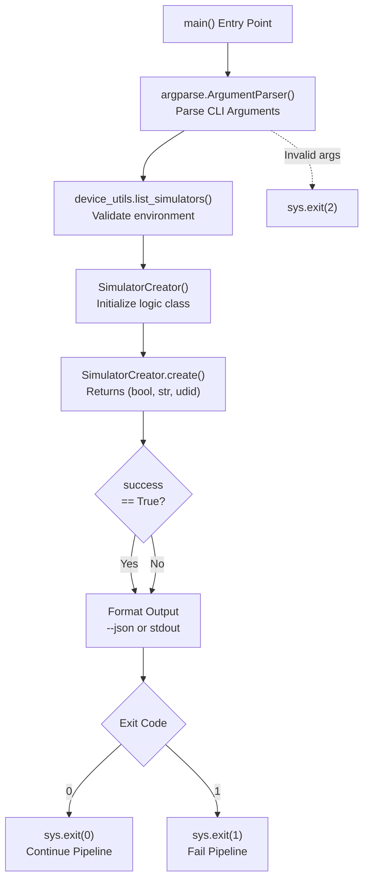
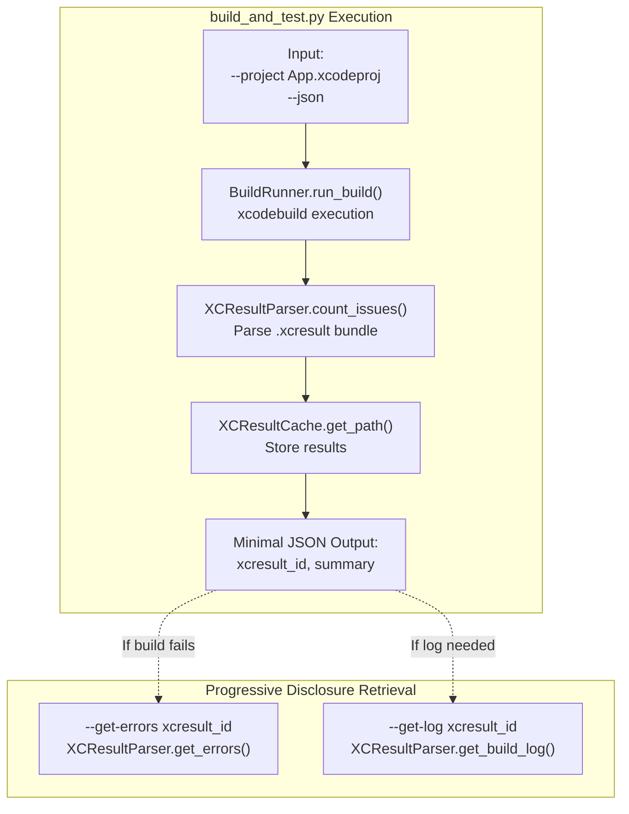

<!-- source: DeepWiki mcp.deepwiki.com · repo conorluddy/ios-simulator-skill · page 11.2 CI/CD Integration Patterns · fetched 2026-10-27 -->

# CI/CD Integration Patterns

<details>
<summary>Relevant source files</summary>

The following files were used as context for generating this wiki page:

- [ios-simulator-skill/skills/ios-simulator-skill/scripts/build_and_test.py](ios-simulator-skill/skills/ios-simulator-skill/scripts/build_and_test.py)
- [ios-simulator-skill/skills/ios-simulator-skill/scripts/simctl_create.py](ios-simulator-skill/skills/ios-simulator-skill/scripts/simctl_create.py)
- [references/test_patterns.md](references/test_patterns.md)

</details>


## Purpose and Scope

This page documents patterns for integrating `ios-simulator-skill` scripts into continuous integration and continuous deployment (CI/CD) pipelines. It covers JSON output mode, exit codes, error handling, and common automation workflows for build servers, GitHub Actions, GitLab CI, and other CI/CD systems.

For general usage examples, see [Examples and Workflows](). For individual script documentation, see the script category pages ([Build & Development](), [Testing & Analysis](), [Device Lifecycle]()).

---

## JSON Output Mode

All 22 scripts support a `--json` flag that produces structured, machine-parseable output instead of human-readable text [ios-simulator-skill/scripts/build_and_test.py:107](). This mode is designed for CI/CD environments where scripts need to be chained together or their output parsed programmatically.

### Output Structure

JSON mode produces a consistent structure across all scripts. Each script's `main()` function handles the `--json` flag and formats output accordingly [ios-simulator-skill/scripts/build_and_test.py:117-120]():

```json
{
  "success": true,
  "message": "Operation completed successfully",
  "data": {
    // Script-specific data
  },
  "timestamp": "2024-01-15T10:30:45Z",
  "duration_ms": 1234
}
```

**Sources:** [ios-simulator-skill/scripts/build_and_test.py:107-131](), [ios-simulator-skill/scripts/simctl_create.py:236-241]()

### Script-Specific JSON Fields

| Script | Key JSON Fields | Implementation | Usage |
|--------|----------------|----------------|-------|
| `simctl_create.py` | `new_udid`, `device_name`, `device_type` | `SimulatorCreator.create()` | Extract UDID for subsequent commands [ios-simulator-skill/scripts/simctl_create.py:31-47]() |
| `simctl_boot.py` | `udid`, `status`, `boot_time_ms` | `SimulatorBooter.execute()` | Verify boot success and timing |
| `screen_mapper.py` | `elements`, `element_count` | `ScreenMapper.execute()` | Parse accessibility tree |
| `build_and_test.py` | `xcresult_id`, `error_count`, `warning_count` | `XCResultParser` | Progressive disclosure pattern [ios-simulator-skill/scripts/build_and_test.py:181-198]() |
| `visual_diff.py` | `difference_percentage`, `passed` | `VisualDiffer.execute()` | Detect visual regressions |

**Sources:** [ios-simulator-skill/scripts/build_and_test.py:190-198](), [ios-simulator-skill/scripts/simctl_create.py:118-125]()

---

## Exit Codes and Error Handling

Scripts follow standard Unix exit code conventions. Each script's `execute()` method typically returns a tuple `(success: bool, message: str)`, which the `main()` function translates to an exit code [ios-simulator-skill/scripts/simctl_create.py:36-47]():

| Exit Code | Meaning | CI/CD Action | Example Scenario |
|-----------|---------|--------------|------------------|
| `0` | Success | Continue pipeline | Operation completed successfully |
| `1` | General error | Fail pipeline | Build failed, test failed, element not found |
| `2` | Invalid arguments | Fail pipeline | Missing required flag, invalid device type |

**Exit code pattern:** `sys.exit(0 if success else 1)` is the standard termination logic.

### Error Handling Pattern

The following diagram maps the logical flow of a CI/CD script execution to the underlying code entities.

**CI/CD Execution Flow with Code Entities**



**Sources:** [ios-simulator-skill/scripts/simctl_create.py:24-47](), [ios-simulator-skill/scripts/simctl_create.py:217-250](), [ios-simulator-skill/scripts/build_and_test.py:45-109](), [ios-simulator-skill/scripts/simctl_create.py:21-22]()

---

## Device Lifecycle Automation Pattern

The most common CI/CD pattern involves creating a fresh simulator, running tests, and cleaning up afterward to ensure isolation [ios-simulator-skill/scripts/simctl_create.py:2-6]().

**Device Lifecycle Automation with Code Entities**

```mermaid
flowchart LR
    subgraph "Setup Phase"
        CREATE["SimulatorCreator.create()<br/>simctl_create.py --json"]
        EXTRACT["jq -r '.new_udid'<br/>Extract UDID"]
        BOOT["SimulatorBooter.execute()<br/>simctl_boot.py --json"]
    end
    
    subgraph "Test Phase"
        LAUNCH["AppLauncher.execute()<br/>app_launcher.py --json"]
        BUILD["BuildRunner.build()<br/>build_and_test.py --json"]
        AUDIT["AccessibilityAuditor.execute()<br/>accessibility_audit.py --json"]
    end
    
    subgraph "Teardown Phase"
        SHUTDOWN["SimulatorShutdown.execute()<br/>simctl_shutdown.py --json"]
        DELETE["SimulatorDeleter.execute()<br/>simctl_delete.py --yes --json"]
    end
    
    CREATE --> EXTRACT
    EXTRACT --> BOOT
    BOOT --> LAUNCH
    LAUNCH --> BUILD
    BUILD --> AUDIT
    AUDIT --> SHUTDOWN
    SHUTDOWN --> DELETE
```



**Sources:** [ios-simulator-skill/scripts/simctl_create.py:31-47](), [ios-simulator-skill/scripts/build_and_test.py:42](), [references/test_patterns.md:39-47]()

### Implementation Example

```bash
#!/bin/bash
set -e

# Setup: Create simulator
# Uses SimulatorCreator._get_device_types() and _get_runtimes() internally
DEVICE_ID=$(python scripts/simctl_create.py \
  --device "iPhone 16 Pro" \
  --json | jq -r '.new_udid')

# Test: Build and run tests
# Uses XCResultCache and XCResultParser for results
python scripts/build_and_test.py \
  --project MyApp.xcodeproj \
  --test \
  --json > build_results.json

# Cleanup: Delete simulator
# Uses simctl_delete.py logic
xcrun simctl delete "$DEVICE_ID"
```

**Sources:** [ios-simulator-skill/scripts/simctl_create.py:118-125](), [ios-simulator-skill/scripts/build_and_test.py:42](), [references/test_patterns.md:39-47](), [ios-simulator-skill/scripts/simctl_create.py:133-162]()

---

## Build and Test Pipeline with Progressive Disclosure

The `build_and_test.py` script implements progressive disclosure for CI/CD: minimal output by default (build summary with `xcresult_id`), with full details available on-demand via retrieval flags [ios-simulator-skill/scripts/build_and_test.py:8-11]().

**Build and Test Execution Flow**



**Sources:** [ios-simulator-skill/scripts/build_and_test.py:42](), [ios-simulator-skill/scripts/build_and_test.py:112](), [ios-simulator-skill/scripts/build_and_test.py:146](), [ios-simulator-skill/scripts/build_and_test.py:182-185]()

### JSON Output Structure with Progressive Disclosure

**Minimal default output (96% token reduction):**

```json
{
  "success": true,
  "build_status": "success",
  "xcresult_id": "xcresult-20251018-143052",
  "summary": {
    "errors": 0,
    "warnings": 3
  }
}
```

**Full output retrieved via `--get-all` [ios-simulator-skill/scripts/build_and_test.py:181-198]():**

```json
{
  "xcresult_id": "xcresult-20251018-143052",
  "error_count": 0,
  "warning_count": 3,
  "errors": [],
  "warnings": [
    {
      "message": "Update to recommended settings",
      "file": "MyApp.xcodeproj"
    }
  ],
  "log_preview": "..."
}
```

**Sources:** [ios-simulator-skill/scripts/build_and_test.py:15-35](), [ios-simulator-skill/scripts/build_and_test.py:187-198]()

---

## Automated Testing Patterns

### Visual Regression Testing
Compare screenshots before and after changes using `visual_diff.py` [references/test_patterns.md:11-19]().

```bash
# Baseline capture
xcrun simctl io booted screenshot baseline.png

# Current capture
xcrun simctl io booted screenshot current.png

# Comparison
python scripts/visual_diff.py baseline.png current.png --json
```

**Sources:** [references/test_patterns.md:12-19]()

### Accessibility Auditing
Run WCAG compliance checks across multiple screens [references/test_patterns.md:21-28]().

```bash
for screen in home login settings; do
  # Navigate to screen
  python scripts/accessibility_audit.py --output $screen.json --json
done
```

**Sources:** [references/test_patterns.md:21-28]()

---

## Summary: CI/CD Integration Checklist

| Task | Script | Key Flags | Implementation Entity |
|------|--------|-----------|-----------------------|
| Create device | `simctl_create.py` | `--device`, `--runtime` | `SimulatorCreator` [ios-simulator-skill/scripts/simctl_create.py:24]() |
| Build & test | `build_and_test.py` | `--project`, `--test` | `BuildRunner`, `XCResultParser` [ios-simulator-skill/scripts/build_and_test.py:42]() |
| Audit A11y | `accessibility_audit.py` | `--json` | `AccessibilityAuditor` |
| Visual diff | `visual_diff.py` | `--json` | `VisualDiffer` |
| Record test | `test_recorder.py` | N/A | `TestRecorder` [references/test_patterns.md:62-64]() |

**Best Practices:**
1. Always use `--json` flag for structured output [ios-simulator-skill/scripts/build_and_test.py:107]().
2. Use `XCResultCache` to manage build artifacts [ios-simulator-skill/scripts/build_and_test.py:112]().
3. Leverage `SimulatorCreator` for on-demand provisioning [ios-simulator-skill/scripts/simctl_create.py:6]().
4. Clean up simulators after tests using `xcrun simctl delete` [references/test_patterns.md:45]().

**Sources:** [ios-simulator-skill/scripts/build_and_test.py:42](), [ios-simulator-skill/scripts/simctl_create.py:24](), [references/test_patterns.md:1-72]()

---

