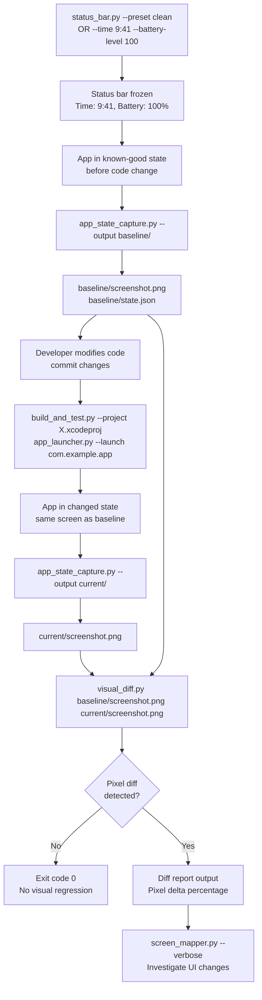
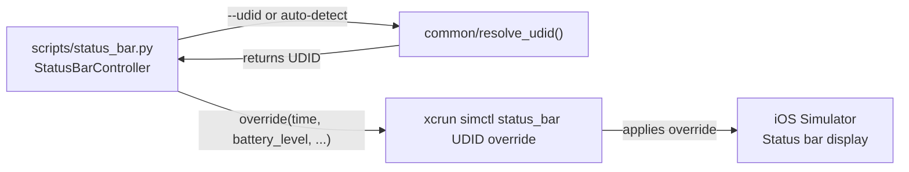
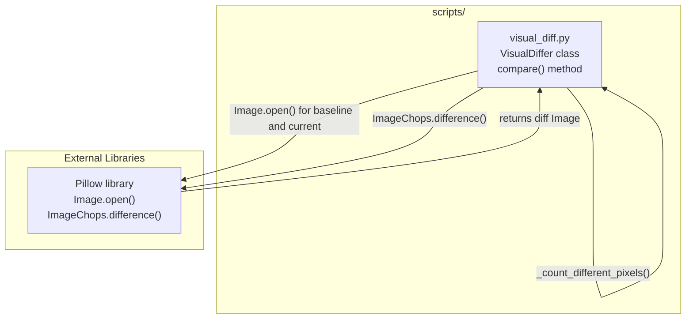

<!-- source: DeepWiki mcp.deepwiki.com · repo conorluddy/ios-simulator-skill · page 11.3 Visual Regression Testing Workflow · fetched 2026-10-27 -->

# Visual Regression Testing Workflow

<details>
<summary>Relevant source files</summary>

The following files were used as context for generating this wiki page:

- [ios-simulator-skill/skills/ios-simulator-skill/scripts/status_bar.py](ios-simulator-skill/skills/ios-simulator-skill/scripts/status_bar.py)
- [ios-simulator-skill/skills/ios-simulator-skill/scripts/visual_diff.py](ios-simulator-skill/skills/ios-simulator-skill/scripts/visual_diff.py)
- [references/test_patterns.md](references/test_patterns.md)

</details>


This page describes how to combine `status_bar.py`, `app_state_capture.py`, and `visual_diff.py` to detect unintended visual changes in your iOS app across code iterations. The workflow includes status bar normalization for consistent baselines, screenshot capture, pixel-level comparison, and threshold tuning.

For standalone script reference: `visual_diff.py` at [7.2](), `app_state_capture.py` at [7.4](), `status_bar.py` at [8.2](). For automated CI/CD pipelines, see [11.2]().

---

## Overview

Visual regression testing answers: *did this code change alter anything visible on screen?* The skill provides three scripts that work together:

| Script | Role | Category |
|--------|------|----------|
| `status_bar.py` | Overrides simulator status bar to fixed values (time, battery, network) for screenshot consistency | Advanced Testing |
| `app_state_capture.py` | Captures debugging snapshot including PNG screenshot and accessibility tree JSON to named directory | Testing & Analysis |
| `visual_diff.py` | Compares two PNG screenshots pixel-by-pixel using Pillow's `ImageChops.difference()` | Testing & Analysis |

All three scripts share dependencies on `common/screenshot_utils.py` for screenshot capture via `xcrun simctl io screenshot`, and on `common/device_utils.py` for UDID resolution.

**Prerequisites:**
- `visual_diff.py` requires Pillow: `pip3 install pillow` [ios-simulator-skill/skills/ios-simulator-skill/scripts/visual_diff.py:17-21]()
- Status bar overrides require iOS Simulator (simctl does not support overrides on physical devices) [ios-simulator-skill/skills/ios-simulator-skill/scripts/status_bar.py:82-107]()

Sources: [ios-simulator-skill/skills/ios-simulator-skill/scripts/visual_diff.py:1-9](), [ios-simulator-skill/skills/ios-simulator-skill/scripts/visual_diff.py:17-21](), [ios-simulator-skill/skills/ios-simulator-skill/scripts/status_bar.py:18-51]()

---

## Workflow Phases

The workflow has four phases:

1.  **Phase 0 — Status bar normalization:** Use `status_bar.py` to set fixed status bar values before capturing baselines. This prevents false positives from clock changes, battery level fluctuations, or network indicator variations.
2.  **Phase 1 — Baseline capture:** Run `app_state_capture.py` against the current app state before making any changes. The `--output` directory stores the reference screenshot PNG and accessibility tree JSON.
3.  **Phase 2 — Code changes:** Modify app code, rebuild with `build_and_test.py`, and relaunch with `app_launcher.py`.
4.  **Phase 3 — Comparison capture and diff:** Capture the post-change screenshot with `app_state_capture.py`, then run `visual_diff.py` to perform pixel-level comparison.

**Visual Regression Workflow — Phase Diagram**



Sources: [ios-simulator-skill/skills/ios-simulator-skill/scripts/visual_diff.py:24-91](), [ios-simulator-skill/skills/ios-simulator-skill/scripts/visual_diff.py:143-163](), [references/test_patterns.md:11-19]()

---

## Phase 0: Status Bar Normalization

Before capturing baselines, freeze the status bar to prevent false positives from time/battery/network changes. `status_bar.py` uses `xcrun simctl status_bar` to override the displayed values [ios-simulator-skill/skills/ios-simulator-skill/scripts/status_bar.py:82-89]().

**Using presets:**

```bash
# Clean preset: 9:41 AM, 100% battery, full WiFi/cellular
python scripts/status_bar.py --preset clean

# Testing preset: 11:11, 50% battery
python scripts/status_bar.py --preset testing
```

**Custom overrides:**

```bash
# Set specific time and battery level
python scripts/status_bar.py --time "9:41" --battery-level 100 --data-network wifi

# Clear overrides (revert to live status bar)
python scripts/status_bar.py --clear
```

The `--preset clean` option is recommended for visual regression baselines because it uses Apple's official marketing screenshot time (9:41) and shows optimal device state [ios-simulator-skill/skills/ios-simulator-skill/scripts/status_bar.py:23-29]().

**Code Entity Map — status_bar.py Execution**



Sources: [ios-simulator-skill/skills/ios-simulator-skill/scripts/status_bar.py:18-108](), [ios-simulator-skill/skills/ios-simulator-skill/scripts/status_bar.py:185-191]()

---

## Phase 1: Capturing the Baseline

After status bar normalization, navigate the app to its known-good visual state and capture the baseline.

```bash
# Baseline capture using simctl directly or app_state_capture.py
python scripts/app_state_capture.py --output baseline/
```

The `AppStateCapture` class (see `app_state_capture.py`) generates two files in the output directory:
- **PNG screenshot** via `capture_screenshot()` from `common/screenshot_utils.py`.
- **JSON snapshot** containing the accessibility tree from `idb ui describe-all --json`.

The screenshot is typically captured via `xcrun simctl io booted screenshot` [references/test_patterns.md:14](). Store the full path — you will reference it in Phase 3.

**Multi-screen baselines:**

```bash
python scripts/app_state_capture.py --output baseline/login/
# Navigate to dashboard
python scripts/navigator.py --find-text "Dashboard" --tap
python scripts/app_state_capture.py --output baseline/dashboard/
```

Sources: [references/test_patterns.md:11-19](), [references/test_patterns.md:49-58]()

---

## Phase 2: Rebuilding After Changes

After committing code changes, rebuild and relaunch the app on the same simulator used for the baseline. Consistency in simulator device type and OS version is critical to avoid false positives from resolution or rendering differences.

```bash
# Rebuild the project
python scripts/build_and_test.py --project MyApp.xcodeproj --scheme MyApp --clean

# Terminate and Launch fresh app instance
python scripts/app_launcher.py --terminate com.example.app
python scripts/app_launcher.py --launch com.example.app
```

Navigate the app to the exact screen captured in Phase 1. Use `screen_mapper.py` to verify you are on the correct screen before capturing the comparison screenshot.

Sources: [references/test_patterns.md:49-58]()

---

## Phase 3: Capturing Comparison and Running Diff

Capture the post-change app state to the `current/` directory:

```bash
python scripts/app_state_capture.py --output current/
```

Then execute the visual diff by providing both PNG paths:

```bash
python scripts/visual_diff.py baseline/screenshot.png current/screenshot.png
```

The `VisualDiffer` class at [ios-simulator-skill/skills/ios-simulator-skill/scripts/visual_diff.py:24-142]() loads both images using `Image.open()` [ios-simulator-skill/skills/ios-simulator-skill/scripts/visual_diff.py:49-50](), then calls `ImageChops.difference()` to compute pixel-level differences [ios-simulator-skill/skills/ios-simulator-skill/scripts/visual_diff.py:73](). The result is analyzed to determine if differences exceed the threshold (default: 0.01, meaning 1% pixel change triggers a fail) [ios-simulator-skill/skills/ios-simulator-skill/scripts/visual_diff.py:27-34]().

**Optional flags:**

```bash
# Set custom difference threshold (0.01 = 1%, default: 0.01)
python scripts/visual_diff.py baseline.png current.png --threshold 0.05

# Generate artifacts in specific directory
python scripts/visual_diff.py baseline.png current.png --output diff_results/

# Show detailed JSON output for CI/CD parsing
python scripts/visual_diff.py baseline.png current.png --details
```

**Code Entity Map — visual_diff.py and External Libraries**



Sources: [ios-simulator-skill/skills/ios-simulator-skill/scripts/visual_diff.py:24-91](), [ios-simulator-skill/skills/ios-simulator-skill/scripts/visual_diff.py:143-163]()

---

## Interpreting Diff Output

`visual_diff.py` returns structured output describing the comparison result. The script's exit code follows standard conventions for CI/CD integration.

| Output Condition | Exit Code | Meaning |
|------------------|-----------|---------|
| `verdict: PASS` | 0 | Differences within `--threshold` — no visual regression [ios-simulator-skill/skills/ios-simulator-skill/scripts/visual_diff.py:81-91]() |
| `verdict: FAIL` | 1 | Pixel differences exceed `--threshold` — visual change detected [ios-simulator-skill/skills/ios-simulator-skill/scripts/visual_diff.py:81-91]() |
| Error message | 1 | Script error (e.g., Pillow not installed, file not found, dimension mismatch) [ios-simulator-skill/skills/ios-simulator-skill/scripts/visual_diff.py:176-180]() |

**Detailed output format (`--details`):**

```json
{
  "summary": {
    "baseline": "baseline.png",
    "current": "current.png",
    "threshold": 0.01,
    "passed": false
  },
  "results": {
    "dimensions": [1170, 2532],
    "total_pixels": 2962440,
    "different_pixels": 85000,
    "difference_percentage": 2.87,
    "threshold_percentage": 1.0,
    "passed": false,
    "verdict": "FAIL"
  },
  "artifacts": {
    "diff_image": "diff.png",
    "comparison_image": "side-by-side.png"
  }
}
```

**Artifacts Generated:**
1.  **`diff.png`**: A red overlay highlighting exactly where pixels changed [ios-simulator-skill/skills/ios-simulator-skill/scripts/visual_diff.py:102-122]().
2.  **`side-by-side.png`**: A combined image showing the baseline and current screenshot next to each other [ios-simulator-skill/skills/ios-simulator-skill/scripts/visual_diff.py:124-141]().

Sources: [ios-simulator-skill/skills/ios-simulator-skill/scripts/visual_diff.py:83-91](), [ios-simulator-skill/skills/ios-simulator-skill/scripts/visual_diff.py:102-141](), [ios-simulator-skill/skills/ios-simulator-skill/scripts/visual_diff.py:193-208]()

---

## Preventing False Positives

Visual diffs are sensitive to simulator state. The following conditions produce false positives (differences that do not reflect code changes):

| Condition | Cause | Mitigation |
|-----------|-------|------------|
| Different device resolution | Baseline on iPhone 15, comparison on iPhone SE | Always use identical device types [ios-simulator-skill/skills/ios-simulator-skill/scripts/visual_diff.py:59-65]() |
| Status bar time/battery | Live status bar shows current time | **Required:** Use `status_bar.py --preset clean` before every capture |
| Noise/Compression | Minor rendering artifacts | `_count_different_pixels` uses a threshold (10) to ignore noise [ios-simulator-skill/skills/ios-simulator-skill/scripts/visual_diff.py:100]() |
| Animation frames | Screenshot captured mid-animation | Add delays after navigation before capture |

**Status bar normalization is mandatory** for reliable visual regression testing. The default status bar displays the live system clock, which guarantees pixel differences between any two captures taken at different times.

Sources: [ios-simulator-skill/skills/ios-simulator-skill/scripts/visual_diff.py:59-65](), [ios-simulator-skill/skills/ios-simulator-skill/scripts/visual_diff.py:93-100](), [ios-simulator-skill/skills/ios-simulator-skill/scripts/status_bar.py:2-9]()

---

