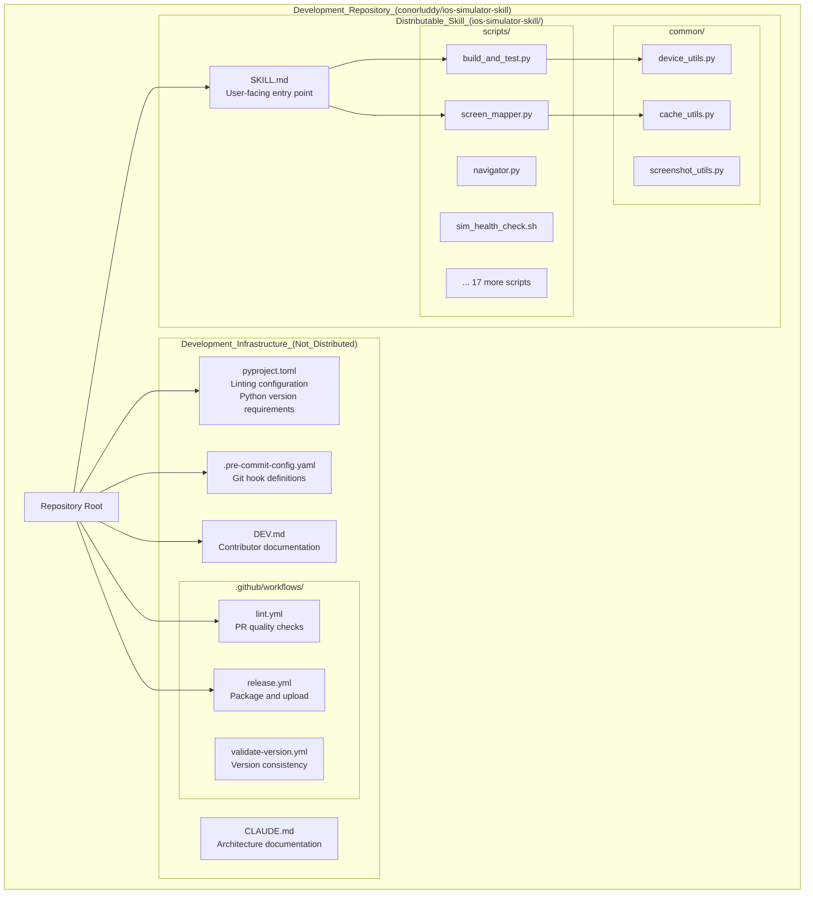
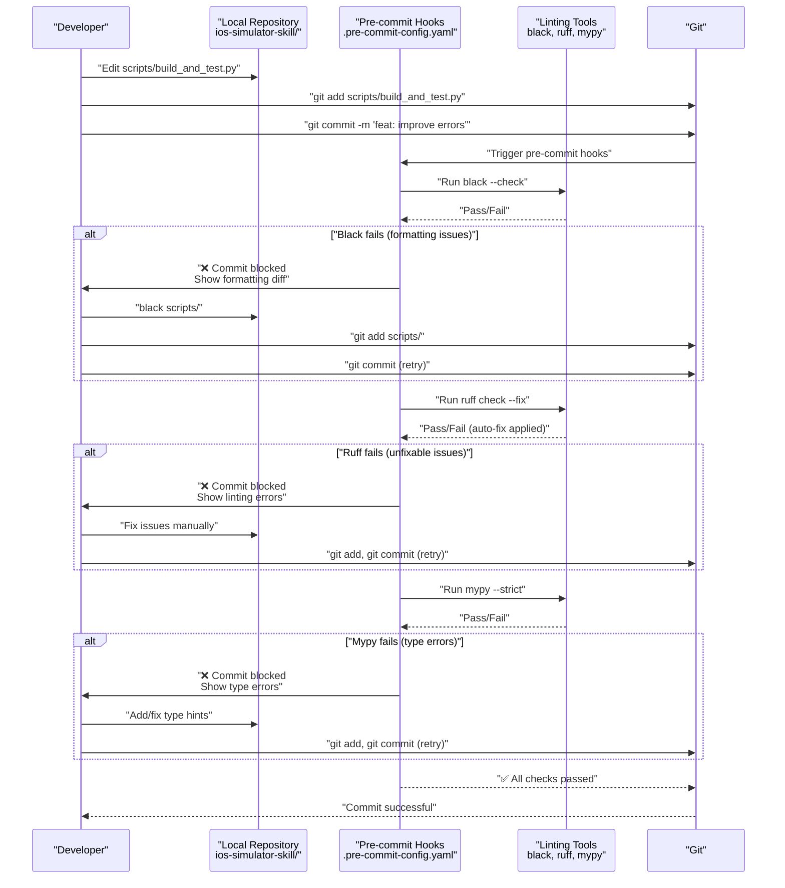

<!-- source: DeepWiki mcp.deepwiki.com · repo conorluddy/ios-simulator-skill · page 12.1 Development Environment Setup · fetched 2026-10-27 -->

# Development Environment Setup

<details>
<summary>Relevant source files</summary>

The following files were used as context for generating this wiki page:

- [.pre-commit-config.yaml](.pre-commit-config.yaml)
- [DEV.md](DEV.md)

</details>


This document covers setting up a local development environment for contributing to the `ios-simulator-skill` repository. It includes cloning the repository, installing development dependencies, configuring pre-commit hooks, and verifying the environment is ready for development.

For information about the specific linting rules and configuration, see **12.2 Code Quality Standards**. For the contribution workflow and pull request process, see **12.5 Contributing Guidelines**. For testing the skill as an end user, see **2.1 Installation and Prerequisites**.

## Overview

The `ios-simulator-skill` repository has a dual-purpose structure: the repository root contains development infrastructure (linting configuration, CI/CD workflows, documentation), while the `ios-simulator-skill/` subdirectory contains the distributable skill package. Contributors work in the development repository and make changes to files under `ios-simulator-skill/scripts/`, while end users download only the packaged skill from GitHub Releases.

**Sources:** [DEV.md:1-116](), [pyproject.toml:1-72]()

## Repository Structure

The following diagram bridges the logical repository structure to the specific code entities and configurations that govern development.

**Repository Entity Map**


**Development occurs in:**
- `ios-simulator-skill/scripts/*.py` - 21 production scripts [DEV.md:7-15]()
- `ios-simulator-skill/common/*.py` - Shared utility modules [DEV.md:106]()

**Not distributed to users:**
- `pyproject.toml` - Development configuration only [DEV.md:113]()
- `.pre-commit-config.yaml` - Development hooks only [DEV.md:114]()
- `.github/workflows/` - CI/CD automation only [DEV.md:108-111]()

**Sources:** [DEV.md:100-116]()

## Prerequisites

| Requirement | Minimum Version | Verification Command | Installation |
|-------------|----------------|---------------------|--------------|
| **macOS** | 11.0+ | `sw_vers` | Required (iOS Simulator dependency) [DEV.md:37]() |
| **Xcode Command Line Tools** | Latest stable | `xcode-select -p` | `xcode-select --install` [DEV.md:38]() |
| **Python** | 3.12+ | `python3 --version` | `brew install python@3.12` [DEV.md:39]() |
| **Git** | Any recent version | `git --version` | `brew install git` [DEV.md:40]() |

**Sources:** [DEV.md:35-40]()

## Initial Setup

### Step 1: Clone the Repository

```bash
git clone https://github.com/conorluddy/ios-simulator-skill.git
cd ios-simulator-skill
```

This creates a local copy of the development repository with all development infrastructure and the distributable skill subdirectory.

**Sources:** [DEV.md:45-47]()

### Step 2: Install Development Dependencies

```bash
pip3 install black ruff mypy pre-commit
```

**Tool purposes:**

| Tool | Purpose | Configuration |
|------|---------|---------------|
| `black` | Code formatting (auto-formats to consistent style) | `pyproject.toml` [DEV.md:78]() |
| `ruff` | Fast linter (catches bugs, style issues, unused imports) | `pyproject.toml` [DEV.md:79]() |
| `mypy` | Static type checker (enforces type hints) | `pyproject.toml` [DEV.md:81]() |
| `pre-commit` | Git hook manager (runs tools automatically on commit) | `.pre-commit-config.yaml` [DEV.md:53]() |

**Sources:** [DEV.md:49-50](), [DEV.md:74-82]()

### Step 3: Install Pre-commit Hooks

```bash
pre-commit install
```

This configures Git to automatically run `black`, `ruff`, and `mypy` on staged files before each commit. If any tool fails, the commit is blocked and the issues are displayed.

**Sources:** [DEV.md:52-53]()

### Step 4: Verify Setup

```bash
pre-commit run --all-files
```

This runs all configured hooks on every file in `ios-simulator-skill/scripts/` to verify:
1. All files are formatted according to `black` standards [DEV.md:78]()
2. No linting errors exist according to `ruff` rules [DEV.md:79]()
3. All type hints are valid according to `mypy` strict checks [DEV.md:81]()

Expected output if setup is correct:
```
black....................................................................Passed
ruff.....................................................................Passed
mypy.....................................................................Passed
```

**Sources:** [DEV.md:55-56](), [.pre-commit-config.yaml:5-40]()

## Development Workflow

The following sequence diagram illustrates how the development environment enforces code quality through the Git lifecycle.

**Code Quality Enforcement Flow**


**Sources:** [DEV.md:59-72]()

### Making Changes

All development work occurs in the `ios-simulator-skill/` subdirectory:

```bash
# Edit production scripts
vim ios-simulator-skill/scripts/build_and_test.py

# Stage changes
git add ios-simulator-skill/scripts/build_and_test.py

# Commit (hooks run automatically)
git commit -m "feat: improve build error reporting"
```

The pre-commit hooks automatically run on staged files only. The hooks operate in sequence:
1. `black` verifies formatting [.pre-commit-config.yaml:7-13]()
2. `ruff` checks linting rules and applies auto-fixes [.pre-commit-config.yaml:16-22]()
3. General hooks check for trailing whitespace, YAML syntax, and large files [.pre-commit-config.yaml:25-39]()

**Sources:** [DEV.md:61-72](), [.pre-commit-config.yaml:1-40]()

### Manual Linting Commands

Pre-commit hooks run automatically, but you can also run linting tools manually:

```bash
# Format all code (modifies files in-place)
black ios-simulator-skill/scripts/

# Lint code with auto-fix
ruff check --fix ios-simulator-skill/scripts/

# Type check (read-only, does not modify files)
mypy ios-simulator-skill/scripts/

# Run all pre-commit hooks manually
pre-commit run --all-files
```

**Sources:** [DEV.md:84-98]()

## Local Verification and Testing

### Environment Health Check

Before developing, verify the iOS Simulator environment is properly configured using the provided utility script:

```bash
bash ios-simulator-skill/scripts/sim_health_check.sh
```

This script checks for:
- macOS operating system [DEV.md:37]()
- Xcode Command Line Tools installation [DEV.md:38]()
- `xcrun simctl` availability [DEV.md:153]()
- Python 3.12+ installation [DEV.md:39]()
- Available simulators [DEV.md:153]()

**Sources:** [DEV.md:148-153]()

### Testing Scripts Locally

Scripts should be tested against a running simulator instance:

```bash
# Boot a simulator (required for most scripts)
open -a Simulator

# Test help documentation
python ios-simulator-skill/scripts/build_and_test.py --help
python ios-simulator-skill/scripts/screen_mapper.py --help

# Test basic functionality
python ios-simulator-skill/scripts/screen_mapper.py
```

**Sources:** [DEV.md:148-163]()

### Simulating Skill Installation

To test the skill as it would be installed by end users in Claude Code:

```bash
# Create test installation directory
mkdir -p ~/.claude/skills/ios-simulator-skill-test

# Copy skill package (not development files)
cp -r ios-simulator-skill/* ~/.claude/skills/ios-simulator-skill-test/

# Restart Claude Code and verify
```

**Sources:** [DEV.md:159-163]()

## Summary of Commands

| Task | Command | Purpose |
|------|---------|---------|
| **Initial setup** | `pip3 install black ruff mypy pre-commit && pre-commit install` | Install and configure development tools [DEV.md:49-53]() |
| **Verify setup** | `pre-commit run --all-files` | Check all files pass linting [DEV.md:56]() |
| **Edit scripts** | `vim ios-simulator-skill/scripts/build_and_test.py` | Make changes to production code [DEV.md:63]() |
| **Format code** | `black ios-simulator-skill/scripts/` | Auto-format before committing [DEV.md:88]() |
| **Lint code** | `ruff check --fix ios-simulator-skill/scripts/` | Check and auto-fix linting issues [DEV.md:91]() |
| **Type check** | `mypy ios-simulator-skill/scripts/` | Verify type annotations [DEV.md:94]() |
| **Test locally** | `python ios-simulator-skill/scripts/screen_mapper.py` | Run scripts to verify functionality [DEV.md:157]() |
| **Health check** | `bash ios-simulator-skill/scripts/sim_health_check.sh` | Verify simulator environment [DEV.md:153]() |

**Sources:** [DEV.md:44-98](), [DEV.md:148-163]()

---

