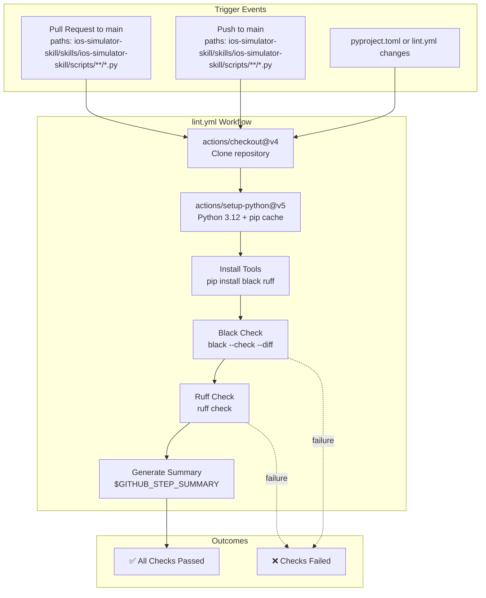
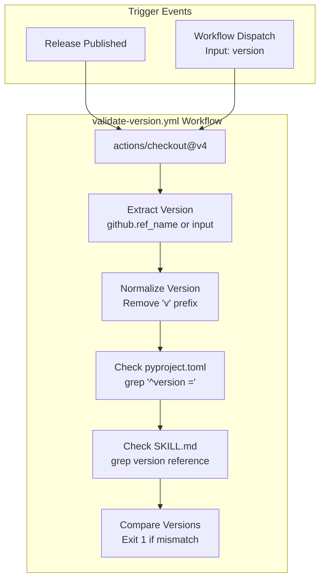
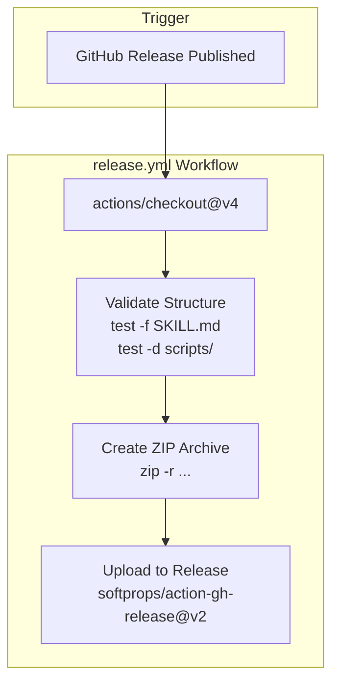

<!-- source: DeepWiki mcp.deepwiki.com · repo conorluddy/ios-simulator-skill · page 12.3 GitHub Actions CI/CD · fetched 2026-10-27 -->

# GitHub Actions CI/CD

Relevant source files

The following files were used as context for generating this wiki page:

- [.github/workflows/lint.yml](.github/workflows/lint.yml)
- [.github/workflows/pages.yml](.github/workflows/pages.yml)
- [.github/workflows/release.yml](.github/workflows/release.yml)
- [.github/workflows/validate-version.yml](.github/workflows/validate-version.yml)
- [site/favicon.svg](site/favicon.svg)
- [site/index.html](site/index.html)
- [site/styles.css](site/styles.css)

## Purpose and Scope

This document describes the GitHub Actions workflows that automate quality validation, version consistency checks, and distribution packaging for the `ios-simulator-skill` repository. These workflows enforce code quality standards and implement the release process for the skill, ensuring that the distributable package is always consistent with the repository state.

## Workflow Overview

The repository implements four distinct GitHub Actions workflows:

| Workflow | File | Trigger | Purpose |
|----------|------|---------|---------|
| **Lint Python Code** | `.github/workflows/lint.yml` | PR/Push to main | Validates code formatting (`black`) and linting (`ruff`) |
| **Validate Version** | `.github/workflows/validate-version.yml` | Release/Manual | Ensures version consistency across `pyproject.toml` and Git tags |
| **Package and Release Skill** | `.github/workflows/release.yml` | Release published | Packages the skill directory into a distributable `.zip` |
| **Deploy GitHub Pages** | `.github/workflows/pages.yml` | Push to main | Deploys documentation site from the `site/` directory |

**Sources:** [.github/workflows/lint.yml:1-53](), [.github/workflows/release.yml:1-57](), [.github/workflows/validate-version.yml:1-71](), [.github/workflows/pages.yml:1-41]()

## Lint Workflow Architecture

### Workflow Definition: lint.yml

The `lint.yml` workflow enforces code quality standards by running `black` and `ruff` on all Python scripts within the skill directory. It targets the `ios-simulator-skill/skills/ios-simulator-skill/scripts/` path specifically to ensure the core logic remains clean.

**Diagram: Lint Workflow Execution Flow**

### Job Execution: lint

The `lint` job executes on `ubuntu-latest` and performs sequential validation:

*   **Set up Python**: Installs Python 3.12 using `actions/setup-python@v5` with `pip` caching enabled [.github/workflows/lint.yml:25-29]().
*   **Install Linting Tools**: Installs `black` and `ruff` via pip [.github/workflows/lint.yml:31-34]().
*   **Run Black**: Executes `black --check --diff` on the scripts directory to verify formatting without modifying files [.github/workflows/lint.yml:36-39]().
*   **Run Ruff**: Executes `ruff check` to identify linting violations [.github/workflows/lint.yml:41-44]().

**Sources:** [.github/workflows/lint.yml:16-52]()

## Version Validation Workflow

### Workflow Definition: validate-version.yml

The `validate-version.yml` workflow ensures version consistency across repository files before and during releases. This prevents shipping a release where the metadata doesn't match the Git tag.

**Diagram: Version Validation Workflow**

### Validation Logic

The workflow determines the version source based on the event type [.github/workflows/validate-version.yml:25-29](). It normalizes the version by removing any `v` prefix [.github/workflows/validate-version.yml:32]().

1.  **pyproject.toml**: It extracts the version from `pyproject.toml` and compares it to the release version [.github/workflows/validate-version.yml:40-49](). A mismatch results in an immediate failure.
2.  **SKILL.md**: It checks if the version number is mentioned in `ios-simulator-skill/SKILL.md` [.github/workflows/validate-version.yml:52-59](). This is a non-blocking warning intended to remind developers to update documentation.

**Sources:** [.github/workflows/validate-version.yml:1-71]()

## Release Workflow Architecture

### Workflow Definition: release.yml

The `release.yml` workflow packages the `ios-simulator-skill/` directory and uploads it as a release artifact. This is the primary distribution mechanism for Claude Code users.

**Diagram: Release Workflow and Artifact Creation**

### Packaging and Distribution

The workflow first validates the skill structure by ensuring `ios-simulator-skill/SKILL.md` and `ios-simulator-skill/scripts` exist [.github/workflows/release.yml:19-24](). 

It then creates a ZIP archive named `ios-simulator-skill-${{ github.ref_name }}.zip`, excluding Python bytecode (`*.pyc`), `__pycache__`, and macOS `.DS_Store` files [.github/workflows/release.yml:26-35](). The package is uploaded to the GitHub release using `softprops/action-gh-release@v2` [.github/workflows/release.yml:37-43]().

**Sources:** [.github/workflows/release.yml:1-57]()

## Documentation Deployment

### Workflow Definition: pages.yml

The `pages.yml` workflow automates the deployment of the documentation site to GitHub Pages, providing a web-based overview of the skill's capabilities.

*   **Trigger**: Activates on pushes to `main` that modify the `site/` directory or the workflow itself [.github/workflows/pages.yml:3-8]().
*   **Permissions**: Requires `pages: write` and `id-token: write` for secure deployment [.github/workflows/pages.yml:11-14]().
*   **Process**: It uploads the contents of the `./site` directory as an artifact and deploys it to the `github-pages` environment [.github/workflows/pages.yml:33-40]().

### Site Assets

The deployment includes the following key files from the `site/` directory:
*   `index.html`: The landing page describing features like "Semantic UI navigation" and "96% Token reduction" [site/index.html:1-170]().
*   `styles.css`: Visual styling using the Inter and Azeret Mono fonts [site/styles.css:1-312]().
*   `favicon.svg`: The site's branding icon [site/favicon.svg:1-6]().

**Sources:** [.github/workflows/pages.yml:1-41](), [site/index.html:1-170](), [site/styles.css:1-312](), [site/favicon.svg:1-6]()

---

