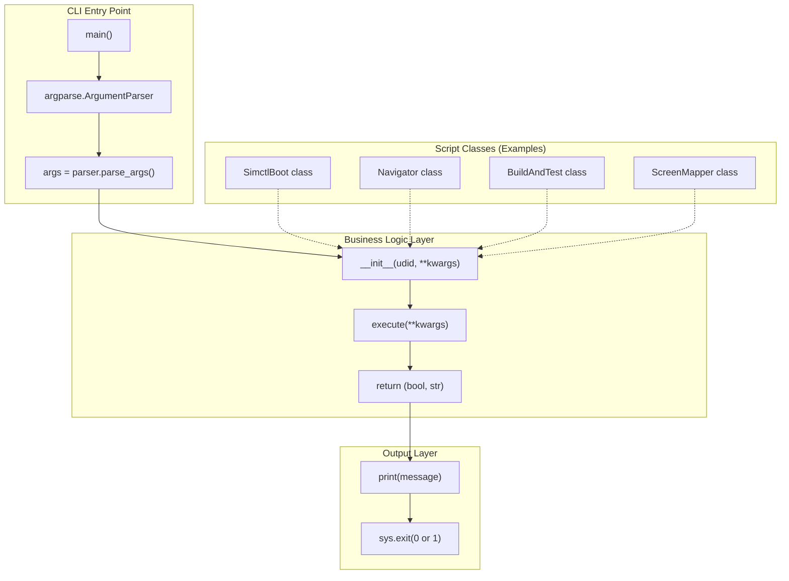
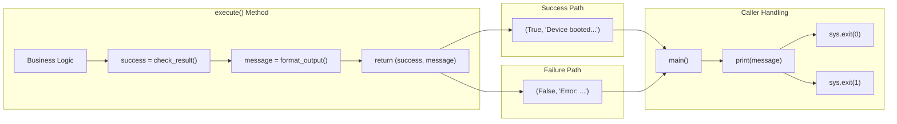
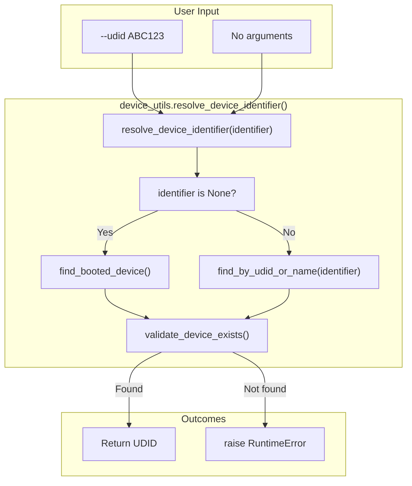
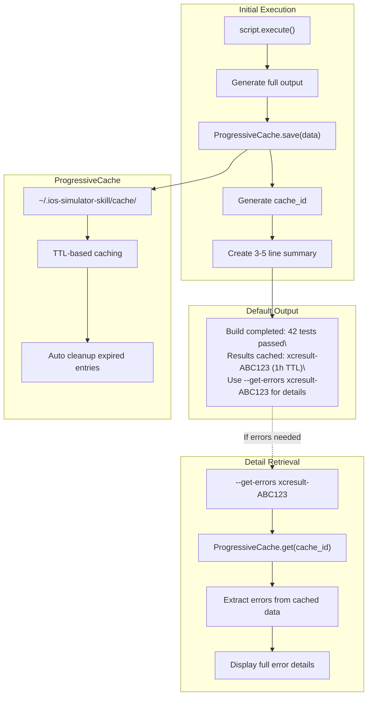
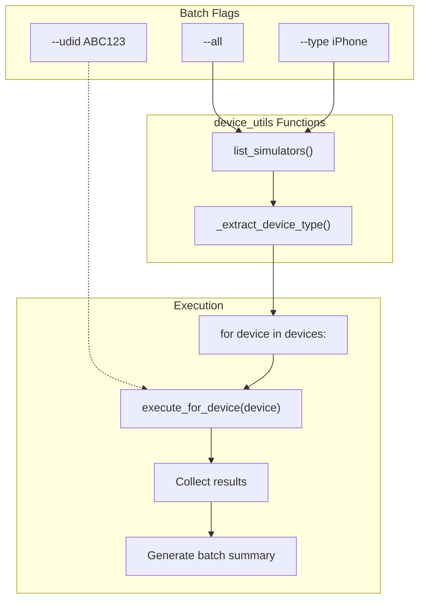
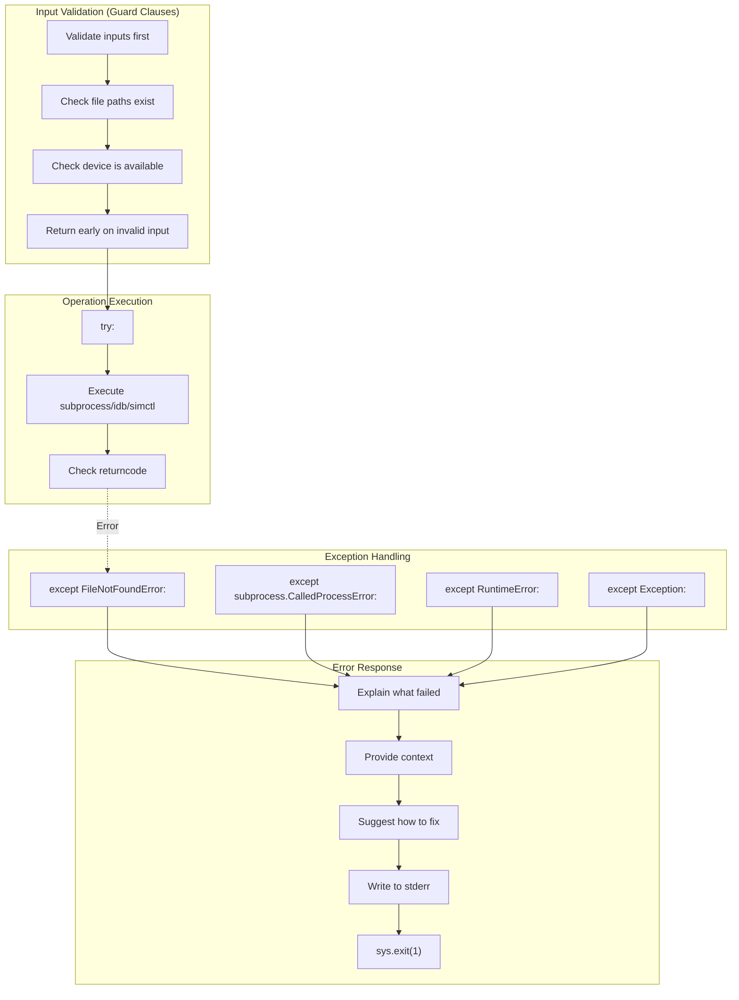

<!-- source: DeepWiki mcp.deepwiki.com · repo conorluddy/ios-simulator-skill · page 12.4 Architecture Patterns and Best Practices · fetched 2026-10-27 -->

# Architecture Patterns and Best Practices

<details>
<summary>Relevant source files</summary>

The following files were used as context for generating this wiki page:

- [CLAUDE.md](CLAUDE.md)
- [DEV.md](DEV.md)

</details>


## Purpose and Scope

This document describes the architectural patterns and best practices used throughout the `ios-simulator-skill` codebase. All 22 production scripts follow consistent design patterns to ensure maintainability, testability, and token efficiency. This includes class-based architecture, standardized return conventions, output formatting strategies, error handling, and security practices.

For development environment setup, see [12.1 Development Environment Setup](). For code quality tools and standards, see [12.2 Code Quality Standards](). For contribution workflow, see [12.5 Contributing Guidelines]().

---

## Core Architectural Patterns

### Class-Based Script Architecture

All scripts with substantial logic (>50 lines) use a class-based design pattern that separates business logic from CLI argument parsing. This enhances testability by allowing the core functionality to be instantiated and tested independently of `argparse` and `sys.exit()`.

**Standard Pattern:**

```python
class DeviceManager:
    def __init__(self, udid: str | None = None):
        self.udid = udid

    def execute(self, **kwargs) -> tuple[bool, str]:
        # Return (success, message) tuple
        pass

def main():
    parser = argparse.ArgumentParser()
    manager = DeviceManager(args.udid)
    success, message = manager.execute()
    print(message)
    sys.exit(0 if success else 1)
```

#### Class-Based Pattern Diagram



**Sources:** [CLAUDE.md:57-76](), [DEV.md:167-174](), [CLAUDE.md:186-194]()

**Examples in Codebase:**

| Script | Class Name | File Path |
|--------|-----------|-----------|
| Boot Simulator | `SimctlBoot` | [ios-simulator-skill/scripts/simctl_boot.py:1-20]() |
| Navigator | `Navigator` | [ios-simulator-skill/scripts/navigator.py:1-20]() |
| Screen Mapper | `ScreenMapper` | [ios-simulator-skill/scripts/screen_mapper.py:1-20]() |
| Build and Test | `BuildAndTest` | [ios-simulator-skill/scripts/build_and_test.py:1-20]() |
| App Launcher | `AppLauncher` | [ios-simulator-skill/scripts/app_launcher.py:1-20]() |

**Benefits:**
- **Testability**: Core logic can be unit tested without mocking `sys.exit()`.
- **Reusability**: Classes can be imported and used by other scripts.
- **Separation of Concerns**: CLI parsing separate from business logic.
- **Type Safety**: Classes enable better type checking with `mypy`.

**Sources:** [CLAUDE.md:57-76]()

---

### Execute Method Return Convention

All script classes implement an `execute()` method that returns a standardized tuple: `(bool, str)`. The boolean indicates success/failure, and the string contains the output message formatted according to the user's requested mode (default/verbose/JSON).

#### Return Tuple Pattern



**Convention Details:**

| Return Value | Meaning | Exit Code | Usage |
|--------------|---------|-----------|-------|
| `(True, str)` | Operation succeeded | 0 | Normal completion, message may be summary or full details |
| `(False, str)` | Operation failed | 1 | Error occurred, message explains what failed and how to fix |

**Sources:** [CLAUDE.md:66-75]()

---

### Auto-UDID Detection Pattern

All device-targeting scripts support optional `--udid` with automatic device detection. The `resolve_device_identifier()` function from `device_utils.py` implements the resolution logic.

#### UDID Resolution Flow



**Resolution Priority:**

1. **Explicit UDID** (`--udid ABC123-DEF456-...`): Use exact UDID.
2. **Auto-detection** (no arguments): Use currently booted device via `resolve_device_identifier(None)`.
3. **Batch Operations** (`--all`, `--type iPhone`): Handled via `list_simulators()`.

**Sources:** [CLAUDE.md:78-88](), [CLAUDE.md:151-155](), [CLAUDE.md:188]()

---

### Output Formatting Strategy

All scripts implement three output modes optimized for different consumers: AI agents (default), human developers (verbose), and automation systems (JSON).

#### Output Mode Selection

```mermaid
graph TB
    subgraph "CLI Arguments"
        DEFAULT["No flags"]
        VERBOSE["--verbose"]
        JSON["--json"]
    end
    
    subgraph "Formatting Functions"
        FORMAT_DEFAULT["format_default_output()"]
        FORMAT_VERBOSE["format_verbose_output()"]
        FORMAT_JSON["format_json_output()"]
    end
    
    subgraph "Output Characteristics"
        D_LINES["3-5 lines"]
        D_TOKENS["5-10 tokens"]
        D_EXAMPLE["'Device booted: iPhone 16 Pro (ABC123) [2.1s]'"]
        
        V_LINES["50+ lines"]
        V_TOKENS["400+ tokens"]
        V_EXAMPLE["'Device booted successfully.\\nDevice UDID: ABC123DEF456...\\nBoot time: 2.1 seconds'"]
        
        J_LINES["20-30 lines"]
        J_TOKENS["20-30 tokens"]
        J_EXAMPLE["{\"action\": \"boot\", \"udid\": \"ABC123\", \"success\": true}"]
    end
    
    DEFAULT --> FORMAT_DEFAULT
    VERBOSE --> FORMAT_VERBOSE
    JSON --> FORMAT_JSON
    
    FORMAT_DEFAULT --> D_LINES
    D_LINES --> D_TOKENS
    D_TOKENS --> D_EXAMPLE
    
    FORMAT_VERBOSE --> V_LINES
    V_LINES --> V_TOKENS
    V_TOKENS --> V_EXAMPLE
    
    FORMAT_JSON --> J_LINES
    J_LINES --> J_TOKENS
    J_TOKENS --> J_EXAMPLE
```

**Output Mode Comparison:**

| Mode | Lines | Tokens | Target Audience | Use Case |
|------|-------|--------|-----------------|----------|
| **Default** | 3-5 | 5-10 | AI agents | Conversational efficiency, 96% token reduction |
| **Verbose** | 50+ | 400+ | Human developers | Debugging, detailed inspection |
| **JSON** | 20-30 | 20-30 | CI/CD systems | Machine parsing, automation |

**Sources:** [CLAUDE.md:90-105](), [CLAUDE.md:174-182](), [CLAUDE.md:189]()

---

### Progressive Disclosure Integration

Scripts that produce large outputs (build logs, accessibility trees, device lists) implement progressive disclosure using `ProgressiveCache` from `cache_utils.py`. This strategy results in a 96% token reduction for typical AI agent interactions.

#### Progressive Disclosure Flow



**Sources:** [CLAUDE.md:161-163](), [CLAUDE.md:174-182](), [CLAUDE.md:206-207]()

---

### Batch Operations Pattern

Most lifecycle scripts support batch operations to act on multiple devices simultaneously using `--all` or `--type` flags.

#### Batch Operation Types



**Sources:** [CLAUDE.md:107-114](), [CLAUDE.md:151-155]()

---

## Best Practices

### Error Handling

All scripts follow strict error handling guidelines to provide actionable feedback and prevent silent failures.

#### Error Handling Pattern



**Key Principles:**
- **Guard Clauses**: Validate inputs and environment states first, then proceed to the "happy path" [DEV.md:170]().
- **Actionable Errors**: Always explain what failed, why it failed, and how to fix it [DEV.md:173]().
- **Specific Exception Handling**: Catch specific exceptions rather than using bare `except:` clauses [CLAUDE.md:168]().

**Sources:** [DEV.md:166-176](), [CLAUDE.md:164-172]()

---

### Security Practices

#### No `shell=True`
To prevent shell injection vulnerabilities, all scripts must use argument lists in `subprocess` calls [CLAUDE.md:172]().

#### Path Validation
Always validate file paths before use, ensuring they exist and are not subject to path traversal [DEV.md:175]().

**Sources:** [DEV.md:175](), [CLAUDE.md:172]()

---

### Code Organization Principles

- **Jackson's Law**: Minimal code to solve the problem [DEV.md:169]().
- **Function Complexity**: Keep functions focused and under 50 lines [DEV.md:171]().
- **File Size**: Keep modules understandable and under 300 lines [DEV.md:172]().
- **Type Safety**: All functions must use type annotations, enforced by `mypy --strict` [DEV.md:174]().

**Sources:** [DEV.md:166-176](), [CLAUDE.md:164-172]()

---

## Summary: Architecture Decision Records

| Decision | Rationale | Implementation |
|----------|-----------|----------------|
| **Class-based scripts** | Testability and reusability | Classes with `execute()` method returning `(bool, str)` |
| **Auto-UDID detection** | Zero-config convenience | `resolve_device_identifier()` in `device_utils.py` |
| **Three output modes** | Efficiency for agents vs. detail for humans | Default, `--verbose`, and `--json` flags |
| **Progressive disclosure** | 96% token reduction | `ProgressiveCache` in `cache_utils.py` |
| **Strict Linting** | Code quality and consistency | Black, Ruff, and Mypy enforcement |

**Sources:** [CLAUDE.md:55-216](), [DEV.md:166-176]()

---

