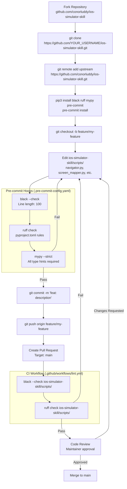
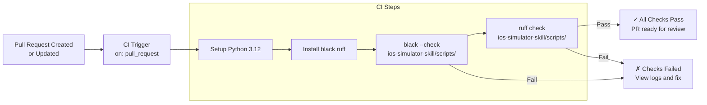
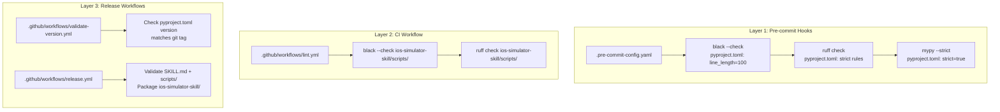
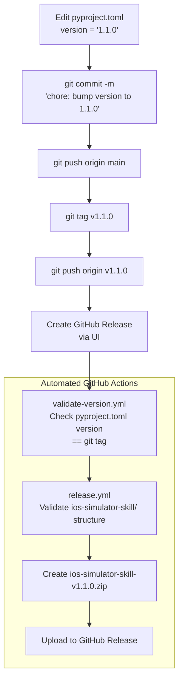

<!-- source: DeepWiki mcp.deepwiki.com · repo conorluddy/ios-simulator-skill · page 12.5 Contributing Guidelines · fetched 2026-10-27 -->

# Contributing Guidelines

<details>
<summary>Relevant source files</summary>

The following files were used as context for generating this wiki page:

- [.gitignore](.gitignore)
- [DEV.md](DEV.md)
- [LICENSE.md](LICENSE.md)

</details>


This page describes the contribution workflow for the ios-simulator-skill repository, including the fork-to-PR process, automated quality gates, testing requirements, and release procedures.

For development environment setup, see page 12.1. For code quality configuration details, see page 12.2. For CI/CD implementation, see page 12.3. For architectural patterns, see page 12.4.

---

## Fork-to-Pull-Request Workflow

**Fork-to-Merge Process with Quality Gates**



**Sources:** [DEV.md:191-199](), [DEV.md:44-57](), [DEV.md:62-72]()

### Step-by-Step Contribution Process

#### 1. Fork and Clone

```bash
# Fork on GitHub UI
git clone https://github.com/YOUR_USERNAME/ios-simulator-skill.git
cd ios-simulator-skill

# Add upstream remote for syncing
git remote add upstream https://github.com/conorluddy/ios-simulator-skill.git
```

#### 2. Install Development Tools

```bash
# Install formatting and linting tools
pip3 install black ruff mypy pre-commit

# Install git hooks from .pre-commit-config.yaml
pre-commit install

# Verify hooks are working
pre-commit run --all-files
```

**Sources:** [DEV.md:44-57]()

#### 3. Create Feature Branch

Branch naming conventions:

| Branch Type | Pattern | Example |
|------------|---------|---------|
| New feature | `feature/description` | `feature/add-network-throttling` |
| Bug fix | `fix/description` | `fix/accessibility-tree-parsing` |
| Documentation | `docs/description` | `docs/improve-skill-md` |
| Refactoring | `refactor/description` | `refactor/device-utils-caching` |

```bash
git checkout -b feature/my-feature
```

#### 4. Make Changes and Test

```bash
# Edit scripts in ios-simulator-skill/scripts/
vim ios-simulator-skill/scripts/navigator.py

# Open iOS Simulator
open -a Simulator

# Verify environment
bash ios-simulator-skill/scripts/sim_health_check.sh

# Test modified script
python ios-simulator-skill/scripts/navigator.py --help
python ios-simulator-skill/scripts/navigator.py --find-text "Login"

# Run linters manually (hooks run on commit)
black ios-simulator-skill/scripts/
ruff check --fix ios-simulator-skill/scripts/
mypy ios-simulator-skill/scripts/
```

**Sources:** [DEV.md:86-98](), [DEV.md:147-163]()

#### 5. Commit with Hooks

```bash
git add ios-simulator-skill/scripts/navigator.py
git commit -m "feat: add fuzzy matching for accessibility labels"

# Pre-commit hooks run automatically:
# 1. black --check (formatting)
# 2. ruff check (linting)
# 3. mypy --strict (type checking)

# If hooks fail, fix issues and retry
```

**Commit message prefixes:**

| Prefix | Usage |
|--------|-------|
| `feat:` | New feature or capability |
| `fix:` | Bug fix |
| `docs:` | Documentation changes only |
| `refactor:` | Code restructuring (no behavior change) |
| `test:` | Test additions or modifications |
| `chore:` | Maintenance (version bumps, dependencies) |

**Sources:** [DEV.md:62-72]()

#### 6. Push and Create PR

```bash
git push origin feature/my-feature

# Create PR on GitHub UI
# - Target branch: main
# - Title: descriptive (e.g., "Add fuzzy matching to navigator.py")
# - Description: explain changes and testing performed
```

#### 7. CI Validation

**CI Workflow Logic**



**Sources:** [DEV.md:183-186]()

---

## Automated Quality Gates

The repository enforces quality through three layers of checks: local pre-commit hooks, CI linting workflow, and release validation.

**Three-Layer Quality Gate System**



**Sources:** [DEV.md:108-115](), [DEV.md:178-190]()

### Layer 1: Pre-commit Hooks

Configured in `.pre-commit-config.yaml`, automatically runs on `git commit`:

| Tool | Purpose | Config Location |
|------|---------|----------------|
| `black` | Code formatting, line length 100 | `pyproject.toml` |
| `ruff` | Linting (imports, style, bugs) | `pyproject.toml` |
| `mypy` | Type checking (strict mode) | `pyproject.toml` |

**Sources:** [DEV.md:74-82](), [DEV.md:52-57]()

### Layer 2: CI Linting Workflow

`lint.yml` runs on:
- Pull requests to `main` for Python files [DEV.md:183-184]()
- Actions include running Black, Ruff, and mypy [DEV.md:185]()
- Merge is blocked if checks fail [DEV.md:186]()

**Sources:** [DEV.md:183-186]()

### Layer 3: Release Validation

#### validate-version.yml

Ensures `pyproject.toml` version matches the git tag when a release is published.

**Sources:** [DEV.md:187-190]()

#### release.yml

Packages the skill into a distributable zip.
1. Validates structure (SKILL.md and scripts directory) [DEV.md:181]()
2. Zips the `ios-simulator-skill/` directory [DEV.md:181]()
3. Uploads the artifact to the GitHub Release [DEV.md:181]()

**Sources:** [DEV.md:179-182]()

---

## Release Process (Maintainers Only)

### Semantic Versioning

Version source of truth: `pyproject.toml` [DEV.md:121-122]()

**Release Workflow with Automated Packaging**



**Sources:** [DEV.md:118-144]()

### Release Commands

```bash
# 1. Update version in pyproject.toml
vim pyproject.toml  # Update version = "1.1.0"

# 2. Commit version bump
git add pyproject.toml
git commit -m "chore: bump version to 1.1.0"
git push origin main

# 3. Create and push tag
git tag v1.1.0
git push origin v1.1.0

# 4. Create GitHub release via UI
```

**Sources:** [DEV.md:120-138]()

---

## Local Testing Requirements

Test all changes before submitting a PR.

### Environment Verification

```bash
# Run health check (verify dependencies)
bash ios-simulator-skill/scripts/sim_health_check.sh
```

**Sources:** [DEV.md:152-153]()

### Script Testing

```bash
# Test individual scripts
python ios-simulator-skill/scripts/build_and_test.py --help
python ios-simulator-skill/scripts/screen_mapper.py
```

**Sources:** [DEV.md:155-157]()

### Skill Installation Test

```bash
# Test skill installation locally
mkdir -p ~/.claude/skills/ios-simulator-skill-test
cp -r ios-simulator-skill/* ~/.claude/skills/ios-simulator-skill-test/
# Restart Claude Code and verify
```

**Sources:** [DEV.md:159-163]()

---

## PR Review Criteria

Maintainers review PRs for:

| Category | Requirements | Reference |
|----------|-------------|-----------|
| **Linting** | Passes `black`, `ruff`, `mypy` | [DEV.md:183-186]() |
| **Code Style** | Jackson's Law, Guard clauses, Functions < 50 lines | [DEV.md:167-173]() |
| **Security** | No `shell=True`, validate paths | [DEV.md:175-176]() |
| **Errors** | Actionable error messages | [DEV.md:173]() |
| **Types** | Strict type hints required | [DEV.md:174]() |

**Sources:** [DEV.md:165-176]()

---

## Summary

The contribution process follows a standard fork-and-pull-request workflow with automated quality gates. All code must be formatted with Black, linted with Ruff, and type-checked with mypy. Release packaging is handled automatically by GitHub Actions upon publishing a release.

**Sources:** [DEV.md:1-209]()

---

