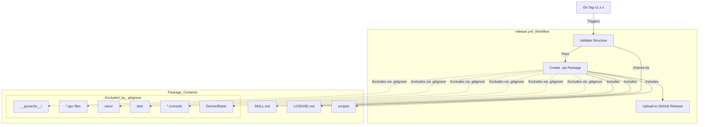

<!-- source: DeepWiki mcp.deepwiki.com · repo conorluddy/ios-simulator-skill · page 14 License · fetched 2026-10-27 -->

# License

<details>
<summary>Relevant source files</summary>

The following files were used as context for generating this wiki page:

- [.gitignore](.gitignore)
- [LICENSE.md](LICENSE.md)

</details>


This page displays the license terms governing the use, modification, and distribution of the `ios-simulator-skill` software. The project is licensed under the MIT License, a permissive open-source license that allows broad usage rights.

For information about contributing to the project, see [12.5 Contributing Guidelines](). For development setup, see [12.1 Development Environment Setup]().

---

## License Overview

The `ios-simulator-skill` is released under the **MIT License**, one of the most permissive open-source licenses. This license allows users to freely use, modify, and distribute the software with minimal restrictions.

**License File Location**: [LICENSE.md:1-22]()

**Copyright Holder**: Conor Luddy (2025)

Sources: [LICENSE.md:1-22]()

---

## License Text

The complete MIT License text is reproduced below:

```text
MIT License

Copyright (c) 2025 Conor Luddy

Permission is hereby granted, free of charge, to any person obtaining a copy
of this software and associated documentation files (the "Software"), to deal
in the Software without restriction, including without limitation the rights
to use, copy, modify, merge, publish, distribute, sublicense, and/or sell
copies of the Software, and to permit persons to whom the Software is
furnished to do so, subject to the following conditions:

The above copyright notice and this permission notice shall be included in all
copies or substantial portions of the Software.

THE SOFTWARE IS PROVIDED "AS IS", WITHOUT WARRANTY OF ANY KIND, EXPRESS OR
IMPLIED, INCLUDING BUT NOT LIMITED TO THE WARRANTIES OF MERCHANTABILITY,
FITNESS FOR A PARTICULAR PURPOSE AND NONINFRINGEMENT. IN NO EVENT SHALL THE
AUTHORS OR COPYRIGHT HOLDERS BE LIABLE FOR ANY CLAIM, DAMAGES OR OTHER
LIABILITY, WHETHER IN AN ACTION OF CONTRACT, TORT OR OTHERWISE, ARISING FROM,
OUT OF OR IN CONNECTION WITH THE SOFTWARE OR THE USE OR OTHER DEALINGS IN THE
SOFTWARE.
```

Sources: [LICENSE.md:1-22]()

---

## License Scope and Coverage

The MIT License applies to all components of the `ios-simulator-skill` package distributed from the GitHub repository.

### Covered Components

```mermaid
graph TB
    LICENSE["LICENSE.md"]
    
    subgraph "Package_Components"
        SKILL["SKILL.md"]
        
        subgraph "scripts_Directory"
            BUILD["build_and_test.py"]
            SCREEN["screen_mapper.py"]
            NAV["navigator.py"]
            GESTURE["gesture.py"]
            KB["keyboard.py"]
            LAUNCHER["app_launcher.py"]
            AUDIT["accessibility_audit.py"]
            VDIFF["visual_diff.py"]
            RECORDER["test_recorder.py"]
            STATE["app_state_capture.py"]
            HEALTH["sim_health_check.sh"]
            CLIP["clipboard.py"]
            STATUS["status_bar.py"]
            PUSH["push_notification.py"]
            PRIVACY["privacy_manager.py"]
            BOOT["simctl_boot.py"]
            SHUTDOWN["simctl_shutdown.py"]
            CREATE["simctl_create.py"]
            DELETE["simctl_delete.py"]
            ERASE["simctl_erase.py"]
            LOG["log_monitor.py"]
            MODEL["model_inspector.py"]
        end
        
        subgraph "common_Utilities"
            DEVICE["device_utils.py"]
            SCREENSHOT["screenshot_utils.py"]
            CACHE["cache_utils.py"]
            IDB["idb_utils.py"]
        end
        
        subgraph "xcode_Modules"
            XCRESULT["xcresult.py"]
            REPORTER["reporter.py"]
            CONFIG["config.py"]
        end
    end
    
    LICENSE -->|"Covers all files"| SKILL
    LICENSE -->|"Covers all files"| BUILD
    LICENSE -->|"Covers all files"| SCREEN
    LICENSE -->|"Covers all files"| NAV
    LICENSE -->|"Covers all files"| GESTURE
    LICENSE -->|"Covers all files"| KB
    LICENSE -->|"Covers all files"| LAUNCHER
    LICENSE -->|"Covers all files"| AUDIT
    LICENSE -->|"Covers all files"| VDIFF
    LICENSE -->|"Covers all files"| RECORDER
    LICENSE -->|"Covers all files"| STATE
    LICENSE -->|"Covers all files"| HEALTH
    LICENSE -->|"Covers all files"| CLIP
    LICENSE -->|"Covers all files"| STATUS
    LICENSE -->|"Covers all files"| PUSH
    LICENSE -->|"Covers all files"| PRIVACY
    LICENSE -->|"Covers all files"| BOOT
    LICENSE -->|"Covers all files"| SHUTDOWN
    LICENSE -->|"Covers all files"| CREATE
    LICENSE -->|"Covers all files"| DELETE
    LICENSE -->|"Covers all files"| ERASE
    LICENSE -->|"Covers all files"| LOG
    LICENSE -->|"Covers all files"| MODEL
    LICENSE -->|"Covers all files"| DEVICE
    LICENSE -->|"Covers all files"| SCREENSHOT
    LICENSE -->|"Covers all files"| CACHE
    LICENSE -->|"Covers all files"| IDB
    LICENSE -->|"Covers all files"| XCRESULT
    LICENSE -->|"Covers all files"| REPORTER
    LICENSE -->|"Covers all files"| CONFIG
```



**Coverage**: All production scripts (including specialized tools like `model_inspector.py`), shared utility modules in `common/`, `xcode/` modules, and documentation files are covered by the MIT License.

Sources: [LICENSE.md:1-22]()

---

## Key Permissions and Requirements

The MIT License grants the following permissions with minimal requirements:

| Permission | Description | Requirement |
|------------|-------------|-------------|
| **Use** | Run the software for any purpose, commercial or non-commercial | None |
| **Copy** | Make copies of the software | Include copyright notice |
| **Modify** | Modify the source code to create derivative works | Include copyright notice |
| **Distribute** | Share the original or modified software with others | Include copyright notice and license |
| **Sublicense** | Grant different license terms to derivatives (within MIT constraints) | Include original copyright notice |
| **Sell** | Sell copies of the software or include it in commercial products | Include copyright notice |

**Required Attribution**: The copyright notice [LICENSE.md:3-3]() and permission notice [LICENSE.md:5-10]() must be included in all copies or substantial portions of the Software.

**No Warranty**: The software is provided "AS IS" without warranty of any kind [LICENSE.md:15-17]().

Sources: [LICENSE.md:1-22]()

---

## Distribution and Packaging

The MIT License requirements are automatically satisfied during the release process through the GitHub Actions workflow.

### Release Workflow License Compliance



**Compliance Mechanism**: The release workflow ensures `LICENSE.md` is included in every packaged release, satisfying the MIT License requirement that "the above copyright notice and this permission notice shall be included in all copies or substantial portions of the Software" [LICENSE.md:12-13]().

**Excluded Files**: Build artifacts and temporary data listed in [.gitignore:1-56]() (such as `__pycache__/` [.gitignore:2-2](), `*.pyc` [.gitignore:3-3](), `dist/` [.gitignore:20-20](), `.xcresult/` [.gitignore:39-39](), and `DerivedData/` [.gitignore:38-38]()) are not included in the distributed package, as they are generated files not part of the source distribution.

Sources: [LICENSE.md:1-22](), [.gitignore:1-56]()

---

## License Implications for Usage

### Use Cases Permitted Without Additional Authorization

The MIT License explicitly permits the following use cases without requiring permission from the copyright holder:

1. **AI Agent Integration**: Claude Code or other AI systems can execute scripts from this skill without license restrictions.
2. **Commercial Testing**: Companies can use the skill in their CI/CD pipelines for commercial iOS app development.
3. **Derivative Works**: Developers can fork the repository, modify scripts, and redistribute under their own branding (with attribution).
4. **Private Internal Use**: Organizations can use and modify the skill internally without publishing changes.
5. **Educational Use**: The skill can be used in teaching materials, courses, or tutorials.

### Attribution Requirements in Practice

| Scenario | Attribution Required |
|----------|---------------------|
| Running scripts locally | No (using software as-is) |
| Distributing modified scripts | Yes (include `LICENSE.md`) |
| Embedding scripts in larger product | Yes (include copyright notice) |
| Linking to GitHub repository | No (reference, not distribution) |
| Forking for internal company use | No (private use, not distribution) |
| Publishing a derivative skill | Yes (include original license) |

Sources: [LICENSE.md:1-22]()

---

## No Warranty Clause

The MIT License includes a comprehensive disclaimer of warranties [LICENSE.md:15-21](). This means:

- **No Implied Warranties**: The software does not come with warranties of merchantability, fitness for a particular purpose, or non-infringement [LICENSE.md:15-17]().
- **Use at Your Own Risk**: Users assume all risks associated with using the software [LICENSE.md:17-21]().
- **No Liability**: The copyright holder (Conor Luddy) is not liable for damages arising from the use of the software [LICENSE.md:17-21]().

This is standard for open-source software and protects contributors from legal liability while still allowing broad usage.

Sources: [LICENSE.md:15-21]()

---

## License Compatibility

The MIT License is compatible with most other open-source licenses, allowing `ios-simulator-skill` to be integrated into projects with different licensing requirements:

| Target License | Compatibility | Notes |
|----------------|---------------|-------|
| **MIT** | ✓ Compatible | Same license |
| **Apache 2.0** | ✓ Compatible | Can be relicensed to Apache 2.0 |
| **BSD (2-clause, 3-clause)** | ✓ Compatible | Similar permissive terms |
| **GPL 2.0/3.0** | ✓ Compatible | MIT code can be included in GPL projects |
| **LGPL** | ✓ Compatible | MIT code can be included in LGPL projects |
| **Proprietary/Commercial** | ✓ Compatible | MIT allows proprietary derivatives |

**Note**: When combining with copyleft licenses like GPL, the combined work must be distributed under GPL terms, but the original MIT-licensed portions remain MIT-licensed.

Sources: [LICENSE.md:1-22]()

---

## Summary

The `ios-simulator-skill` is licensed under the MIT License, granting users broad permissions to use, modify, and distribute the software with minimal restrictions. The only requirement is to include the copyright notice and license text in distributions. The software is provided without warranty, and the copyright holder is not liable for damages.

For the complete legal text, refer to [LICENSE.md:1-22]() in the repository root.

Sources: [LICENSE.md:1-22]()

---

