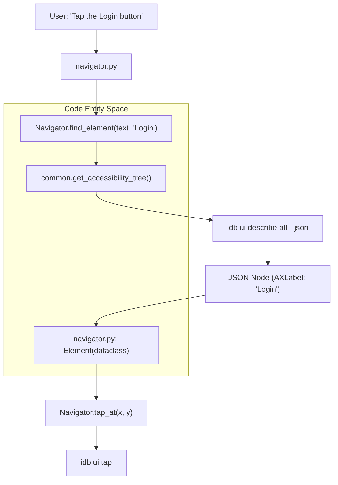
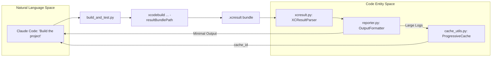

<!-- source: DeepWiki mcp.deepwiki.com · repo conorluddy/ios-simulator-skill · page 15 Glossary · fetched 2026-10-27 -->

# Glossary

Relevant source files

The following files were used as context for generating this wiki page:

- [CLAUDE.md](CLAUDE.md)
- [README.md](README.md)
- [ios-simulator-skill/.claude-plugin/plugin.json](ios-simulator-skill/.claude-plugin/plugin.json)
- [ios-simulator-skill/skills/ios-simulator-skill/scripts/common/cache_utils.py](ios-simulator-skill/skills/ios-simulator-skill/scripts/common/cache_utils.py)
- [ios-simulator-skill/skills/ios-simulator-skill/scripts/common/device_utils.py](ios-simulator-skill/skills/ios-simulator-skill/scripts/common/device_utils.py)
- [references/idb_quick.md](references/idb_quick.md)
- [references/simctl_quick.md](references/simctl_quick.md)

This glossary defines codebase-specific terms, abbreviations, and domain concepts essential for understanding the **ios-simulator-skill** architecture and implementation.

## Core Infrastructure Terms

### UDID (Unique Device Identifier)
A unique string that identifies a specific iOS simulator instance.
*   **Implementation**: Scripts use `resolve_udid()` or `resolve_device_identifier()` to convert human-readable names (e.g., "iPhone 16") or "booted" keywords into a specific UDID string.
*   **Sources**: [ios-simulator-skill/skills/ios-simulator-skill/scripts/common/device_utils.py:161-199](), [CLAUDE.md:78-88]()

### simctl
Apple's command-line utility (`xcrun simctl`) for controlling iOS simulators.
*   **Usage**: Primary tool for lifecycle management (boot, shutdown, create, delete) and app installation. The skill wraps these via `build_simctl_command`.
*   **Sources**: [CLAUDE.md:7-8](), [ios-simulator-skill/skills/ios-simulator-skill/scripts/common/device_utils.py:22-66](), [references/simctl_quick.md:5-38]()

### idb (iOS Debug Bridge)
A command-line interface developed by Meta for automating iOS Simulators and Devices.
*   **Usage**: The skill uses `idb` for advanced interactions like querying the accessibility tree, simulating swipes, and sending push notifications.
*   **Sources**: [CLAUDE.md:7-8](), [README.md:44-45](), [references/idb_quick.md:1-25]()

### idb-companion
The server-side component of `idb` that must be running to communicate with the simulator. The skill's `idb_utils.py` handles detection and health checks for this service.
*   **Sources**: [ios-simulator-skill/skills/ios-simulator-skill/scripts/common/idb_utils.py:12-25]()

### xcresult
A bundle format (`.xcresult`) used by Xcode to store build and test execution results.
*   **Implementation**: Parsed by `XCResultParser` to extract errors, warnings, and test failure messages.
*   **Sources**: [ios-simulator-skill/skills/ios-simulator-skill/scripts/xcode/xcresult.py:15-21](), [README.md:51-55]()

### xcresulttool
The underlying Apple CLI tool used by the skill to export JSON data from `.xcresult` bundles.
*   **Implementation**: Called within `XCResultParser._run_xcresulttool`.
*   **Sources**: [ios-simulator-skill/skills/ios-simulator-skill/scripts/xcode/xcresult.py:23-45]()

---

## Design Patterns

### Progressive Disclosure
A design principle where the system provides a concise summary by default and reveals deep technical details only on demand.
*   **Implementation**: Achieving a 96% token reduction by returning a `cache_id` instead of full logs or lists.
*   **Sources**: [ios-simulator-skill/skills/ios-simulator-skill/scripts/common/cache_utils.py:5-9](), [CLAUDE.md:174-182](), [README.md:49-65]()

### Token Efficiency
The practice of minimizing the number of text tokens sent to an AI Agent to reduce latency and cost.
*   **Stats**: Default output is typically 5-10 tokens, compared to 400+ for verbose output.
*   **Sources**: [CLAUDE.md:174-182](), [README.md:81-90]()

### Semantic Navigation
Navigating an app based on the meaning and identity of UI elements (labels, types) rather than raw pixel coordinates.
*   **Implementation**: `Navigator.find_element()` searches the accessibility tree for matches.
*   **Sources**: [ios-simulator-skill/skills/ios-simulator-skill/scripts/navigator.py:8-11](), [README.md:67-79]()

### Coordinate Transformation
The process of converting coordinates from a screenshot (which may be scaled) to the actual logical coordinate space of the simulator.
*   **Implementation**: Handled by logic within `navigator.py` or `screenshot_utils.py` to ensure taps land on intended targets.
*   **Sources**: [ios-simulator-skill/skills/ios-simulator-skill/scripts/navigator.py:68-69](), [ios-simulator-skill/skills/ios-simulator-skill/scripts/common/device_utils.py:13-14]()

---

## Technical Components

### Accessibility Tree
A hierarchical representation of the UI provided by iOS for assistive technologies.
*   **Data Flow**: `idb ui describe-all --json` -> `get_accessibility_tree()` -> `flatten_tree()`.
*   **Fields**:
    *   **AXLabel**: The accessibility label (usually the text or button description).
    *   **AXValue**: The current value (e.g., text in a text field).
    *   **AXUniqueId**: The programmer-defined accessibility identifier (often maps to `accessibilityIdentifier`).
*   **Sources**: [ios-simulator-skill/skills/ios-simulator-skill/scripts/navigator.py:49-55](), [ios-simulator-skill/skills/ios-simulator-skill/scripts/navigator.py:121-131](), [references/idb_quick.md:5-8]()

### Cache System
| Term | Definition | Code Pointer |
| :--- | :--- | :--- |
| **cache_id** | A timestamped identifier (e.g., `sim-20251028-143052`) for retrieving cached data. | `ProgressiveCache.save()` |
| **TTL** | Time-To-Live; the duration before a cache entry is considered expired (default 1 hour). | `ProgressiveCache.__init__` |
| **ProgressiveCache** | The class managing storage in `~/.ios-simulator-skill/cache/`. | `cache_utils.py` |

*   **Sources**: [ios-simulator-skill/skills/ios-simulator-skill/scripts/common/cache_utils.py:25-46](), [ios-simulator-skill/skills/ios-simulator-skill/scripts/common/cache_utils.py:62-65]()

### Data Modeling
*   **@Model (SwiftData)**: A Swift macro for defining persistent models. The skill extracts these via regex in `model_inspector.py`.
*   **xcdatamodeld**: The Core Data XML-based schema format. The skill parses these using `ElementTree`.
*   **Sources**: [ios-simulator-skill/skills/ios-simulator-skill/scripts/model_inspector.py:24-26](), [ios-simulator-skill/skills/ios-simulator-skill/scripts/model_inspector.py:153-164]()

### Build Artifacts
*   **xcodebuild**: The primary CLI tool for building and testing Xcode projects.
*   **DerivedData**: The directory where Xcode stores intermediate build artifacts and `.xcresult` bundles.
*   **Sources**: [README.md:11-12](), [ios-simulator-skill/skills/ios-simulator-skill/scripts/model_inspector.py:93-95]()

---

## System Mapping Diagrams

### From Natural Language to Code Entities (Navigation)

This diagram maps how a user's intent to "tap a button" traverses the codebase.

*   **Sources**: [ios-simulator-skill/skills/ios-simulator-skill/scripts/navigator.py:144-164](), [ios-simulator-skill/skills/ios-simulator-skill/scripts/navigator.py:73-83](), [ios-simulator-skill/skills/ios-simulator-skill/scripts/navigator.py:204-214]()

### Build and Result Processing Pipeline

This diagram maps the flow from an execution command to a token-efficient response.

*   **Sources**: [ios-simulator-skill/skills/ios-simulator-skill/scripts/xcode/xcresult.py:15-21](), [ios-simulator-skill/skills/ios-simulator-skill/scripts/xcode/reporter.py:18-46](), [ios-simulator-skill/skills/ios-simulator-skill/scripts/common/cache_utils.py:48-61]()

---

## Miscellaneous Terms

*   **TCC (Transparency, Consent, and Control)**: The iOS subsystem managing privacy permissions (Camera, Photos, etc.). Managed by `privacy_manager.py`.
*   **WCAG (Web Content Accessibility Guidelines)**: The standard used by `accessibility_audit.py` to evaluate screen compliance.
*   **Device Readiness**: A state where the simulator is not just "booted" but has fully loaded its internal services and is responsive to commands.
*   **Auto-learning Config**: The `Config` class in `scripts/xcode/config.py` that automatically remembers the `last_used_simulator` to simplify future commands.
*   **Fuzzy Matching**: A search technique used in `navigator.py` to find elements even if the provided text doesn't match the `AXLabel` exactly (case-insensitive substring matching).
*   **Pillow**: The Python Imaging Library used for processing screenshots and calculating visual diffs.
*   **Skill**: A collection of scripts and metadata (like `plugin.json` and `SKILL.md`) that extends Claude Code's capabilities.
*   **Smart Deletion**: The ability to delete simulators based on age (`--old N` flag) to keep the environment clean.

*   **Sources**: [README.md:130-130](), [README.md:116-116](), [ios-simulator-skill/skills/ios-simulator-skill/scripts/simctl_boot.py:87-111](), [ios-simulator-skill/skills/ios-simulator-skill/scripts/xcode/config.py:14-24](), [ios-simulator-skill/skills/ios-simulator-skill/scripts/navigator.py:184-192](), [README.md:45-45](), [ios-simulator-skill/ios-simulator-skill/.claude-plugin/plugin.json:1-12](), [README.md:139-139]()