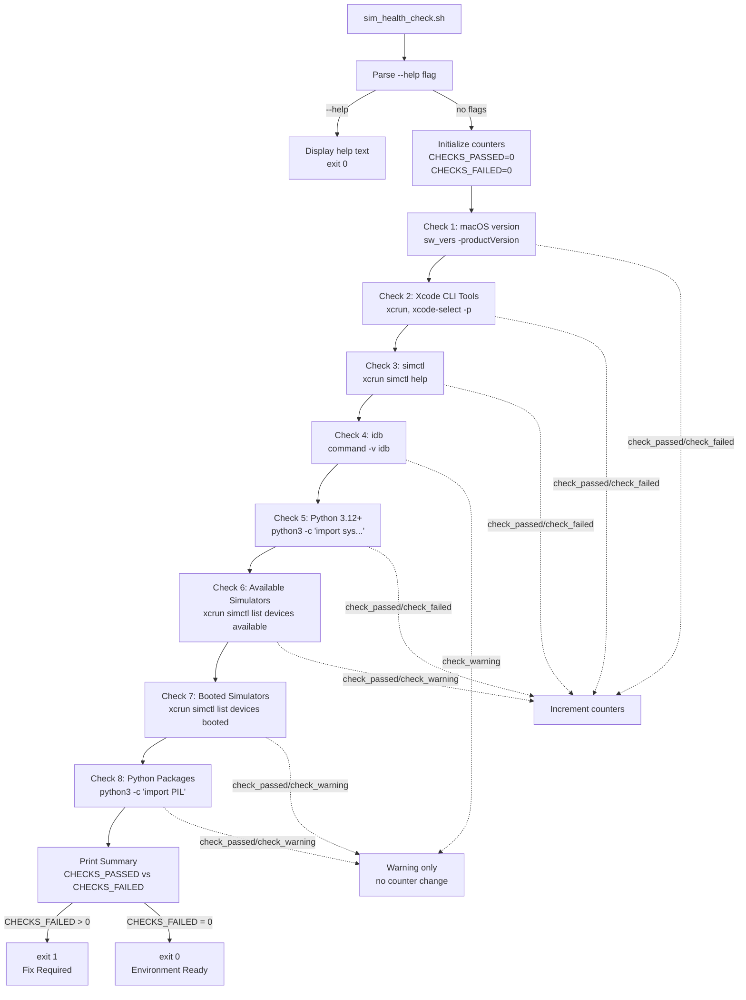
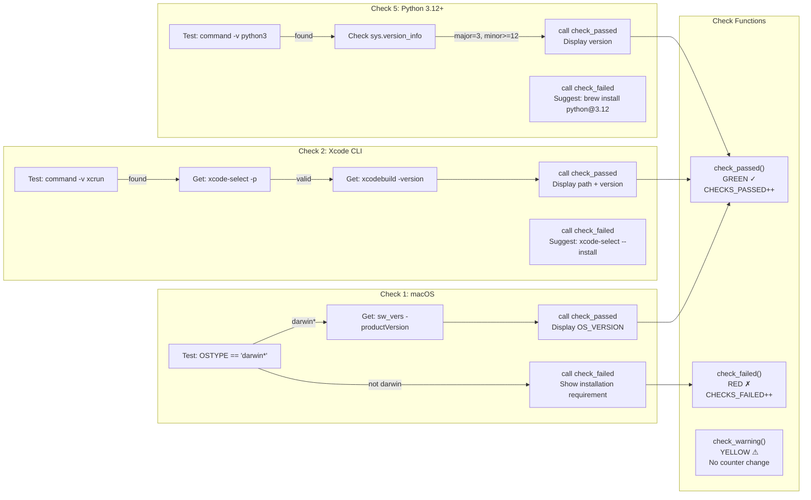
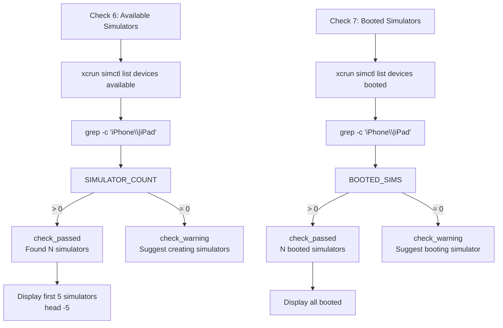
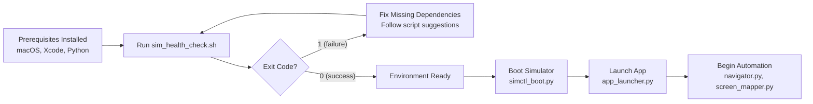

<!-- source: DeepWiki mcp.deepwiki.com · repo conorluddy/ios-simulator-skill · page 2.2 Environment Verification · fetched 2026-10-27 -->

# Environment Verification

<details>
<summary>Relevant source files</summary>

The following files were used as context for generating this wiki page:

- [ios-simulator-skill/skills/ios-simulator-skill/scripts/sim_health_check.sh](ios-simulator-skill/skills/ios-simulator-skill/scripts/sim_health_check.sh)

</details>


This page documents the environment verification system provided by `sim_health_check.sh`, which validates that all required dependencies for `ios-simulator-skill` are properly installed and configured. This script performs comprehensive checks across system tools, simulators, and optional dependencies, providing actionable feedback for missing or misconfigured components.

For installing the initial prerequisites, see [2.1 Installation and Prerequisites](). For executing your first automation workflow after verification, see [2.3 Quick Start Tutorial]().

## Overview

The `sim_health_check.sh` script performs eight sequential checks to validate the complete iOS simulator testing environment. It verifies core Apple tools (`xcodebuild`, `simctl`), optional automation tools (`idb`), runtime requirements (Python 3.12+), and the availability of simulator devices. The script uses color-coded output with exit codes suitable for both interactive terminal use and CI/CD integration.

**Sources:** [ios-simulator-skill/skills/ios-simulator-skill/scripts/sim_health_check.sh:1-55]()

## Script Execution Model

The logic flow of `sim_health_check.sh` is designed to be exhaustive rather than failing fast, ensuring users receive a complete report of their environment state in one pass.

Title: Health Check Execution Flow


The script executes checks sequentially without early termination. All eight checks run regardless of individual failures, providing complete diagnostic information in a single execution. The final exit code is determined by whether any critical checks failed (macOS, Xcode, simctl, Python).

**Sources:** [ios-simulator-skill/skills/ios-simulator-skill/scripts/sim_health_check.sh:62-239]()

## Dependency Checks

The script performs eight distinct validation checks, each targeting a specific component of the iOS simulator testing environment.

### Check Categories

| Check # | Component | Status Type | Exit Impact | Command |
|---------|-----------|-------------|-------------|---------|
| 1 | macOS Version | Pass/Fail | Critical | `sw_vers -productVersion` |
| 2 | Xcode CLI Tools | Pass/Fail | Critical | `xcrun`, `xcode-select -p` |
| 3 | `simctl` Availability | Pass/Fail | Critical | `xcrun simctl help` |
| 4 | `idb` Installation | Pass/Warning | Non-critical | `command -v idb` |
| 5 | Python 3.12+ | Pass/Fail | Critical | `python3 -c "import sys..."` |
| 6 | Available Simulators | Pass/Warning | Non-critical | `xcrun simctl list devices available` |
| 7 | Booted Simulators | Pass/Warning | Non-critical | `xcrun simctl list devices booted` |
| 8 | Python Packages (Pillow) | Pass/Warning | Non-critical | `python3 -c "import PIL"` |

**Sources:** [ios-simulator-skill/skills/ios-simulator-skill/scripts/sim_health_check.sh:80-217]()

### Check Implementation Details

Title: Status Reporting Logic


The three output functions ([ios-simulator-skill/skills/ios-simulator-skill/scripts/sim_health_check.sh:66-78]()) use color codes defined at the script header ([ios-simulator-skill/skills/ios-simulator-skill/scripts/sim_health_check.sh:13-17]()). Critical checks use `check_failed` which increments `CHECKS_FAILED`, causing the script to exit with code 1. Optional checks use `check_warning` to inform the user without failing the overall validation.

**Sources:** [ios-simulator-skill/skills/ios-simulator-skill/scripts/sim_health_check.sh:66-78](), [ios-simulator-skill/skills/ios-simulator-skill/scripts/sim_health_check.sh:80-152]()

### Simulator Device Discovery

Check 6 and Check 7 specifically target simulator availability and state by parsing `simctl` output:

Title: Simulator Discovery Data Flow


The script limits the display of available simulators to 5 devices ([ios-simulator-skill/skills/ios-simulator-skill/scripts/sim_health_check.sh:165]()) to prevent output overflow on systems with many installed runtimes. Booted simulators are always shown in full since there are typically few active devices ([ios-simulator-skill/skills/ios-simulator-skill/scripts/sim_health_check.sh:188]()).

**Sources:** [ios-simulator-skill/skills/ios-simulator-skill/scripts/sim_health_check.sh:154-200]()

## Usage

### Basic Invocation

```bash
bash scripts/sim_health_check.sh
```

The script requires no arguments for standard operation and automatically detects all environment components. The `--help` flag displays detailed usage information:

```bash
bash scripts/sim_health_check.sh --help
```

**Sources:** [ios-simulator-skill/skills/ios-simulator-skill/scripts/sim_health_check.sh:22-55]()

### Exit Codes

| Exit Code | Condition | Meaning |
|-----------|-----------|---------|
| 0 | `CHECKS_FAILED = 0` | All critical checks passed, environment ready |
| 1 | `CHECKS_FAILED > 0` | One or more critical checks failed, action required |

The exit code determination occurs in the summary section ([ios-simulator-skill/skills/ios-simulator-skill/scripts/sim_health_check.sh:225-239]()). The script continues executing all checks even after failures, providing complete diagnostic output before exiting.

**Sources:** [ios-simulator-skill/skills/ios-simulator-skill/scripts/sim_health_check.sh:225-239]()

## Output Interpretation

### Status Symbols

The script uses three distinct status indicators, implemented via the check functions:

| Symbol | Color | Function | Meaning | Impact |
|--------|-------|----------|---------|--------|
| ✓ | Green | `check_passed` | Component verified successfully | Increments `CHECKS_PASSED` |
| ✗ | Red | `check_failed` | Component missing or misconfigured | Increments `CHECKS_FAILED` |
| ⚠ | Yellow | `check_warning` | Optional component not found | No counter impact |

**Sources:** [ios-simulator-skill/skills/ios-simulator-skill/scripts/sim_health_check.sh:66-78]()

### Sample Output Structure

```
━━━━━━━━━━━━━━━━━━━━━━━━━━━━━━━━━━━━━━━━━━━━━━━━━━━━━
  iOS Simulator Testing - Environment Health Check
━━━━━━━━━━━━━━━━━━━━━━━━━━━━━━━━━━━━━━━━━━━━━━━━━━━━━

[1/8] Checking operating system...
✓ macOS detected (version 14.2)

[2/8] Checking Xcode Command Line Tools...
✓ Xcode Command Line Tools installed
       Path: /Applications/Xcode.app/Contents/Developer
       Version: Xcode 15.1

[3/8] Checking simctl (Simulator Control)...
✓ simctl is available

[4/8] Checking IDB (iOS Development Bridge)...
⚠ IDB not found in PATH
       IDB is optional but provides advanced UI automation
       Install: https://fbidb.io/docs/installation
       Recommended: brew tap facebook/fb && brew install idb-companion
```

Each check section follows the pattern: header with check number, test execution, status output, and actionable feedback for failures.

**Sources:** [ios-simulator-skill/skills/ios-simulator-skill/scripts/sim_health_check.sh:57-217]()

## Troubleshooting Common Issues

### Missing Xcode Command Line Tools

**Symptom:** Check 2 fails with "xcrun command not found" or "path not set".

**Resolution:**
```bash
xcode-select --install
```

The script suggests this exact command in the failure message ([ios-simulator-skill/skills/ios-simulator-skill/scripts/sim_health_check.sh:102-106]()).

### Incompatible Python Version

**Symptom:** Check 5 fails with "Python 3.12+ required".

**Resolution:**
```bash
brew install python@3.12
```

The script specifically checks for Python 3.12 or higher ([ios-simulator-skill/skills/ios-simulator-skill/scripts/sim_health_check.sh:141-142]()) and provides the upgrade command.

### IDB Not Installed

**Symptom:** Check 4 shows warning "IDB not found in PATH".

**Impact:** Navigation scripts will not function as they rely on IDB for semantic UI analysis.

**Resolution:**
```bash
brew tap facebook/fb
brew install idb-companion
```

The script notes that IDB is optional ([ios-simulator-skill/skills/ios-simulator-skill/scripts/sim_health_check.sh:130]()) but recommended for advanced UI automation.

### No Simulators Available

**Symptom:** Check 6 shows warning "No simulators found".

**Resolution:** Create a simulator using `simctl` or Xcode:
```bash
xcrun simctl create 'iPhone 15' 'iPhone 15'
```

The script suggests this command at [ios-simulator-skill/skills/ios-simulator-skill/scripts/sim_health_check.sh:171]().

### Missing Pillow Package

**Symptom:** Check 8 shows warning "Pillow (PIL) not installed".

**Impact:** Visual regression scripts (`visual_diff.py`) will not function.

**Resolution:**
```bash
pip3 install pillow
```

The script detects missing packages and suggests installation ([ios-simulator-skill/skills/ios-simulator-skill/scripts/sim_health_check.sh:208-213]()).

**Sources:** [ios-simulator-skill/skills/ios-simulator-skill/scripts/sim_health_check.sh:80-217]()

## Integration with Setup Workflow

Title: Setup and Verification Lifecycle


The health check serves as the gateway validation step in the setup workflow. It should be executed during initial setup, troubleshooting, or CI/CD environment provisioning.

**Sources:** [ios-simulator-skill/skills/ios-simulator-skill/scripts/sim_health_check.sh:1-240]()

---

