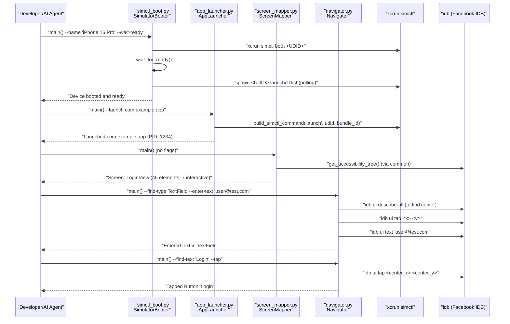
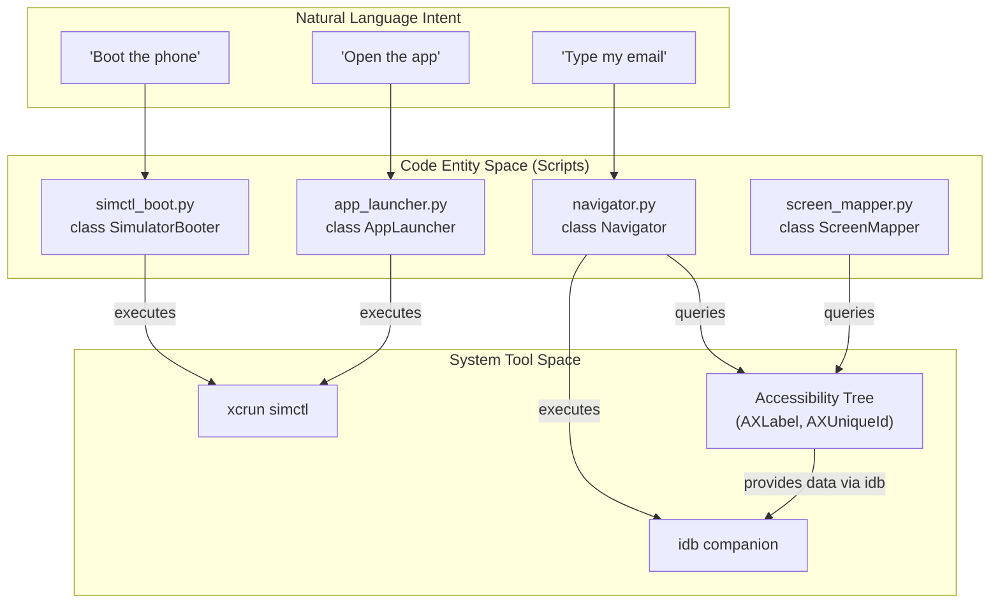

<!-- source: DeepWiki mcp.deepwiki.com · repo conorluddy/ios-simulator-skill · page 2.3 Quick Start Tutorial · fetched 2026-10-27 -->

# Quick Start Tutorial

<details>
<summary>Relevant source files</summary>

The following files were used as context for generating this wiki page:

- [README.md](README.md)
- [ios-simulator-skill/skills/ios-simulator-skill/scripts/app_launcher.py](ios-simulator-skill/skills/ios-simulator-skill/scripts/app_launcher.py)
- [ios-simulator-skill/skills/ios-simulator-skill/scripts/screen_mapper.py](ios-simulator-skill/skills/ios-simulator-skill/scripts/screen_mapper.py)
- [ios-simulator-skill/skills/ios-simulator-skill/scripts/simctl_boot.py](ios-simulator-skill/skills/ios-simulator-skill/scripts/simctl_boot.py)

</details>


This page provides a hands-on walkthrough of the most common workflow with the `ios-simulator-skill`: booting a simulator, launching an app, analyzing the screen, and interacting with UI elements. By the end, you will understand the basic script execution pattern and how to navigate an iOS app using semantic element finding.

For installation instructions, see **2.1 Installation and Prerequisites**. For environment verification, see **2.2 Environment Verification**.

## Prerequisites Check

Before starting this tutorial, verify your environment is properly configured using the health check utility:

```bash
bash scripts/sim_health_check.sh
```

This script verifies the presence of macOS, Xcode Command Line Tools, `xcrun simctl`, Python 3, and optional dependencies like `idb` and `Pillow`.

**Sources:** [README.md:120-120](), [README.md:41-45]()

## Tutorial Overview: Login Flow Automation

This tutorial demonstrates a complete login flow automation:

1.  **Boot** an iOS simulator with readiness verification.
2.  **Launch** the target application.
3.  **Map** the screen to identify interactive elements.
4.  **Interact** by entering text and tapping buttons.

### Script Execution Flow



**Sources:** [ios-simulator-skill/skills/ios-simulator-skill/scripts/simctl_boot.py:35-127](), [ios-simulator-skill/skills/ios-simulator-skill/scripts/app_launcher.py:27-56](), [ios-simulator-skill/skills/ios-simulator-skill/scripts/screen_mapper.py:103-129](), [README.md:106-110]()

## Step-by-Step Walkthrough

### Step 1: Boot the Simulator

Boot a simulator by name. The `SimulatorBooter` class handles UDID resolution and polls for system readiness.

```bash
python scripts/simctl_boot.py --name "iPhone 16 Pro" --wait-ready
```

**Key Implementation Details:**
- **Resolution:** Uses `resolve_device_identifier()` from `common.device_utils` to map names to UDIDs [ios-simulator-skill/skills/ios-simulator-skill/scripts/simctl_boot.py:21-25]().
- **Readiness:** The `_wait_for_ready()` method polls `simctl spawn <udid> launchctl list` to ensure the sub-system is responsive [ios-simulator-skill/skills/ios-simulator-skill/scripts/simctl_boot.py:87-127]().
- **Batching:** Supports `boot_all()` and `boot_by_type()` for environment setup [ios-simulator-skill/skills/ios-simulator-skill/scripts/simctl_boot.py:130-175]().

### Step 2: Launch the App

Launch your application using its bundle identifier.

```bash
python scripts/app_launcher.py --launch com.example.MyApp
```

**Key Implementation Details:**
- **Tooling:** Wraps `xcrun simctl launch` via `build_simctl_command()` [ios-simulator-skill/skills/ios-simulator-skill/scripts/app_launcher.py:27-44]().
- **PID Capture:** Parses the standard output (e.g., `com.example.app: 1234`) to return the process ID of the launched app [ios-simulator-skill/skills/ios-simulator-skill/scripts/app_launcher.py:45-53]().
- **State Management:** Can also `terminate()`, `install()`, or `get_app_state()` [ios-simulator-skill/skills/ios-simulator-skill/scripts/app_launcher.py:57-198]().

### Step 3: Map the Screen

Analyze the current UI hierarchy. This script is the entry point for "Semantic Navigation."

```bash
python scripts/screen_mapper.py
```

**Expected Output (Default Mode):**
```
Screen: LoginViewController (45 elements, 7 interactive)
Buttons: "Login", "Cancel", "Forgot Password"
TextFields: 2 (0 filled)
```

**Key Implementation Details:**
- **Data Source:** Queries the accessibility tree via `idb` to identify elements by `AXLabel`, `AXValue`, and `AXUniqueId` [ios-simulator-skill/skills/ios-simulator-skill/scripts/screen_mapper.py:40-44]().
- **Efficiency:** Achieves ~97.5% token reduction by summarizing the tree into a few lines instead of raw JSON [README.md:85-89]().
- **Categorization:** Filters for `INTERACTIVE_TYPES` such as `Button`, `TextField`, and `NavigationBar` [ios-simulator-skill/skills/ios-simulator-skill/scripts/screen_mapper.py:75-88]().

### Step 4: Enter Text and Tap

Use `navigator.py` to interact with elements by their semantic properties.

```bash
# 1. Enter Email
python scripts/navigator.py --find-type TextField --enter-text "user@example.com"

# 2. Tap Login Button
python scripts/navigator.py --find-text "Login" --tap
```

**Key Implementation Details:**
- **Semantic Finding:** Locates elements using fuzzy text matching or specific types [README.md:107-107]().
- **Coordinate Transformation:** Automatically calculates the center point of an element's frame for tapping, avoiding fragile pixel coordinates [README.md:71-79]().
- **Interaction:** Uses `idb` for reliable text injection and touch events [README.md:107-107]().

**Sources:** [ios-simulator-skill/skills/ios-simulator-skill/scripts/app_launcher.py:20-218](), [ios-simulator-skill/skills/ios-simulator-skill/scripts/simctl_boot.py:28-175](), [ios-simulator-skill/skills/ios-simulator-skill/scripts/screen_mapper.py:55-175](), [README.md:67-110]()

## Script Interaction Pattern

The following diagram illustrates how the tutorial scripts bridge high-level intent to the underlying system tools and code entities.



**Sources:** [README.md:9-12](), [ios-simulator-skill/skills/ios-simulator-skill/scripts/app_launcher.py:38-44](), [ios-simulator-skill/skills/ios-simulator-skill/scripts/simctl_boot.py:62-63](), [ios-simulator-skill/skills/ios-simulator-skill/scripts/screen_mapper.py:103-109]()

## Understanding Output Modes

All scripts follow a consistent output strategy to balance human readability with AI token efficiency.

| Mode | Flag | Purpose | Token Impact |
| :--- | :--- | :--- | :--- |
| **Default** | N/A | High-level summary for AI agents | 5-10 tokens (3-5 lines) |
| **Verbose** | `--verbose` | Detailed debugging/element info | 400+ tokens (50+ lines) |
| **JSON** | `--json` | Machine-readable data for scripts | 20-30 tokens (JSON object) |

**Sources:** [README.md:83-93](), [ios-simulator-skill/skills/ios-simulator-skill/scripts/simctl_boot.py:210-213](), [ios-simulator-skill/skills/ios-simulator-skill/scripts/screen_mapper.py:29-30]()

## Troubleshooting the Tutorial

If you encounter issues during this quick start:

1.  **Device not found:** Ensure the name matches `xcrun simctl list devices`. The skill uses `resolve_device_identifier` to find simulators [ios-simulator-skill/skills/ios-simulator-skill/scripts/simctl_boot.py:21-25]().
2.  **App won't launch:** Ensure the simulator is fully booted (`--wait-ready`) before launching [ios-simulator-skill/skills/ios-simulator-skill/scripts/simctl_boot.py:74-80]().
3.  **Element not found:** Use `python scripts/screen_mapper.py --verbose` to inspect the full accessibility tree if a semantic find fails [ios-simulator-skill/skills/ios-simulator-skill/scripts/screen_mapper.py:23-24]().
4.  **Health Check:** Re-run `bash scripts/sim_health_check.sh` to ensure all dependencies like `idb` are correctly installed [README.md:120-120]().

**Sources:** [ios-simulator-skill/skills/ios-simulator-skill/scripts/simctl_boot.py:35-127](), [README.md:120-120]()

---

