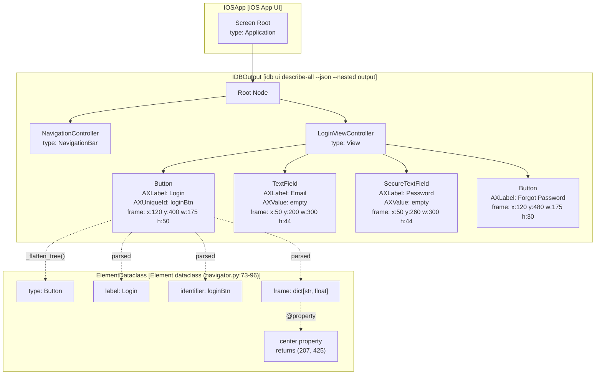
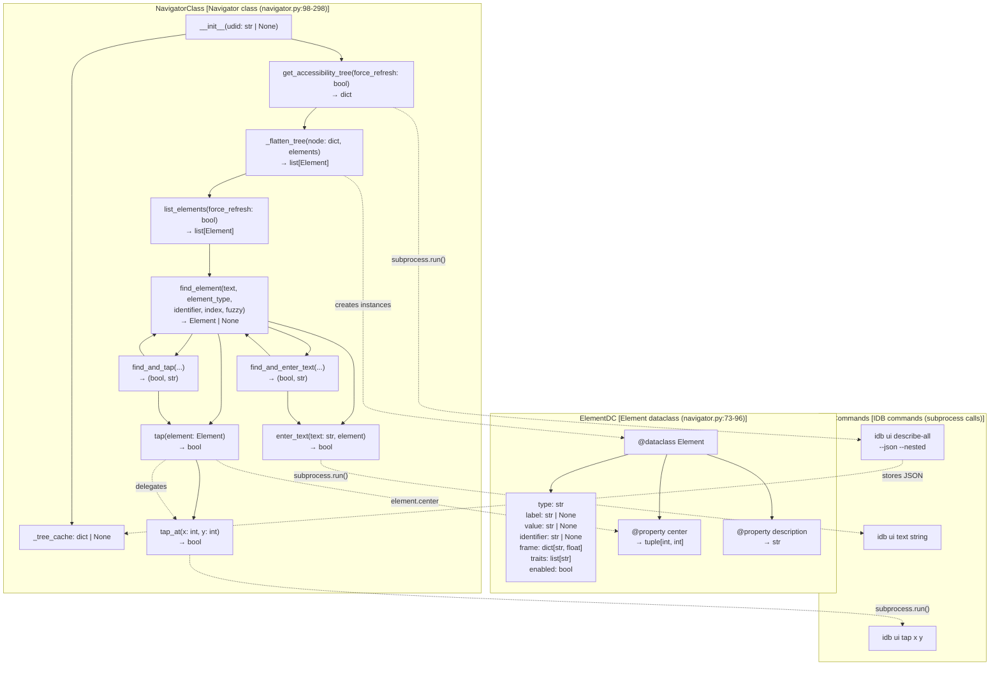
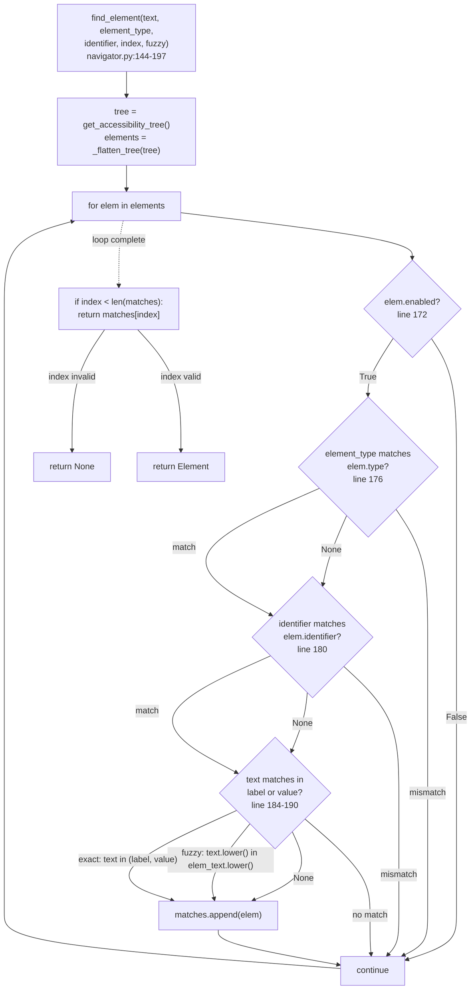
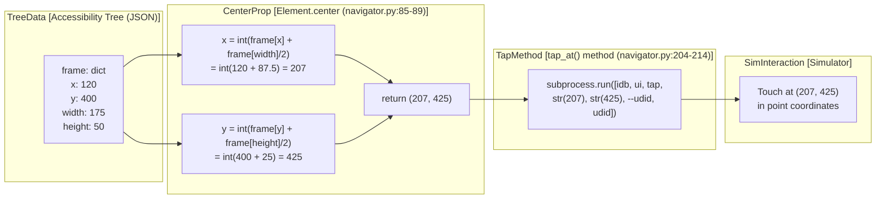

<!-- source: DeepWiki mcp.deepwiki.com · repo conorluddy/ios-simulator-skill · page 3.1 Semantic Navigation via Accessibility APIs · fetched 2026-10-27 -->

# Semantic Navigation via Accessibility APIs

<details>
<summary>Relevant source files</summary>

The following files were used as context for generating this wiki page:

- [CLAUDE.md](CLAUDE.md)
- [ios-simulator-skill/skills/ios-simulator-skill/scripts/navigator.py](ios-simulator-skill/skills/ios-simulator-skill/scripts/navigator.py)
- [ios-simulator-skill/skills/ios-simulator-skill/scripts/screen_mapper.py](ios-simulator-skill/skills/ios-simulator-skill/scripts/screen_mapper.py)

</details>


**Purpose**: This page explains how the ios-simulator-skill uses iOS accessibility APIs to navigate apps by semantic meaning (text, type, accessibility ID) rather than fragile pixel coordinates. This approach provides robust automation that survives UI redesigns and works across different screen sizes.

**Scope**: Covers the accessibility tree structure, element discovery, coordinate transformation, and the `Navigator` class implementation. For UI discovery and analysis, see `screen_mapper.py`. For gesture-based interaction beyond tapping, see `gesture.py`.

---

## Accessibility-First Philosophy

The skill prioritizes **semantic stability over visual stability**. Traditional automation tools use hardcoded pixel coordinates that break when UI layouts change. This system finds elements by their accessibility properties (label, type, identifier), which remain stable across:

- Screen size changes (iPhone vs iPad)
- UI redesigns and layout shifts
- Different OS versions
- Localization changes (when using identifiers)

The accessibility tree is iOS's structured representation of the UI, designed for assistive technologies. It provides reliable, hierarchical element data that the skill leverages for automation.

**Sources**: [ios-simulator-skill/skills/ios-simulator-skill/scripts/navigator.py:42-47](), [ios-simulator-skill/skills/ios-simulator-skill/scripts/screen_mapper.py:67-71]()

---

## Accessibility Tree Structure

### Diagram: iOS Accessibility Tree Hierarchy



The accessibility tree is retrieved via `idb ui describe-all --json --nested`, which returns a deeply nested JSON structure. Each node contains:

| Property | Description | Usage |
|----------|-------------|-------|
| `type` | Element type (Button, TextField, etc.) | Type-based matching |
| `AXLabel` | Accessibility label text | Primary text matching |
| `AXValue` | Current value (for inputs) | Secondary text matching |
| `AXUniqueId` | Accessibility identifier | Precise matching |
| `frame` | `{x, y, width, height}` in points | Coordinate calculation |
| `traits` | Array of traits (e.g., `["Button"]`) | Capability detection |
| `enabled` | Boolean enablement state | Skip disabled elements |
| `children` | Nested child elements | Tree traversal |

**Sources**: [ios-simulator-skill/skills/ios-simulator-skill/scripts/navigator.py:48-55](), [ios-simulator-skill/skills/ios-simulator-skill/scripts/navigator.py:73-96](), [ios-simulator-skill/skills/ios-simulator-skill/scripts/screen_mapper.py:39-44]()

---

## Navigator Class Architecture

### Diagram: Navigator Class and Element Discovery Flow



The `Navigator` class [ios-simulator-skill/skills/ios-simulator-skill/scripts/navigator.py:98-298]() implements the core semantic navigation logic:

**State Management**:
- `_tree_cache` [ios-simulator-skill/skills/ios-simulator-skill/scripts/navigator.py:104]() caches the accessibility tree to avoid redundant IDB calls.
- `get_accessibility_tree(force_refresh)` [ios-simulator-skill/skills/ios-simulator-skill/scripts/navigator.py:106-113]() provides cached or fresh tree data by calling the shared utility `get_accessibility_tree`.

**Element Discovery**:
- `_flatten_tree()` [ios-simulator-skill/skills/ios-simulator-skill/scripts/navigator.py:115-137]() recursively transforms nested JSON into flat `list[Element]`, extracting labels from `AXLabel`, `AXValue`, and `AXUniqueId`.
- `list_elements()` [ios-simulator-skill/skills/ios-simulator-skill/scripts/navigator.py:139-142]() exposes all elements for analysis.
- `find_element()` [ios-simulator-skill/skills/ios-simulator-skill/scripts/navigator.py:144-197]() implements multi-criteria matching including fuzzy text search.

**Interaction Primitives**:
- `tap(element)` [ios-simulator-skill/skills/ios-simulator-skill/scripts/navigator.py:199-202]() taps element center point.
- `tap_at(x, y)` [ios-simulator-skill/skills/ios-simulator-skill/scripts/navigator.py:204-214]() executes coordinate-based tap using `idb ui tap`.
- `enter_text(text, element)` [ios-simulator-skill/skills/ios-simulator-skill/scripts/navigator.py:216-245]() types text using `idb ui text`, optionally after tapping the target element.

**Convenience Methods**:
- `find_and_tap()` [ios-simulator-skill/skills/ios-simulator-skill/scripts/navigator.py:247-274]() combines find + tap with error reporting.
- `find_and_enter_text()` [ios-simulator-skill/skills/ios-simulator-skill/scripts/navigator.py:276-297]() combines find + text entry.

**Sources**: [ios-simulator-skill/skills/ios-simulator-skill/scripts/navigator.py:98-298]()

---

## Element Matching Strategies

### Diagram: Element Matching Decision Tree



The matching algorithm [ios-simulator-skill/skills/ios-simulator-skill/scripts/navigator.py:164-197]() applies filters sequentially:

**Filter 1: Enabled State**
```python
if not elem.enabled:
    continue
```
Disabled elements are skipped automatically to prevent interaction errors [ios-simulator-skill/skills/ios-simulator-skill/scripts/navigator.py:172-173]().

**Filter 2: Element Type** (optional)
```python
if element_type and elem.type != element_type:
    continue
```
Exact match against `type` field (e.g., `"Button"`, `"TextField"`) [ios-simulator-skill/skills/ios-simulator-skill/scripts/navigator.py:176-177]().

**Filter 3: Accessibility Identifier** (optional)
```python
if identifier and elem.identifier != identifier:
    continue
```
Exact match against `AXUniqueId` for precise targeting [ios-simulator-skill/skills/ios-simulator-skill/scripts/navigator.py:180-181]().

**Filter 4: Text Matching** (optional)
```python
if text:
    elem_text = (elem.label or "") + " " + (elem.value or "")
    if fuzzy:
        if text.lower() not in elem_text.lower():
            continue
    elif text not in (elem.label, elem.value):
        continue
```
- **Fuzzy mode** (default): Case-insensitive substring match in label OR value [ios-simulator-skill/skills/ios-simulator-skill/scripts/navigator.py:187-188]().
- **Exact mode**: Precise equality check against label OR value [ios-simulator-skill/skills/ios-simulator-skill/scripts/navigator.py:189-190]().

**Index Selection**
```python
if matches and index < len(matches):
    return matches[index]
```
Returns the Nth matching element (0-based indexing) for form traversal [ios-simulator-skill/skills/ios-simulator-skill/scripts/navigator.py:194-195]().

**Sources**: [ios-simulator-skill/skills/ios-simulator-skill/scripts/navigator.py:144-197]()

---

## Coordinate Transformation

### Diagram: From Semantic Data to Tap Coordinates



The `Element.center` property [ios-simulator-skill/skills/ios-simulator-skill/scripts/navigator.py:85-89]() calculates tap coordinates:

```python
@property
def center(self) -> tuple[int, int]:
    """Calculate center point for tapping."""
    x = int(self.frame["x"] + self.frame["width"] / 2)
    y = int(self.frame["y"] + self.frame["height"] / 2)
    return (x, y)
```

**Coordinate System**: iOS uses points (not pixels) in a top-left origin coordinate system. The frame dimensions come directly from the accessibility tree, ensuring accuracy across densities and device sizes.

**Tap Execution**: The `tap()` method [ios-simulator-skill/skills/ios-simulator-skill/scripts/navigator.py:199-214]() uses these coordinates to call `idb ui tap`.

**Sources**: [ios-simulator-skill/skills/ios-simulator-skill/scripts/navigator.py:85-89](), [ios-simulator-skill/skills/ios-simulator-skill/scripts/navigator.py:199-214]()

---

## Semantic vs Pixel-Based Automation

### Comparison Table

| Aspect | Pixel-Based (Traditional) | Semantic (This Skill) |
|--------|---------------------------|----------------------|
| **Element Finding** | `idb ui tap 320 400` | `--find-text "Login" --tap` |
| **Coordinate Source** | Hardcoded by developer | Calculated from frame geometry |
| **Screen Size** | Breaks on iPhone vs iPad | Works across all devices |
| **UI Redesign** | Breaks on layout changes | Survives if label/type stable |
| **Maintainability** | Manual coordinate updates | Self-healing via accessibility |
| **Readability** | `tap 320 400` (opaque) | `--find-text "Submit"` (clear intent) |

### Example: Login Flow

**Traditional Approach** (fragile):
```bash
idb ui tap 200 300  # Tap email field
idb ui text "user@example.com"
idb ui tap 200 460  # Tap login button
```

**Semantic Approach** (robust):
```bash
python scripts/navigator.py --find-type TextField --index 0 --enter-text "user@example.com"
python scripts/navigator.py --find-text "Login" --tap
```

**Sources**: [ios-simulator-skill/skills/ios-simulator-skill/scripts/navigator.py:42-47](), [ios-simulator-skill/skills/ios-simulator-skill/scripts/navigator.py:21-35]()

---

## Tree Caching Strategy

The `Navigator` class caches the accessibility tree to minimize IDB calls:

```python
def get_accessibility_tree(self, force_refresh: bool = False) -> dict:
    """Get accessibility tree (cached for efficiency)."""
    if self._tree_cache and not force_refresh:
        return self._tree_cache

    # Delegate to shared utility
    self._tree_cache = get_accessibility_tree(self.udid, nested=True)
    return self._tree_cache
```

**Cache Scope**: Per-instance lifetime. A new `Navigator()` instance starts with a `None` cache [ios-simulator-skill/skills/ios-simulator-skill/scripts/navigator.py:101-104]().

**Refresh Trigger**: Pass `force_refresh=True` to re-fetch from IDB via the shared `get_accessibility_tree` utility [ios-simulator-skill/skills/ios-simulator-skill/scripts/navigator.py:106-113]().

**Sources**: [ios-simulator-skill/skills/ios-simulator-skill/scripts/navigator.py:101-113]()

---

## IDB Integration Points

The navigator delegates low-level simulator operations to IDB (iOS Device Bridge):

- **Accessibility Tree Retrieval**: `idb ui describe-all --json --nested` [ios-simulator-skill/skills/ios-simulator-skill/scripts/navigator.py:49-54]().
- **Tap Execution**: `idb ui tap [x] [y]` [ios-simulator-skill/skills/ios-simulator-skill/scripts/navigator.py:204-214]().
- **Text Entry**: `idb ui text [string]` [ios-simulator-skill/skills/ios-simulator-skill/scripts/navigator.py:216-245]().

**Sources**: [ios-simulator-skill/skills/ios-simulator-skill/scripts/navigator.py:204-245]()

---

