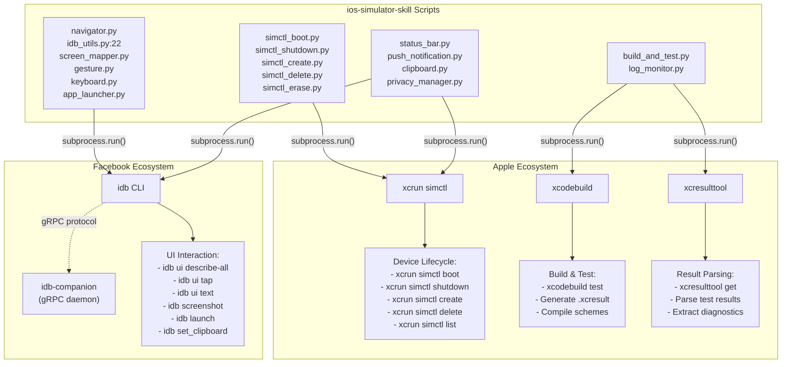
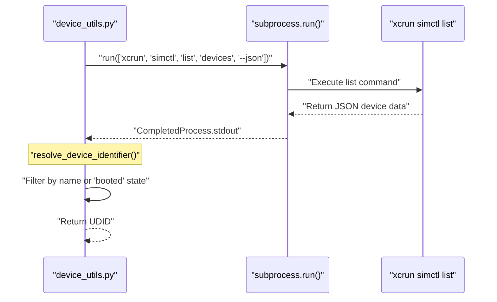
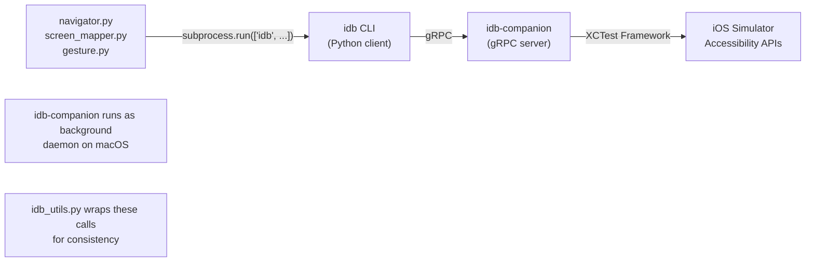
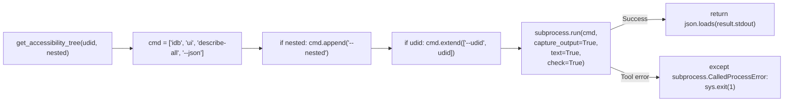

<!-- source: DeepWiki mcp.deepwiki.com · repo conorluddy/ios-simulator-skill · page 3.2 External Tools: simctl and idb · fetched 2026-10-27 -->

# External Tools: simctl and idb

Relevant source files

The following files were used as context for generating this wiki page:

- [README.md](README.md)
- [ios-simulator-skill/skills/ios-simulator-skill/scripts/common/idb_utils.py](ios-simulator-skill/skills/ios-simulator-skill/scripts/common/idb_utils.py)
- [references/idb_quick.md](references/idb_quick.md)
- [references/simctl_quick.md](references/simctl_quick.md)

## Purpose and Scope

This page describes the two primary external command-line tools that `ios-simulator-skill` wraps: Apple's `xcrun simctl` and Facebook's `idb` (iOS Device Bridge). It explains what each tool provides, which scripts use them, the command patterns employed, and how the skill mediates interactions to provide semantic, token-efficient interfaces.

For information about how scripts use these tools to implement semantic navigation, see [3.1 Semantic Navigation via Accessibility APIs](). For information about the shared utilities that standardize tool interactions, see [10 Shared Utilities]().

---

## Tool Ecosystem and Script Architecture

The `ios-simulator-skill` relies on two distinct tool ecosystems, each serving specific purposes. Apple's tools handle the foundational lifecycle and build processes, while Facebook's `idb` provides the deep introspection required for AI-driven interaction.

**Diagram: Tool Ecosystem and Script Architecture**

**Key Division**: `simctl` handles device lifecycle and low-level simulator control, while `idb` provides high-level UI interaction through accessibility APIs. All tool invocations use `subprocess.run()` without `shell=True`.

**Sources**: [ios-simulator-skill/skills/ios-simulator-skill/scripts/common/idb_utils.py:8-15](), [references/idb_quick.md:1-40](), [references/simctl_quick.md:1-40](), [README.md:9-12]()

---

## xcrun simctl: Device Lifecycle Management

### Capabilities

`simctl` is Apple's primary tool for controlling iOS simulators. It provides low-level access to device lifecycle operations and state queries.

| Command Pattern | Purpose | Used By |
|----------------|---------|---------|
| `xcrun simctl boot <UDID>` | Boot a simulator | `simctl_boot.py` [references/simctl_quick.md:10-13]() |
| `xcrun simctl shutdown <UDID>` | Shutdown a simulator | `simctl_shutdown.py` [README.md:137-137]() |
| `xcrun simctl create <name> <type> <runtime>` | Create new simulator | `simctl_create.py` [README.md:138-138]() |
| `xcrun simctl delete <UDID>` | Delete simulator | `simctl_delete.py` [README.md:139-139]() |
| `xcrun simctl erase <UDID>` | Factory reset simulator | `simctl_erase.py` [README.md:140-140]() |
| `xcrun simctl list devices` | List all devices/runtimes | `device_utils.py` [references/simctl_quick.md:5-9]() |
| `xcrun simctl spawn <UDID> log stream` | Stream system logs | `log_monitor.py` [references/simctl_quick.md:36-39]() |
| `xcrun simctl privacy <UDID> grant/revoke` | Manage permissions | `privacy_manager.py` [README.md:130-130]() |
| `xcrun simctl status_bar <UDID> override` | Override status bar | `status_bar.py` [README.md:128-128]() |
| `xcrun simctl push <UDID> <bundle-id>` | Send push notification | `push_notification.py` [README.md:129-129]() |

### Example: Device List Interaction

Scripts use `simctl list` to resolve device names to UDIDs and filter by state.

**Diagram: Device Identifier Resolution Flow**

**Sources**: [references/simctl_quick.md:5-9](), [references/simctl_quick.md:42-51]()

---

## idb: UI Interaction and Accessibility

### Capabilities

`idb` (iOS Device Bridge) is Facebook's tool providing programmatic access to iOS accessibility APIs, enabling semantic UI interaction.

| Command Pattern | Purpose | Used By |
|----------------|---------|---------|
| `idb ui describe-all --json --nested` | Get accessibility tree | `idb_utils.py:49](), navigator.py` |
| `idb ui tap <x> <y>` | Tap at coordinates | `navigator.py`, `gesture.py` [references/idb_quick.md:10-13]() |
| `idb ui text <string>` | Enter text | `navigator.py`, `keyboard.py` [references/idb_quick.md:18-21]() |
| `idb ui swipe <x1> <y1> <x2> <y2>` | Swipe gesture | `gesture.py` [references/idb_quick.md:14-17]() |
| `idb screenshot` | Capture screenshot | `screenshot_utils.py` [references/idb_quick.md:32-35]() |
| `idb launch <bundle-id>` | Launch app | `app_launcher.py` [README.md:110-110]() |
| `idb set_clipboard <text>` | Set clipboard | `clipboard.py` [README.md:127-127]() |

### Architecture: idb vs idb-companion

The `idb-companion` daemon must be running. Scripts invoke the `idb` CLI, which communicates with the companion via gRPC to interact with the XCTest framework inside the simulator.

**Sources**: [ios-simulator-skill/skills/ios-simulator-skill/scripts/common/idb_utils.py:1-15](), [references/idb_quick.md:1-53](), [README.md:44-44]()

---

## Accessibility Tree Structure

The core data structure returned by `idb ui describe-all --json --nested` is retrieved via `get_accessibility_tree()` [ios-simulator-skill/skills/ios-simulator-skill/scripts/common/idb_utils.py:22-48]().

### Parsing Pattern in idb_utils.py

The skill converts the hierarchical accessibility data into a searchable list using `flatten_tree()` [ios-simulator-skill/skills/ios-simulator-skill/scripts/common/idb_utils.py:71-116]().

**Table: Element Properties from Accessibility Tree**

| JSON Key | Purpose | Code Usage |
|----------|---------|------------|
| `type` | Element classification (Button, TextField) | `flatten_tree` [ios-simulator-skill/skills/ios-simulator-skill/scripts/common/idb_utils.py:91]() |
| `AXLabel` | User-visible text or description | `flatten_tree` [ios-simulator-skill/skills/ios-simulator-skill/scripts/common/idb_utils.py:92]() |
| `frame` | Screen position and size (x, y, w, h) | `get_screen_size` [ios-simulator-skill/skills/ios-simulator-skill/scripts/common/idb_utils.py:174]() |
| `children` | Nested UI elements | `count_elements` [ios-simulator-skill/skills/ios-simulator-skill/scripts/common/idb_utils.py:141]() |

### Coordinate Normalization

The `get_screen_size()` utility extracts dimensions from the root node's frame to calculate center points or normalize coordinates for gestures [ios-simulator-skill/skills/ios-simulator-skill/scripts/common/idb_utils.py:146-181]().

**Sources**: [ios-simulator-skill/skills/ios-simulator-skill/scripts/common/idb_utils.py:22-181](), [references/idb_quick.md:5-8]()

---

## Subprocess Invocation Patterns

All scripts follow a standardized subprocess pattern to ensure reliability and security.

### Standard Pattern: No Shell Execution

Commands are always passed as lists to avoid shell injection vulnerabilities.

**Diagram: idb_utils.get_accessibility_tree Execution Pattern**

### Error Handling

The skill uses `check=True` in `subprocess.run` to ensure failures are caught, then provides actionable error messages [ios-simulator-skill/skills/ios-simulator-skill/scripts/common/idb_utils.py:56-68]().

**Sources**: [ios-simulator-skill/skills/ios-simulator-skill/scripts/common/idb_utils.py:49-69]()

---

## Tool Selection Rationale

The skill intelligently selects between `simctl` and `idb` based on the specific requirements of the operation.

| Operation Category | Primary Tool | Rationale |
|-------------------|--------------|-----------|
| **Device Lifecycle** | `simctl` | Official Apple tool for booting/shutting down simulators [references/simctl_quick.md:1-13](). |
| **UI Inspection** | `idb` | Provides structured JSON accessibility trees [references/idb_quick.md:5-9](). |
| **Touch Gestures** | `idb` | Supports precise coordinate-based tapping and swiping [references/idb_quick.md:10-16](). |
| **App Lifecycle** | `simctl`/`idb` | `simctl` is faster for launch; `idb` is better for listing installed apps [references/simctl_quick.md:14-21](), [references/idb_quick.md:36-39](). |
| **System Settings** | `simctl` | Only `simctl` can override the status bar or send push notifications [references/simctl_quick.md:22-39](). |

**Sources**: [references/simctl_quick.md:1-54](), [references/idb_quick.md:1-54](), [ios-simulator-skill/skills/ios-simulator-skill/scripts/common/idb_utils.py:8-15]()

---

