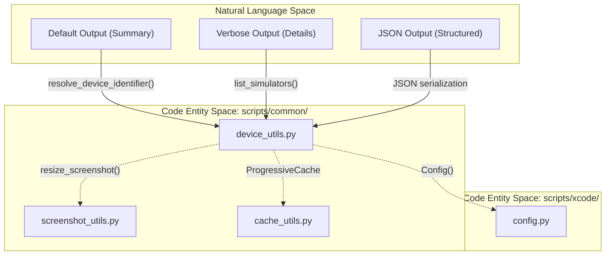
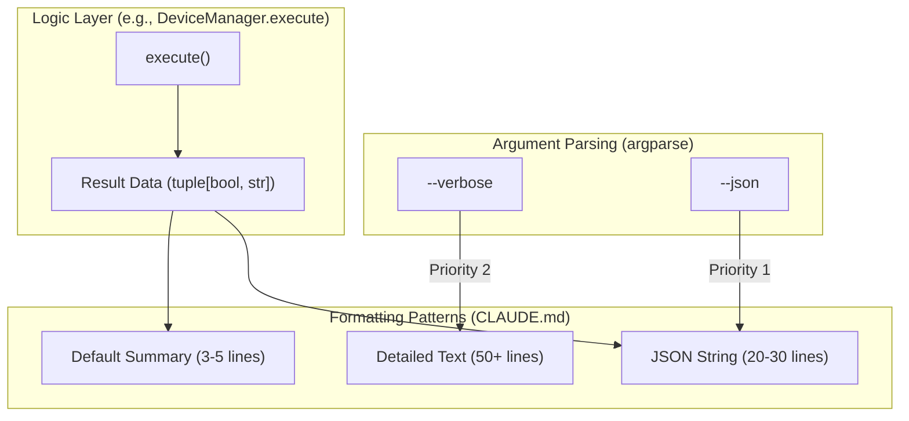

<!-- source: DeepWiki mcp.deepwiki.com · repo conorluddy/ios-simulator-skill · page 3.4 Output Modes and Formatting · fetched 2026-10-27 -->

# Output Modes and Formatting

<details>
<summary>Relevant source files</summary>

The following files were used as context for generating this wiki page:

- [CLAUDE.md](CLAUDE.md)
- [pyproject.toml](pyproject.toml)

</details>


## Purpose and Scope

This page documents the three output modes implemented consistently across the 22 scripts in the `ios-simulator-skill`: **default** (minimal), **verbose** (detailed), and **json** (machine-readable). It explains how each mode serves different consumers, the implementation pattern used across scripts, and the token optimization strategy that enables a 96% reduction in context usage for AI agents.

For information about the progressive disclosure caching mechanism that complements these output modes, see [3.3 Progressive Disclosure and Token Efficiency]().

---

## The Three Output Modes

All scripts implement three output modes controlled by command-line flags. Each mode targets a specific use case and consumer type.

| Mode | Flag | Target Consumer | Line Count | Token Count | Use Case |
|------|------|----------------|------------|-------------|----------|
| **Default** | (none) | AI Agents (Claude) | 3-5 lines | 5-10 tokens | Conversational interaction |
| **Verbose** | `--verbose` | Human Developers | 50+ lines | 400+ tokens | Debugging and detailed analysis |
| **JSON** | `--json` | CI/CD Systems | 20-30 lines | 20-30 tokens | Machine parsing and automation |

### Default Mode: Token-Optimized Summary

The default mode outputs 3-5 lines summarizing the operation result. This achieves a 96% token reduction compared to raw tool output, keeping AI agent conversations focused and cost-effective.

**Example from `simctl_boot.py`:**
`Device booted: iPhone 16 Pro (ABC123) [2.1s]` [CLAUDE.md:95-96]()

### Verbose Mode: Human-Readable Details

The verbose mode provides comprehensive information for human debugging, including full UDIDs, detailed timestamps, and diagnostic logs.

**Example from `simctl_boot.py` with `--verbose`:**
```text
Device booted successfully.
Device UDID: ABC123DEF456...
Boot time: 2.1 seconds
```
[CLAUDE.md:98-101]()

### JSON Mode: Machine-Parseable Structured Data

The JSON mode outputs structured data for CI/CD integration and programmatic consumption. All JSON output follows a consistent schema where applicable.

**Example from `simctl_boot.py` with `--json`:**
```json
{"action": "boot", "udid": "ABC123", "success": true}
```
[CLAUDE.md:103-104]()

**Sources:** [CLAUDE.md:90-105](), [CLAUDE.md:174-182]()

---

## Implementation Architecture

The skill utilizes a standardized class-based design to manage output. While the formatting logic varies by script complexity, the interface remains consistent.

### Code Entity Mapping: Formatting Layer

This diagram shows how natural language output requirements map to specific utility modules that handle data processing and formatting.



**Sources:** [CLAUDE.md:149-163](), [CLAUDE.md:57-76]()

### Output Selection Flow

The output mode is determined by flag precedence: `--json` takes priority over `--verbose`, and both override the default mode. The `execute()` method in the script class returns the data, which is then formatted before printing.



**Sources:** [CLAUDE.md:57-76](), [CLAUDE.md:90-105]()

---

## Build and Test Formatting

The `build_and_test.py` script provides specialized logic for build results. It uses "Progressive Disclosure" to show only what is necessary to minimize context bloat.

### Progressive Disclosure Logic
1. **Initial Build:** Returns a single line with status and an `xcresult` ID.
2. **On-Demand Detail:** The user or agent can request specific subsets of data using flags:
    - `--get-errors`: Surfaces only compilation/test errors.
    - `--get-warnings`: Surfaces only build warnings.
    - `--get-log`: Surfaces the full build log.

**Sources:** [CLAUDE.md:118-120]()

---

## Token Efficiency Metrics

The skill achieves a **96% reduction** in typical output volume, which is critical for maintaining long-running sessions with AI agents like Claude Code [CLAUDE.md:176]().

| Operation | Raw Tool (Lines) | This Skill (Lines) | Savings |
|-----------|------------------|-------------------|---------|
| Screen analysis | 200+ | 5 | 97.5% |
| Find & tap button | 100+ | 1 | 99% |
| Login flow | 400+ | 15 | 96% |

### Strategy for AI Agents
1. **Accessibility over Pixels:** Using accessibility APIs (via `screen_mapper.py` and `navigator.py`) yields minimal text output compared to high-token image analysis [CLAUDE.md:203-216]().
2. **Screenshot Optimization:** When visual verification is required, `screenshot_utils.py` automatically resizes and compresses images via `resize_screenshot()` to minimize token cost [CLAUDE.md:156-159]().
3. **Class-Based Returns:** All `execute()` methods return a `tuple[bool, str]`, ensuring a clean separation between operation logic and the final string presented to the agent [CLAUDE.md:66-68]().

**Sources:** [CLAUDE.md:174-182](), [CLAUDE.md:156-159]()

---

## Exit Code Conventions

Regardless of the output mode, scripts maintain standard Unix exit codes to facilitate scripting and automation:

- **`0`**: Success.
- **`1`**: Failure (accompanied by an error message in the chosen format).

**Implementation Pattern:**
```python
def main():
    parser = argparse.ArgumentParser()
    # ... setup args ...
    manager = DeviceManager(args.udid)
    success, message = manager.execute()
    print(message)
    sys.exit(0 if success else 1)
```
[CLAUDE.md:70-75]()

**Sources:** [CLAUDE.md:57-76]()

---

