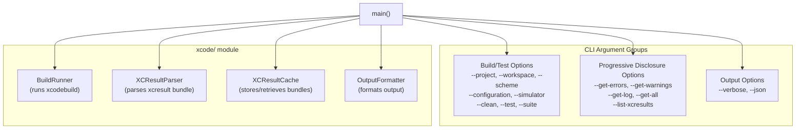
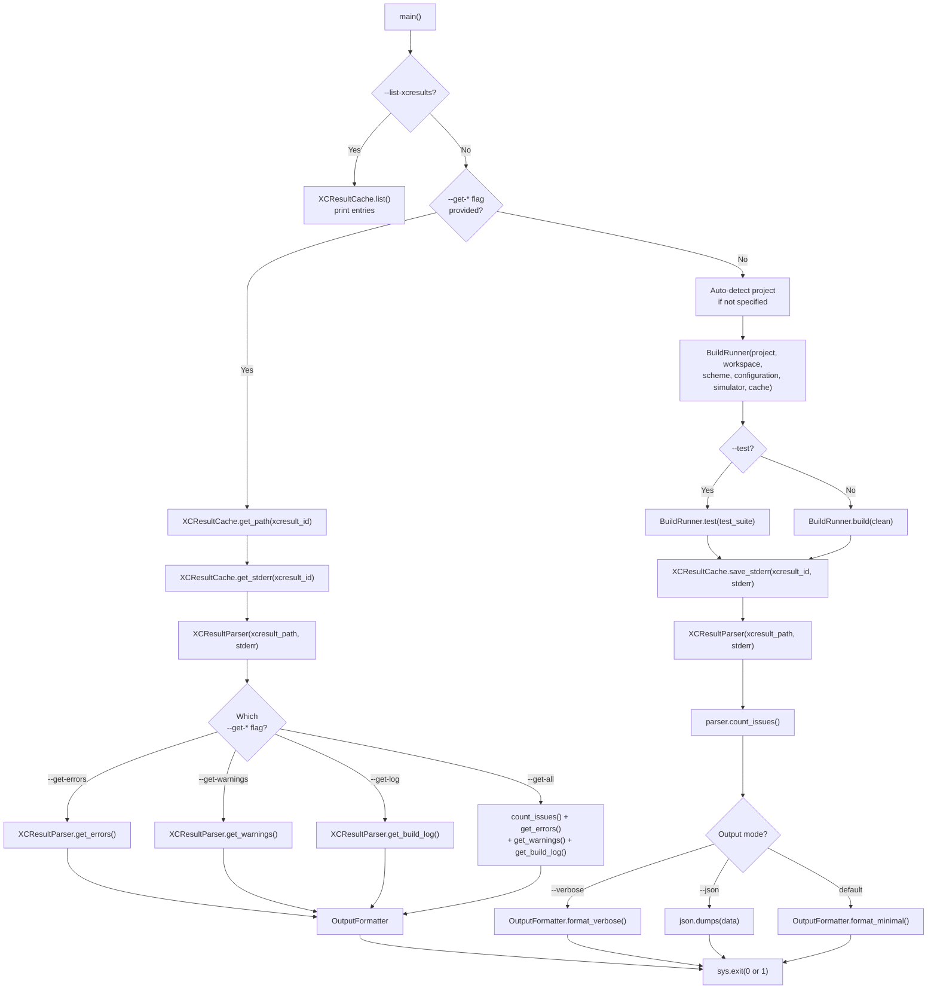
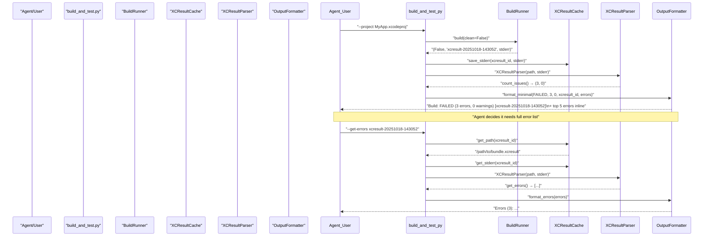

<!-- source: DeepWiki mcp.deepwiki.com · repo conorluddy/ios-simulator-skill · page 5.1 build_and_test.py · fetched 2026-10-27 -->

# build_and_test.py

Relevant source files

The following files were used as context for generating this wiki page:

- [ios-simulator-skill/skills/ios-simulator-skill/scripts/build_and_test.py](ios-simulator-skill/skills/ios-simulator-skill/scripts/build_and_test.py)
- [ios-simulator-skill/skills/ios-simulator-skill/scripts/xcode/builder.py](ios-simulator-skill/skills/ios-simulator-skill/scripts/xcode/builder.py)
- [ios-simulator-skill/skills/ios-simulator-skill/scripts/xcode/config.py](ios-simulator-skill/skills/ios-simulator-skill/scripts/xcode/config.py)

This page documents `ios-simulator-skill/scripts/build_and_test.py` — the script responsible for building and testing Xcode projects from the command line, with token-efficient output and progressive disclosure of build results via xcresult bundles.

The script is the primary entry point for all build and test automation. Its internal implementation delegates to four supporting modules in the `xcode/` subdirectory: `BuildRunner`, `XCResultParser`, `XCResultCache`, and `OutputFormatter`. For details on the output formatter and xcresult parser internals, see [XCResult Parser and Reporter](5.3). For real-time log monitoring during a running build, see [log_monitor.py](5.2).

---

## Overview

`build_and_test.py` operates in two distinct modes:

1. **Build/Test mode** — invokes `xcodebuild` via `BuildRunner`, stores results in an xcresult bundle, and emits a minimal summary. [ios-simulator-skill/scripts/build_and_test.py:229-329]()
2. **Retrieval mode** — reads a previously stored xcresult bundle by ID and surfaces errors, warnings, or the full log on demand. [ios-simulator-skill/scripts/build_and_test.py:133-212]()

This two-phase design is the core of the progressive disclosure pattern: the initial build output is intentionally small (one line on success), and all detail is fetched only when needed.

Sources: [ios-simulator-skill/scripts/build_and_test.py:1-35]()

---

## Module Architecture

**Diagram: Internal Component Roles**

Sources: [ios-simulator-skill/scripts/build_and_test.py:42-43](), [ios-simulator-skill/scripts/build_and_test.py:70-108]()

---

## CLI Reference

### Build/Test Options

| Argument | Type | Default | Description |
|---|---|---|---|
| `--project` | path | — | Path to `.xcodeproj` file |
| `--workspace` | path | — | Path to `.xcworkspace` file (mutually exclusive with `--project`) |
| `--scheme` | string | auto-detected | Xcode build scheme |
| `--configuration` | string | `Debug` | Build configuration (e.g. `Release`) |
| `--simulator` | string | `iPhone 15` | Target simulator name |
| `--clean` | flag | false | Run a clean build before building |
| `--test` | flag | false | Run tests after building |
| `--suite` | string | — | Specific test suite to run (used with `--test`) |

`--project` and `--workspace` are mutually exclusive [ios-simulator-skill/scripts/build_and_test.py:71-73](). If neither is provided, the script auto-detects a `.xcworkspace` or `.xcodeproj` in the current working directory, preferring workspaces. `BuildRunner` handles the logic for `auto_detect_scheme()` [ios-simulator-skill/scripts/xcode/builder.py:50-85]().

Sources: [ios-simulator-skill/scripts/build_and_test.py:69-84](), [ios-simulator-skill/scripts/xcode/builder.py:50-85]()

---

### Progressive Disclosure Options

These arguments operate in **retrieval mode** and take an xcresult bundle ID as their value. They do not trigger a new build.

| Argument | Description |
|---|---|
| `--get-errors XCRESULT_ID` | Retrieve error details from a stored xcresult |
| `--get-warnings XCRESULT_ID` | Retrieve warning details from a stored xcresult |
| `--get-log XCRESULT_ID` | Retrieve the full build log from a stored xcresult |
| `--get-all XCRESULT_ID` | Retrieve errors, warnings, and a 1000-character log preview |
| `--list-xcresults` | List all stored xcresult bundles with their IDs, timestamps, and sizes |

The xcresult ID is generated by `XCResultCache.generate_id()` and printed in the default output of every build (e.g. `xcresult-20251018-143052`). This ID is the key to all subsequent retrieval operations.

Sources: [ios-simulator-skill/scripts/build_and_test.py:87-103](), [ios-simulator-skill/scripts/xcode/cache.py:33-44]()

---

### Output Options

| Argument | Description |
|---|---|
| `--verbose` | Show detailed errors and warnings inline immediately after the build |
| `--json` | Emit structured JSON instead of formatted text |

These flags apply in both build/test mode and retrieval mode.

Sources: [ios-simulator-skill/scripts/build_and_test.py:105-108]()

---

## Execution Flow

**Diagram: build_and_test.py Control Flow**

Sources: [ios-simulator-skill/scripts/build_and_test.py:111-212](), [ios-simulator-skill/scripts/build_and_test.py:229-329]()

---

## Component Responsibilities

### `BuildRunner`

Instantiated in `main()` with project/workspace path, scheme, configuration, simulator name, and a `XCResultCache` instance. Key methods:

- `build(clean: bool)` → `tuple[bool, str, str]` — runs `xcodebuild build`, returns `(success, xcresult_id, stderr)`. [ios-simulator-skill/scripts/xcode/builder.py:207-210]()
- `test(test_suite: str | None)` → `tuple[bool, str, str]` — runs `xcodebuild test`, returns `(success, xcresult_id, stderr)`. [ios-simulator-skill/scripts/xcode/builder.py:293-296]()
- `auto_detect_scheme()` → `str | None` — executes `xcodebuild -list` and parses the output to find the first available scheme. [ios-simulator-skill/scripts/xcode/builder.py:50-85]()

It also handles simulator destination resolution via `get_simulator_destination()`, which prioritizes CLI flags over `Config` preferences and auto-detected iPhone simulators. [ios-simulator-skill/scripts/xcode/builder.py:87-134]()

### `XCResultParser`

Located in `xcode/xcresult.py`. Accepts a `Path` to an xcresult bundle and an optional `stderr` string for fallback parsing.

| Method | Returns | Description |
|---|---|---|
| `get_build_log()` | `str \| None` | Calls `xcresulttool get log --type build` |
| `count_issues()` | `tuple[int, int]` | Returns `(error_count, warning_count)` |
| `get_errors()` | `list[dict]` | Structured error list with `message`, `type`, `location` |
| `get_warnings()` | `list[dict]` | Structured warning list with `message`, `type`, `location` |

Sources: [ios-simulator-skill/scripts/xcode/xcresult.py:15-451]()

### `XCResultCache`

Manages storage and retrieval of xcresult bundles and their associated stderr captures in `~/.ios-simulator-skill/xcresults`. Key methods:

| Method | Description |
|---|---|
| `list()` | Returns list of dicts with `id`, `created`, `size_mb`. [ios-simulator-skill/scripts/xcode/cache.py:102-131]() |
| `get_path(xcresult_id)` | Returns `Path` to the bundle directory. [ios-simulator-skill/scripts/xcode/cache.py:46-60]() |
| `save_stderr(xcresult_id, stderr)` | Persists stderr alongside the bundle. [ios-simulator-skill/scripts/xcode/cache.py:176-189]() |
| `get_stderr(xcresult_id)` | Retrieves previously saved stderr string. [ios-simulator-skill/scripts/xcode/cache.py:190-204]() |

---

## Configuration and Auto-Learning

`BuildRunner` uses the `Config` class to resolve simulator preferences. This class manages project-local settings in `.claude/skills/<skill-name>/config.json`. [ios-simulator-skill/scripts/xcode/config.py:14-24]()

- **Auto-Learning**: After a successful build, `BuildRunner` can trigger an update to `last_used_simulator`. [ios-simulator-skill/scripts/xcode/config.py:137-145]()
- **Resolution Priority**: When determining the target simulator, `BuildRunner` checks manual preferences, then auto-learned preferences, and finally falls back to auto-detection of an available iPhone. [ios-simulator-skill/scripts/xcode/config.py:147-169](), [ios-simulator-skill/scripts/xcode/builder.py:93-102]()

Sources: [ios-simulator-skill/scripts/xcode/config.py:1-179](), [ios-simulator-skill/scripts/xcode/builder.py:87-134]()

---

## Progressive Disclosure Workflow

**Diagram: Two-Phase Build Interaction**

Sources: [ios-simulator-skill/scripts/build_and_test.py:133-212](), [ios-simulator-skill/scripts/build_and_test.py:244-326]()

---

