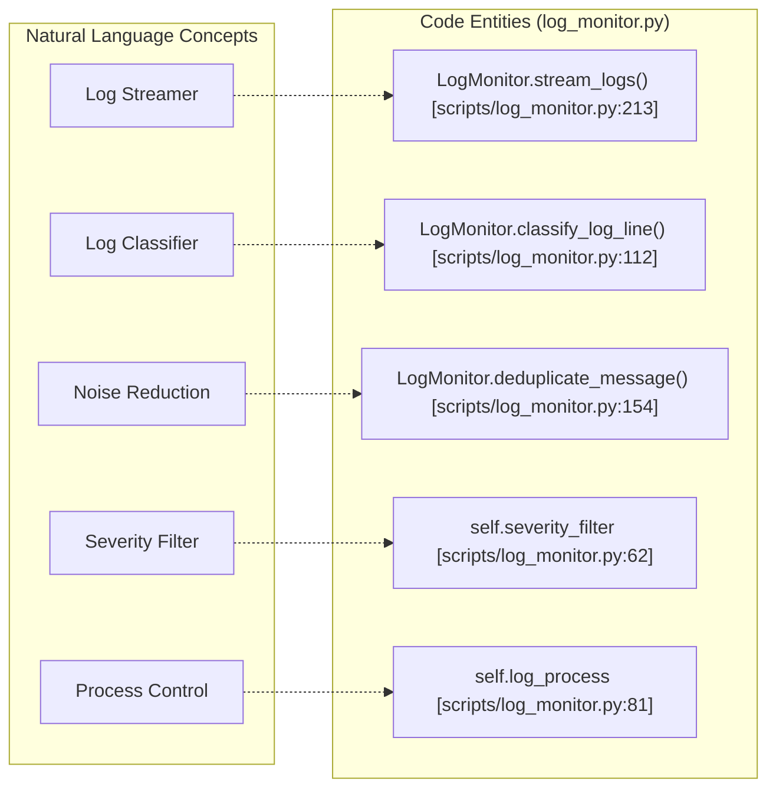

<!-- source: DeepWiki mcp.deepwiki.com · repo conorluddy/ios-simulator-skill · page 5.2 log_monitor.py · fetched 2026-10-27 -->

# log_monitor.py

<details>
<summary>Relevant source files</summary>

The following files were used as context for generating this wiki page:

- [ios-simulator-skill/skills/ios-simulator-skill/scripts/log_monitor.py](ios-simulator-skill/skills/ios-simulator-skill/scripts/log_monitor.py)

</details>


`log_monitor.py` provides real-time monitoring and analysis of iOS Simulator system logs. It features intelligent filtering by severity, app bundle ID, and duration, with an emphasis on deduplicating errors and warnings to provide token-efficient summaries for LLM agents.

---

## Purpose and Role

The iOS Simulator emits a high-volume stream of system log messages. `log_monitor.py` wraps the `xcrun simctl spawn <udid> log stream` command [scripts/log_monitor.py:231]() to transform this raw data into actionable insights. It serves as a runtime diagnostic tool, often used in conjunction with `app_state_capture.py` to debug crashes or verify app behavior during automated sessions.

Key capabilities include:
- **Real-time streaming** with a continuous `--follow` mode [scripts/log_monitor.py:17-18]().
- **Severity classification** (Error, Warning, Info, Debug) using regex patterns [scripts/log_monitor.py:112-152]().
- **Smart Deduplication** of repeated error messages to save context window space [scripts/log_monitor.py:154-173]().
- **Duration-based capture** (e.g., `30s`, `5m`) for targeted monitoring [scripts/log_monitor.py:20-21]().

Sources: [scripts/log_monitor.py:1-31](), [scripts/log_monitor.py:43-83]()

---

## System Architecture

The script follows the standard class-based architecture of the skill, utilizing a `LogMonitor` class to manage the lifecycle of the log collection process.

**Figure 1: log_monitor.py Data Flow and Logic**

```mermaid
flowchart TD
    subgraph CLI["CLI Interface"]
        "argparse.ArgumentParser"
        "parse_time_duration()"
    end

    subgraph CORE["LogMonitor Class [scripts/log_monitor.py:43]"]
        "__init__()"
        "stream_logs()"
        "process_log_line()"
        "classify_log_line()"
        "deduplicate_message()"
    end

    subgraph PLATFORM["macOS / Simulator"]
        "xcrun_simctl_spawn_log_stream"["xcrun simctl spawn &lt;udid&gt; log stream [scripts/log_monitor.py:231]"]
        "System_Log_Stream"["System Log Stream"]
    end

    "argparse.ArgumentParser" --> "parse_time_duration()"
    "parse_time_duration()" --> "__init__()"
    "__init__()" --> "stream_logs()"
    "stream_logs()" -->|"Subprocess Popen [scripts/log_monitor.py:81]"| "xcrun_simctl_spawn_log_stream"
    "xcrun_simctl_spawn_log_stream" --> "System_Log_Stream"
    "System_Log_Stream" -->|"Stdout Pipe"| "process_log_line()"
    "process_log_line()" --> "classify_log_line()"
    "classify_log_line()" --> "deduplicate_message()"
    "deduplicate_message()" -->|"Storage"| "LISTS"["log_lines[]\nerrors[]\nwarnings[] [scripts/log_monitor.py:65-68]"]
```

Sources: [scripts/log_monitor.py:43-51](), [scripts/log_monitor.py:84-110](), [scripts/log_monitor.py:175-212](), [scripts/log_monitor.py:213-231]()

---

## Implementation Details

### Log Classification and Filtering
The `classify_log_line` method uses predefined regex patterns to categorize logs [scripts/log_monitor.py:112-152](). It searches for keywords like `error`, `fault`, `failed`, or `crash` for error classification [scripts/log_monitor.py:125-130](), and `warning` or `deprecated` for warnings [scripts/log_monitor.py:135](). It also recognizes common emojis used in modern iOS logging (❌, ⚠️, ℹ️) [scripts/log_monitor.py:131-138]().

### Token-Efficient Deduplication
To prevent logs from consuming excessive tokens, the `deduplicate_message` method generates a "signature" for each line [scripts/log_monitor.py:154-173](). It strips transient metadata using regex:
- **Dates/Times**: `\d{4}-\d{2}-\d{2}\s+\d{2}:\d{2}:\d{2}` [scripts/log_monitor.py:165]()
- **Process IDs (PIDs)**: `\[\d+\]` [scripts/log_monitor.py:166]()

If a message signature has been seen before in `self.seen_messages` [scripts/log_monitor.py:78](), it is excluded from the high-priority `errors` or `warnings` lists [scripts/log_monitor.py:169-173]().

### Monitoring Modes
The script supports three primary monitoring strategies:
1. **Follow Mode**: Continuous streaming until interrupted by the user (Ctrl+C) [scripts/log_monitor.py:17-18]().
2. **Duration Mode**: Captures logs for a specific window (e.g., `--duration 1m`) using `parse_time_duration` [scripts/log_monitor.py:27]().
3. **Historical Mode**: Using the `--last` flag to extract logs from the recent past [scripts/log_monitor.py:24]().

Sources: [scripts/log_monitor.py:154-173](), [scripts/log_monitor.py:188-212](), [scripts/log_monitor.py:213-231]()

---

## Key Functions

| Function | Role |
|---|---|
| `__init__` | Initializes log storage lists and sets the target `device_udid` (defaults to `"booted"`) [scripts/log_monitor.py:46-62](). |
| `parse_time_duration` | Converts strings like "5m" or "30s" into float seconds [scripts/log_monitor.py:84-110](). |
| `classify_log_line` | Assigns a severity level (`error`, `warning`, `info`, `debug`) to a raw string [scripts/log_monitor.py:112-152](). |
| `deduplicate_message` | Strips transient metadata (PIDs/Timestamps) to identify repeated log patterns [scripts/log_monitor.py:154-173](). |
| `process_log_line` | The central router that classifies, filters, and stores lines in severity-specific buffers [scripts/log_monitor.py:175-212](). |
| `stream_logs` | Spawns the `simctl` subprocess and manages the I/O loop for real-time capture [scripts/log_monitor.py:213-231](). |

Sources: [scripts/log_monitor.py:43-231]()

---

## Integration with Other Scripts

`log_monitor.py` acts as a standalone diagnostic tool but its logic is designed to complement:
- **`app_state_capture.py`**: Which provides a point-in-time snapshot of logs. `log_monitor.py` provides the continuous stream version [scripts/log_monitor.py:5-6]().
- **`test_recorder.py`**: For capturing logs during the execution of an automated test script [scripts/log_monitor.py:14]().
- **`build_and_test.py`**: To monitor for runtime exceptions immediately after a successful build and launch [scripts/log_monitor.py:14]().

**Figure 2: Code Entity Mapping (Natural Language to Code)**



Sources: [scripts/log_monitor.py:43-231](), [scripts/log_monitor.py:62](), [scripts/log_monitor.py:81](), [scripts/log_monitor.py:112](), [scripts/log_monitor.py:154](), [scripts/log_monitor.py:213]()

---

