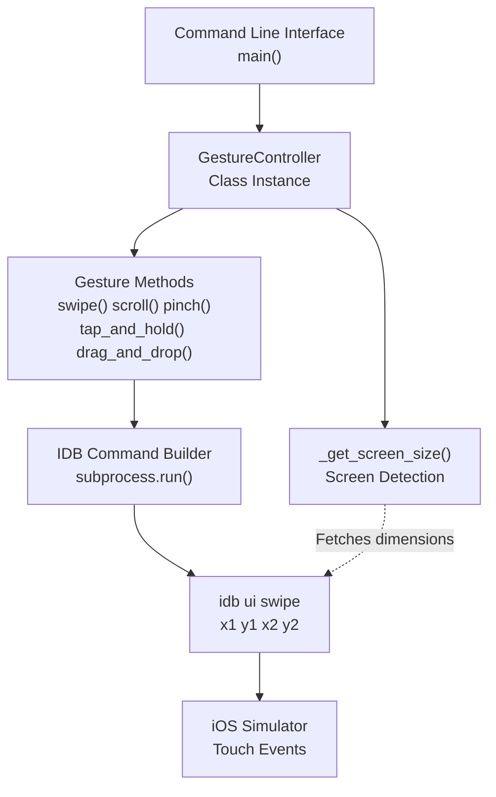
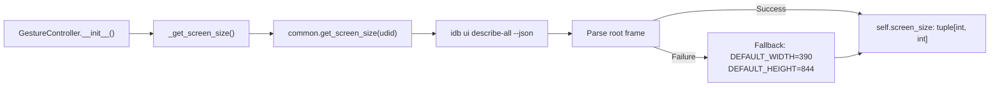
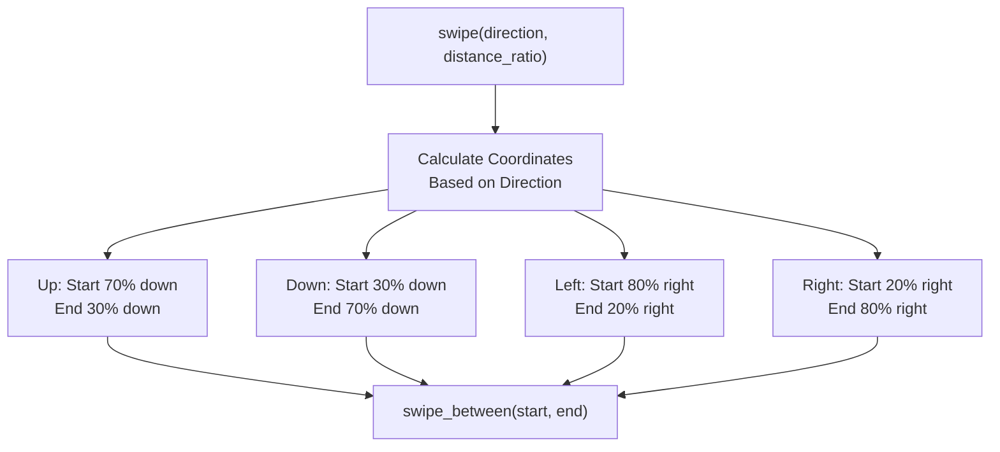
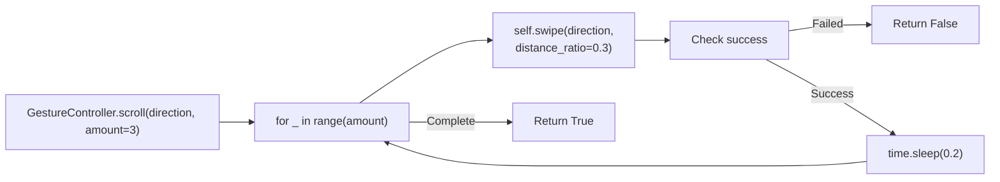
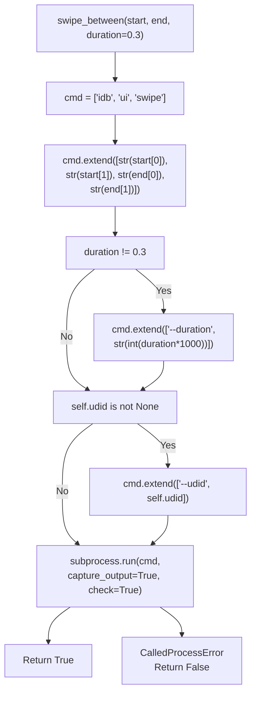
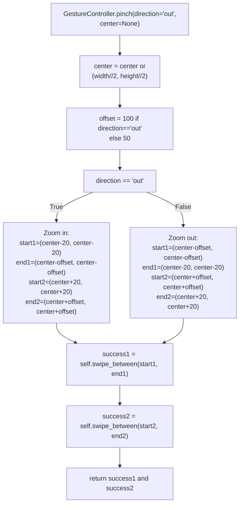
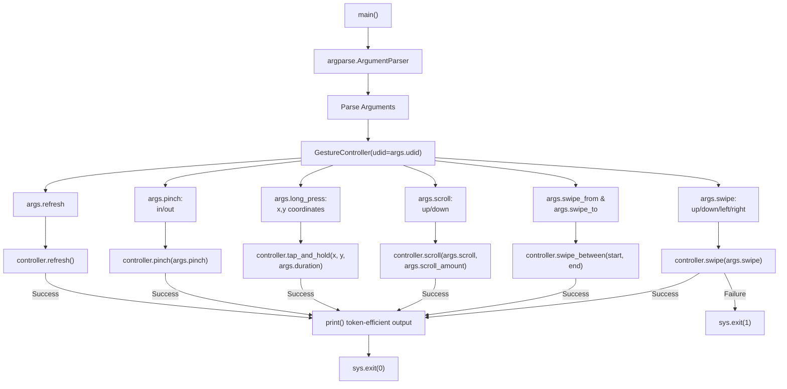
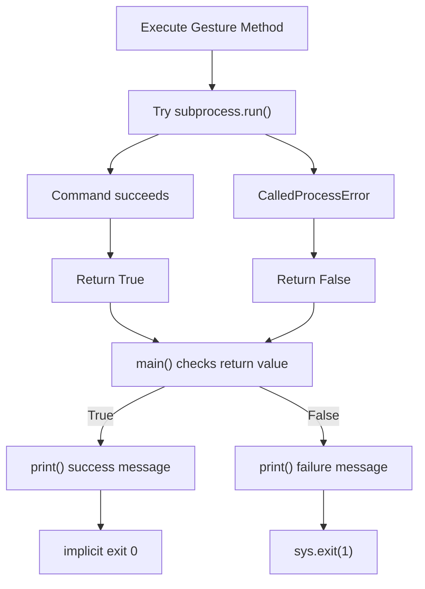

<!-- source: DeepWiki mcp.deepwiki.com · repo conorluddy/ios-simulator-skill · page 6.3 gesture.py · fetched 2026-10-27 -->

# gesture.py

<details>
<summary>Relevant source files</summary>

The following files were used as context for generating this wiki page:

- [ios-simulator-skill/skills/ios-simulator-skill/scripts/gesture.py](ios-simulator-skill/skills/ios-simulator-skill/scripts/gesture.py)

</details>


The Gesture Controller provides touch gesture automation for iOS simulators, enabling programmatic execution of swipes, scrolls, pinches, and other multi-touch interactions. This script wraps Facebook IDB's gesture commands with device-aware positioning and token-efficient output.

For element-based interaction (tapping buttons by text/type), see [6.2 navigator.py](). For text input and hardware buttons, see [6.4 keyboard.py]().

**Sources:** [ios-simulator-skill/skills/ios-simulator-skill/scripts/gesture.py:1-58]()

---

## Overview and Architecture

The `gesture.py` script implements the `GestureController` class, which provides high-level gesture abstractions over IDB's coordinate-based swipe commands. The controller automatically detects screen dimensions and calculates gesture coordinates as fractions of screen size, ensuring device-independent automation.

### Core Components



**Sources:** [ios-simulator-skill/skills/ios-simulator-skill/scripts/gesture.py:73-247]()

---

## Screen Size Detection

The controller auto-detects screen dimensions on initialization to calculate device-independent gesture coordinates.

### Detection via Common Utility

The `GestureController` delegates screen size detection to the shared `get_screen_size()` utility from the `common` module, which handles IDB queries and parsing.



**Implementation Details:**

The controller imports and uses the shared utility:

```python
# gesture.py imports from common module
from common import (
    get_device_screen_size,
    get_screen_size,
    resolve_udid,
    transform_screenshot_coords,
)

class GestureController:
    DEFAULT_WIDTH = 390  # iPhone 14
    DEFAULT_HEIGHT = 844
    
    def _get_screen_size(self) -> tuple[int, int]:
        """Try to detect screen size from device using shared utility."""
        return get_screen_size(self.udid)
```

The `get_screen_size()` utility handles IDB queries and fallback logic. See [10.1 device_utils.py]() for details on the shared implementation.

**Sources:** [ios-simulator-skill/skills/ios-simulator-skill/scripts/gesture.py:65-70](), [ios-simulator-skill/skills/ios-simulator-skill/scripts/gesture.py:77-88]()

---

## Gesture Types and Methods

### Directional Swipes

The `swipe()` method performs single-direction swipes with configurable distance ratios.



**Coordinate Calculation Table:**

| Direction | Start Point | End Point | Distance Ratio |
|-----------|-------------|-----------|----------------|
| `up` | `(center_x, height * 0.7)` | `(center_x, height * (1 - distance_ratio + 0.3))` | Default 0.7 |
| `down` | `(center_x, height * 0.3)` | `(center_x, height * (distance_ratio - 0.3 + 0.3))` | Default 0.7 |
| `left` | `(width * 0.8, center_y)` | `(width * (1 - distance_ratio + 0.2), center_y)` | Default 0.7 |
| `right` | `(width * 0.2, center_y)` | `(width * (distance_ratio - 0.2 + 0.2), center_y)` | Default 0.7 |

**Sources:** [ios-simulator-skill/skills/ios-simulator-skill/scripts/gesture.py:89-121]()

---

### Multi-Swipe Scrolling

The `scroll()` method performs multiple small swipes with delays to simulate scrolling behavior.



**Key Characteristics:**

- **Distance:** 30% of screen per swipe (vs 70% for single swipes) [ios-simulator-skill/skills/ios-simulator-skill/scripts/gesture.py:164]().
- **Delay:** 200ms between swipes [ios-simulator-skill/skills/ios-simulator-skill/scripts/gesture.py:166]().
- **Default Amount:** 3 swipes [ios-simulator-skill/skills/ios-simulator-skill/scripts/gesture.py:152]().
- **Early Exit:** Returns `False` on first failure [ios-simulator-skill/skills/ios-simulator-skill/scripts/gesture.py:165]().

**Sources:** [ios-simulator-skill/skills/ios-simulator-skill/scripts/gesture.py:152-167]()

---

### Swipe Between Coordinates

The `swipe_between()` method executes custom swipes between arbitrary points.

**IDB Command Construction:**

```
idb ui swipe <x1> <y1> <x2> <y2> [--duration <ms>] [--udid <device-id>]
```

**Command Building Process:**



**Sources:** [ios-simulator-skill/skills/ios-simulator-skill/scripts/gesture.py:122-150]()

---

### Pinch Gestures

The `pinch()` method simulates two-finger pinch gestures for zoom operations.

**Pinch Algorithm:**

| Direction | Start Positions | End Positions | Effect |
|-----------|----------------|---------------|--------|
| `out` (zoom in) | Fingers close to center<br/>`(center ± 20)` | Fingers far from center<br/>`(center ± 100)` | Zoom in |
| `in` (zoom out) | Fingers far from center<br/>`(center ± 50)` | Fingers close to center<br/>`(center ± 20)` | Zoom out |



**Note:** Pinch is simulated via two sequential swipes, not simultaneous multi-touch [ios-simulator-skill/skills/ios-simulator-skill/scripts/gesture.py:214-225]().

**Sources:** [ios-simulator-skill/skills/ios-simulator-skill/scripts/gesture.py:195-226]()

---

### Additional Gestures

#### Long Press (`tap_and_hold`)

Simulates tap-and-hold by executing a tap followed by a sleep delay:

- Executes `idb ui tap x y` [ios-simulator-skill/skills/ios-simulator-skill/scripts/gesture.py:182]().
- Calls `time.sleep(duration)` to simulate hold [ios-simulator-skill/skills/ios-simulator-skill/scripts/gesture.py:190]().
- Default duration: 2.0 seconds [ios-simulator-skill/skills/ios-simulator-skill/scripts/gesture.py:169]().

**Sources:** [ios-simulator-skill/skills/ios-simulator-skill/scripts/gesture.py:169-193]()

#### Drag and Drop

Wrapper around `swipe_between()` with longer duration (1.0s) to simulate drag:

```python
def drag_and_drop(self, start: tuple[int, int], end: tuple[int, int]) -> bool:
    """Perform drag and drop between points."""
    return self.swipe_between(start, end, duration=1.0)
```

**Sources:** [ios-simulator-skill/skills/ios-simulator-skill/scripts/gesture.py:228-239]()

#### Pull to Refresh

Predefined swipe from top of screen downward:

- Start: `(screen_width // 2, 100)`
- End: `(screen_width // 2, 400)`

**Sources:** [ios-simulator-skill/skills/ios-simulator-skill/scripts/gesture.py:241-247]()

---

## Command-Line Interface

### Argument Structure



**Sources:** [ios-simulator-skill/skills/ios-simulator-skill/scripts/gesture.py:249-381]()

---

## Token Efficiency

### Output Comparison

| Operation | Raw IDB Output | gesture.py Output | Reduction |
|-----------|----------------|-------------------|-----------|
| Single swipe | ~50 lines of debug info | `Swiped up` (1 line) | 98% |
| Scroll 3x | ~150 lines | `Scrolled down (3x)` (1 line) | 99.3% |
| Pinch | ~100 lines | `Zoomed in` (1 line) | 99% |

**Design Principle:** Default output is token-efficient (1 line). Verbose details available via standard IDB capture if needed.

**Sources:** [ios-simulator-skill/skills/ios-simulator-skill/scripts/gesture.py:40-44](), [ios-simulator-skill/skills/ios-simulator-skill/scripts/gesture.py:280-326]()

---

## Device Independence

### Coordinate Calculation Strategy

The controller uses fractional positioning instead of absolute coordinates:

```python
# gesture.py logic
width, height = self.screen_size
center_x = width // 2
center_y = height // 2

# Swipe Up coordinates
start = (center_x, int(height * 0.7))
end = (center_x, int(height * (1 - distance_ratio + 0.3)))
```

**Supported Devices:**

| Device | Resolution | Detection Method |
|--------|-----------|------------------|
| iPhone 14 | 390x844 | Default fallback [ios-simulator-skill/skills/ios-simulator-skill/scripts/gesture.py:77-78]() |
| iPhone 14 Pro Max | 430x932 | Auto-detected via IDB [ios-simulator-skill/skills/ios-simulator-skill/scripts/gesture.py:86-87]() |
| iPhone SE | 375x667 | Auto-detected via IDB [ios-simulator-skill/skills/ios-simulator-skill/scripts/gesture.py:86-87]() |

**Sources:** [ios-simulator-skill/skills/ios-simulator-skill/scripts/gesture.py:77-88](), [ios-simulator-skill/skills/ios-simulator-skill/scripts/gesture.py:100-116]()

---

## Error Handling

### Failure Modes and Exit Codes



**Exit Code Contract:**

- `0`: Gesture executed successfully [ios-simulator-skill/skills/ios-simulator-skill/scripts/gesture.py:381]()
- `1`: Gesture failed (IDB error, invalid arguments) [ios-simulator-skill/skills/ios-simulator-skill/scripts/gesture.py:285]()

**Sources:** [ios-simulator-skill/skills/ios-simulator-skill/scripts/gesture.py:146-150](), [ios-simulator-skill/skills/ios-simulator-skill/scripts/gesture.py:280-381]()

---

