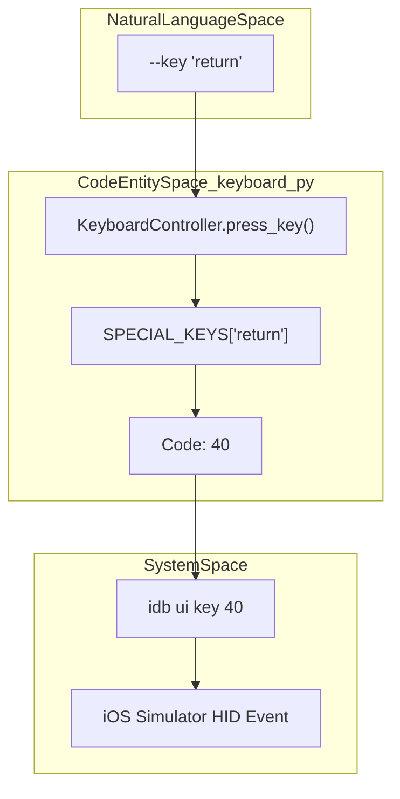
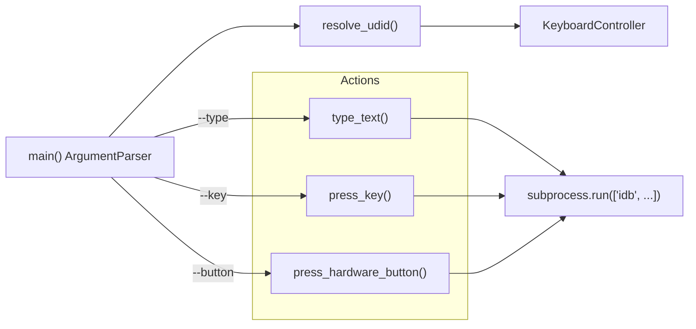

<!-- source: DeepWiki mcp.deepwiki.com · repo conorluddy/ios-simulator-skill · page 6.4 keyboard.py · fetched 2026-10-27 -->

# keyboard.py

Relevant source files

The following files were used as context for generating this wiki page:

- [ios-simulator-skill/skills/ios-simulator-skill/scripts/keyboard.py](ios-simulator-skill/skills/ios-simulator-skill/scripts/keyboard.py)

`keyboard.py` is a core script in the Navigation & Interaction category. It provides text input and hardware button simulation for the iOS Simulator, sending keystrokes and button events primarily through `idb` and `simctl`. It is distinct from text entry via `navigator.py` — while `navigator.py` first locates an element semantically before entering text into it, `keyboard.py` operates at a lower level, sending raw key events and hardware button presses to the simulator's currently focused element or system-level responders.

---

## Purpose and Scope

`keyboard.py` handles three primary interaction types:

| Feature | Description | Implementation |
|---|---|---|
| **Text Typing** | Sends strings to the focused element, optionally with per-character delays. | `idb ui text` [scripts/keyboard.py:133-133]() |
| **Special Keys** | Sends HID key codes for keys like `return`, `delete`, `tab`, and `arrows`. | `idb ui key` [scripts/keyboard.py:163-163]() |
| **Hardware Buttons** | Simulates physical buttons like `home`, `lock`, `volume`, and `screenshot`. | `idb ui button` [scripts/keyboard.py:225-225]() |

Sources: [scripts/keyboard.py:8-18](), [scripts/keyboard.py:59-66]()

---

## Technical Architecture

The script is centered around the `KeyboardController` class [scripts/keyboard.py:76-76](), which encapsulates the logic for mapping human-readable commands to iOS HID (Human Interface Device) codes and executing them via subprocess calls to `idb`.

### Key Mappings
The script maintains static mappings to translate string arguments into the integers or constants required by the underlying tools.

*   **Special Keys**: Maps names to iOS HID usage codes (e.g., `return` → `40`) based on Apple's `UIKeyboardHIDUsage` specification. [scripts/keyboard.py:81-93]()
*   **Hardware Buttons**: Maps names to IDB button constants (e.g., `home` → `HOME`). [scripts/keyboard.py:96-104]()

### Logic Flow: Natural Language to HID Codes
The following diagram illustrates how a user's intent (e.g., "press return") is transformed into a system-level event.

Title: Natural Language to HID Mapping

Sources: [scripts/keyboard.py:81-93](), [scripts/keyboard.py:143-175]()

---

## Key Functions and Implementation

### Text Entry: `type_text`
The `type_text` method [scripts/keyboard.py:110-129]() supports two modes of operation:
1.  **Batch Mode**: Sends the entire string at once using `_type_single`. This is token-efficient and fast. [scripts/keyboard.py:129-129]()
2.  **Delayed Mode**: If a `--delay` is provided, it iterates through the string, calling `_type_single` for each character followed by a `time.sleep(delay)`. This is used to simulate human typing or wait for UI animations. [scripts/keyboard.py:121-127]()

### Special Key Handling: `press_key` and `press_key_sequence`
*   **`press_key`**: Looks up the HID code in `SPECIAL_KEYS`. If not found, it attempts to treat the input as a literal integer key code. [scripts/keyboard.py:155-161]()
*   **`press_key_sequence`**: Allows sending multiple keys in a single `idb` command (`idb ui key-sequence`), reducing the overhead of multiple subprocess calls. [scripts/keyboard.py:176-210]()

### Hardware Buttons: `press_hardware_button`
This method uses the `HARDWARE_BUTTONS` dictionary to translate inputs like `lock` or `volume-up` into the specific strings required by `idb ui button`. [scripts/keyboard.py:211-234]()

---

## Data Flow: CLI to Simulator

The `main()` function [scripts/keyboard.py:237-300]() handles argument parsing and initializes the `KeyboardController` with a UDID resolved via `resolve_udid` [scripts/keyboard.py:73-73]().

Title: CLI Command Execution Flow

Sources: [scripts/keyboard.py:237-300](), [scripts/keyboard.py:133-138](), [scripts/keyboard.py:163-169](), [scripts/keyboard.py:225-230]()

---

## Usage Examples and Flags

### Core Flags
| Flag | Description |
|---|---|
| `--type` | Text to type into the focused element. |
| `--key` | Special key name (e.g., `tab`, `delete`) or HID code. Can be repeated. |
| `--button` | Hardware button name (e.g., `home`, `screenshot`). |
| `--delay` | Seconds to wait between characters when typing. |
| `--udid` | Target device identifier (resolved via `common.resolve_udid`). |

### Example Commands
*   **Submit a form**: `python scripts/keyboard.py --key return` [scripts/keyboard.py:25-25]()
*   **Delete multiple characters**: `python scripts/keyboard.py --key delete --key delete` [scripts/keyboard.py:28-28]()
*   **Simulate slow typing**: `python scripts/keyboard.py --type "Slowly..." --delay 0.2` [scripts/keyboard.py:37-37]()
*   **Capture a screenshot**: `python scripts/keyboard.py --button screenshot` [scripts/keyboard.py:57-57]()

---

## Relationship to navigator.py

`keyboard.py` and `navigator.py` overlap in text entry, but serve different architectural layers:

1.  **`navigator.py --enter-text`**: High-level. Performs a semantic search (Accessibility Tree), calculates coordinates, taps the element to focus it, and then enters text.
2.  **`keyboard.py --type`**: Low-level. Assumes focus is already correct. Directly injects characters into the system input buffer. [scripts/keyboard.py:64-64]()

Use `keyboard.py` when focus is already established (e.g., after a previous tap) or when interacting with system-level hardware buttons that have no corresponding UI element in the app's accessibility tree.

Sources: [scripts/keyboard.py:64-64](), [scripts/keyboard.py:110-120]()

---

