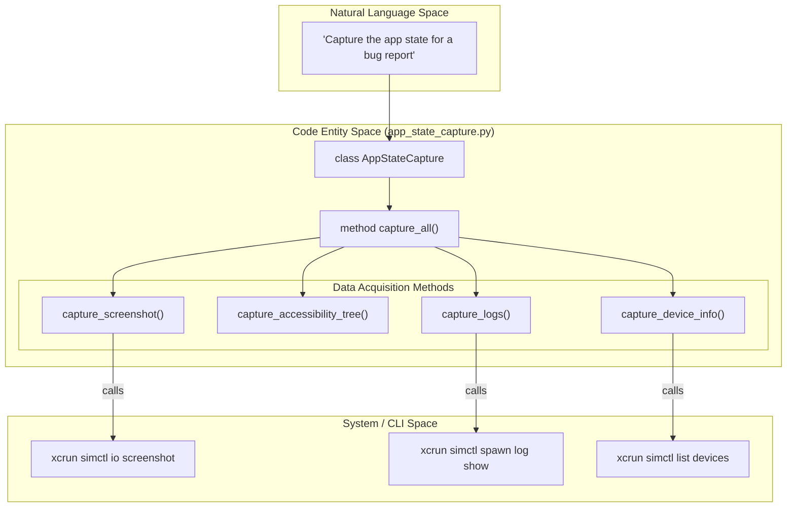
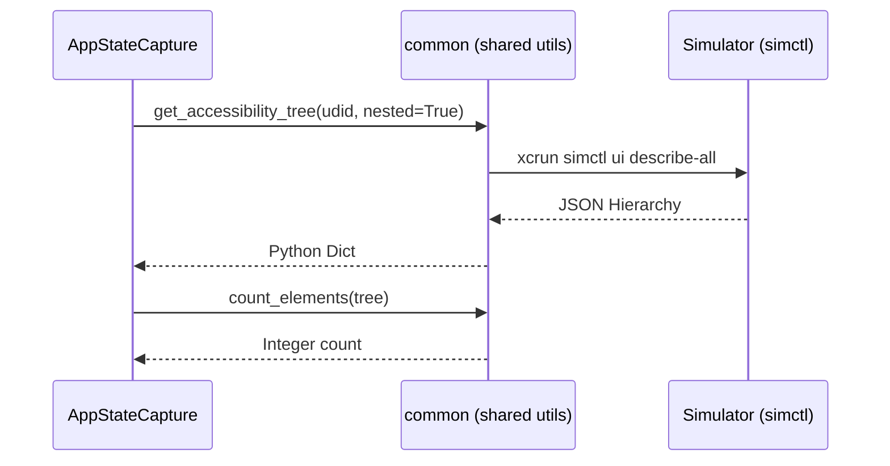

<!-- source: DeepWiki mcp.deepwiki.com · repo conorluddy/ios-simulator-skill · page 7.4 app_state_capture.py · fetched 2026-10-27 -->

# app_state_capture.py

<details>
<summary>Relevant source files</summary>

The following files were used as context for generating this wiki page:

- [ios-simulator-skill/skills/ios-simulator-skill/scripts/app_state_capture.py](ios-simulator-skill/skills/ios-simulator-skill/scripts/app_state_capture.py)

</details>


Documents the implementation of the `AppStateCapture` class, which creates comprehensive debugging snapshots by aggregating screenshots, accessibility trees, app logs, and device metadata.

---

## Overview

`app_state_capture.py` implements a diagnostic utility that captures a point-in-time snapshot of the iOS Simulator's state. It is designed to provide a "black box" recording for bug reports, visual regression baselines, and automated test failure analysis.

The script aggregates data from multiple sources into a structured output:

| Data Source | Collection Method | Implementation Detail |
|:---|:---|:---|
| **Screenshot** | `xcrun simctl io screenshot` | Captured via `capture_screenshot()` utility [ios-simulator-skill/skills/ios-simulator-skill/scripts/app_state_capture.py:19-19](), [ios-simulator-skill/skills/ios-simulator-skill/scripts/app_state_capture.py:199-204]() |
| **UI Hierarchy** | Accessibility Tree | Fetched via `get_accessibility_tree()` [ios-simulator-skill/skills/ios-simulator-skill/scripts/app_state_capture.py:21-21](), [ios-simulator-skill/skills/ios-simulator-skill/scripts/app_state_capture.py:71-71]() |
| **App Logs** | `simctl spawn log show` | Filtered by process name derived from Bundle ID [ios-simulator-skill/skills/ios-simulator-skill/scripts/app_state_capture.py:100-109]() |
| **Device Info** | `simctl list devices` | Parsed to identify device name, UDID, and state [ios-simulator-skill/skills/ios-simulator-skill/scripts/app_state_capture.py:139-161]() |

Sources: [ios-simulator-skill/skills/ios-simulator-skill/scripts/app_state_capture.py:2-9](), [ios-simulator-skill/skills/ios-simulator-skill/scripts/app_state_capture.py:26-27]()

---

## Class Architecture and Data Flow

The `AppStateCapture` class follows the standard skill pattern: initialization with configuration, followed by an orchestration method (`capture_all`) that executes sub-tasks.

### Natural Language to Code Entity Space

This diagram maps the conceptual "Debugging Snapshot" to the specific Python methods and CLI commands used to generate them.



Sources: [ios-simulator-skill/skills/ios-simulator-skill/scripts/app_state_capture.py:26-170](), [ios-simulator-skill/skills/ios-simulator-skill/scripts/app_state_capture.py:52-62](), [ios-simulator-skill/skills/ios-simulator-skill/scripts/app_state_capture.py:91-109]()

---

## Key Functions and Implementation

### Initialization
The constructor allows for flexible targeting of devices and specific apps for log filtering.

```python
def __init__(
    self,
    app_bundle_id: str | None = None,
    udid: str | None = None,
    inline: bool = False,
    screenshot_size: str = "half",
):
```
- `app_bundle_id`: Used to filter system logs to only show entries from the target app [ios-simulator-skill/skills/ios-simulator-skill/scripts/app_state_capture.py:45-45]().
- `inline`: Determines if the screenshot is saved as a file or returned as a Base64 string for LLM vision processing [ios-simulator-skill/skills/ios-simulator-skill/scripts/app_state_capture.py:47-47]().

Sources: [ios-simulator-skill/skills/ios-simulator-skill/scripts/app_state_capture.py:29-48]()

### Log Capture and Analysis
The `capture_logs` method uses a predicate to filter logs by process name (derived from the bundle ID) and limits output for token efficiency.

- **Predicate**: `process == "{app_name}"` [ios-simulator-skill/skills/ios-simulator-skill/scripts/app_state_capture.py:103-103]().
- **Time Window**: Captures the last 1 minute of activity [ios-simulator-skill/skills/ios-simulator-skill/scripts/app_state_capture.py:105-105]().
- **Analysis**: It automatically counts "warning" and "error" occurrences in the captured lines [ios-simulator-skill/skills/ios-simulator-skill/scripts/app_state_capture.py:125-133]().

Sources: [ios-simulator-skill/skills/ios-simulator-skill/scripts/app_state_capture.py:82-135]()

### Accessibility Tree Integration
Instead of reimplementing UI inspection, it leverages the shared `get_accessibility_tree` utility.



Sources: [ios-simulator-skill/skills/ios-simulator-skill/scripts/app_state_capture.py:20-21](), [ios-simulator-skill/skills/ios-simulator-skill/scripts/app_state_capture.py:71-78]()

---

## Execution Flow: `capture_all`

The `capture_all` method orchestrates the full suite of data collection. It supports two distinct modes: **File Mode** (for traditional bug reports) and **Inline Mode** (for AI agent interaction).

| Feature | File Mode (`inline=False`) | Inline Mode (`inline=True`) |
|:---|:---|:---|
| **Storage** | Creates `app-state-YYYYMMDD-HHMMSS/` directory [ios-simulator-skill/skills/ios-simulator-skill/scripts/app_state_capture.py:185-186]() | No directory created; data kept in memory [ios-simulator-skill/skills/ios-simulator-skill/scripts/app_state_capture.py:188-188]() |
| **Screenshot** | Saved as `.png` file [ios-simulator-skill/skills/ios-simulator-skill/scripts/app_state_capture.py:216-216]() | Returned as Base64 in JSON [ios-simulator-skill/skills/ios-simulator-skill/scripts/app_state_capture.py:210-210]() |
| **Summary** | Returns paths to all artifacts [ios-simulator-skill/skills/ios-simulator-skill/scripts/app_state_capture.py:196-196]() | Returns complete data structure in summary [ios-simulator-skill/skills/ios-simulator-skill/scripts/app_state_capture.py:208-214]() |

Sources: [ios-simulator-skill/skills/ios-simulator-skill/scripts/app_state_capture.py:167-215]()

---

## Token Efficiency and Optimization

To remain compatible with LLM context windows, the script applies several optimization strategies:

1. **Log Truncation**: Limits logs to the most recent `N` lines (default 100) [ios-simulator-skill/skills/ios-simulator-skill/scripts/app_state_capture.py:117-118]().
2. **Screenshot Resizing**: Supports `full`, `half`, `quarter`, and `thumb` presets to reduce image payload size [ios-simulator-skill/skills/ios-simulator-skill/scripts/app_state_capture.py:43-43]().
3. **Log Styling**: Uses `--style compact` to minimize per-line overhead [ios-simulator-skill/skills/ios-simulator-skill/scripts/app_state_capture.py:107-107]().
4. **Summary Statistics**: Provides counts (warnings, errors, elements) so the agent can decide if it needs to read the full files [ios-simulator-skill/skills/ios-simulator-skill/scripts/app_state_capture.py:125-133]().

Sources: [ios-simulator-skill/skills/ios-simulator-skill/scripts/app_state_capture.py:115-133](), [ios-simulator-skill/skills/ios-simulator-skill/scripts/app_state_capture.py:48-48]()

---

