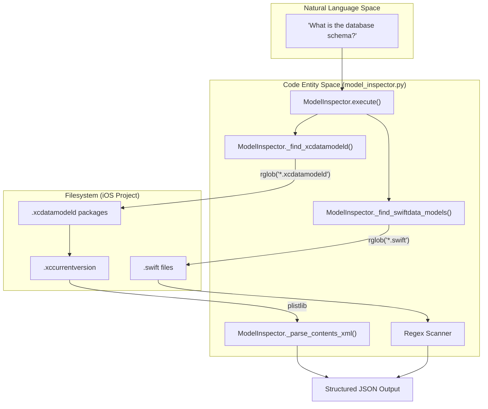
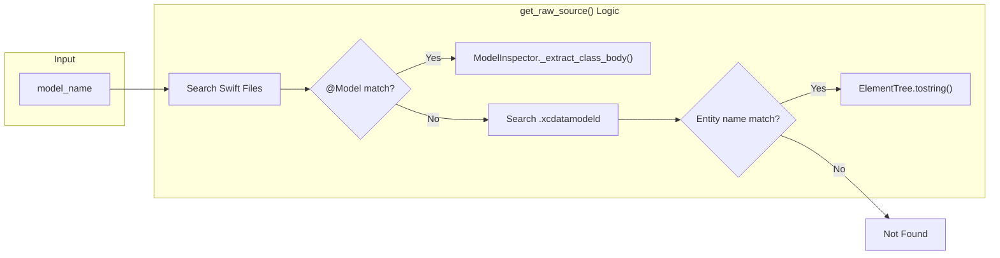

<!-- source: DeepWiki mcp.deepwiki.com · repo conorluddy/ios-simulator-skill · page 7.5 model_inspector.py · fetched 2026-10-27 -->

# model_inspector.py

<details>
<summary>Relevant source files</summary>

The following files were used as context for generating this wiki page:

- [ios-simulator-skill/skills/ios-simulator-skill/scripts/model_inspector.py](ios-simulator-skill/skills/ios-simulator-skill/scripts/model_inspector.py)

</details>


The `model_inspector.py` script is a diagnostic and discovery utility designed to extract data schemas from iOS projects. It identifies and parses both legacy **Core Data** (`.xcdatamodeld`) XML packages and modern **SwiftData** (`@Model`) Swift declarations without requiring Xcode build tools or external dependencies.

## Overview

This script serves as a bridge between the raw source code/model definitions and the Claude Code skill, allowing the LLM to understand the application's data layer. It provides structured JSON output of entities, attributes, and relationships, as well as raw source extraction for deep inspection of specific models.

### Key Capabilities
*   **Hybrid Support**: Simultaneously scans for Core Data XML models and SwiftData class declarations [[ios-simulator-skill/scripts/model_inspector.py:54-65]]().
*   **Version Detection**: Identifies the active model version in Core Data packages by parsing `.xccurrentversion` plists [[ios-simulator-skill/scripts/model_inspector.py:194-210]]().
*   **Raw Extraction**: Extracts the full source code of a specific model, whether it is a Swift class or a segment of a Core Data XML file [[ios-simulator-skill/scripts/model_inspector.py:72-82]]().
*   **Zero Dependencies**: Implementation relies solely on Python's standard library (`xml.etree.ElementTree`, `re`, `plistlib`) [[ios-simulator-skill/scripts/model_inspector.py:15-21]]().

---

## System Architecture & Data Flow

The `ModelInspector` class orchestrates the discovery of model files by traversing the project directory while ignoring build artifacts like `DerivedData` or `Pods`.

### Data Extraction Flow

The following diagram illustrates how the script processes a project path to produce a unified model representation.

**Model Extraction Logic**

**Sources:** [[ios-simulator-skill/scripts/model_inspector.py:35-68]](), [[ios-simulator-skill/scripts/model_inspector.py:149-151]](), [[ios-simulator-skill/scripts/model_inspector.py:221-240]]()

---

## Implementation Details

### Core Data Parsing
Core Data models are stored as directory packages. The script:
1.  Locates `.xcdatamodeld` directories using `Path.rglob` [[ios-simulator-skill/scripts/model_inspector.py:149-151]]().
2.  Determines the active version via `_detect_current_version` by reading the `_activeVersionName` key from the `.xccurrentversion` plist [[ios-simulator-skill/scripts/model_inspector.py:194-210]]().
3.  Parses the `contents` XML file using `ElementTree` to extract `<entity>`, `<attribute>`, and `<relationship>` nodes [[ios-simulator-skill/scripts/model_inspector.py:212-258]]().

### SwiftData Inspection
SwiftData models are defined directly in Swift code. Since there is no compiled schema to read without building the app, the script uses regular expressions:
1.  It scans `.swift` files for the `@Model` attribute using a multiline regex pattern [[ios-simulator-skill/scripts/model_inspector.py:228-232]]().
2.  It identifies class names and attempts to extract property names and types by parsing the class body [[ios-simulator-skill/scripts/model_inspector.py:234-240]]().
3.  It filters out directories like `DerivedData`, `Pods`, and `Carthage` to avoid scanning third-party or generated code [[ios-simulator-skill/scripts/model_inspector.py:223-226]]().

### Raw Source Retrieval
The `get_raw_source` method allows the skill to retrieve the exact definition of a model. It performs the following:
1. **SwiftData Search**: Scans for `@Model class [Name]` and uses a brace-counting algorithm in `_extract_class_body` to capture the entire class implementation [[ios-simulator-skill/scripts/model_inspector.py:87-124]]().
2. **Core Data Search**: Locates the entity within the active model version's `contents` XML and returns the raw XML snippet [[ios-simulator-skill/scripts/model_inspector.py:127-143]]().

**Raw Extraction Flow**

**Sources:** [[ios-simulator-skill/scripts/model_inspector.py:72-145]]()

---

## Class and Function Reference

| Function/Method | Description |
| :--- | :--- |
| `ModelInspector.execute()` | Main entry point; coordinates Core Data and SwiftData scanning [[ios-simulator-skill/scripts/model_inspector.py:35-68]](). |
| `ModelInspector.get_raw_source()` | Performs a targeted search for a named entity to return its raw definition [[ios-simulator-skill/scripts/model_inspector.py:72-145]](). |
| `ModelInspector._find_xcdatamodeld()` | Returns a list of all Core Data model packages in the project [[ios-simulator-skill/scripts/model_inspector.py:149-151]](). |
| `ModelInspector._parse_contents_xml()` | Extracts entities, attributes, and relationships from a Core Data XML file [[ios-simulator-skill/scripts/model_inspector.py:212-258]](). |
| `ModelInspector._find_swiftdata_models()` | Scans Swift files for `@Model` declarations and parses class structures [[ios-simulator-skill/scripts/model_inspector.py:221-240]]() |
| `ModelInspector._detect_current_version()` | Reads `.xccurrentversion` to find the active Core Data model version [[ios-simulator-skill/scripts/model_inspector.py:194-210]](). |

**Sources:** [[ios-simulator-skill/scripts/model_inspector.py:24-258]]()

---

## Usage and Output

### CLI Flags
*   `--project-path`: The root directory of the iOS project (required) [[ios-simulator-skill/scripts/model_inspector.py:302-303]]().
*   `--core-data-only`: Skip scanning for SwiftData models [[ios-simulator-skill/scripts/model_inspector.py:308-309]]().
*   `--swiftdata-only`: Skip scanning for Core Data models [[ios-simulator-skill/scripts/model_inspector.py:310-311]]().
*   `--raw [MODEL_NAME]`: Output the raw source code/XML for a specific entity [[ios-simulator-skill/scripts/model_inspector.py:314-315]]().
*   `--show-versions`: Include full version history for Core Data packages [[ios-simulator-skill/scripts/model_inspector.py:312-313]]().
*   `--json`: Output results in structured JSON format [[ios-simulator-skill/scripts/model_inspector.py:305-306]]().

### JSON Schema Example
When run with `--json`, the script produces a dictionary containing lists for both model types.

```json
{
  "core_data": [
    {
      "package": "Example.xcdatamodeld",
      "current_version": "Example 2.xcdatamodel",
      "entities": [
        {
          "name": "User",
          "attributes": [{"name": "username", "type": "String"}],
          "relationships": []
        }
      ]
    }
  ],
  "swiftdata": [
    {
      "name": "TodoItem",
      "file": "Models/TodoItem.swift",
      "properties": [{"name": "title", "type": "String"}]
    }
  ]
}
```
**Sources:** [[ios-simulator-skill/scripts/model_inspector.py:54-68]](), [[ios-simulator-skill/scripts/model_inspector.py:212-258]]()

---

