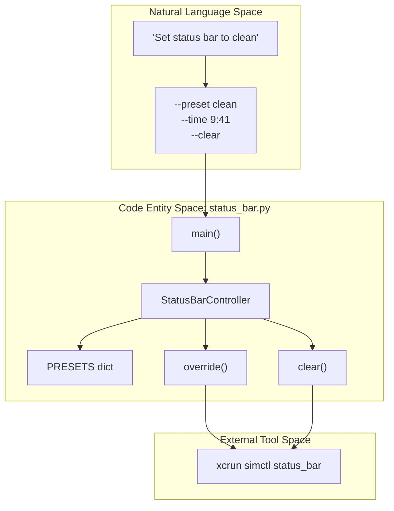
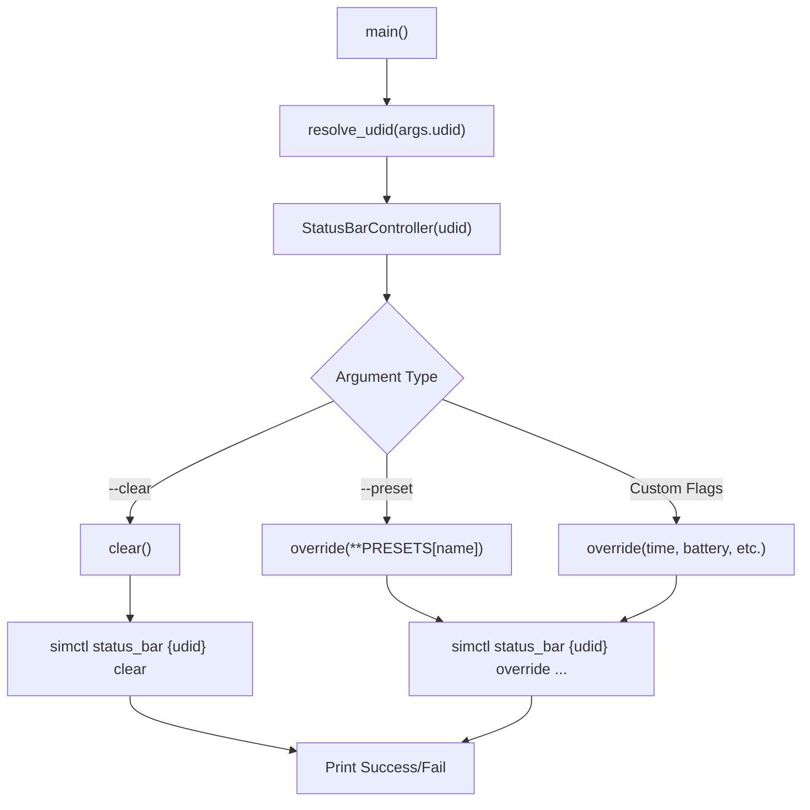

<!-- source: DeepWiki mcp.deepwiki.com · repo conorluddy/ios-simulator-skill · page 8.2 status_bar.py · fetched 2026-10-27 -->

# status_bar.py

<details>
<summary>Relevant source files</summary>

The following files were used as context for generating this wiki page:

- [ios-simulator-skill/skills/ios-simulator-skill/scripts/status_bar.py](ios-simulator-skill/skills/ios-simulator-skill/scripts/status_bar.py)

</details>


This document covers the status bar override functionality provided by `status_bar.py`, which allows developers and AI agents to standardize the iOS simulator's status bar appearance for consistent screenshots and visual testing.

**Scope**: This page documents the status bar override mechanism, preset configurations, custom override options, and integration with visual testing workflows. For visual comparison of screenshots, see [visual_diff.py](). For comprehensive debugging snapshots that include screenshots, see [app_state_capture.py]().

---

## Purpose and Use Cases

The iOS simulator's status bar displays dynamic information (current time, battery level, cellular signal, WiFi status) that changes constantly. This variability creates problems for automated testing:

- **Visual regression tests** fail due to timestamp differences between baseline and comparison screenshots.
- **Documentation screenshots** look inconsistent across different capture times.
- **Test recordings** show different battery levels or network states in each run.
- **CI/CD pipelines** produce non-deterministic visual outputs.

`status_bar.py` solves these problems by overriding the simulator's status bar to display fixed, predictable values using the `xcrun simctl status_bar` command [scripts/status_bar.py:82-107]().

**Sources**: [scripts/status_bar.py:2-9](), [scripts/status_bar.py:82-89]()

---

## Command Structure and Architecture

The script uses a class-based design centered around the `StatusBarController` class [scripts/status_bar.py:18-130](). It interfaces directly with `simctl` to modify the simulator's appearance.

### Code Entity Mapping



**Diagram**: Mapping of user intent and CLI arguments to internal Python class methods and external `simctl` commands.

**Sources**: [scripts/status_bar.py:18-19](), [scripts/status_bar.py:132-143](), [scripts/status_bar.py:82-89]()

### Execution Flow



**Diagram**: Logical flow from UDID resolution to the specific `simctl` subcommand execution.

**Sources**: [scripts/status_bar.py:61-107](), [scripts/status_bar.py:109-129](), [scripts/status_bar.py:185-242]()

---

## Preset Configurations

The `StatusBarController` defines four built-in presets in the `PRESETS` dictionary [scripts/status_bar.py:22-51]():

| Preset | Time | Network | WiFi | Battery State | Level |
| :--- | :--- | :--- | :--- | :--- | :--- |
| `clean` | 9:41 | 5g | active | charged | 100% |
| `testing` | 11:11 | 4g | active | discharging | 50% |
| `low_battery` | 9:41 | 5g | active | discharging | 20% |
| `airplane` | 9:41 | none | failed | charged | 100% |

**Sources**: [scripts/status_bar.py:22-51]()

---

## Custom Override Options

Beyond presets, individual status bar elements can be controlled via CLI flags [scripts/status_bar.py:146-169]().

### Parameters and Valid Values

| CLI Flag | Parameter | Valid Values |
| :--- | :--- | :--- |
| `--time` | `time` | HH:MM format (e.g., "9:41") |
| `--data-network` | `data_network` | none, 1x, 3g, 4g, 5g, lte, lte-a |
| `--wifi-mode` | `wifi_mode` | active, searching, failed |
| `--battery-state`| `battery_state`| charging, charged, discharging |
| `--battery-level`| `battery_level`| Integer 0-100 |

**Sources**: [scripts/status_bar.py:73-77](), [scripts/status_bar.py:146-169]()

---

## Implementation Details

### Device Resolution
The script uses `resolve_udid` from `common` to identify the target simulator [scripts/status_bar.py:15](). If no UDID is provided via `--udid`, it attempts to auto-detect the currently booted simulator [scripts/status_bar.py:178-189]().

### The override() Method
The `override()` method constructs a list of arguments for `subprocess.run` [scripts/status_bar.py:61-107](). It dynamically appends flags only if the corresponding parameter is provided:

```python
# Example logic for parameter appending [scripts/status_bar.py:92-101]
if time:
    cmd.extend(["--time", time])
if battery_level is not None:
    cmd.extend(["--batteryLevel", str(battery_level)])
```

### The clear() Method
To restore the status bar to its default system behavior, the `clear()` method executes `xcrun simctl status_bar {udid} clear` [scripts/status_bar.py:109-129]().

---

## Usage Examples

### Applying a Preset
```bash
python scripts/status_bar.py --preset clean
```
[scripts/status_bar.py:8]()

### Custom Configuration
```bash
python scripts/status_bar.py --time "10:00" --battery-level 85 --data-network lte
```
[scripts/status_bar.py:216-231]()

### Resetting the Status Bar
```bash
python scripts/status_bar.py --clear
```
[scripts/status_bar.py:173-176]()

**Sources**: [scripts/status_bar.py:8](), [scripts/status_bar.py:173-176](), [scripts/status_bar.py:216-231]()

---

