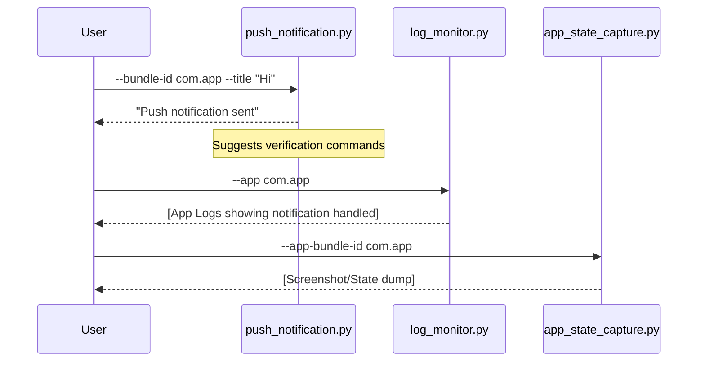

<!-- source: DeepWiki mcp.deepwiki.com · repo conorluddy/ios-simulator-skill · page 8.3 push_notification.py · fetched 2026-10-27 -->

# push_notification.py

<details>
<summary>Relevant source files</summary>

The following files were used as context for generating this wiki page:

- [ios-simulator-skill/skills/ios-simulator-skill/scripts/push_notification.py](ios-simulator-skill/skills/ios-simulator-skill/scripts/push_notification.py)

</details>


## Purpose and Scope

This page documents `push_notification.py`, which sends simulated push notifications to iOS simulator apps. This utility allows for testing notification handling, badge updates, and deep link navigation without requiring a real Apple Push Notification service (APNs) connection or a physical device.

For app lifecycle management (launching apps to receive notifications), see [scripts/app_launcher.py](). For capturing app state after notification delivery, see [scripts/app_state_capture.py](). For managing notification permissions, see [scripts/privacy_manager.py]().

Sources: [scripts/push_notification.py:1-9](), [scripts/push_notification.py:21-22]()

---

## Overview

`push_notification.py` wraps the `xcrun simctl push` command to deliver simulated push notifications to running simulator apps. It provides two operational modes: a simple mode for common notification parameters (title, body, badge, sound) and a custom mode where users provide complete JSON payloads or file paths for advanced testing scenarios.

The script follows the standard class-based architecture with the `PushNotificationSender` class, providing structured output and automatic UDID detection via `common.resolve_udid`.

Sources: [scripts/push_notification.py:18-18](), [scripts/push_notification.py:21-22](), [scripts/push_notification.py:79-86](), [scripts/push_notification.py:103-110]()

---

## How Push Notification Simulation Works

The script automates the creation of a temporary APNs-compatible JSON file and triggers the simulator's internal notification delivery mechanism.

| Step | Code Entity | Action |
|:---|:---|:---|
| 1 | `main()` | Parses CLI arguments using `argparse`. [scripts/push_notification.py:148-180]() |
| 2 | `resolve_udid()` | Detects the target simulator (defaults to "booted"). [scripts/push_notification.py:183-187]() |
| 3 | `send_simple()` | (Optional) Constructs an `aps` dictionary from title/body/badge. [scripts/push_notification.py:124-143]() |
| 4 | `send()` | Validates JSON and writes the payload to a `tempfile`. [scripts/push_notification.py:52-76]() |
| 5 | `subprocess.run()` | Executes `xcrun simctl push <UDID> <BUNDLE_ID> <TEMP_FILE>`. [scripts/push_notification.py:79-89]() |
| 6 | `Path.unlink()` | Cleans up the temporary JSON file after delivery. [scripts/push_notification.py:91-92]() |

### Command Execution Path

Title: "Push Notification Delivery Flow"
```mermaid
graph TB
    subgraph "scripts/push_notification.py"
        ["main()"]
        ["PushNotificationSender"]
        ["send_simple()"]
        ["send()"]
    end
    
    subgraph "common/__init__.py"
        ["resolve_udid()"]
    end
    
    subgraph "System Execution"
        ["tempfile.NamedTemporaryFile"]
        ["subprocess.run(['xcrun', 'simctl', 'push', ...])"]
        ["Path.unlink()"]
    end
    
    ["main()"] --> ["resolve_udid()"]
    ["main()"] --> ["PushNotificationSender"]
    ["PushNotificationSender"] --> ["send_simple()"]
    ["send_simple()"] --> ["send()"]
    ["send()"] --> ["tempfile.NamedTemporaryFile"]
    ["tempfile.NamedTemporaryFile"] --> ["subprocess.run(['xcrun', 'simctl', 'push', ...])"]
    ["subprocess.run(['xcrun', 'simctl', 'push', ...])"] --> ["Path.unlink()"]
```
Sources: [scripts/push_notification.py:18-18](), [scripts/push_notification.py:74-92](), [scripts/push_notification.py:143-143]()

---

## Operational Modes

### Simple Mode

In simple mode, the script accepts high-level parameters and constructs the `aps` dictionary automatically.

| Argument | Type | Description |
|:---|:---|:---|
| `--bundle-id` | `str` | **Required**. Target app bundle identifier. [scripts/push_notification.py:151-153]() |
| `--title` | `str` | Alert title. [scripts/push_notification.py:156-156]() |
| `--body` | `str` | Alert body message. [scripts/push_notification.py:157-157]() |
| `--badge` | `int` | App icon badge number. [scripts/push_notification.py:158-158]() |
| `--no-sound` | `flag` | Disables the default "default" sound string. [scripts/push_notification.py:159-159]() |

**Internal Payload Construction:**
The `send_simple` method wraps parameters into a standard Apple structure:
```json
{
  "aps": {
    "alert": { "title": "...", "body": "..." },
    "badge": 0,
    "sound": "default"
  }
}
```
Sources: [scripts/push_notification.py:124-141]()

### Custom Payload Mode

For testing deep links, custom keys, or notification categories, use the `--payload` argument.

| Argument | Input Type | Behavior |
|:---|:---|:---|
| `--payload` | **File Path** | Reads JSON content from the specified file. [scripts/push_notification.py:54-57]() |
| `--payload` | **JSON String** | Parses the string directly as JSON. [scripts/push_notification.py:61-64]() |

If the provided payload does not contain an `aps` key, the script automatically wraps the data in one to ensure compatibility with `simctl`. [scripts/push_notification.py:69-70]()

Sources: [scripts/push_notification.py:52-70](), [scripts/push_notification.py:162-165]()

---

## Command-Line Interface

Title: "CLI to Code Entity Mapping"
```mermaid
graph LR
    subgraph "CLI Arguments"
        ["--bundle-id"]
        ["--test-name"]
        ["--payload"]
        ["--expected"]
    end

    subgraph "PushNotificationSender Class"
        ["send()"]
        ["send_simple()"]
    end

    subgraph "Main Logic"
        ["print(output)"]
    end

    ["--bundle-id"] --> ["send()"]
    ["--bundle-id"] --> ["send_simple()"]
    ["--payload"] --> ["send()"]
    ["--test-name"] --> ["print(output)"]
    ["--expected"] --> ["print(output)"]
```
Sources: [scripts/push_notification.py:151-179](), [scripts/push_notification.py:189-203]()

### Test Tracking Arguments

The script includes specialized flags for documentation and verification within Claude Code workflows:
* `--test-name`: Labels the output for easier log parsing. [scripts/push_notification.py:168-168]()
* `--expected`: Prints the expected behavior to help the LLM or developer verify the result. [scripts/push_notification.py:169-172]()

Sources: [scripts/push_notification.py:209-215]()

---

## Implementation Details

### PushNotificationSender Class

The class manages the state of the target device and the mechanics of delivery.

| Method | Role |
|:---|:---|
| `__init__` | Stores the `udid`. If `None`, the script uses "booted". [scripts/push_notification.py:24-30]() |
| `send` | The core engine. Handles payload parsing (file vs string), temp file creation, and `simctl` execution. [scripts/push_notification.py:32-101]() |
| `send_simple` | A convenience wrapper that builds a standard `aps` alert dictionary. [scripts/push_notification.py:103-143]() |

### Error Handling

The script implements robust error checking for common simulation failures:
1. **JSON Validation**: Catches `json.JSONDecodeError` if an inline payload is malformed. [scripts/push_notification.py:62-64]()
2. **Process Failures**: Catches `subprocess.CalledProcessError` to report `simctl` errors (e.g., app not installed). [scripts/push_notification.py:96-98]()
3. **UDID Resolution**: Fails early if no booted simulator is found via `resolve_udid`. [scripts/push_notification.py:183-187]()

Sources: [scripts/push_notification.py:60-64](), [scripts/push_notification.py:96-101](), [scripts/push_notification.py:183-187]()

---

## Integration with Testing Workflows

After sending a notification, the script suggests follow-up actions to verify the app's internal state.

Title: "Verification Workflow"

Sources: [scripts/push_notification.py:227-232]()

### Example Usage

**1. Basic Alert:**
```bash
python scripts/push_notification.py --bundle-id com.example.app --title "Update" --body "New content available"
```

**2. Custom Payload with Deep Link:**
```bash
python scripts/push_notification.py --bundle-id com.example.app --payload '{"aps": {"alert": "Open Link"}, "url": "myapp://settings"}'
```

**3. Using a Payload File:**
```bash
python scripts/push_notification.py --bundle-id com.example.app --payload ./tests/payloads/complex_note.json
```

Sources: [scripts/push_notification.py:8-8](), [scripts/push_notification.py:162-165]()

---

