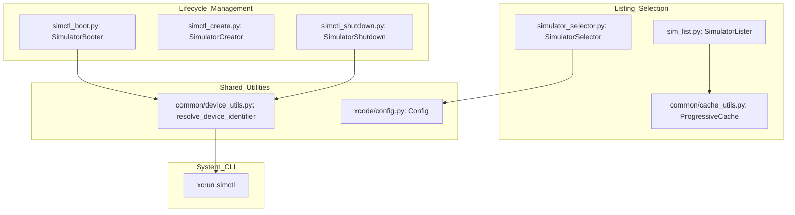

<!-- source: DeepWiki mcp.deepwiki.com · repo conorluddy/ios-simulator-skill · page 9 Device Lifecycle Scripts · fetched 2026-10-27 -->

# Device Lifecycle Scripts

<details>
<summary>Relevant source files</summary>

The following files were used as context for generating this wiki page:

- [ios-simulator-skill/skills/ios-simulator-skill/scripts/sim_list.py](ios-simulator-skill/skills/ios-simulator-skill/scripts/sim_list.py)
- [ios-simulator-skill/skills/ios-simulator-skill/scripts/simctl_boot.py](ios-simulator-skill/skills/ios-simulator-skill/scripts/simctl_boot.py)
- [ios-simulator-skill/skills/ios-simulator-skill/scripts/simulator_selector.py](ios-simulator-skill/skills/ios-simulator-skill/scripts/simulator_selector.py)

</details>


This section covers the scripts responsible for managing the full lifecycle of iOS simulator devices: listing, selection, creation, booting, shutdown, erasure, and deletion. These scripts wrap `xcrun simctl` commands with the same class-based architecture and output modes used across the rest of the skill.

This page is a high-level overview. For detailed CLI reference of each script, see the child pages linked below. For the shared utilities these scripts depend on (auto-UDID detection, device listing), see [Shared Utilities](#10).

---

## Typical Workflow Order

The lifecycle scripts map to a logical device state machine. The diagram below shows simulator states and which script drives each transition.

**Device State Machine and Script Mapping**

```mermaid
stateDiagram-v2
    [*] --> "Shutdown" : "simctl_create.py"
    "Shutdown" --> "Booted" : "simctl_boot.py"
    "Booted" --> "Shutdown" : "simctl_shutdown.py"
    "Shutdown" --> "FactoryReset" : "simctl_erase.py"
    "FactoryReset" --> "Shutdown" : "(state cleared)"
    "FactoryReset" --> "Booted" : "simctl_boot.py"
    "Shutdown" --> [*] : "simctl_delete.py"
    "FactoryReset" --> [*] : "simctl_delete.py"
```

**State Requirements:**
- **Erase**: Device must be in `Shutdown` state. Resets content/settings but preserves device definition.
- **Delete**: Device must be in `Shutdown` state. Permanently removes device from `xcrun simctl list`.
- **Boot**: Works on `Shutdown` or `FactoryReset` devices. Use `--wait-ready` to poll for readiness [scripts/simctl_boot.py:74-80]().

Sources: [scripts/simctl_boot.py:35-86](), [scripts/simctl_boot.py:87-127]()

---

## Scripts at a Glance

| Script | Manager Class | Primary Action | Key Flags |
|---|---|---|---|
| `sim_list.py` | `SimulatorLister` | Efficient device listing | `--suggest`, `--get-details`, `--json` |
| `simulator_selector.py` | `SimulatorSelector` | Intelligent device selection | `--suggest`, `--boot`, `--list` |
| `simctl_create.py` | `SimulatorCreator` | Create a new simulator | `--device`, `--runtime`, `--name` |
| `simctl_boot.py` | `SimulatorBooter` | Boot a simulator | `--wait-ready`, `--timeout`, `--all` |
| `simctl_shutdown.py` | `SimulatorShutdown` | Shut down a simulator | `--udid`, `--all`, `--type` |
| `simctl_erase.py` | `SimulatorEraser` | Factory-reset a simulator | `--udid`, `--name`, `--all` |
| `simctl_delete.py` | `SimulatorDeleter` | Permanently delete a simulator | `--old N`, `--all`, `--yes` |

Sources: [scripts/sim_list.py:49-54](), [scripts/simctl_boot.py:28-33](), [scripts/simulator_selector.py:69-85]()

---

## Internal Architecture

All lifecycle scripts follow a standard class-based pattern. Each exposes a Manager class whose methods return either a `tuple[bool, str]` for single operations or structured data for listing.

**Code Entity Map: Device Lifecycle Scripts**



Sources: [scripts/sim_list.py:52-54](), [scripts/simctl_boot.py:21-25](), [scripts/simulator_selector.py:88-93]()

---

## Intelligent Selection & Listing

The skill uses a "Progressive Disclosure" pattern to manage the large volume of data returned by `simctl`.

### Simulator Listing (`sim_list.py`)
`SimulatorLister` achieves a 96% token reduction by providing a concise summary and a `cache_id` [scripts/sim_list.py:8-12]. Users can request full details for a specific cache ID [scripts/sim_list.py:15-16]. It uses `xcrun simctl list devices --json` as its data source [scripts/sim_list.py:71-78].

### Intelligent Selector (`simulator_selector.py`)
The `SimulatorSelector` scores devices based on multiple factors to provide recommendations [scripts/simulator_selector.py:144-159]:
1. **Recently used**: Prioritizes the preferred simulator from local `Config` [scripts/simulator_selector.py:216-217].
2. **Latest iOS version**: Prioritizes the highest available runtime version [scripts/simulator_selector.py:220-222].
3. **Common models**: Scores models like "iPhone 16 Pro" higher for testing priority [scripts/simulator_selector.py:73-79, 225-228].
4. **Boot status**: Prefers already booted devices [scripts/simulator_selector.py:231-232].

Sources: [scripts/sim_list.py:111-141](), [scripts/simulator_selector.py:144-199](), [scripts/simulator_selector.py:201-233]()

---

## Batch Operations and Cleanup

Lifecycle scripts support batch operations to manage environments efficiently.

- **Boot All**: `SimulatorBooter.boot_all()` iterates through all available devices to boot them [scripts/simctl_boot.py:130-149]().
- **Shutdown All**: `SimulatorShutdown.shutdown_all()` (covered in [simctl_shutdown.py](#9.2)) shuts down all currently booted simulators.
- **Type-based Operations**: Boot operations support filtering by device type (e.g., "iPhone") [scripts/simctl_boot.py:152-175]().
- **Smart Deletion**: `SimulatorDeleter` (covered in [simctl_delete.py](#9.4)) can target "old" simulators based on creation date or inactivity.

Sources: [scripts/simctl_boot.py:130-175]()

---

## Readiness Waiting (`simctl_boot.py`)

Booting a simulator is asynchronous; `simctl boot` returns before the OS is responsive. The `--wait-ready` flag triggers `_wait_for_ready()`, which polls the device using `simctl spawn ... launchctl list` until it responds or hits a timeout [scripts/simctl_boot.py:87-127](). This ensures that subsequent commands like app installation or launching do not fail due to the device being in a "booting" state.

Sources: [scripts/simctl_boot.py:87-127]()

---

## Child Pages

| Page | Title | Covers |
|---|---|---|
| [simctl_boot.py](#9.1) | simctl_boot.py | Booting, `--wait-ready` polling, and batch booting |
| [simctl_shutdown.py](#9.2) | simctl_shutdown.py | Shutting down single or batch simulators |
| [simctl_create.py](#9.3) | simctl_create.py | Dynamic creation with type and runtime resolution |
| [simctl_delete.py](#9.4) | simctl_delete.py | Permanent deletion and smart cleanup of old devices |
| [simctl_erase.py](#9.5) | simctl_erase.py | Factory resets (erasing content and settings) |
| [sim_list.py and simulator_selector.py](#9.6) | Listing & Selection | `sim_list.py` (token efficiency) and `simulator_selector.py` (scoring) |

---

