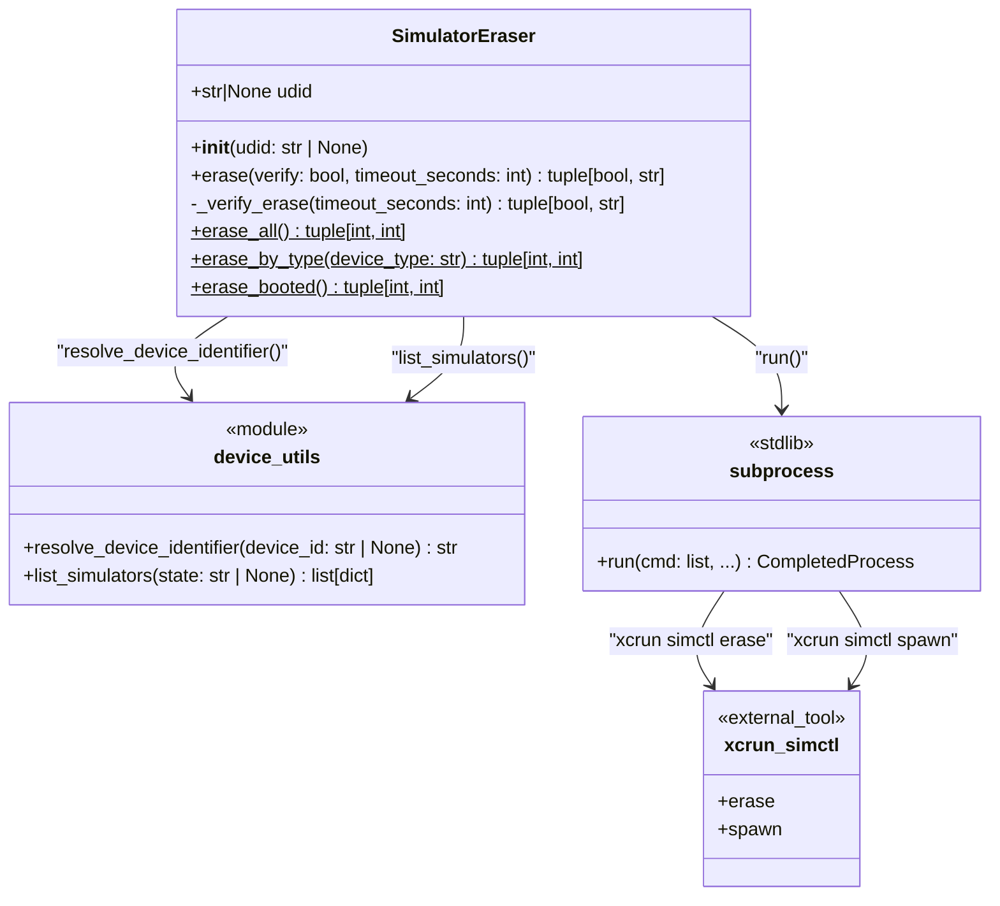
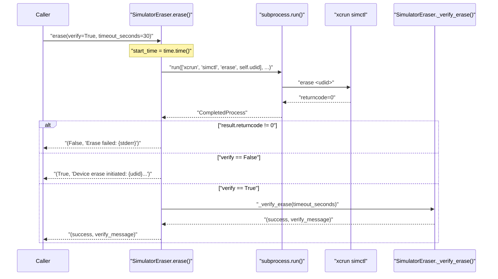
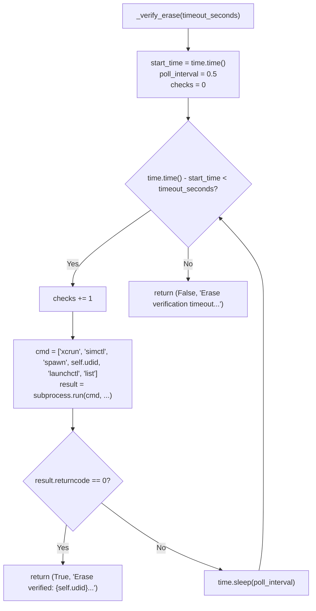
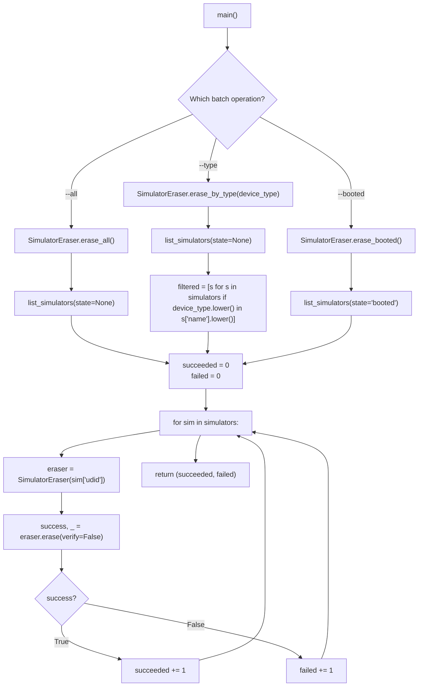
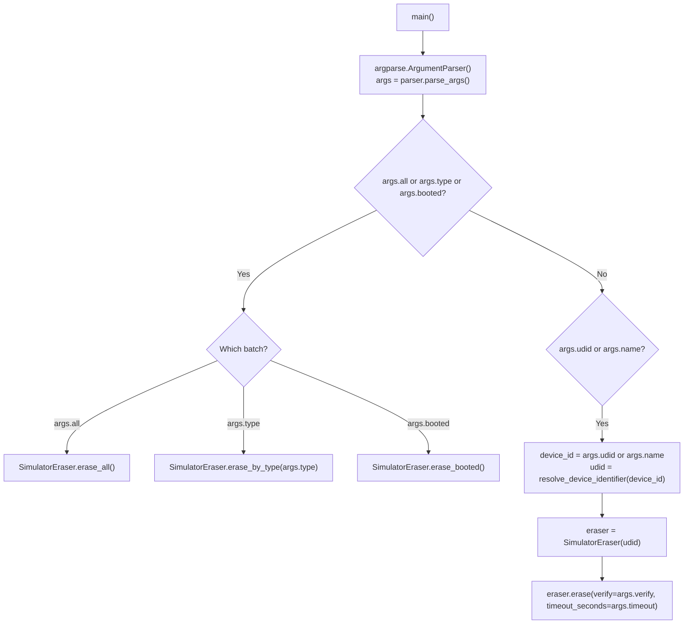
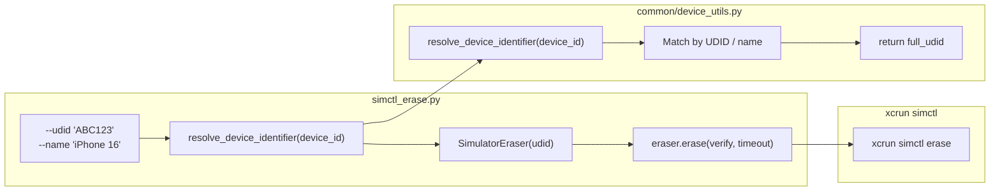

<!-- source: DeepWiki mcp.deepwiki.com · repo conorluddy/ios-simulator-skill · page 9.5 simctl_erase.py · fetched 2026-10-27 -->

# simctl_erase.py

<details>
<summary>Relevant source files</summary>

The following files were used as context for generating this wiki page:

- [ios-simulator-skill/skills/ios-simulator-skill/scripts/simctl_erase.py](ios-simulator-skill/skills/ios-simulator-skill/scripts/simctl_erase.py)

</details>


**Purpose**: Documents the `simctl_erase.py` script, which wraps `xcrun simctl erase` to perform factory resets on iOS simulators. Factory reset clears all app data and settings while preserving the simulator's UDID.

**Scope**: Covers the `SimulatorEraser` class structure, the `erase()` method, `_verify_erase()` polling mechanism, static batch methods (`erase_all()`, `erase_by_type()`, `erase_booted()`), and the `main()` CLI function. Related pages: [ios-simulator-skill/scripts/simctl_boot.py:1-237](), [ios-simulator-skill/scripts/simctl_shutdown.py:1-180](), [ios-simulator-skill/scripts/simctl_create.py:1-150](), [ios-simulator-skill/scripts/simctl_delete.py:1-210](), [ios-simulator-skill/common/device_utils.py:1-450]().

---

## Overview

`simctl_erase.py` provides a Python wrapper around `xcrun simctl erase` with device resolution, verification polling, and batch operations. Erase operations preserve the simulator's UDID, making them faster than delete-and-recreate for CI/CD cleanup.

**Core Functionality**:
- Single device erase via `SimulatorEraser.erase(verify, timeout_seconds)` [ios-simulator-skill/scripts/simctl_erase.py:35-81]()
- Device resolution via `device_utils.resolve_device_identifier()` [ios-simulator-skill/scripts/simctl_erase.py:24-24]()
- Optional verification polling via `_verify_erase()` [ios-simulator-skill/scripts/simctl_erase.py:83-126]()
- Batch operations via static methods: `erase_all()`, `erase_by_type()`, `erase_booted()` [ios-simulator-skill/scripts/simctl_erase.py:128-196]()

Sources: [ios-simulator-skill/scripts/simctl_erase.py:1-26]()

---

## SimulatorEraser Class

**Class Definition**: [ios-simulator-skill/scripts/simctl_erase.py:28-34]()

The `SimulatorEraser` class provides instance methods for single-device operations and static methods for batch operations.

### Class Structure

**SimulatorEraser Class Diagram**


**Method Summary**:

| Method | Type | Returns | Purpose |
|--------|------|---------|---------|
| `__init__(udid)` | Instance | None | Initialize with optional UDID [ios-simulator-skill/scripts/simctl_erase.py:31-33]() |
| `erase(verify, timeout_seconds)` | Instance | `(bool, str)` | Execute erase, optionally verify [ios-simulator-skill/scripts/simctl_erase.py:35-81]() |
| `_verify_erase(timeout_seconds)` | Instance | `(bool, str)` | Poll device until responsive [ios-simulator-skill/scripts/simctl_erase.py:83-126]() |
| `erase_all()` | Static | `(int, int)` | Erase all simulators [ios-simulator-skill/scripts/simctl_erase.py:128-148]() |
| `erase_by_type(device_type)` | Static | `(int, int)` | Erase by name filter [ios-simulator-skill/scripts/simctl_erase.py:150-174]() |
| `erase_booted()` | Static | `(int, int)` | Erase only booted [ios-simulator-skill/scripts/simctl_erase.py:176-196]() |

Sources: [ios-simulator-skill/scripts/simctl_erase.py:28-196]()

---

## erase() Method

**Method Signature**: [ios-simulator-skill/scripts/simctl_erase.py:35-48]()

```python
def erase(self, verify: bool = True, timeout_seconds: int = 30) -> tuple[bool, str]:
```

The `erase()` method executes `xcrun simctl erase` and optionally verifies completion by polling the device.

### Execution Flow

**SimulatorEraser.erase() call sequence**


**Implementation Details**:

1. **Command Construction** [ios-simulator-skill/scripts/simctl_erase.py:56-56]():
   ```python
   cmd = ["xcrun", "simctl", "erase", self.udid]
   ```

2. **Execution** [ios-simulator-skill/scripts/simctl_erase.py:57-57]():
   ```python
   result = subprocess.run(cmd, check=False, capture_output=True, text=True, timeout=60)
   ```

3. **Error Handling** [ios-simulator-skill/scripts/simctl_erase.py:59-65]():
   - Non-zero returncode: Return `(False, "Erase failed: {error}")`
   - `TimeoutExpired`: Return `(False, "Erase command timed out")`
   - Other exceptions: Return `(False, "Erase error: {e}")`

4. **Verification** [ios-simulator-skill/scripts/simctl_erase.py:68-75]():
   - If `verify=True`, call `self._verify_erase(timeout_seconds)`
   - If `verify=False`, return immediately with elapsed time [ios-simulator-skill/scripts/simctl_erase.py:77-81]()

Sources: [ios-simulator-skill/scripts/simctl_erase.py:35-81]()

---

## _verify_erase() Method

**Method Signature**: [ios-simulator-skill/scripts/simctl_erase.py:83-94]()

```python
def _verify_erase(self, timeout_seconds: int = 30) -> tuple[bool, str]:
```

The `_verify_erase()` method polls the simulator with `xcrun simctl spawn` to detect when the erase operation completes and the device becomes responsive.

### Polling Algorithm

**_verify_erase() polling loop**


**Implementation Constants** [ios-simulator-skill/scripts/simctl_erase.py:95-97]():
- `poll_interval = 0.5` (seconds between checks)
- `checks = 0`

**Verification Command** [ios-simulator-skill/scripts/simctl_erase.py:103-109]():
```python
result = subprocess.run(
    ["xcrun", "simctl", "spawn", self.udid, "launchctl", "list"],
    check=False,
    capture_output=True,
    text=True,
    timeout=5,
)
```

The command `spawn launchctl list` requires the simulator to be in a state where it can execute processes. A return code of 0 indicates the erase is complete and the device is responsive [ios-simulator-skill/scripts/simctl_erase.py:112-116]().

Sources: [ios-simulator-skill/scripts/simctl_erase.py:83-126]()

---

## Batch Operation Methods

Three static methods provide batch erase operations. All return `(succeeded: int, failed: int)` tuples.

### Method Signatures

| Method | Signature | Device Selection | Code |
|--------|-----------|------------------|------|
| `erase_all()` | `erase_all() -> tuple[int, int]` | All simulators | [ios-simulator-skill/scripts/simctl_erase.py:128-148]() |
| `erase_by_type()` | `erase_by_type(device_type: str) -> tuple[int, int]` | Name filter match | [ios-simulator-skill/scripts/simctl_erase.py:150-174]() |
| `erase_booted()` | `erase_booted() -> tuple[int, int]` | State is "booted" | [ios-simulator-skill/scripts/simctl_erase.py:176-196]() |

### Batch Operation Flow

**Batch dispatch and iteration through list_simulators()**


**Common Implementation Pattern** [ios-simulator-skill/scripts/simctl_erase.py:140-148]():

```python
simulators = list_simulators(state=None)
succeeded = 0
failed = 0

for sim in simulators:
    eraser = SimulatorEraser(udid=sim["udid"])
    success, _message = eraser.erase(verify=False)
    if success:
        succeeded += 1
    else:
        failed += 1

return succeeded, failed
```

**Note**: Batch operations use `verify=False` for performance. Verification polls each device individually, which is impractical for large batches.

Sources: [ios-simulator-skill/scripts/simctl_erase.py:128-196]()

---

## main() Function

**Function Definition**: [ios-simulator-skill/scripts/simctl_erase.py:199-237]()

The `main()` function parses command-line arguments and dispatches to either single-device or batch operations.

### Argument Parser Structure

**Argument Groups** [ios-simulator-skill/scripts/simctl_erase.py:201-230]():

| Group | Argument | Type | Default | Description |
|-------|----------|------|---------|-------------|
| Device Selection | `--udid` | `str` | None | Target device UDID or name |
| | `--name` | `str` | None | Alternative to --udid |
| Batch Operations | `--all` | flag | False | Erase all simulators |
| | `--type` | `str` | None | Erase by device type filter |
| | `--booted` | flag | False | Erase only booted |
| Options | `--verify` | flag | False | Poll for completion |
| | `--timeout` | `int` | 30 | Verification timeout (seconds) |

### Dispatch Flow

**main() argument dispatch and control flow**


Sources: [ios-simulator-skill/scripts/simctl_erase.py:199-237]()

---

## Integration with device_utils

The script imports two functions from `device_utils.py` for device identification and listing.

**Imports** [ios-simulator-skill/scripts/simctl_erase.py:22-25]():
```python
from common.device_utils import (
    list_simulators,
    resolve_device_identifier,
)
```

### Device Resolution Flow

**Data flow from CLI input through device_utils to xcrun simctl**


**`resolve_device_identifier()` Usage**:
Used in `main()` to convert human-readable names or partial UDIDs into full UDIDs required by `simctl`.

**`list_simulators()` Usage** [ios-simulator-skill/scripts/simctl_erase.py:136-136](), [ios-simulator-skill/scripts/simctl_erase.py:161-161](), [ios-simulator-skill/scripts/simctl_erase.py:184-184]():
Used in static batch methods to retrieve the set of simulators to iterate over.

Sources: [ios-simulator-skill/scripts/simctl_erase.py:22-25](), [ios-simulator-skill/scripts/simctl_erase.py:128-196]()

---

## Error Handling

The script handles several error scenarios with informative messages.

| Error Condition | Detection | Response |
|----------------|-----------|----------|
| Device not specified | `not self.udid` in `erase()` | Return `(False, "Error: Device UDID not specified")` [ios-simulator-skill/scripts/simctl_erase.py:49-50]() |
| Erase command fails | `result.returncode != 0` | Return `(False, "Erase failed: {error}")` [ios-simulator-skill/scripts/simctl_erase.py:59-61]() |
| Erase timeout | `subprocess.TimeoutExpired` (60s) | Return `(False, "Erase command timed out")` [ios-simulator-skill/scripts/simctl_erase.py:62-63]() |
| Verification timeout | Polling exceeds `timeout_seconds` | Return `(False, "Erase verification timeout: ...")` [ios-simulator-skill/scripts/simctl_erase.py:123-126]() |
| Generic exception | `Exception as e` | Return `(False, "Erase error: {e}")` [ios-simulator-skill/scripts/simctl_erase.py:64-65]() |

Sources: [ios-simulator-skill/scripts/simctl_erase.py:49-126]()

---

## Performance Characteristics

### Erase vs Delete-Create Comparison

| Metric | `simctl_erase.py` | `simctl_delete.py` + `simctl_create.py` |
|--------|-------------------|------------------------------------------|
| Execution time | ~0.3s (no verify) / ~2s (with verify) | ~5-10s |
| UDID preservation | Yes | No (new UDID generated) |
| App data cleared | Yes | Yes |

**Verification Overhead** [ios-simulator-skill/scripts/simctl_erase.py:96-120]():
- `verify=False`: Returns immediately after command execution [ios-simulator-skill/scripts/simctl_erase.py:77-81]().
- `verify=True`: Includes polling overhead with `poll_interval = 0.5`.

**Batch Performance** [ios-simulator-skill/scripts/simctl_erase.py:128-196]():
- Batch operations use `verify=False` to avoid compounding polling delays.
- Sequential execution: one device at a time in a loop.

Sources: [ios-simulator-skill/scripts/simctl_erase.py:1-14](), [ios-simulator-skill/scripts/simctl_erase.py:83-126](), [ios-simulator-skill/scripts/simctl_erase.py:128-196]()

---

