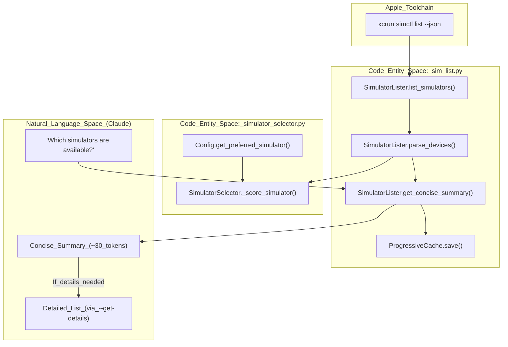
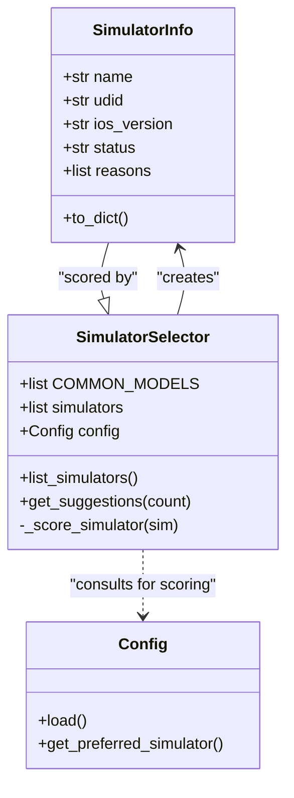

<!-- source: DeepWiki mcp.deepwiki.com · repo conorluddy/ios-simulator-skill · page 9.6 sim_list.py and simulator_selector.py · fetched 2026-10-27 -->

# sim_list.py and simulator_selector.py

Relevant source files

The following files were used as context for generating this wiki page:

- [ios-simulator-skill/skills/ios-simulator-skill/scripts/common/cache_utils.py](ios-simulator-skill/skills/ios-simulator-skill/scripts/common/cache_utils.py)
- [ios-simulator-skill/skills/ios-simulator-skill/scripts/sim_list.py](ios-simulator-skill/skills/ios-simulator-skill/scripts/sim_list.py)
- [ios-simulator-skill/skills/ios-simulator-skill/scripts/simulator_selector.py](ios-simulator-skill/skills/ios-simulator-skill/scripts/simulator_selector.py)

This section documents the scripts responsible for discovering, filtering, and intelligently recommending iOS simulators. These tools implement the **Progressive Disclosure** design principle to minimize token usage while providing sophisticated selection logic based on device recency, OS version, and boot status.

## Overview

The simulator discovery system consists of two primary scripts:
1.  **`sim_list.py`**: A high-efficiency listing tool that uses a caching system to reduce token consumption by 96% [scripts/sim_list.py:8-8]().
2.  **`simulator_selector.py`**: An intelligent recommendation engine that scores simulators based on developer preferences and system state [scripts/simulator_selector.py:5-9]().

### Data Flow: From simctl to Claude

The following diagram illustrates how raw data from `simctl` is transformed into token-efficient summaries for the LLM.

**Simulator Discovery and Selection Flow**

**Sources:** [scripts/sim_list.py:49-141](), [scripts/simulator_selector.py:69-234](), [scripts/simulator_selector.py:88-93]()

---

## sim_list.py: Progressive Disclosure

`sim_list.py` is designed to solve the "token bloat" problem where listing 50+ simulators can consume ~57k tokens [scripts/sim_list.py:8-8](). It defaults to a concise summary and provides a `cache_id` for on-demand expansion.

### ProgressiveCache Implementation
The script utilizes the `ProgressiveCache` class from `common/cache_utils.py` to handle data persistence.

| Method | Role |
| :--- | :--- |
| `save(data, cache_type)` | Generates a timestamped ID (e.g., `sim-20251028-143052`) and writes JSON to `~/.ios-simulator-skill/cache/` [common/cache_utils.py:48-81](). |
| `get(cache_id)` | Retrieves data and checks against `max_age_hours` (default 1) [common/cache_utils.py:83-112](). |
| `cleanup()` | Removes expired `.json` files from the cache directory [common/cache_utils.py:160-183](). |

### Key Functions in SimulatorLister

| Function | Purpose |
| :--- | :--- |
| `list_simulators()` | Executes `xcrun simctl list devices --json` and returns the raw dictionary [scripts/sim_list.py:56-80](). |
| `parse_devices()` | Flattens the nested `simctl` output into a list of device dictionaries with normalized runtime names [scripts/sim_list.py:82-109](). |
| `get_concise_summary()` | Generates a 30-token summary, saves the full list to `ProgressiveCache`, and returns a `cache_id` [scripts/sim_list.py:111-141](). |
| `get_full_list()` | Retrieves a previously cached list using a `cache_id` and applies optional filters like `--device-type` [scripts/sim_list.py:143-172](). |
| `suggest_simulators()` | Scores devices to find the best candidates (e.g., preferring booted devices and recent iOS versions) [scripts/sim_list.py:174-209](). |

**Sources:** [scripts/sim_list.py:1-222](), [common/cache_utils.py:1-183]()

---

## simulator_selector.py: Intelligent Scoring

While `sim_list.py` focuses on efficiency, `simulator_selector.py` focuses on **intent**. It uses a weighted scoring algorithm to guess which simulator a developer likely wants to use.

### Scoring Logic (`_score_simulator`)

The `SimulatorSelector` class calculates a score for each device based on several criteria [scripts/simulator_selector.py:201-234]():

1.  **Recently Used (+100 points)**: Checks the project configuration via `Config.get_preferred_simulator()` to see which device was last targeted [scripts/simulator_selector.py:216-217]().
2.  **Latest iOS Version (+50 points)**: Prioritizes the highest available SDK version [scripts/simulator_selector.py:220-222]().
3.  **Common Models (+20 to +30 points)**: Prioritizes standard testing targets defined in `COMMON_MODELS` (e.g., iPhone 16 Pro, iPhone SE) [scripts/simulator_selector.py:73-79](), [scripts/simulator_selector.py:225-228]().
4.  **Boot Status (+10 points)**: Prefers simulators that are already `Booted` to save time [scripts/simulator_selector.py:231-232]().

### Integration with Project Config
The selector attempts to import `xcode.config.Config` to enable "auto-learning" of user preferences [scripts/simulator_selector.py:35-38](). If a user frequently builds for a specific UDID, the selector will automatically rank it highest in future suggestions [scripts/simulator_selector.py:88-93]().

**Sources:** [scripts/simulator_selector.py:41-234]()

---

## Implementation Detail: Simulator Mapping

The following diagram maps the relationship between the `SimulatorInfo` data structure and the scoring components.

**Selector Logic Entity Map**

**Sources:** [scripts/simulator_selector.py:41-67](), [scripts/simulator_selector.py:69-234](), [scripts/simulator_selector.py:88-93]()

## Usage and Output

### sim_list.py Output Modes
*   **Default**: Returns a summary like `Simulator Summary [cache-sim-...]` with totals and a few "Quick Access" devices [scripts/sim_list.py:23-31]().
*   **`--suggest`**: Uses a scoring logic to return the best candidates (e.g., preferring booted, available, and recent iOS versions) [scripts/sim_list.py:174-209]().
*   **`--get-details <ID>`**: Expands a previous summary into a full list [scripts/sim_list.py:143-158]().

### simulator_selector.py Flags
*   **`--suggest`**: Returns the top N (default 4) simulators with human-readable "reasons" for the recommendation [scripts/simulator_selector.py:144-199]().
*   **`--boot <UDID>`**: A convenience wrapper to boot a selected simulator immediately after identification [scripts/simulator_selector.py:18-19]().
*   **`--json`**: Returns the `SimulatorInfo` objects as a JSON array for programmatic consumption by other scripts [scripts/simulator_selector.py:21-22]().

**Sources:** [scripts/sim_list.py:10-38](), [scripts/simulator_selector.py:11-23]()

---

