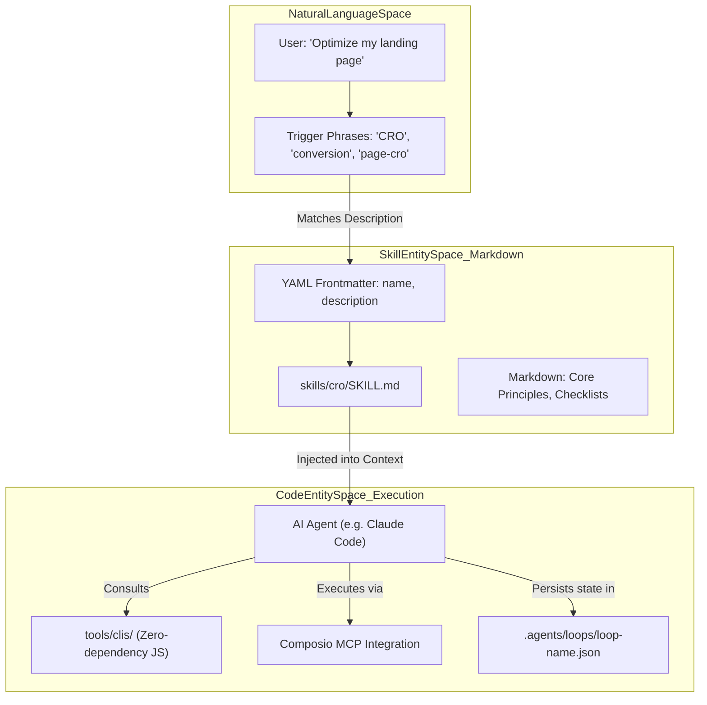
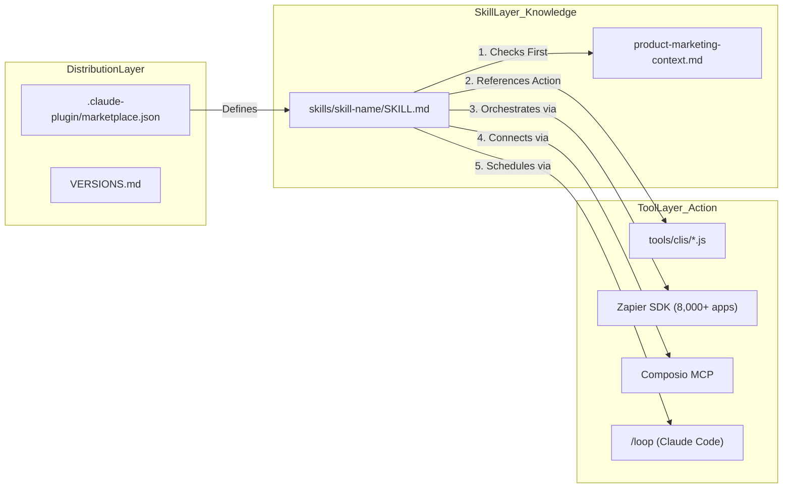

<!-- source: DeepWiki mcp.deepwiki.com · repo coreyhaines31/marketingskills · page 3.1 What is a Skill · fetched 2026-10-27 -->

# What is a Skill

<details>
<summary>Relevant source files</summary>

The following files were used as context for generating this wiki page:

- [.claude-plugin/marketplace.json](.claude-plugin/marketplace.json)
- [.claude-plugin/plugin.json](.claude-plugin/plugin.json)
- [README.md](README.md)
- [VERSIONS.md](VERSIONS.md)

</details>


## Purpose and Scope

This document defines what a skill is in the Marketing Skills system, explains how skills differ from traditional executable code, and describes why the system uses markdown-based knowledge modules. For the technical specification of the `SKILL.md` format, see **3.2 Skill File Format**. For details on how skills reference each other, see **3.4 Skill Relationships**.

**Sources:** [README.md:13-16](), [AGENTS.md:7-13]()

---

## Definition: Skills as Knowledge Modules

A skill is a **structured knowledge document** that provides an AI agent with specialized frameworks, methodologies, and best practices for a specific marketing task. Skills are not executable code—they are instructional content that guides the AI's reasoning process and tool selection.

Each skill resides in its own directory under `skills/` and consists of a required `SKILL.md` file [AGENTS.md:20-22]():

```text
skills/
  cro/
    SKILL.md
  copywriting/
    SKILL.md
  marketing-loops/
    SKILL.md
```

The system contains 47 distinct skills (as of v2.8.11), organized into functional categories including SEO, CRO, Content, and Growth [README.md:54-100](), [VERSIONS.md:5-53]().

**Key Characteristics:**

| Characteristic | Description |
|----------------|-------------|
| **Format** | Markdown with YAML frontmatter [AGENTS.md:52-59]() |
| **Purpose** | Guide AI reasoning and workflow [README.md:13-16]() |
| **Location** | `skills/{skill-name}/SKILL.md` [AGENTS.md:83-84]() |
| **Consumption** | Parsed by AI agent (Claude Code, etc.) [README.md:3-5]() |
| **Invocation** | Natural language triggers defined in `description` [AGENTS.md:121-128]() |

**Sources:** [README.md:54-100](), [.claude-plugin/marketplace.json:12-18](), [VERSIONS.md:5-53](), [AGENTS.md:83-84]()

---

## Skills vs. Traditional Code

The fundamental distinction between a skill and traditional code is the **execution model**. Traditional code contains imperative instructions executed by a runtime (like Node.js). Skills contain declarative knowledge interpreted by an LLM to guide its behavior.

### Comparison Diagram: Natural Language to Code Entity Space

This diagram bridges how a user's natural language intent maps through the "Skill" entity into actual task execution.



**Sources:** [README.md:13-16](), [AGENTS.md:121-128](), [AGENTS.md:23-27](), [AGENTS.md:172-173](), [VERSIONS.md:67-67]()

### Technical Differences

| Aspect | Traditional Code (e.g., `tools/clis/*.js`) | Skills (e.g., `skills/*/SKILL.md`) |
|--------|-------------------------------------------|-----------------------------------|
| **File Extension** | `.js` | `.md` (markdown) |
| **Content Type** | Imperative logic, API calls | Declarative instructions, frameworks |
| **Execution** | `node tools/clis/ga4.js` | Interpreted by LLM context window |
| **Variability** | Deterministic (Same input = Same output) | Context-dependent and reasoning-based |
| **Validation** | `node --check` syntax check | Evals system (Automated tests) |

**Sources:** [AGENTS.md:41-46](), [AGENTS.md:52-59](), [AGENTS.md:83-84]()

---

## The SKILL.md File Structure

Each skill is defined by a `SKILL.md` file that follows a two-part structure defined by the [Agent Skills specification](https://agentskills.io).

### 1. YAML Frontmatter
Contains machine-readable metadata used for skill discovery. The `description` is critical as it contains the trigger phrases the agent uses to decide when to activate the skill [AGENTS.md:52-59]().

```yaml
---
name: marketing-loops
description: "When the user wants to set up recurring marketing workflows... mentions 'loop', 'cadence', 'idempotency'..."
metadata:
  version: 1.2.0
---
```

**Sources:** [AGENTS.md:52-59](), [VERSIONS.md:31-31]()

### 2. Markdown Content
The body contains the "Knowledge" layer. Common patterns in the codebase include:
- **Context Awareness**: Instructions to check `product-marketing-context.md` (foundational context) [README.md:17-19]().
- **Reasoning-Based Guidance**: Instructions are kept under 500 lines to ensure clarity and avoid context bloat [AGENTS.md:94-94]().
- **Tool Mapping**: Instructions on how to use the 60+ CLI tools or Composio MCP to perform actions [AGENTS.md:165-173]().
- **State Management**: Specific skills like `marketing-loops` define patterns for idempotency and state persistence in `.agents/loops/` [VERSIONS.md:67-67]().

**Sources:** [README.md:17-19](), [AGENTS.md:94-94](), [AGENTS.md:165-173](), [VERSIONS.md:67-67]()

---

## System Architecture: Data Flow

The following diagram illustrates how the system moves from raw knowledge (`SKILL.md`) to project-specific execution.



**Sources:** [README.md:17-19](), [.claude-plugin/marketplace.json:12-18](), [AGENTS.md:23-27](), [AGENTS.md:172-173](), [VERSIONS.md:67-67]()

---

## Why Markdown-Based Knowledge?

The system uses markdown instead of executable code for the "Skill" layer for several technical reasons:

1.  **AI-Native Format**: LLMs are pre-trained on markdown; they interpret headings, lists, and tables as structural hierarchies for reasoning [AGENTS.md:92-98]().
2.  **Zero-Dependency Logic**: Unlike the `tools/clis/` which require Node.js, the skills are portable across any agentic platform (Claude Code, Cursor, Windsurf) [README.md:3-5]().
3.  **Contextual Flexibility**: A skill can provide "Reasoning-based guidance" which allows the agent to adapt a marketing framework to a specific product's unique context (e.g., ICP, positioning) [AGENTS.md:101-104]().
4.  **Composition**: Skills reference each other via standard markdown links, allowing the agent to "hop" between domains (e.g., `copywriting` ↔ `cro` ↔ `ab-testing`) [README.md:45-50]().
5.  **Operational Cadence**: New skills like `marketing-loops` use markdown to define "Loop Anatomy" (check cadence, self-check, bail-out), which would be overly rigid if hard-coded into imperative scripts [VERSIONS.md:67-67]().

**Sources:** [README.md:3-5](), [README.md:43-50](), [AGENTS.md:92-104](), [VERSIONS.md:67-67]()

---

## Summary

A skill in this repository is a **markdown-based module** that bridges the gap between a user's high-level marketing goal and the technical tools required to execute it. By providing the agent with frameworks (the "How") and tool references (the "What"), skills enable autonomous agents to perform complex marketing operations like SEO audits, CRO optimizations, and automated email sequencing across 47 specialized domains.

**Sources:** [README.md:13-16](), [VERSIONS.md:5-53]()

---

