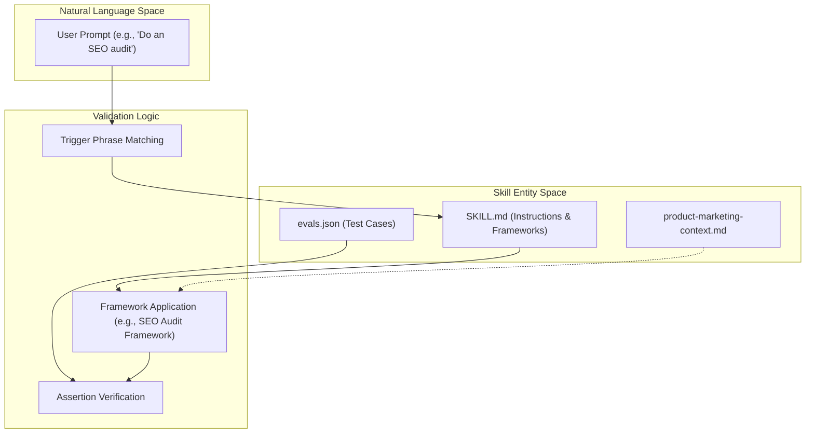
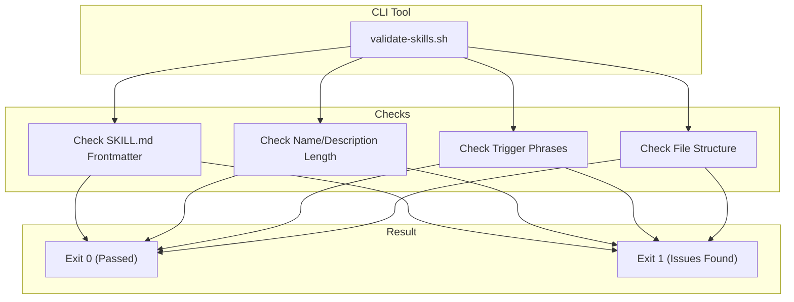

<!-- source: DeepWiki mcp.deepwiki.com · repo coreyhaines31/marketingskills · page 3.5 Skill Evals System · fetched 2026-10-27 -->

# Skill Evals System

<details>
<summary>Relevant source files</summary>

The following files were used as context for generating this wiki page:

- [skills/ad-creative/assets/creative-review-template.html](skills/ad-creative/assets/creative-review-template.html)
- [skills/ad-creative/evals/evals.json](skills/ad-creative/evals/evals.json)
- [skills/ad-creative/references/creative-review-page.md](skills/ad-creative/references/creative-review-page.md)
- [skills/ad-creative/references/imessage-video-ads.md](skills/ad-creative/references/imessage-video-ads.md)
- [skills/copywriting/evals/evals.json](skills/copywriting/evals/evals.json)
- [skills/seo-audit/evals/evals.json](skills/seo-audit/evals/evals.json)
- [validate-skills.sh](validate-skills.sh)

</details>


The Skill Evals System is a comprehensive testing framework designed to ensure the reliability, accuracy, and consistent behavior of the marketing skills. With hundreds of individual evaluations distributed across all skills, the system provides a programmatic way to verify that AI agents correctly apply marketing frameworks, respect platform constraints, and maintain appropriate scope boundaries.

## Overview of Evals

An "eval" (evaluation) is a structured test case consisting of a natural language prompt, a description of the expected agent behavior, and a set of verifiable assertions. These evals serve three primary purposes:

1.  **Quality Assurance**: Verifying that skills like `copywriting` or `seo-audit` consistently apply their internal frameworks, such as the "Audit Report Structure" or "Headline Formulas" [skills/seo-audit/evals/evals.json:7-18](), [skills/copywriting/evals/evals.json:24-32]().
2.  **Scope Enforcement**: Ensuring agents correctly delegate tasks to the appropriate skill. For example, a `copywriting` prompt about email sequences should defer to the `emails` skill [skills/copywriting/evals/evals.json:85-93](), and a `sales-enablement` request for a public comparison page should defer to the `competitors` skill [skills/sales-enablement/evals/evals.json:79-88]().
3.  **Context Awareness**: Testing that agents prioritize checking for the `product-marketing-context.md` file before generating output to ensure brand and product consistency [skills/copywriting/evals/evals.json:7-9](), [skills/ad-creative/evals/evals.json:7-9]().

### Eval Structure

Evals are defined in `evals.json` files located within the `evals/` directory of each skill. Each eval follows a standardized JSON schema:

| Field | Description |
| :--- | :--- |
| `id` | Unique identifier for the eval within the skill. |
| `prompt` | The natural language input provided to the agent. |
| `expected_output` | A technical description of how the agent should process the prompt and what the result should contain. |
| `assertions` | A list of specific, testable requirements the agent's response must satisfy. |
| `files` | (Optional) Specific files the agent should reference or modify during the eval. |

**Example: Ad Creative Eval #3 (Performance Iteration)**
[skills/ad-creative/evals/evals.json:36-47]()

```json
{
  "id": 3,
  "prompt": "Here's our ad performance data: Ad A (pain point angle) - CTR 2.1%, CPC $3.20, Conv rate 4.5%... Help me iterate on these.",
  "expected_output": "Should activate the iteration-from-performance mode (not generate-from-scratch). Should analyze the data... recommend doubling down on the pain point angle...",
  "assertions": [
    "Activates iteration mode based on performance data",
    "Analyzes CTR, CPC, and conversion rate for each ad",
    "Identifies winning angles from the data",
    "Recommends pausing or reworking underperforming creative"
  ]
}
```

## System Architecture & Data Flow

The eval system bridges the gap between high-level marketing requirements (Natural Language Space) and the structured logic defined in the skill modules (Code Entity Space).

### Logic Flow: Prompt to Assertion

The following diagram illustrates how a user prompt is processed through the Skill Eval infrastructure to ensure compliance with marketing frameworks.

**Title: Eval Processing Pipeline**

**Sources:** [skills/seo-audit/evals/evals.json:4-21](), [skills/copywriting/evals/evals.json:4-20](), [skills/ad-creative/evals/evals.json:4-18]()

## Key Validation Mechanisms

### 1. Framework Adherence
Evals verify that agents follow specific technical frameworks. For example, the `seo-audit` skill is tested against its priority order: Crawlability, Technical Foundations, On-Page, Content Quality, and Authority [skills/seo-audit/evals/evals.json:7-11]().

### 2. Character & Platform Constraints
For advertising skills, evals enforce strict platform limits. The `ad-creative` evals verify that Google RSA headlines stay under 30 characters and Meta primary text stays under 125 characters [skills/ad-creative/evals/evals.json:22-32](), [skills/ad-creative/evals/evals.json:7-17]().

### 3. Cross-Skill Delegation (Scope)
A critical function of the eval system is preventing "skill creep." Evals explicitly test that a skill refuses a task that belongs to another skill.

**Title: Skill Delegation Logic**

**Sources:** [skills/copywriting/evals/evals.json:85-93](), [skills/ad-creative/evals/evals.json:79-87]()

## Specialized Eval Patterns

### Visual Artifact Validation
Skills that generate complex artifacts, such as the `ad-creative` skill's Creative Review Page [skills/ad-creative/references/creative-review-page.md:1-5](), include evals to ensure the data block follows strict JSON requirements and includes mandatory grounding disclosures [skills/ad-creative/references/creative-review-page.md:78-83]().

### iOS-Native Reveal Evals
The system includes evals for specialized formats like iMessage-style video ads. These verify that the agent selects a concept angle (e.g., `Result-as-screenshot`) and follows the 8-14 bubble script rules before generating the final script [skills/ad-creative/evals/evals.json:90-100](), [skills/ad-creative/references/imessage-video-ads.md:39-51]().

## Validation Scripts

The repository includes a `validate-skills.sh` script to ensure that all skills and their evals adhere to the system specification.

**Title: Skill Validation Workflow**

**Sources:** [validate-skills.sh:1-20](), [validate-skills.sh:54-95](), [validate-skills.sh:113-125]()

## Summary of Evals by Category

| Category | Key Skill | Eval Focus |
| :--- | :--- | :--- |
| **SEO** | `seo-audit` | Crawlability, Technical foundations, E-E-A-T, Migration diagnostics [skills/seo-audit/evals/evals.json:4-55]() |
| **Copywriting** | `copywriting` | Headline formulas, Pricing page guidance, About page story, CTA optimization [skills/copywriting/evals/evals.json:4-83]() |
| **Ads** | `ad-creative` | Platform character limits, Angle-based generation, Iteration from performance data, iOS Reveal formats [skills/ad-creative/evals/evals.json:4-100]() |
| **Validation** | `validate-skills.sh` | YAML frontmatter, name/description constraints, trigger phrase presence [validate-skills.sh:21-111]() |

**Sources:** [skills/seo-audit/evals/evals.json:1-93](), [skills/copywriting/evals/evals.json:1-100](), [skills/ad-creative/evals/evals.json:1-100](), [validate-skills.sh:1-170]().

---

