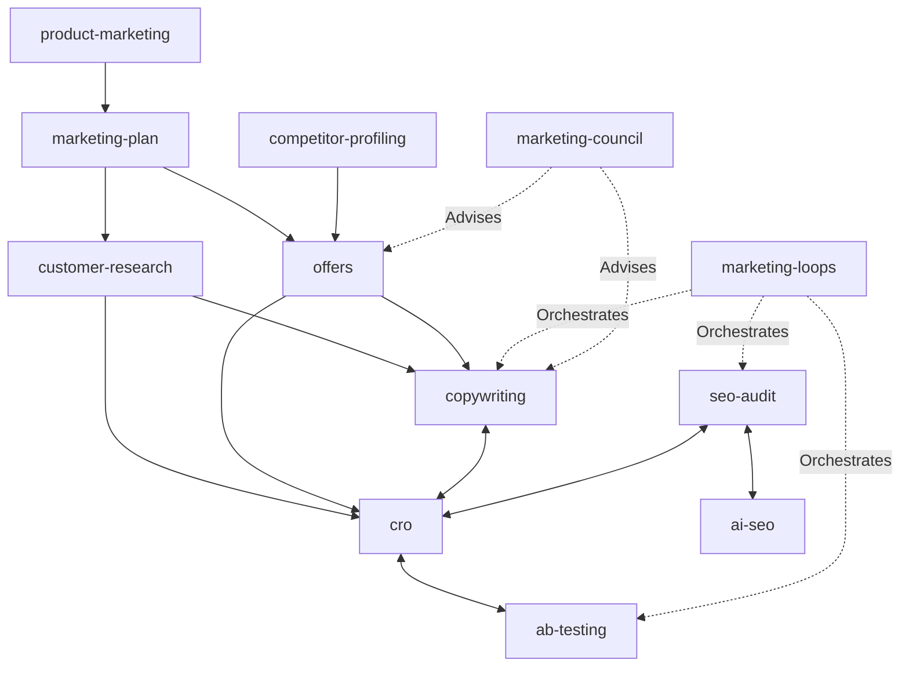
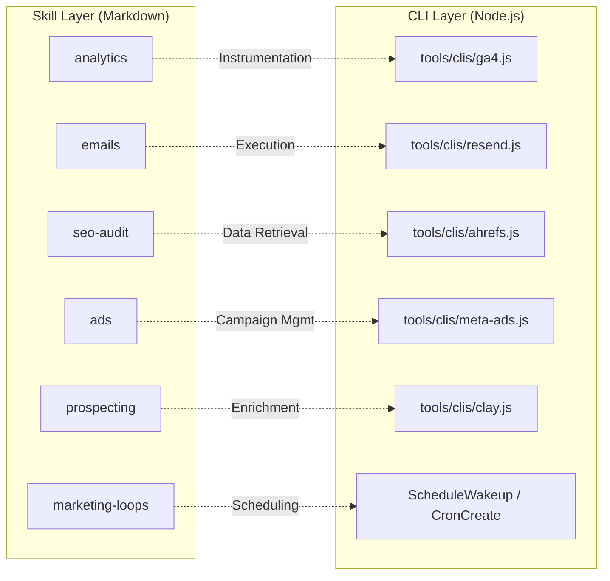

<!-- source: DeepWiki mcp.deepwiki.com · repo coreyhaines31/marketingskills · page 4 Skills Reference · fetched 2026-10-27 -->

# Skills Reference

Relevant source files

The following files were used as context for generating this wiki page:

- [.claude-plugin/marketplace.json](.claude-plugin/marketplace.json)
- [.claude-plugin/plugin.json](.claude-plugin/plugin.json)
- [README.md](README.md)
- [VERSIONS.md](VERSIONS.md)

This page provides a comprehensive hub for all 47 marketing skills in the repository. Each skill is a markdown-based knowledge module that provides AI agents with specialized expertise for specific marketing tasks. Skills are organized into functional categories covering the complete SaaS customer lifecycle from awareness to expansion.

For implementation details on what skills are and how they work, see [What is a Skill](#3.1). For the structural format of skill files, see [Skill File Format](#3.2). For information on how skills relate to each other, see [Skill Relationships](#3.4).

## Skills Directory Structure

All skills are located in the `skills/` directory. Each skill subdirectory contains a `SKILL.md` file and often a `references/` folder with deep-dive frameworks. The catalog was expanded significantly in v2.6.0 and v2.8.6 to include `marketing-loops` and `marketing-council`, providing both repeatable workflows and expert advisory simulations.

### Skill Hierarchy Diagram

```mermaid
graph TB
    root["skills/"]
    
    root --> cro["Conversion Optimization"]
    root --> ret["Retention & Monetization"]
    root --> content["Content & Copywriting"]
    root --> seo["SEO & Discovery"]
    root --> ads["Paid Advertising"]
    root --> analytics["Analytics & Testing"]
    root --> growth["Growth & Strategy"]
    root --> sales["Sales & RevOps"]
    root --> plan["Orchestration"]
    
    cro --> cro1["cro/"]
    cro --> cro2["signup/"]
    cro --> cro3["onboarding/"]
    cro --> cro4["popups/"]
    cro --> cro5["paywalls/"]
    
    ret --> ret1["churn-prevention/"]
    ret --> ret2["pricing/"]
    ret --> ret3["offers/"]
    
    content --> con1["copywriting/"]
    content --> con2["copy-editing/"]
    content --> con3["emails/"]
    content --> con4["cold-email/"]
    content --> con5["social/"]
    content --> con6["lead-magnets/"]
    content --> con7["public-relations/"]
    content --> con8["sms/"]
    content --> con9["video/"]
    content --> con10["image/"]
    
    seo --> seo1["seo-audit/"]
    seo --> seo2["ai-seo/"]
    seo --> seo3["programmatic-seo/"]
    seo --> seo4["schema/"]
    seo --> seo5["competitors/"]
    seo --> seo6["content-strategy/"]
    seo --> seo7["site-architecture/"]
    seo --> seo8["aso/"]
    seo --> seo9["directory-submissions/"]
    
    ads --> ads1["ads/"]
    ads --> ads2["ad-creative/"]
    
    analytics --> an1["analytics/"]
    analytics --> an2["ab-testing/"]
    
    growth --> gro1["free-tools/"]
    growth --> gro2["referrals/"]
    growth --> gro3["community-marketing/"]
    growth --> gro4["co-marketing/"]
    growth --> gro5["marketing-loops/"]
    growth --> gro6["marketing-council/"]
    
    sales --> sls1["sales-enablement/"]
    sales --> sls2["revops/"]
    sales --> sls3["competitor-profiling/"]
    sales --> sls4["prospecting/"]
    
    plan --> plan1["marketing-plan/"]
    
    strategy["Strategy Hub"] --> str1["marketing-ideas/"]
    strategy --> str2["launch/"]
    strategy --> str3["marketing-psychology/"]
    strategy --> str4["customer-research/"]
```

**Directory Structure Pattern**: Each skill follows the pattern `skills/[skill-name]/SKILL.md`. This standardized structure allows agents to reliably locate the core logic and supplementary reference materials.

**Sources**: [README.md:21-50](), [.claude-plugin/marketplace.json:12-19](), [VERSIONS.md:5-53]()

## Complete Skills Catalog

The repository contains 47 skills as of v2.8.11. This catalog includes the foundational `product-marketing` context and specialized modules for every stage of the funnel.

| Skill | Category | Version | Description |
|-------|----------|---------|-------------|
| **marketing-council** | Strategy | 1.0.0 | Simulated board of 12 legendary advisors. [skills/marketing-council/SKILL.md]() |
| **marketing-loops** | Growth | 1.2.0 | 43 repeatable marketing workflows. [skills/marketing-loops/SKILL.md]() |
| **marketing-plan** | Orchestration | 1.1.0 | Comprehensive AARRR-structured plan generator. [skills/marketing-plan/SKILL.md]() |
| **offers** | Monetization | 1.0.0 | Design the core offer using the Value Equation. [skills/offers/SKILL.md]() |
| **public-relations** | Content | 1.0.0 | Earned media, newsjacking, and journalist pitching. [skills/public-relations/SKILL.md]() |
| **prospecting** | Sales/GTM | 1.1.0 | Building qualified B2B/SMB prospect lists + Demand Signals. [skills/prospecting/SKILL.md]() |
| **video** | Content | 2.1.0 | AI video production + Viral Edit Reverse Engineering. [skills/video/SKILL.md]() |
| **ad-creative** | Paid Ads | 2.8.0 | Creative production including AirDrop Reveal ads. [skills/ad-creative/SKILL.md]() |
| **ai-seo** | SEO | 2.2.0 | Optimize for AI Overviews and AI Visibility Ladder. [skills/ai-seo/SKILL.md]() |
| **churn-prevention** | Retention | 2.0.0 | Reduce churn via cancel flows and dunning. [skills/churn-prevention/SKILL.md]() |
| **pricing** | Monetization | 2.0.1 | Design packaging and value-based price points. [skills/pricing/SKILL.md]() |
| **copywriting** | Content | 2.0.1 | Write high-converting marketing copy. [skills/copywriting/SKILL.md]() |
| **ads** | Paid Ads | 2.2.0 | Multi-platform strategy and modern Meta playbook. [skills/ads/SKILL.md]() |
| **analytics** | Analytics | 2.0.0 | Event instrumentation and tracking plans. [skills/analytics/SKILL.md]() |
| **customer-research** | Strategy | 2.0.1 | Analyze VOC, reviews, and conduct ICP research. [skills/customer-research/SKILL.md]() |
| **revops** | Sales/GTM | 2.0.0 | Lead lifecycle, scoring, and CRM automation. [skills/revops/SKILL.md]() |

**Sources**: [README.md:54-100](), [VERSIONS.md:7-53](), [.claude-plugin/marketplace.json:12-19](), [VERSIONS.md:57-73]()

## Category Hubs

Skills are organized into 10 functional areas. Click the links below to view detailed documentation for each category.

### [Conversion Optimization Skills](#4.2)
Focuses on converting visitors into users. Includes `cro`, `signup`, `onboarding`, `popups`, and `paywalls`.
**Sources**: [README.md:33-37](), [VERSIONS.md:21,35,37,38,49]()

### [Retention & Monetization](#4.3)
Strategies for keeping customers and maximizing revenue. Includes `churn-prevention`, `pricing`, and the `offers` skill for core offer design.
**Sources**: [VERSIONS.md:12,34,39]()

### [Content & Copywriting](#4.4)
Creative creation from social posts to video and SMS. Includes `copywriting`, `copy-editing`, `emails`, `cold-email`, `social`, `lead-magnets`, `public-relations`, `sms`, `image`, and `video`.
**Sources**: [VERSIONS.md:14,19,20,24,26,28,43,51,52,53]()

### [SEO & Discovery](#4.5)
Modern search optimization and technical foundations. Includes `seo-audit`, `ai-seo`, `programmatic-seo`, `schema`, `competitors`, `content-strategy`, `site-architecture`, `aso`, and `directory-submissions`.
**Sources**: [VERSIONS.md:9,11,17,18,41,47,48,50]()

### [Paid Advertising](#4.6)
Execution and creative production for paid channels. Includes `ads` and `ad-creative`. Includes advanced formats like AirDrop Reveal and the Creative Review Page.
**Sources**: [VERSIONS.md:8,36,63,71]()

### [Analytics & Testing](#4.7)
The measurement layer. Includes `analytics` and `ab-testing`.
**Sources**: [VERSIONS.md:7,10]()

### [Growth & Strategy](#4.8)
High-level tactics and product-led loops. Includes `marketing-ideas`, `launch`, `free-tools`, `referrals`, `marketing-psychology`, `customer-research`, `community-marketing`, `co-marketing`, `marketing-loops`, and `marketing-council`.
**Sources**: [VERSIONS.md:13,15,22,25,27,29,30,31,33,44]()

### [Sales & Revenue Operations](#4.9)
B2B-focused alignment and funnel management. Includes `sales-enablement`, `revops`, `competitor-profiling`, and `prospecting`.
**Sources**: [VERSIONS.md:16,42,45,46]()

### [Marketing Plan](#4.10)
Documentation for the `marketing-plan` skill, which orchestrates other skills to produce a comprehensive 13-section strategy.
**Sources**: [VERSIONS.md:32]()

## Skill Interdependencies

Skills cross-reference each other to build a cohesive marketing strategy. The `product-marketing` context is the foundation for all others.

### Logic Flow Diagram

**Key Relationship Patterns**:
- **Foundational**: `product-marketing` is read by all other skills first [README.md:19]().
- **Offer-Led**: `offers` informs `pricing`, `copywriting`, `launch`, and `sales-enablement` [VERSIONS.md:34,39,46]().
- **Operational**: `marketing-loops` acts as the operational cousin to `marketing-ideas`, turning one-off tactics into scheduled workflows [VERSIONS.md:31]().

**Sources**: [README.md:17-50](), [VERSIONS.md:57-73]()

## Knowledge to Execution Bridge

While skills provide the "brain," the CLI tools provide the "hands." Skills often suggest specific CLI commands to implement their recommendations.

### Code Entity Bridge

**Sources**: [README.md:1-5](), [VERSIONS.md:31]()

---
For details on specific skills, proceed to [Skills Overview](#4.1).

---

