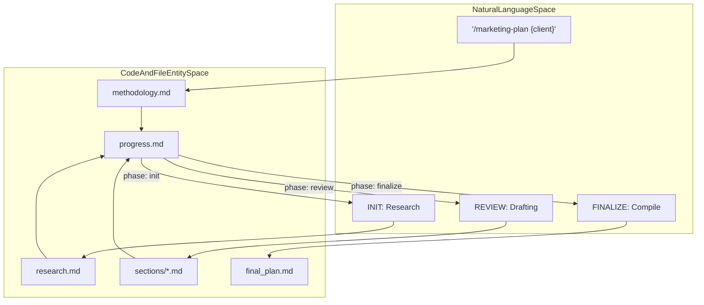
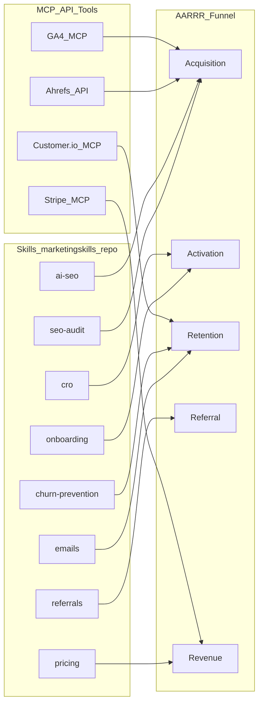

<!-- source: DeepWiki mcp.deepwiki.com · repo coreyhaines31/marketingskills · page 4.10 Marketing Plan · fetched 2026-10-27 -->

# Marketing Plan

Relevant source files

The following files were used as context for generating this wiki page:

- [skills/marketing-plan/SKILL.md](skills/marketing-plan/SKILL.md)
- [skills/marketing-plan/evals/evals.json](skills/marketing-plan/evals/evals.json)
- [skills/marketing-plan/references/aarrr-framework.md](skills/marketing-plan/references/aarrr-framework.md)
- [skills/marketing-plan/references/budget-planning.md](skills/marketing-plan/references/budget-planning.md)
- [skills/marketing-plan/references/client-types.md](skills/marketing-plan/references/client-types.md)
- [skills/marketing-plan/references/current-state-rubric.md](skills/marketing-plan/references/current-state-rubric.md)
- [skills/marketing-plan/references/example-quietude.md](skills/marketing-plan/references/example-quietude.md)
- [skills/marketing-plan/references/funding-stage-unlocks.md](skills/marketing-plan/references/funding-stage-unlocks.md)
- [skills/marketing-plan/references/growth-patterns.md](skills/marketing-plan/references/growth-patterns.md)
- [skills/marketing-plan/references/idea-cross-reference.md](skills/marketing-plan/references/idea-cross-reference.md)
- [skills/marketing-plan/references/measurement-framework.md](skills/marketing-plan/references/measurement-framework.md)
- [skills/marketing-plan/references/methodology.md](skills/marketing-plan/references/methodology.md)
- [skills/marketing-plan/references/ops-stack-mapping.md](skills/marketing-plan/references/ops-stack-mapping.md)
- [skills/marketing-plan/references/plan-template.md](skills/marketing-plan/references/plan-template.md)
- [skills/marketing-plan/references/team-and-agency-model.md](skills/marketing-plan/references/team-and-agency-model.md)

The `marketing-plan` skill is a high-level orchestration module designed to produce a comprehensive, 13-section "fractional CMO" (fCMO) level strategy [skills/marketing-plan/SKILL.md:3-10](). It uses an **AARRR** (Acquisition, Activation, Retention, Referral, Revenue) framework to ensure every recommendation is tied to a specific stage of the customer funnel [skills/marketing-plan/references/aarrr-framework.md:1-13]().

## System State Machine

The skill operates as a three-phase state machine, tracking progress via a `progress.md` file located in the client's specific directory [skills/marketing-plan/references/methodology.md:26-36]().

### Phase 1: INIT (Research & Intake)
The agent aggregates context from three sources:
1.  **Materials:** Reads existing files in `materials/` (decks, brand docs, previous audits, SEO research) [skills/marketing-plan/references/methodology.md:73-86]().
2.  **Live Data:** Pulls real-time metrics via MCP/API integrations including **Ahrefs** (SEO), **GA4** (traffic), **Stripe** (revenue/churn), and **Customer.io** (email flows) [skills/marketing-plan/references/methodology.md:88-101]().
3.  **Structured Intake:** Conducts a 10-topic interview with the user to fill gaps in ICP, funding state, team composition, and budget [skills/marketing-plan/references/methodology.md:103-148]().

### Phase 2: REVIEW (Section-by-Section Drafting)
The agent drafts the 13 sections of the plan interactively. The user must approve or adjust each section before the agent moves to the next [skills/marketing-plan/SKILL.md:47-55](). Confirmations are saved to the progress file, making the skill resumable [skills/marketing-plan/SKILL.md:55]().

### Phase 3: FINALIZE (Compilation & Verification)
The agent compiles all sections into `final_plan.md`, verifies cross-references to the `marketing-ideas` library, and ensures brand voice consistency [skills/marketing-plan/SKILL.md:57-61]().

### Execution Workflow Diagram
The following diagram maps the natural language phases to the underlying file system and state transitions.

**Marketing Plan State Machine**

Sources: [skills/marketing-plan/SKILL.md:37-61](), [skills/marketing-plan/references/methodology.md:5-71]()

---

## The 13-Section Structure

The skill generates a standardized document designed for board-level presentation [skills/marketing-plan/references/plan-template.md:1-24]().

| Section | Title | Key Components |
| :--- | :--- | :--- |
| 1 | **Executive Summary** | 3 Big Bets, 90-day priorities, 12-month outcome [skills/marketing-plan/references/plan-template.md:22-32](). |
| 2 | **Strategic Frame** | Category claim, ICP, business model logic, brand voice [skills/marketing-plan/references/plan-template.md:42-64](). |
| 3 | **Current State** | Team, budget, audit rubric (17-section scored 0-5) [skills/marketing-plan/references/plan-template.md:71-125](). |
| 4 | **Acquisition** | Channels (Organic, Paid, SEO), 90-day/12-month moves [skills/marketing-plan/references/plan-template.md:143-167](). |
| 5 | **Activation** | Onboarding, signup flow, paywall optimization [skills/marketing-plan/SKILL.md:71]() |
| 6 | **Retention** | Lifecycle emails, churn prevention, win-back [skills/marketing-plan/SKILL.md:72]() |
| 7 | **Referral** | Ambassador/affiliate programs, viral mechanics [skills/marketing-plan/SKILL.md:73]() |
| 8 | **Revenue** | Pricing, packaging, upsells, B2B ACV [skills/marketing-plan/SKILL.md:74]() |
| 9 | **90-Day Roadmap** | Week-by-week execution (Unblock, Foundation, Velocity, Compound) [skills/marketing-plan/SKILL.md:75]() |
| 10 | **12-Month Outlook** | Quarterly milestones tied to funding unlocks [skills/marketing-plan/SKILL.md:76]() |
| 11 | **Ops Stack** | Skills + MCP integrations mapped to AARRR [skills/marketing-plan/SKILL.md:77]() |
| 12 | **Tactical Idea Bank** | 139 ideas from `marketing-ideas` filtered for client [skills/marketing-plan/SKILL.md:78]() |
| 13 | **Measurement & RACI** | North-star metric, leading indicators, open decisions [skills/marketing-plan/SKILL.md:79]() |

Sources: [skills/marketing-plan/SKILL.md:65-80](), [skills/marketing-plan/references/plan-template.md:1-167]()

---

## Marketing Operations Stack Mapping

The `marketing-plan` skill acts as an orchestrator, mapping other skills and MCP tools to specific funnel stages in Section 11 of the plan [skills/marketing-plan/references/ops-stack-mapping.md:1-15]().

### Skill & Tool Orchestration Diagram
This diagram shows how the `marketing-plan` skill associates specific code-based "Skills" and "MCP Tools" with the AARRR funnel stages.

**AARRR Orchestration Map**

Sources: [skills/marketing-plan/references/ops-stack-mapping.md:17-111]()

---

## Technical Logic & Data Integration

### Funding-Stage Unlocks
The plan logic varies based on the client's funding tier (Tier 1: Pre-seed to Tier 5: Series B+). This determines "unlocks" for paid budget and headcount [skills/marketing-plan/references/funding-stage-unlocks.md:20-136](). For example, Tier 1 plans focus exclusively on organic channels, while Tier 2 unlocks a $5-15K/mo paid test budget [skills/marketing-plan/references/funding-stage-unlocks.md:22-54]().

### Current-State Rubric
Section 3 of the plan is generated using a 17-section scoring lens (0-5 scale) [skills/marketing-plan/references/current-state-rubric.md:1-13](). It assesses areas like Positioning, Customer Research, and Email Lifecycle [skills/marketing-plan/references/current-state-rubric.md:15-112]().

### Budget Planning
The skill utilizes two methods for budget recommendations:
1.  **Revenue-Based:** 5–40% of ARR depending on growth goals [skills/marketing-plan/references/funding-stage-unlocks.md:8]().
2.  **Goal-Based:** Reverse-engineering from a revenue target using CAC and conversion math [skills/marketing-plan/references/funding-stage-unlocks.md:8]().

### File Persistence Schema
Plans are stored in `~/marketing-plans/{client-slug}/` with the following structure:
*   `materials/`: Source documents provided by the user [skills/marketing-plan/references/methodology.md:15]().
*   `sections/`: Individual markdown files for each of the 13 sections [skills/marketing-plan/references/methodology.md:18-22]().
*   `research.md`: Compiled facts from Phase 1 [skills/marketing-plan/references/methodology.md:16]().
*   `progress.md`: State machine tracking via a schema including `phase`, `current_section`, and `plan_version` [skills/marketing-plan/references/methodology.md:26-36]().
*   `final_plan.md`: The compiled deliverable [skills/marketing-plan/references/methodology.md:23]().

Sources: [skills/marketing-plan/references/methodology.md:11-36](), [skills/marketing-plan/references/funding-stage-unlocks.md:1-136](), [skills/marketing-plan/references/current-state-rubric.md:1-112]()

---

