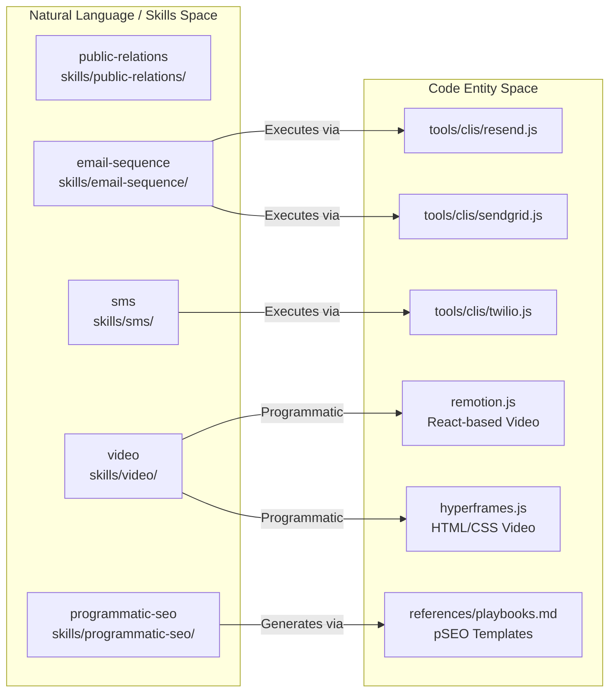
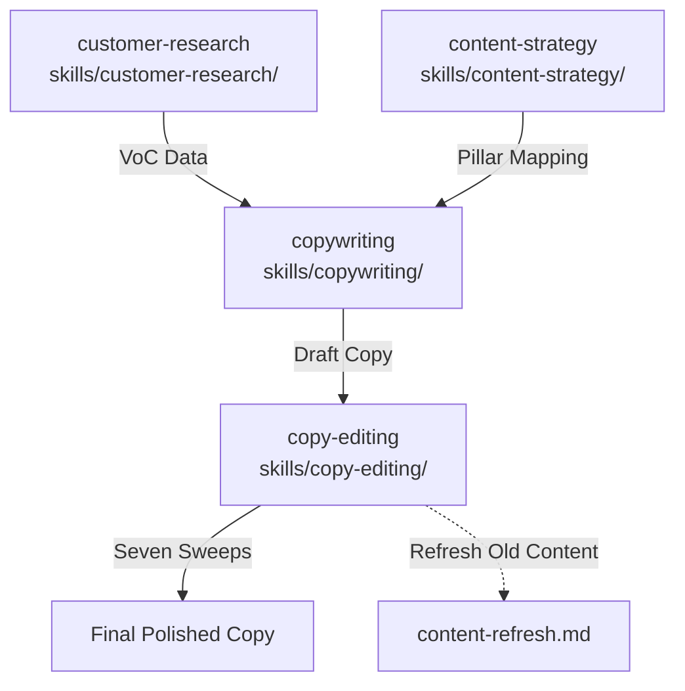

<!-- source: DeepWiki mcp.deepwiki.com · repo coreyhaines31/marketingskills · page 4.4 Content & Copywriting · fetched 2026-10-27 -->

# Content & Copywriting

Relevant source files

The following files were used as context for generating this wiki page:

- [skills/content-strategy/SKILL.md](skills/content-strategy/SKILL.md)
- [skills/copy-editing/SKILL.md](skills/copy-editing/SKILL.md)
- [skills/copy-editing/references/content-refresh.md](skills/copy-editing/references/content-refresh.md)
- [skills/programmatic-seo/SKILL.md](skills/programmatic-seo/SKILL.md)
- [skills/seo-audit/SKILL.md](skills/seo-audit/SKILL.md)

This section provides an overview of the content creation, copywriting, and multi-channel communication skills in the repository. These skills handle the generation and refinement of written and visual assets across marketing channels: website copy, email campaigns, cold outreach, social media, public relations, and programmatic video/image generation.

## Purpose and Scope

The content and copywriting skills provide AI agents with specialized knowledge for creating, editing, and optimizing marketing assets. These skills cover:

- **Marketing page copywriting** — Homepage, landing pages, and pricing pages.
- **Systematic editing** — Improving existing copy for clarity and impact using structured frameworks.
- **Lifecycle communication** — Automated email sequences and SMS marketing programs.
- **Outreach and PR** — B2B cold email personalization and earned media strategy (newsjacking, pitching).
- **Social and Lead Gen** — Social content repurposing and gated lead magnet planning.
- **AI-Native Creative** — Programmatic generation of images and videos using models like Flux, Ideogram, and Remotion.

These skills integrate closely with [Product Marketing Context](#3.3) to ensure brand consistency and leverage the [Customer Research](#4.8.6) skill for Voice of Customer (VoC) data.

**Sources:** [skills/copywriting/SKILL.md:3-5](), [skills/copy-editing/SKILL.md:14-15](), [skills/content-strategy/SKILL.md:14-15]()

## Skills Overview

The Content & Copywriting category contains 10 specialized skills:

| Skill | File Path | Primary Use Case | Related Lifecycle Stage |
|-------|-----------|------------------|------------------------|
| **copywriting** | `skills/copywriting/` | Write marketing copy for pages (homepage, landing, pricing) | Consideration, Conversion |
| **copy-editing** | `skills/copy-editing/` | Refine existing copy using the Seven Sweeps Framework | Consideration, Conversion |
| **email-sequence** | `skills/email-sequence/` | Create automated flows (welcome, nurture, re-engagement) | Activation, Retention |
| **cold-email** | `skills/cold-email/` | B2B outreach with 4-level personalization | Awareness, Consideration |
| **social** | `skills/social/` | Platform-specific content and repurposing "content atoms" | Awareness, Consideration |
| **lead-magnets** | `skills/lead-magnets/` | Plan gated assets (ebooks, checklists) for email capture | Awareness, Consideration |
| **public-relations** | `skills/public-relations/` | Earned media, newsjacking, and journalist pitching | Awareness, Brand Legitimacy |
| **sms** | `skills/sms/` | SMS/MMS marketing and compliance (A2P 10DLC) | Conversion, Retention |
| **image** | `skills/image/` | AI image generation (Flux, Ideogram) and OG images | Awareness, Consideration |
| **video** | `skills/video/` | AI video (Sora, Kling) and programmatic Remotion/Hyperframes | Awareness, Conversion |

**Sources:** [skills/copywriting/SKILL.md:1-6](), [skills/copy-editing/SKILL.md:1-6](), [skills/content-strategy/SKILL.md:1-6]()

## Skill Relationships and Dependencies

The content cluster bridges the gap between research/strategy and the technical tools used for distribution.

### Natural Language to Code Entity Space: Content Distribution
This diagram maps high-level content skills to the specific CLI tools and programmatic frameworks used to implement them.

**Sources:** [skills/programmatic-seo/SKILL.md:87-87](), [skills/video/SKILL.md:20-25](), [skills/sms/SKILL.md:15-20]()

### Content Repurposing and Refinement
The workflow typically starts with a long-form asset or research, which is then broken down and polished.

**Sources:** [skills/copy-editing/SKILL.md:27-30](), [skills/copy-editing/references/content-refresh.md:1-3](), [skills/content-strategy/SKILL.md:125-127]()

## Core Frameworks

### Searchable vs Shareable (Content Strategy)
The `content-strategy` skill categorizes all content into two primary buckets:
- **Searchable**: Captures existing demand via keyword targeting and intent matching. [skills/content-strategy/SKILL.md:46-46]()
- **Shareable**: Creates demand through novel insights, original data, or "thought leadership." [skills/content-strategy/SKILL.md:48-48]()

**Sources:** [skills/content-strategy/SKILL.md:42-49]()

### Seven Sweeps (Copy Editing)
The `copy-editing` skill utilizes a systematic approach to improve copy:
1. **Clarity**: Ensure the message is understood. [skills/copy-editing/SKILL.md:31-55]()
2. **Voice and Tone**: Maintain brand consistency. [skills/copy-editing/SKILL.md:58-82]()
3. **So What**: Connect features to benefits using "which means..." bridges. [skills/copy-editing/SKILL.md:84-115]()
4. **Prove It**: Back claims with testimonials, data, or social proof. [skills/copy-editing/SKILL.md:117-150]()
5. **Specificity**: Replace vague adjectives with concrete numbers. [skills/copy-editing/SKILL.md:152-187]()
6. **Heightened Emotion**: Evoke the "before" pain and "after" transformation. [skills/copy-editing/SKILL.md:188-216]()
7. **The Tighten**: Final pass to remove wordiness.

**Sources:** [skills/copy-editing/SKILL.md:27-220]()

### Content Refresh Checklist
Used to combat content decay on existing pages:
- **Freshness**: Update dates and stale examples. [skills/copy-editing/references/content-refresh.md:15-15]()
- **Accuracy**: Verify claims and check for broken links. [skills/copy-editing/references/content-refresh.md:16-16]()
- **SEO**: Re-align with current search intent or AI search signals. [skills/copy-editing/references/content-refresh.md:18-18]()

**Sources:** [skills/copy-editing/references/content-refresh.md:13-21]()

## Related Pages

- [Copywriting](#4.4.1) — Detailed documentation for page copy.
- [Copy Editing](#4.4.2) — The Seven Sweeps Framework for refinement.
- [Email Sequences](#4.4.3) — Lifecycle and automated email flows.
- [Cold Email](#4.4.4) — B2B outbound prospecting systems.
- [Social Content](#4.4.5) — Strategy, content atoms, and platform limits.
- [Lead Magnets](#4.4.6) — Planning high-value gated assets.
- [Public Relations](#4.4.7) — Newsjacking and media outreach.
- [SMS Marketing](#4.4.8) — SMS/MMS programs and compliance.
- [Image Creation](#4.4.9) — AI image generation models and logic.
- [Video Production](#4.4.10) — Programmatic and AI-native video pipelines.

**Sources:** [skills/copywriting/SKILL.md:3-5](), [skills/copy-editing/SKILL.md:3-5](), [skills/content-strategy/SKILL.md:3-5]()

---

