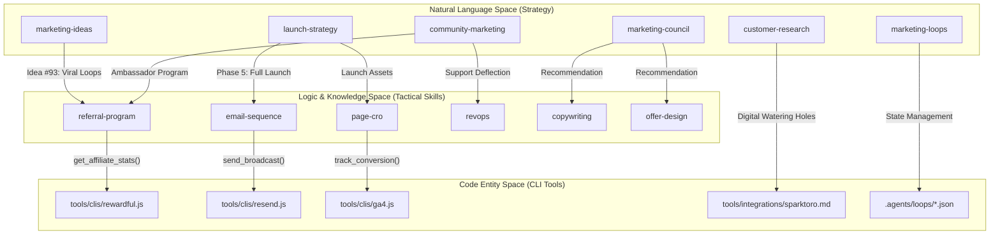
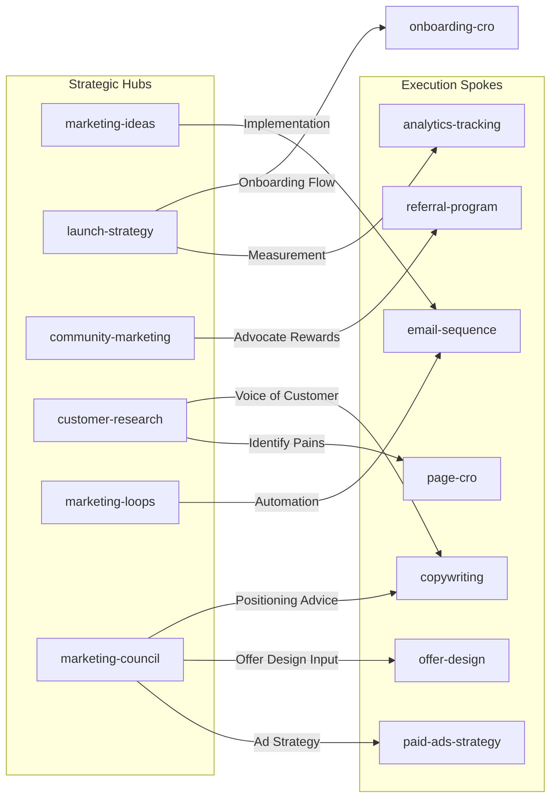

<!-- source: DeepWiki mcp.deepwiki.com · repo coreyhaines31/marketingskills · page 4.8 Growth & Strategy · fetched 2026-10-27 -->

# Growth & Strategy

Relevant source files

The following files were used as context for generating this wiki page:

- [skills/community-marketing/SKILL.md](skills/community-marketing/SKILL.md)
- [skills/marketing-ideas/SKILL.md](skills/marketing-ideas/SKILL.md)

This document provides an overview of the high-level marketing strategy, growth engineering, and strategic planning skills within the `marketingskills` repository. These skills provide thinking frameworks, decision matrices, and strategic checklists that coordinate more tactical execution skills.

## Purpose and Scope

The Growth & Strategy category acts as the "brain" of the marketing engine. While other categories focus on execution (writing copy, setting up tracking, or optimizing forms), these skills focus on the "what" and "why" of marketing initiatives.

- **Strategic Planning**: High-level frameworks for ideation (`marketing-ideas`) and execution timing (`launch-strategy`).
- **Growth Engineering**: Designing scalable loops and tools for acquisition (`free-tool-strategy`, `referral-program`, `marketing-loops`).
- **Behavioral Science**: Applying mental models and research to influence user behavior (`marketing-psychology`, `customer-research`).
- **Community & Intelligence**: Building long-term brand equity through community-led growth (`community-marketing`), competitive intelligence (`competitor-profiling`), and strategic partnerships (`co-marketing`).

---

## Skills Overview

| Skill | Primary Use Case | Child Page |
|-------|------------------|------------|
| `marketing-ideas` | Discovering and filtering 140+ SaaS marketing tactics | [Marketing Ideas](#4.8.1) |
| `launch-strategy` | Planning multi-phase product or feature releases | [Launch Strategy](#4.8.2) |
| `free-tool-strategy` | Building "Engineering as Marketing" assets | [Free Tool Strategy](#4.8.3) |
| `referral-program` | Designing viral growth loops and affiliate programs | [Referral Programs](#4.8.4) |
| `marketing-psychology` | Applying behavioral science and mental models | [Marketing Psychology](#4.8.5) |
| `customer-research` | Mining reviews and conducting interview analysis | [Customer Research](#4.8.6) |
| `community-marketing` | Designing and scaling online communities (Discord/Slack) | [Community Marketing](#4.8.7) |
| `competitor-profiling` | Researching and profiling competitors from URLs | [Competitor Profiling](#4.8.8) |
| `co-marketing` | Finding partners and planning joint campaigns | [Co-Marketing](#4.8.9) |
| `marketing-loops` | Setting up recurring, self-running marketing workflows | [Marketing Loops](#4.8.10) |
| `marketing-council` | Simulating a board of marketing advisors for strategic decisions | [Marketing Council](#4.8.11) |

**Sources:** [README.md:24-44](), [skills/community-marketing/SKILL.md:2-3](), [skills/marketing-ideas/SKILL.md:2-3]()

---

## System Architecture: Strategy to Execution

The following diagram illustrates how Growth & Strategy skills act as entry points, orchestrating tactical skills and CLI tools to achieve business outcomes.

### Strategy-to-Code Mapping

**Diagram: Bridging Strategy to Code Entities**

**Sources:** [skills/launch-strategy/SKILL.md:161-178](), [skills/community-marketing/SKILL.md:84-98](), [skills/customer-research/SKILL.md:114-129](), [tools/integrations/sparktoro.md:60-67]()

---

## Core Strategic Frameworks

### Two Modes of Research
Used in `customer-research` to differentiate between signal extraction and active gathering:
- **Mode 1: Analyze Existing Assets**: Processing transcripts, surveys, and support tickets. [skills/customer-research/SKILL.md:31-57]()
- **Mode 2: Go Find Research**: Mining "Digital Watering Holes" like Reddit, G2, and Hacker News. [skills/customer-research/SKILL.md:114-136]()

### The Community Flywheel
Healthy communities compound over time by creating a self-sustaining loop:
`Members join → get value → engage → create content/help others → new members discover`. [skills/community-marketing/SKILL.md:52-60]()

### The Nine-Part Loop Anatomy
Used in `marketing-loops` to define recurring workflows:
1. **Check Cadence**: Frequency of execution.
2. **Acts-When**: The trigger condition.
3. **Purpose**: The "Why".
4. **Skills Used**: Orchestrated knowledge modules.
5. **Loop Body**: The sequence of actions.
6. **Self-Check**: Verification of success.
7. **State/Idempotency**: Using `.agents/loops/*.json` to track watermarks.
8. **Stop/Bail-out**: Guardrails to prevent infinite loops or waste.
9. **Output**: Result of the loop.

### Marketing Council Session Modes
The `marketing-council` skill operates in three modes to provide expert perspectives:
- **Quick Take**: A rapid, high-level opinion.
- **Council Session**: A focused discussion with 2-3 lens-fit advisors and a designated dissenter.
- **Full Council**: A comprehensive debate involving all 12 advisors.

**Sources:** [skills/marketing-council/SKILL.md:3-4](), [skills/marketing-council/SKILL.md:30-32]()

---

## Skill Interdependencies

Growth & Strategy skills rarely operate in isolation. They utilize the `Related Skills` pattern to compose complex workflows.

### Dependency Graph

**Diagram: Strategic Hub and Spoke Model**

**Sources:** [skills/marketing-ideas/SKILL.md:161-168](), [skills/community-marketing/SKILL.md:132-145](), [skills/customer-research/SKILL.md:3]()

---

## Sub-Topic Overviews

### [Marketing Ideas](#4.8.1)
A database of 140+ SaaS marketing tactics. It categorizes ideas by stage (Pre-launch, Early, Growth, Scale) and budget (Free to High Budget). [skills/marketing-ideas/SKILL.md:25-46]()
*For details, see [Marketing Ideas](#4.8.1).*

### [Launch Strategy](#4.8.2)
A five-phase approach to shipping products: Internal, Alpha, Beta, Early Access, and Full Launch. Includes specific playbooks for Product Hunt.
*For details, see [Launch Strategy](#4.8.2).*

### [Free Tool Strategy](#4.8.3)
Frameworks for "Engineering as Marketing." Focuses on building calculators, generators, and analyzers that drive high-intent organic traffic.
*For details, see [Free Tool Strategy](#4.8.3).*

### [Referral Programs](#4.8.4)
Designing viral coefficients and incentive structures (Double-sided vs. Single-sided) to turn customers into a distribution channel.
*For details, see [Referral Programs](#4.8.4).*

### [Marketing Psychology](#4.8.5)
Applying behavioral science (Anchoring, Social Proof, IKEA Effect, Goal-Gradient Effect) to copy and UX to reduce friction and increase conversion.
*For details, see [Marketing Psychology](#4.8.5).*

### [Customer Research](#4.8.6)
Methodologies for mining "Voice of Customer" (VoC) data from Reddit, G2, and interviews. It utilizes an extraction framework covering Jobs to Be Done (JTBD), pain points, and trigger events. [skills/customer-research/SKILL.md:59-81]()
*For details, see [Customer Research](#4.8.6).*

### [Community Marketing](#4.8.7)
Strategies for building brand advocates and driving community-led growth. Covers platform selection (Discord vs. Slack) and health metrics like DAU/MAU and thread reply rate. [skills/community-marketing/SKILL.md:101-122]()
*For details, see [Community Marketing](#4.8.7).*

### [Competitor Profiling](#4.8.8)
Framework for researching competitors using live site scraping and SEO data to create structured profiles and brand maturity assessments.
*For details, see [Competitor Profiling](#4.8.8).*

### [Co-Marketing](#4.8.9)
Framework for identifying and executing partnerships with non-competing brands that share the same target audience.
*For details, see [Co-Marketing](#4.8.9).*

### [Marketing Loops](#4.8.10)
System for setting up recurring marketing workflows. Uses a four-layer orchestration model (sensing → diagnostic → action → learning) and manages state via JSON watermarks to ensure idempotency.
*For details, see [Marketing Loops](#4.8.10).*

### [Marketing Council](#4.8.11)
A simulated board of 12 legendary marketing advisors providing conflicting expert perspectives on marketing decisions. It includes specific advisors like Seth Godin and David Ogilvy, each with documented lenses, and a seating logic to ensure diverse viewpoints. [skills/marketing-council/SKILL.md:3-4](), [skills/marketing-council/SKILL.md:30-32]()
*For details, see [Marketing Council](#4.8.11).*

---

## Implementation via CLI Tools

Strategic decisions made within these skills are executed using the CLI tools in the `tools/` directory or specialized integration guides.

| Strategy Component | Associated Tool | Path |
|--------------------|---------------------|------|
| Affiliate Management | Rewardful | [tools/clis/rewardful.js]() |
| Email Distribution | Resend / SendGrid | [tools/clis/resend.js]() |
| Audience Research | SparkToro | [tools/integrations/sparktoro.md]() |
| Conversion Tracking | GA4 / Mixpanel | [tools/clis/ga4.js]() |

**Sources:** [README.md:65-90](), [tools/integrations/sparktoro.md:1-4]()

---

